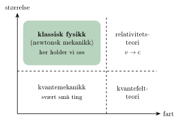



<!-- fra notatene -->
Fysikk er vitenskapen om naturen: hva alt er bygget av, hvilke krefter som virker, og hvordan **masse, energi og bevegelse** henger sammen. Målet er å finne **lover** som gjelder overalt, fra atomer til galakser.

## Fysikk og de andre fagene

Fysikken står nederst i en slags trapp. Kjemi bygger på fysikk, biologi bygger på kjemi, og samfunnsfag som sosiologi bygger på biologi. Fysikken låner sitt språk fra **matematikken**, og spørsmålene om hva kunnskap er, hører til **filosofien**.

$$
\text{matematikk} \;\to\; \textbf{fysikk} \;\to\; \text{kjemi} \;\to\; \text{biologi} \;\to\; \text{sosiologi}
$$

Fysikk har selv mange greiner: mekanikk, termofysikk, bølgefysikk, fluidmekanikk, elektromagnetisme, kvantemekanikk, relativitetsteori og flere til.

## Hvor gjelder det vi lærer?

Hvilken teori vi trenger, avhenger av hvor *store* tingene er og hvor *fort* de går:

{.tikz-fig style="width:420px"}

- For vanlige ting med vanlige farter gjelder **klassisk fysikk**: Newtons lover. Det er her vi holder oss.
- Nærmer farten seg lyshastigheten $\mathrm{c}$, trenger vi **relativitetsteori**.
- For svært små ting, som atomer og elektroner, trenger vi **kvantemekanikk**.

<!-- tillegg: Claude -->
Klassisk fysikk er altså ikke «feil». Den er en svært god modell innenfor sitt område, og det er nesten alltid der ingeniører jobber: broer, biler, maskiner og bygg.

## Slik jobber fysikere (og ingeniører)

1. **Observer** noe i naturen eller i et forsøk.
2. **Lag en modell**: en forenklet beskrivelse med matematikk. Ofte ser vi bort fra noe, for eksempel luftmotstand.
3. **Regn ut** hva modellen forutsier.
4. **Sammenlign** med målinger. Stemmer det ikke, forbedrer vi modellen.

## På ingeniørnivå

<!-- fra notatene -->
På ingeniørnivå starter vi med **mekanikk** (newtonsk), og fortsetter med **elektromagnetisme** eller **fluid- og bølgefysikk**. Mekanikken starter med *kinematikk*, som beskriver bevegelse, og fortsetter med *dynamikk*, der Newtons lover forklarer bevegelsen ut fra kreftene.



::: {.callout-tip title="Slik jobber du best"}
Se videoen, les teksten, og prøv oppgavene *før* du ser på løsningen. Står du fast, bruk hint-knappen. Det er i oppgavene du lærer mest.
:::
