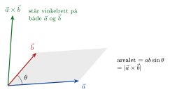
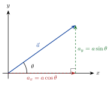



<!-- tillegg: Claude -->
Noen størrelser er helt beskrevet av ett tall, for eksempel masse ($5\ \mathrm{kg}$) eller tid ($3\ \mathrm{s}$). De kalles **skalarer**. Andre har også en **retning**: Det er stor forskjell på å gå $500\ \mathrm{m}$ nordover og $500\ \mathrm{m}$ østover. Slike størrelser kalles **vektorer**, og vi tegner dem som piler. Lengden av pila er størrelsen, og pila peker i retningen.

Vi skriver vektorer med en pil over: $\vec s$, $\vec v$, $\vec a$, $\vec F$. Lengden (størrelsen) skrives $|\vec a|$ eller bare $a$.

## Koordinatsystem

<!-- fra notatene -->
Matematikken er et verktøy i fysikken, og det viktigste verktøyet er **koordinatsystemet**. Med det kan vi beskrive hvor noe er (punktene A og B), og hvordan det beveger seg fra A til B.

::: {.graa}
Vektorer + koordinatsystem = sant ❤
:::

## Komponenter

I et koordinatsystem kan vi beskrive en vektor med hvor langt den går i $x$-retning og hvor langt i $y$-retning. Det er vektorens **komponenter**:
$$
\vec a = [a_x,\ a_y] = a_x\,\hat x + a_y\,\hat y
$$
Her er $\hat x$ og $\hat y$ **enhetsvektorer**: piler med lengde 1 langs aksene. I tre dimensjoner kommer $\hat z$ i tillegg: $\vec a = [a_x,\ a_y,\ a_z]$.

::: {.eksempel}
**Eksempel:** Et fly har hastigheten $500\ \mathrm{m/s}$ nordover og $300\ \mathrm{m/s}$ østover. Skriv hastigheten som en vektor, og finn farten.

::: {.losning}
Vi legger $x$-aksen mot øst og $y$-aksen mot nord:
$$
\vec v = [300,\ 500]\ \mathrm{m/s} = 300\ \mathrm{m/s}\ \hat x + 500\ \mathrm{m/s}\ \hat y
$$
Farten er lengden av vektoren (Pytagoras):
$$
v = \sqrt{300^2 + 500^2}\ \mathrm{m/s} \approx 583\ \mathrm{m/s}
$$
:::
:::

## Regning med vektorer

<!-- fra notatene -->
Med komponenter er det enkelt å regne. Ta $\vec A = [5,\ 3]$ og $\vec B = [-3,\ 5]$.

**Addisjon:** Legg sammen komponent for komponent. Geometrisk setter vi pilene etter hverandre, hale mot spiss.
$$
\vec A + \vec B = [5 + (-3),\ 3 + 5] = [2,\ 8]
$$

**Gange med et tall:** Hver komponent ganges: $2\vec A = [10,\ 6]$. Pila blir dobbelt så lang, med samme retning. Et negativt tall snur pila: $-\vec A = [-5,\ -3]$.

**Skalarprodukt** (prikkprodukt): Gang komponentene parvis og legg sammen. Det er også lik lengdene ganget med cosinus til vinkelen $\theta$ mellom vektorene:

::: {.graa}
$$
\vec A\cdot\vec B = A_xB_x + A_yB_y = A\,B\cos\theta
$$
:::

Resultatet er et *tall*, ikke en vektor. For vektorene våre:
$$
\vec A\cdot\vec B = 5\cdot(-3) + 3\cdot5 = 0
$$
Skalarproduktet er null, så $\cos\theta = 0$ og $\theta = 90^\circ$: **Vektorene står vinkelrett på hverandre**, $\vec A \perp \vec B$.

<!-- tillegg: Claude -->
Skalarproduktet sier hvor mye av den ene vektoren som peker i retningen til den andre. Det bruker vi for eksempel når vi regner ut *arbeid*: Bare den delen av kraften som peker langs bevegelsen, teller.

## Kryssprodukt

<!-- tillegg: Claude -->
I rotasjon trenger vi et produkt som gir en *ny vektor*. **Kryssproduktet** $\vec a\times\vec b$ er en vektor som står vinkelrett på både $\vec a$ og $\vec b$:

{.tikz-fig style="width:420px"}

::: {.graa}
$$
|\vec a\times\vec b| = a\,b\sin\theta, \qquad \vec a\times\vec b = [a_yb_z - a_zb_y,\ \ a_zb_x - a_xb_z,\ \ a_xb_y - a_yb_x]
$$
:::

Retningen finner du med **høyrehåndsregelen**: Pek fingrene langs $\vec a$, krum dem mot $\vec b$, og tommelen peker langs $\vec a\times\vec b$. Rekkefølgen betyr noe: $\vec b\times\vec a = -\vec a\times\vec b$. Er vektorene parallelle, er kryssproduktet null.

For enhetsvektorene gjelder $\hat x\times\hat y = \hat z$, $\hat y\times\hat z = \hat x$ og $\hat z\times\hat x = \hat y$. Ligger begge vektorene i $xy$-planet, peker kryssproduktet langs $z$-aksen:
$$
[a_x,\ a_y,\ 0]\times[b_x,\ b_y,\ 0] = [0,\ 0,\ a_xb_y - a_yb_x]
$$

::: {.eksempel}
**Eksempel:** Finn $\vec A\times\vec B$ for $\vec A = [5,\ 3,\ 0]$ og $\vec B = [-3,\ 5,\ 0]$.

::: {.losning}
Begge ligger i $xy$-planet, så bare $z$-komponenten er med:
$$
\vec A\times\vec B = [0,\ 0,\ 5\cdot5 - 3\cdot(-3)] = [0,\ 0,\ 34]
$$
Lengden er $34$. Sjekk: Vektorene står vinkelrett på hverandre, så $|\vec A\times\vec B| = AB\sin90^\circ = \sqrt{34}\cdot\sqrt{34} = 34$. ✓
:::
:::

## Dekomponering med trigonometri

<!-- fra notatene -->
Kjenner vi lengden $a$ og vinkelen $\theta$ med $x$-aksen, finner vi komponentene med en rettvinklet trekant:

{.tikz-fig style="width:330px"}

$$
\cos\theta = \frac{\text{hosliggende katet}}{\text{hypotenus}} = \frac{a_x}{a}, \qquad
\sin\theta = \frac{\text{motstående katet}}{\text{hypotenus}} = \frac{a_y}{a}
$$

::: {.graa}
$$
a_x = a\cos\theta, \qquad a_y = a\sin\theta, \qquad \tan\theta = \frac{a_y}{a_x}
$$
:::

<!-- fra notatene -->
::: {.eksempel}
**Eksempel:** En kraft $S = 500\ \mathrm{N}$ virker $\theta = 30^\circ$ over horisontalen. Hvor stor er den horisontale komponenten $S_x$?

::: {.losning}
Tegn kraften, tegn komponentene, og se på den rettvinklede trekanten:
$$
\cos\theta = \frac{S_x}{S} \quad\Rightarrow\quad S_x = S\cos\theta = 500\ \mathrm{N}\cdot\cos30^\circ \approx 433\ \mathrm{N}
$$
:::
:::

<!-- tillegg: Claude -->
Andre veien, fra komponenter til lengde og vinkel, bruker vi Pytagoras:
$$
a = |\vec a| = \sqrt{a_x^2 + a_y^2}, \qquad \theta = \arctan\frac{a_y}{a_x}
$$
Pass på kvadranten: Kalkulatorens $\arctan$ gir bare vinkler mellom $-90^\circ$ og $90^\circ$. Er $a_x < 0$, må du legge til $180^\circ$.

::: {.callout-tip title="Hvorfor dekomponere?"}
Det er mye lettere å regne i én retning om gangen. Vi deler problemet i en $x$-del og en $y$-del, løser hver for seg, og setter sammen til slutt. Dette trikset bruker vi hele tiden i mekanikken, både for bevegelse og for krefter.
:::



:::: {.oppgaver}

::: {.oppgave tittel="Anne går en tur"}
Anne går først $s_1 = 400\ \mathrm{m}$ østover og deretter $s_2 = 500\ \mathrm{m}$ nordover.

a) Lag et koordinatsystem og tegn Annes tur.

b) Tegn vektorene $\vec s_1$ og $\vec s_2$.

c) Tegn summen $\vec s = \vec s_1 + \vec s_2$. Hvor langt er Anne fra startpunktet i luftlinje, og i hvilken retning?

::: {.losning}
**a)** Vi velger positiv $x$-akse mot øst og positiv $y$-akse mot nord, med origo der Anne starter.

**b)** $\vec s_1$ går fra origo $400\ \mathrm{m}$ langs $x$-aksen. $\vec s_2$ starter der $\vec s_1$ slutter og går $500\ \mathrm{m}$ i $y$-retning.

**c)** Summen går fra origo til sluttpunktet:
$$
\vec s = [400,\ 0]\ \mathrm{m} + [0,\ 500]\ \mathrm{m} = [400,\ 500]\ \mathrm{m}
$$
Lengden finner vi med Pytagoras, og retningen med tangens:
$$
|\vec s| = \sqrt{400^2 + 500^2}\ \mathrm{m} \approx \underline{\underline{640\ \mathrm{m}}}, \qquad \theta = \arctan\frac{500}{400} \approx \underline{\underline{51^\circ}}\ \text{nord for øst}
$$
:::
:::

::: {.oppgave tittel="Arne drar en slede"}
Arne drar en slede med en kraft $F = 600\ \mathrm{N}$ som danner vinkelen $\theta = 30^\circ$ med bakken. Finn komponentene av kraften horisontalt og vertikalt.

::: {.losning}
Vi dekomponerer med cosinus og sinus:
$$
F_x = F\cos\theta = 600\ \mathrm{N}\cdot\cos30^\circ \approx \underline{\underline{520\ \mathrm{N}}}, \qquad F_y = F\sin\theta = 600\ \mathrm{N}\cdot\sin30^\circ = \underline{\underline{300\ \mathrm{N}}}
$$
Bare $F_x$ drar sleden framover. $F_y$ løfter litt på den.
:::
:::

::: {.oppgave tittel="Vinkelen mellom to vektorer"}
<!-- tillegg: Claude -->
Finn vinkelen mellom $\vec a = [3,\ 4]$ og $\vec b = [4,\ -2]$.

::: {.losning}
Skalarproduktet på to måter:
$$
\vec a\cdot\vec b = 3\cdot4 + 4\cdot(-2) = 4, \qquad a = \sqrt{3^2+4^2} = 5, \qquad b = \sqrt{4^2+2^2} = \sqrt{20}
$$
$$
\cos\theta = \frac{\vec a\cdot\vec b}{ab} = \frac{4}{5\sqrt{20}} \approx 0.179 \quad\Rightarrow\quad \underline{\underline{\theta \approx 80^\circ}}
$$
:::
:::

::: {.oppgave tittel="Kryssprodukt"}
<!-- tillegg: Claude -->
a) Regn ut $\hat x\times\hat x$ og $\hat y\times\hat x$.

b) Finn $\vec r\times\vec F$ for $\vec r = [2,\ 0,\ 0]\ \mathrm{m}$ og $\vec F = [0,\ 10,\ 0]\ \mathrm{N}$. Hvilken vei peker resultatet?

::: {.losning}
**a)** $\hat x\times\hat x = \vec 0$, fordi vektorene er parallelle ($\sin0^\circ = 0$). $\hat y\times\hat x = -\hat x\times\hat y = -\hat z$.

**b)** $\vec r\times\vec F = [0,\ 0,\ 2\cdot10 - 0\cdot0]\ \mathrm{N\,m} = [0,\ 0,\ 20]\ \mathrm{N\,m}$. Det peker langs positiv $z$-akse, altså ut av $xy$-planet mot deg hvis $x$ peker mot høyre og $y$ oppover. (Dette er kraftmomentet, som vi møter under *rotasjon*.)
:::
:::

::: {.oppgave tittel="Vektor eller ikke?"}
a) Er strekning en vektor?
b) Er fart en vektor?
c) Er akselerasjon en vektor?
d) Er kraft en vektor?

::: {.losning}
**a)** *Forflytning* (endring i posisjon) har både størrelse og retning, og er en vektor. Tilbakelagt *strekning* langs en bane er derimot bare en lengde.

**b)** *Hastighet* er en vektor: hvor fort og i hvilken retning. *Fart* er bare størrelsen av hastigheten, altså en skalar. I dagligtale blandes ordene, men i fysikk skiller vi dem.

**c)** Ja. Akselerasjon er endring i hastighet per tid, og har retning.

**d)** Ja. En kraft har både størrelse (målt i newton) og retning.
:::
:::

::::
