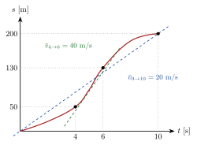
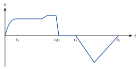



<!-- tillegg: Claude -->
For å beskrive en bevegelse trenger vi tre størrelser. Alle er funksjoner av tiden $t$.

| Størrelse | Symbol | Betyr | SI-enhet |
|---|---|---|---|
| posisjon | $\vec s(t)$ | hvor legemet er | $\mathrm{m}$ |
| hastighet | $\vec v(t)$ | hvor fort posisjonen endres | $\mathrm{m/s}$ |
| akselerasjon | $\vec a(t)$ | hvor fort hastigheten endres | $\mathrm{m/s^2}$ |

Vi starter med bevegelse langs en rett linje. Da kan vi la posisjonen være ett tall $s$ (eller $x$), og fortegnet viser retningen.

## Gjennomsnittsfart

<!-- fra notatene -->
Hvordan måler vi fart? Vi sjekker hvor langt legemet flytter seg, $\Delta s$, på en gitt tid, $\Delta t$:

::: {.graa}
$$
\bar v = \frac{\Delta s}{\Delta t} = \frac{s_\text{slutt} - s_0}{t_\text{slutt} - t_0}
$$
:::

Dette er **gjennomsnittsfarten** over tidsintervallet $\Delta t$. Streken over $v$ betyr «gjennomsnitt».

Et nyttig verktøy er **posisjonsgrafen** $s(t)$. Gjennomsnittsfarten er stigningstallet til linja mellom to punkter på grafen:

{.tikz-fig style="width:480px"}

$$
\bar v_{0\to10} = \frac{200\ \mathrm{m} - 0\ \mathrm{m}}{10\ \mathrm{s} - 0\ \mathrm{s}} = 20\ \mathrm{m/s}, \qquad
\bar v_{4\to6} = \frac{130\ \mathrm{m} - 50\ \mathrm{m}}{6\ \mathrm{s} - 4\ \mathrm{s}} = 40\ \mathrm{m/s}
$$

Mellom 4 og 6 sekunder går det altså mye fortere enn i snitt.

## Momentanfart

**Idé:** Vil vi vite farten i ett bestemt øyeblikk, lar vi $\Delta s$ og $\Delta t$ bli veldig små. **Momentanfarten** er verdien gjennomsnittsfarten nærmer seg når $\Delta t \to 0$. Det er nettopp definisjonen av den deriverte:

::: {.graa}
$$
v(t) = \lim_{\Delta t \to 0} \frac{\Delta s}{\Delta t} = \frac{\mathrm{d}s}{\mathrm{d}t} = s'(t)
$$
:::

<!-- tillegg: Claude -->
Geometrisk: Linja gjennom to punkter P og Q på grafen blir til **tangenten** i P når Q glir mot P. Momentanfarten er stigningstallet til tangenten. Speedometeret i bilen viser momentanfarten.

::: {.eksempel}
<!-- fra notatene -->
**Eksempel: Sprinteren.** En enkel modell for posisjonen til en sprinter i starten av et løp er $s(t) = 0.548\ \mathrm{m/s^2}\cdot t^2$. Finn gjennomsnittsfarten de første $10\ \mathrm{s}$, og momentanfarten etter $4.0\ \mathrm{s}$.

::: {.losning}
Gjennomsnittsfarten:
$$
\bar v = \frac{s(10\ \mathrm{s}) - s(0)}{10\ \mathrm{s} - 0} = \frac{54.8\ \mathrm{m} - 0}{10\ \mathrm{s}} \approx \underline{\underline{5.5\ \mathrm{m/s}}}
$$
Momentanfarten: Vi deriverer med regelen $(t^n)' = n\,t^{n-1}$:
$$
v(t) = s'(t) = 2\cdot0.548\ \mathrm{m/s^2}\cdot t \quad\Rightarrow\quad v(4.0\ \mathrm{s}) = 2\cdot0.548\cdot4.0\ \mathrm{m/s} \approx \underline{\underline{4.4\ \mathrm{m/s}}}
$$
:::
:::

## Akselerasjon

<!-- fra notatene -->
Akselerasjon er **endring i hastighet over tid**. På samme måte som for farten har vi gjennomsnittsakselerasjon og momentanakselerasjon:

::: {.graa}
$$
\bar a = \frac{\Delta v}{\Delta t} = \frac{v_2 - v_1}{t_2 - t_1}, \qquad
a(t) = \lim_{\Delta t\to0}\frac{\Delta v}{\Delta t} = v'(t) = s''(t)
$$
:::

Akselerasjonen er altså den deriverte av farten, og den *andrederiverte* av posisjonen.

::: {.eksempel}
**Eksempel:** Farten til et legeme er $v(t) = t^2$ (i $\mathrm{m/s}$, med $t$ i sekunder).

Finn gjennomsnittsakselerasjonen fra 0 til 1 s og fra 2 til 3 s, og sammenlign med momentanakselerasjonen midt i hvert intervall.

::: {.losning}
Gjennomsnittsakselerasjon fra 0 til 1 s og fra 2 til 3 s:
$$
\bar a_{0\to1} = \frac{1^2 - 0^2}{1 - 0}\ \mathrm{m/s^2} = 1\ \mathrm{m/s^2}, \qquad
\bar a_{2\to3} = \frac{3^2 - 2^2}{3 - 2}\ \mathrm{m/s^2} = 5\ \mathrm{m/s^2}
$$
Momentanakselerasjonen er $a(t) = v'(t) = 2t$, så
$$
a(0.5\ \mathrm{s}) = 1\ \mathrm{m/s^2}, \qquad a(2.5\ \mathrm{s}) = 5\ \mathrm{m/s^2}
$$
Legg merke til at gjennomsnittet over et intervall er lik momentanverdien midt i intervallet. Det gjelder når akselerasjonen endrer seg jevnt (lineært).
:::
:::

## I én og flere dimensjoner

Langs en rett linje legger vi en $x$-akse langs bevegelsen, og skriver $s(t) = x(t)$:
$$
v(t) = x'(t) = \frac{\mathrm{d}x}{\mathrm{d}t}, \qquad a(t) = x''(t) = \frac{\mathrm{d}^2x}{\mathrm{d}t^2}
$$
Egentlig er posisjon, hastighet og akselerasjon **vektorer**, $\vec s = [s_x,\ s_y]$, $\vec v = [v_x,\ v_y]$ og $\vec a = [a_x,\ a_y]$, og vi deriverer komponent for komponent. Det bruker vi når bevegelsen ikke er rettlinjet, i [skrått kast](03-skratt-kast.qmd).



## Fart og hastighet er ikke det samme

**Fart** er hvor fort noe går, uten retning. Det er et tall, for eksempel $v = 10\ \mathrm{m/s}$. **Hastighet** er fart *med retning*, altså en vektor, for eksempel $\vec v = [6.0,\ 8.0]\ \mathrm{m/s}$. Farten er lengden av hastighetsvektoren: $\sqrt{6.0^2+8.0^2}\ \mathrm{m/s} = 10\ \mathrm{m/s}$.

En bil som holder $50\ \mathrm{km/h}$ gjennom en sving, har konstant fart men *endrer hastighet*, fordi retningen endres. Den har altså en akselerasjon, selv om speedometeret står stille. Dette kommer vi tilbake til under *sirkelbevegelse*.

## Å lese grafer



Sammenhengen mellom de tre grafene er nyttig å kunne utenat. Mot høyre deriverer vi (stigningstall), mot venstre integrerer vi (areal under grafen):

{.tikz-fig style="width:640px"}

Arealet under $v(t)$-grafen er forflytningen, og arealet under $a(t)$-grafen er endringen i hastighet:
$$
\int_{t_1}^{t_2} v(t)\,\mathrm{d}t = s(t_2) - s(t_1), \qquad \int_{t_1}^{t_2} a(t)\,\mathrm{d}t = v(t_2) - v(t_1)
$$

::: {.callout-note title="Tenk selv: tog som akselererer"}
<!-- fra notatene -->
Et tog starter fra ro. Akselerasjonen er først positiv, så negativ, og til slutt null. Når har toget størst fart? *Svar: akkurat idet akselerasjonen skifter fortegn. Før det øker farten, etterpå avtar den.*
:::

:::: {.oppgaver}

::: {.oppgave tittel="Fra posisjon til akselerasjon"}
<!-- tillegg: Claude -->
Posisjonen til en heis er $x(t) = 2.0\ \mathrm{m/s^3}\cdot t^3 - 6.0\ \mathrm{m/s}\cdot t$ for $0 \le t \le 2.0\ \mathrm{s}$.

a) Finn $v(t)$ og $a(t)$.

b) Når står heisen stille et øyeblikk?

c) Hva er gjennomsnittsfarten fra $t = 0$ til $t = 2.0\ \mathrm{s}$?

::: {.fasit}
b) $t = 1.0\ \mathrm{s}$ · c) $2.0\ \mathrm{m/s}$
:::
:::

::: {.oppgave tittel="Fra akselerasjon til posisjon" niva="Middels"}
<!-- tillegg: Claude -->
En bil starter fra ro i $x = 0$ med akselerasjonen $a(t) = 3.0\ \mathrm{m/s^2} - 0.30\ \mathrm{m/s^3}\cdot t$ til akselerasjonen er null.

a) Når er akselerasjonen null?

b) Finn farten da.

c) Hvor langt har bilen kjørt?

::: {.fasit}
a) $10\ \mathrm{s}$ · b) $15\ \mathrm{m/s}$ · c) $1.0\cdot10^{2}\ \mathrm{m}$ <!-- tillegg: Claude: notasjon (standardform) -->
:::
:::

::: {.oppgave tittel="Akselerasjonsgrafen til et tog" niva="Middels"}
Grafen viser akselerasjonen til et tog som kjører rett fram mellom to stasjoner.

{.tikz-fig style="width:480px"}

a) Forklar ut fra grafen når farten øker og når den avtar.

b) I hvilket tidsintervall har toget størst fart?

c) Når begynner toget å bremse?

d) Hva betyr arealet under grafen fra $t_1$ til $t_2$?

e) Hva forteller stigningstallet til grafen?

:::

::::
