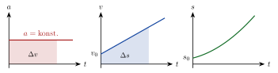



<!-- tillegg: Claude -->
I mange viktige situasjoner er akselerasjonen konstant: fritt fall, en bil som bremser jevnt, en kloss som sklir ned et skråplan. Da kan vi finne posisjon og fart ved ethvert tidspunkt med fire likninger. Det beste eksempelet er **tyngdeakselerasjonen** nær jordoverflaten, $\mathrm{g} = 9.81\ \mathrm{m/s^2}$.

## Utledning: fire likninger

<!-- fra notatene -->
Anta at $a$ er konstant. Akselerasjonen er den deriverte av farten, så farten er integralet av akselerasjonen:

**1.** 
$$
v = \int a\,\mathrm{d}t = C + a t
$$
Ved $t = 0$ er $v = C$. Vi kaller startfarten $v_0$, og får
$$
v(t) = v_0 + a t
$$

**2.** Posisjonen er integralet av farten:
$$
s(t) = \int v\,\mathrm{d}t = \int (v_0 + a t)\,\mathrm{d}t = v_0 t + \tfrac12 a t^2 + C
$$
Her har vi brukt $\int t^n\,\mathrm{d}t = \frac{1}{n+1}t^{n+1}$. Ved $t = 0$ er $s = C$, som vi kaller startposisjonen $s_0$:
$$
s(t) = s_0 + v_0 t + \tfrac12 a t^2
$$

**3.** Tilbakelagt strekning er **arealet under $v(t)$-grafen**. Grafen er en rett linje, så arealet er et rektangel $A_1 = v_0 t$ pluss en trekant $A_2 = \frac12(v - v_0)t$:
$$
s = A_1 + A_2 = v_0 t + \tfrac12(v - v_0)t = \tfrac12(v_0 + v)\,t
$$

{.tikz-fig style="width:620px"}

**4.** **Energibevaring:** Den kinetiske energien etterpå er lik kinetisk energi før, pluss arbeidet $W = F s = m a s$ som er gjort på legemet:
$$
\tfrac12 m v^2 = \tfrac12 m v_0^2 + m a s \quad\Rightarrow\quad 2 a s = v^2 - v_0^2
$$
Massen forkortes bort.

Samlet, med $s$ målt fra startposisjonen:

::: {.graa}
$$
\begin{aligned}
v &= v_0 + a t \\
s &= v_0 t + \tfrac{1}{2} a t^2 \\
2as &= v^2 - v_0^2 \\
s &= \tfrac{1}{2}(v_0 + v)\,t
\end{aligned}
$$
:::

<!-- tillegg: Claude -->
Hver likning mangler én av størrelsene. Velg den som mangler den du verken kjenner eller spør etter: den tredje når du ikke kjenner tiden, den fjerde når du ikke kjenner akselerasjonen.



::: {.callout-important title="Velg positiv retning – og hold deg til den"}
Bestem deg for hvilken retning som er positiv, og gi alle størrelser riktig fortegn ut fra det. Velger du *oppover* som positiv, er tyngdeakselerasjonen $a = -\mathrm{g} = -9.81\ \mathrm{m/s^2}$.
:::

::: {.eksempel}
<!-- fra notatene -->
**Eksempel: Appelsin utfor Preikestolen.** En appelsin slippes ($v_0 = 0$) fra Preikestolen, $600\ \mathrm{m}$ over sjøen. Hvor stor fart har den når den treffer sjøoverflaten? Se bort fra luftmotstand.

::: {.losning}
Vi velger positiv retning **oppover**. Da er $a = -9.81\ \mathrm{m/s^2}$ og forflytningen $s = -600\ \mathrm{m}$. Tiden kjenner vi ikke, så vi bruker $2as = v^2 - v_0^2$:
$$
v = \pm\sqrt{2\cdot(-9.81\ \mathrm{m/s^2})\cdot(-600\ \mathrm{m})} = \pm108.5\ \mathrm{m/s}
$$
Appelsinen er på vei ned, så vi velger minus: $v \approx \underline{\underline{-108\ \mathrm{m/s}}}$. Det er nesten $400\ \mathrm{km/h}$! I virkeligheten bremser luftmotstanden den mye før den kommer så langt.
:::
:::

::: {.eksempel}
<!-- fra notatene -->
**Eksempel: Bil som bremser.** En bil har farten $v_0 = 24\ \mathrm{m/s}$ ved $t_1 = 5\ \mathrm{s}$ og $v = 12\ \mathrm{m/s}$ ved $t_2 = 15\ \mathrm{s}$.

**a)** Finn akselerasjonen (den er konstant).\
**b)** Anta i stedet at vi bare vet at bilen har kjørt $80\ \mathrm{m}$ mellom de to målingene. Hva blir akselerasjonen da?

::: {.losning}
**a)** Akselerasjonen: $\Delta t = 10\ \mathrm{s}$, og fra $v = v_0 + a\Delta t$:
$$
a = \frac{v - v_0}{\Delta t} = \frac{12\ \mathrm{m/s} - 24\ \mathrm{m/s}}{10\ \mathrm{s}} = \underline{\underline{-1.2\ \mathrm{m/s^2}}}
$$

**b)** Anta i stedet at vi bare vet at bilen har kjørt $80\ \mathrm{m}$ mellom de to målingene. Uten tid bruker vi $2as = v^2 - v_0^2$:
$$
a = \frac{v^2 - v_0^2}{2s} = \frac{(12\ \mathrm{m/s})^2 - (24\ \mathrm{m/s})^2}{2\cdot80\ \mathrm{m}} = \frac{144 - 576}{160}\ \mathrm{m/s^2} = \underline{\underline{-2.7\ \mathrm{m/s^2}}}
$$
Sjekk enheten: $\frac{\mathrm{m^2/s^2}}{\mathrm{m}} = \mathrm{m/s^2}$. ✓
:::
:::

:::: {.oppgaver}

::: {.oppgave tittel="Ball kastet nedover"}
En ball kastes nedover med en fart $v_0$ ved tiden $t = 0$. Vi velger positiv retning *oppover* og ser bort fra luftmotstand. Hvilket uttrykk for hastigheten er riktig?

- **A.** $v = v_0 + \frac12 \mathrm{g} t^2$
- **B.** $v = v_0 + \mathrm{g} t$
- **C.** $v = v_0 - \mathrm{g} t$
- **D.** $v = -v_0 - \frac12 \mathrm{g} t^2$
- **E.** $v = -v_0 - \mathrm{g} t$

::: {.losning}
<!-- fra notatene -->
Akselerasjonen er konstant, så vi bruker $v = v_0 + a t$. Uttrykkene med $t^2$ kan vi stryke med en gang: de hører til posisjonen, ikke hastigheten.

Nå gjelder det fortegnene. Positiv retning er oppover. Ballen kastes *nedover*, så starthastigheten er $-v_0$. Tyngdeakselerasjonen peker også nedover: $a = -\mathrm{g}$. Dermed
$$
v = -v_0 - \mathrm{g} t \qquad \text{(alternativ E)}
$$
:::
:::

::: {.oppgave tittel="Bremselengde"}
En bil som kjører i $30\ \mathrm{km/h}$, bremser jevnt og stopper etter $30\ \mathrm{m}$.

a) Hvor stor er akselerasjonen?

b) Hvor lang tid tar det før bilen står stille?

c) Bilen bremser fra dobbelt så stor fart, $60\ \mathrm{km/h}$, med samme akselerasjon. Hvor lang blir bremsestrekningen og bremsetiden nå?

::: {.losning}
**a)** Vi kjenner ikke tiden, så vi bruker $v^2 - v_0^2 = 2as$ med $v = 0$ og $v_0 = 30/3.6\ \mathrm{m/s}$:
$$
a = \frac{v^2 - v_0^2}{2s} = \frac{0 - (30/3.6)^2}{2\cdot30}\ \mathrm{m/s^2} \approx \underline{\underline{-1.2\ \mathrm{m/s^2}}}
$$
Minustegnet betyr at akselerasjonen peker mot kjøreretningen: bilen bremser.

**b)** Fra $s = \frac12(v_0 + v)t$ med $v = 0$:
$$
t = \frac{2s}{v_0} = \frac{2\cdot30\ \mathrm{m}}{30/3.6\ \mathrm{m/s}} \approx \underline{\underline{7.2\ \mathrm{s}}}
$$

**c)** Fra a) er $s = -v_0^2/(2a)$: bremselengden er proporsjonal med $v_0^2$. Dobbel fart gir $2^2 = 4$ ganger så lang bremselengde, altså $120\ \mathrm{m}$. Tiden er $t = -v_0/a$, proporsjonal med $v_0$, og blir dobbelt så lang: $14\ \mathrm{s}$. <!-- tillegg: Claude: notasjon, 2 gjeldende siffer (var 14.4 s) -->
:::
:::

::: {.oppgave tittel="Innhenting" niva="Middels"}
En personbil kjører med konstant fart $v = 100\ \mathrm{km/h}$ forbi en politibil som står i ro i $x = 0$. Politibilen reagerer etter $\Delta t = 2.0\ \mathrm{s}$ og starter da med konstant akselerasjon. La $t = 0$ være når politibilen starter. Den tar igjen personbilen $1.0\ \mathrm{km}$ lenger fram.

a) Finn posisjonsfunksjonene for personbilen og politibilen.

b) Hvor stor akselerasjon må politibilen ha?

c) Hvor stor fart har politibilen idet den tar igjen personbilen?

::: {.losning}
**a)** Personbilen har et forsprang $v\Delta t$ ved $t = 0$, og kjører med konstant fart:
$$
x_1(t) = v\Delta t + v t
$$
Politibilen starter fra ro i $x = 0$ med konstant akselerasjon:
$$
x_2(t) = \tfrac12 a t^2
$$

**b)** De møtes når $x_1 = x_2 = x = 1.0\cdot10^3\ \mathrm{m}$. Fra personbilens likning finner vi tiden: $t = x/v - \Delta t$. Den setter vi inn i politibilens likning og løser for $a$:
$$
a = \frac{2x}{\left(\frac{x}{v} - \Delta t\right)^2} = \frac{2\cdot1.0\cdot10^3\ \mathrm{m}}{\left(\frac{1.0\cdot10^3\ \mathrm{m}}{100/3.6\ \mathrm{m/s}} - 2.0\ \mathrm{s}\right)^2} \approx \underline{\underline{1.7\ \mathrm{m/s^2}}}
$$

**c)** Fra $v^2 - v_0^2 = 2ax$ med $v_0 = 0$:
$$
v_{\text{politi}} = \sqrt{2ax} = \sqrt{2\cdot1.73\ \mathrm{m/s^2}\cdot1.0\cdot10^3\ \mathrm{m}} \approx 58.8\ \mathrm{m/s} \approx \underline{\underline{2.1\cdot10^2\ \mathrm{km/h}}}
$$
:::
:::

::: {.oppgave tittel="Appelsin fra Preikestolen"}
Kenny mister en appelsin utfor kanten på Preikestolen. Den faller rett ned fra ro. Hvor lang tid bruker den på de første $3.0000\ \mathrm{m}$? Se bort fra luftmotstand.

::: {.losning}
Vi bruker $s = v_0 t + \frac12 a t^2$ med $v_0 = 0$ og $a = \mathrm{g}$ (positiv retning nedover):
$$
s = \tfrac12 \mathrm{g} t^2 \quad\Rightarrow\quad t = \sqrt{\frac{2s}{\mathrm{g}}} = \sqrt{\frac{2\cdot3.0000\ \mathrm{m}}{9.81\ \mathrm{m/s^2}}} \approx \underline{\underline{0.782\ \mathrm{s}}}
$$
:::
:::

::::
