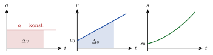



<!-- tillegg: Claude -->
I mange viktige situasjoner er akselerasjonen konstant: fritt fall, en bil som bremser jevnt, en kloss som sklir ned et skråplan. Da kan vi finne posisjon og fart ved ethvert tidspunkt med fire likninger. Det viktigste eksempelet er **tyngdeakselerasjonen** nær jordoverflaten, $\mathrm{g} = 9.81\ \mathrm{m/s^2}$, rettet loddrett nedover. Uten luftmotstand faller alle legemer med denne akselerasjonen, uansett masse.

## Utledning: fire likninger

<!-- fra notatene -->
Anta at $a$ er konstant. Akselerasjonen er den deriverte av farten, så farten er integralet av akselerasjonen.

**1. Farten.**
$$
v = \int a\,\mathrm{d}t = a t + C
$$
Ved $t = 0$ er $v = C$. Vi kaller startfarten $v_0$, og får
$$
v(t) = v_0 + a t
$$

**2. Posisjonen** er integralet av farten:
$$
s(t) = \int v\,\mathrm{d}t = \int (v_0 + a t)\,\mathrm{d}t = v_0 t + \tfrac12 a t^2 + C
$$
Her har vi brukt $\int t^n\,\mathrm{d}t = \frac{1}{n+1}t^{n+1}$. Ved $t = 0$ er $s = C$, som vi kaller startposisjonen $s_0$:
$$
s(t) = s_0 + v_0 t + \tfrac12 a t^2
$$

**3. Uten akselerasjonen.** Forflytningen er **arealet under $v(t)$-grafen**. Grafen er en rett linje, så arealet er et rektangel $A_1 = v_0 t$ pluss en trekant $A_2 = \frac12(v - v_0)t$:
$$
s - s_0 = A_1 + A_2 = v_0 t + \tfrac12(v - v_0)t = \tfrac12(v_0 + v)\,t
$$

{.tikz-fig style="width:620px"}

**4. Uten tiden.** Fra likning 1 er $t = (v - v_0)/a$. Det setter vi inn i likning 3:
$$
s - s_0 = \tfrac12(v_0 + v)\cdot\frac{v - v_0}{a} = \frac{v^2 - v_0^2}{2a} \quad\Rightarrow\quad 2a(s - s_0) = v^2 - v_0^2
$$

<!-- tillegg: Claude -->
Samlet, med $s$ målt fra startposisjonen ($s_0 = 0$):

::: {.graa}
$$
\begin{aligned}
v &= v_0 + a t &&\text{(mangler } s\text{)}\\
s &= v_0 t + \tfrac{1}{2} a t^2 &&\text{(mangler } v\text{)}\\
2as &= v^2 - v_0^2 &&\text{(mangler } t\text{)}\\
s &= \tfrac{1}{2}(v_0 + v)\,t &&\text{(mangler } a\text{)}
\end{aligned}
$$
:::

Hver likning mangler én av størrelsene $s$, $v$, $t$ og $a$. Velg den som mangler den du verken kjenner eller spør etter.

<!-- tillegg: Claude -->
Den tredje likningen har en fin tolkning som vi kommer tilbake til under *arbeid og energi*: Ganger vi den med $\tfrac12 m$, står det at endringen i bevegelsesenergi er lik kraften ganger strekningen.



::: {.callout-important title="Velg positiv retning – og hold deg til den"}
Bestem deg for hvilken retning som er positiv, og gi alle størrelser riktig fortegn ut fra det. Velger du *oppover* som positiv, er tyngdeakselerasjonen $a = -\mathrm{g} = -9.81\ \mathrm{m/s^2}$.
:::

::: {.eksempel}
<!-- fra notatene -->
**Eksempel: Appelsin utfor Preikestolen.** En appelsin slippes ($v_0 = 0$) fra Preikestolen, $600\ \mathrm{m}$ over sjøen. Hvor stor fart har den når den treffer sjøoverflaten? Se bort fra luftmotstand.

::: {.losning}
Vi velger positiv retning **oppover**. Da er $a = -9.81\ \mathrm{m/s^2}$ og forflytningen $s = -600\ \mathrm{m}$. Tiden kjenner vi ikke, så vi bruker $2as = v^2 - v_0^2$:
$$
v = \pm\sqrt{2\cdot(-9.81\ \mathrm{m/s^2})\cdot(-600\ \mathrm{m})} = \pm108.5\ \mathrm{m/s}
$$
Appelsinen er på vei ned, så vi velger minus: $v \approx \underline{\underline{-108\ \mathrm{m/s}}}$. Det er nesten $400\ \mathrm{km/h}$! I virkeligheten bremser luftmotstanden den mye før den kommer så langt.
:::
:::

::: {.eksempel}
<!-- fra notatene -->
**Eksempel: Bil som bremser.** En bil har farten $v_0 = 24\ \mathrm{m/s}$ ved $t_1 = 5.0\ \mathrm{s}$ og $v = 12\ \mathrm{m/s}$ ved $t_2 = 15\ \mathrm{s}$.

**a)** Finn akselerasjonen (den er konstant).\
**b)** Anta i stedet at vi bare vet at bilen har kjørt $80\ \mathrm{m}$ mellom de to målingene. Hva blir akselerasjonen da?

::: {.losning}
**a)** $\Delta t = 10\ \mathrm{s}$, og fra $v = v_0 + a\Delta t$:
$$
a = \frac{v - v_0}{\Delta t} = \frac{12\ \mathrm{m/s} - 24\ \mathrm{m/s}}{10\ \mathrm{s}} = \underline{\underline{-1.2\ \mathrm{m/s^2}}}
$$

**b)** Uten tid bruker vi $2as = v^2 - v_0^2$:
$$
a = \frac{v^2 - v_0^2}{2s} = \frac{(12\ \mathrm{m/s})^2 - (24\ \mathrm{m/s})^2}{2\cdot80\ \mathrm{m}} = \frac{144 - 576}{160}\ \mathrm{m/s^2} = \underline{\underline{-2.7\ \mathrm{m/s^2}}}
$$
Sjekk enheten: $\frac{\mathrm{m^2/s^2}}{\mathrm{m}} = \mathrm{m/s^2}$. ✓ (De to opplysningene passer ikke sammen. Med $a = -1.2\ \mathrm{m/s^2}$ ville bilen kjørt $180\ \mathrm{m}$ på de ti sekundene.)
:::
:::

## Strategi

::: {.steg}
1. **Tegn** situasjonen og velg positiv retning.
2. **List opp** hva du kjenner ($s$, $v_0$, $v$, $a$, $t$) med fortegn, og hva du skal finne.
3. **Velg likningen** som mangler størrelsen du verken kjenner eller spør etter.
4. **Sjekk svaret**: enhet, fortegn og om tallet er rimelig.
:::

:::: {.oppgaver}

::: {.oppgave tittel="Ball kastet nedover"}
En ball kastes nedover med en fart $v_0$ ved tiden $t = 0$. Vi velger positiv retning *oppover* og ser bort fra luftmotstand. Hvilket uttrykk for hastigheten er riktig?

- **A.** $v = v_0 + \frac12 \mathrm{g} t^2$
- **B.** $v = v_0 + \mathrm{g} t$
- **C.** $v = v_0 - \mathrm{g} t$
- **D.** $v = -v_0 - \frac12 \mathrm{g} t^2$
- **E.** $v = -v_0 - \mathrm{g} t$

:::

::: {.oppgave tittel="Loddrett kast"}
<!-- tillegg: Claude -->
En ball kastes rett opp med $v_0 = 15\ \mathrm{m/s}$. Se bort fra luftmotstand.

a) Hvor høyt går ballen?

b) Hvor lang tid tar det før den er tilbake i utgangspunktet?

::: {.fasit}
a) $11\ \mathrm{m}$ · b) $3.1\ \mathrm{s}$
:::
:::

::: {.oppgave tittel="Bremselengde"}
En bil som kjører i $30\ \mathrm{km/h}$, bremser jevnt og stopper etter $30\ \mathrm{m}$.

a) Hvor stor er akselerasjonen?

b) Hvor lang tid tar det før bilen står stille?

c) Bilen bremser fra dobbelt så stor fart, $60\ \mathrm{km/h}$, med samme akselerasjon. Hvor lang blir bremsestrekningen og bremsetiden nå?

::: {.fasit}
a) $-1.2\ \mathrm{m/s^2}$ · b) $7.2\ \mathrm{s}$ · c) $120\ \mathrm{m}$ · c) $14\ \mathrm{s}$
:::
:::

::: {.oppgave tittel="Innhenting" niva="Middels"}
En personbil kjører med konstant fart $v = 100\ \mathrm{km/h}$ forbi en politibil som står i ro i $x = 0$. Politibilen reagerer etter $\Delta t = 2.0\ \mathrm{s}$ og starter da med konstant akselerasjon. La $t = 0$ være når politibilen starter. Den tar igjen personbilen $1.0\ \mathrm{km}$ lenger fram.

a) Finn posisjonsfunksjonene for personbilen og politibilen.

b) Hvor stor akselerasjon må politibilen ha?

c) Hvor stor fart har politibilen idet den tar igjen personbilen?

::: {.fasit}
b) $1.7\ \mathrm{m/s^2}$ · c) $2.1\cdot10^2\ \mathrm{km/h}$
:::
:::

::: {.oppgave tittel="Appelsin fra Preikestolen"}
Kenny mister en appelsin utfor kanten på Preikestolen. Den faller rett ned fra ro. Hvor lang tid bruker den på de første $3.0000\ \mathrm{m}$? Se bort fra luftmotstand.

::: {.fasit}
$0.782\ \mathrm{s}$
:::
:::

::::
