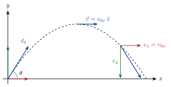
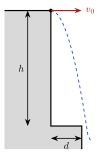

<!-- fra notatene -->
Når noe beveger seg i et plan, for eksempel en ball som kastes, er banen krum. Da bruker vi vektorer. Trikset er å **dekomponere**: vi deler bevegelsen i en $x$-del og en $y$-del og behandler dem hver for seg.
$$
\vec s(t) = [x(t),\ y(t)], \qquad \vec v(t) = [x'(t),\ y'(t)], \qquad \vec a(t) = [x''(t),\ y''(t)]
$$

## Konstant akselerasjon i to retninger

Er akselerasjonen konstant, gjelder bevegelseslikningene i hver retning for seg:

::: {.graa}
| $x$-retning | $y$-retning |
|---|---|
| $x = x_0 + v_{0x}\,t + \tfrac12 a_x t^2$ | $y = y_0 + v_{0y}\,t + \tfrac12 a_y t^2$ |
| $v_x = v_{0x} + a_x t$ | $v_y = v_{0y} + a_y t$ |
:::

## Skrått kast

<!-- tillegg: Claude -->
Uten luftmotstand er tyngdekraften den eneste kraften. Den virker bare loddrett. Med $x$-aksen vannrett og $y$-aksen oppover blir
$$
a_x = 0, \qquad a_y = -\mathrm{g}
$$
Det betyr:

- **Vannrett** går legemet med *konstant fart*: $v_x = v_{0x}$ hele tiden.
- **Loddrett** er det fritt fall med startfart $v_{0y}$.

De to bevegelsene påvirker ikke hverandre. Det kalles **uavhengighetsprinsippet**.

{.tikz-fig style="width:520px"}

Startfarten dekomponeres som en vanlig vektor: $v_{0x} = v_0\cos\theta$ og $v_{0y} = v_0\sin\theta$. På toppen av banen er $v_y = 0$, og hastigheten er bare vannrett.

## Fire steg som alltid virker

<!-- fra notatene -->
1. **Dekomponer** bevegelseslikningene i $x$- og $y$-retning. Skriv opp hva du vet ($a_x = 0$, $a_y = -\mathrm{g}$, startfarter).
2. **Finn tiden** fra den retningen der du har nok opplysninger, som oftest $y$-retningen.
3. **Bruk tiden** i den andre retningen.
4. **Sett sammen** og løs.

::: {.eksempel}
**Eksempel: Stuperen.** En stuper hopper vannrett ut fra en klippe. Et utspring med bredde $d = 1.75\ \mathrm{m}$ ligger $h = 9.00\ \mathrm{m}$ under toppen. Hvor stor vannrett fart $v_0$ må stuperen minst ha for å komme klar av utspringet?

{.tikz-fig style="width:230px"}

::: {.losning}
**1. Dekomponer.** Startfarten er vannrett, så $v_{0x} = v_0$ og $v_{0y} = 0$. Med origo på toppen:
$$
x(t) = v_0 t, \qquad y(t) = -\tfrac12 \mathrm{g} t^2
$$
To likninger og to ukjente ($v_0$ og tiden).

**2. Finn tiden fra $y$-retningen.** Stuperen er nede på utspringets høyde når $y = -h$:
$$
-h = -\tfrac12 \mathrm{g} T^2 \quad\Rightarrow\quad T = \sqrt{\frac{2h}{\mathrm{g}}}
$$

**3. Finn farten fra $x$-retningen.** På tiden $T$ må stuperen ha kommet minst $d$ ut: $d = v_0 T$, så $v_0 = d/T$.

**4. Sett sammen:**
$$
v_0 = \frac{d}{\sqrt{2h/\mathrm{g}}} = \frac{1.75\ \mathrm{m}}{\sqrt{2\cdot9.00\ \mathrm{m}/9.81\ \mathrm{m/s^2}}} \approx \underline{\underline{1.29\ \mathrm{m/s}}}
$$
<!-- tillegg: Claude: notasjon, svaret gitt med 3 gjeldende siffer som dataene (var 1.3 m/s) -->
:::
:::

<!-- tillegg: Claude -->
::: {.callout-tip title="Legg merke til"}
Falltiden avhenger bare av høyden, ikke av den vannrette farten. En kule som slippes, og en kule som skytes vannrett ut fra samme høyde, treffer bakken samtidig.
:::

## Hvor langt går et kast?

<!-- fra notatene -->
Et legeme kastes med fart $v_0$ i vinkelen $\theta$ over vannrett. Hvor treffer det bakken, og hvilken vinkel gir lengst kast?

Fra $x$-retningen: $x = v_0\cos\theta\cdot t$, så $t = \dfrac{x}{v_0\cos\theta}$. Dette setter vi inn i $y$-likningen:
$$
y = v_0\sin\theta\cdot t - \tfrac12 \mathrm{g} t^2 = x\tan\theta - \frac{\mathrm{g}\,x^2}{2v_0^2\cos^2\theta}
$$
Dette er likningen for **banen**: en parabel. Lander legemet på samme høyde som det ble kastet fra ($y = 0$), får vi kastlengden
$$
x = \frac{2v_0^2}{\mathrm{g}}\sin\theta\cos\theta = \frac{v_0^2}{\mathrm{g}}\sin 2\theta
$$
Den er størst når $\sin 2\theta = 1$:

::: {.graa}
På flat mark gir $\theta = 45^\circ$ lengst kast (uten luftmotstand).
:::

:::: {.oppgaver}

::: {.oppgave tittel="Finn startfarten"}
En ball ruller utfor en bordkant $0.80\ \mathrm{m}$ over gulvet og treffer gulvet $0.85\ \mathrm{m}$ fra bordkanten (målt vannrett). Hvor stor fart hadde ballen da den forlot bordet?

::: {.losning}
<!-- fra notatene -->
**1.** Ved $t = 0$ er $v_{0y} = 0$ og $\vec v_0 = v_{0x}\,\hat x$. Akselerasjonen er $a_y = -\mathrm{g}$ og $a_x = 0$.

**2.** Vi finner tiden $t^*$ til ballen treffer gulvet ($y = 0$) fra $y = y_0 + v_{0y}t + \frac12 a_y t^2$ med $v_{0y} = 0$:
$$
t^* = \sqrt{\frac{2(y - y_0)}{a_y}} = \sqrt{\frac{2(0 - 0.80\ \mathrm{m})}{-9.81\ \mathrm{m/s^2}}} \approx 0.404\ \mathrm{s}
$$

**3.** I $x$-retning er farten konstant, så $v_{0x} = x^*/t^*$:
$$
v_{0x} = \frac{0.85\ \mathrm{m}}{0.404\ \mathrm{s}} \approx 2.1\ \mathrm{m/s}
$$

**4.** Startfarten er $v_0 = v_{0x} \approx \underline{\underline{2.1\ \mathrm{m/s}}}$.
:::
:::

::: {.oppgave tittel="Hvor fort treffer stuperen vannet?"}
Hvor stor er den totale farten til stuperen i eksempelet over idet hun treffer vannet ved foten av utspringet?

::: {.losning}
<!-- tillegg: Claude -->
Vannrett er farten fortsatt $v_x = v_0 \approx 1.29\ \mathrm{m/s}$. Loddrett har stuperen falt i tiden $T = \sqrt{2h/\mathrm{g}} \approx 1.35\ \mathrm{s}$, så
$$
v_y = -\mathrm{g}T \approx -13.3\ \mathrm{m/s}
$$
Den totale farten er lengden av hastighetsvektoren:
$$
v = \sqrt{v_x^2 + v_y^2} = \sqrt{1.29^2 + 13.3^2}\ \mathrm{m/s} \approx \underline{\underline{13.4\ \mathrm{m/s}}}
$$
<!-- tillegg: Claude: notasjon, svaret gitt med 3 gjeldende siffer (var 13 m/s) -->
Nesten all farten er loddrett.
:::
:::

::: {.oppgave tittel="To kanoner"}
To kanoner med munning i samme punkt på bakken avfyres samtidig. De skyter kuler med **samme startfart**, men i ulik vinkel. Den grønne skyter brattere mot blink A, den blå flatere mot blink B. Blinkene står på bakkenivå. Se bort fra luftmotstand. Hvilke påstander er riktige?

- **A.** Den grønne kanonen treffer blink A først.
- **B.** Den blå kanonen treffer blink B først.
- **C.** Blinkene treffes samtidig.
- **D.** Den blå kula treffer med større fart enn den grønne.
- **E.** Kulene treffer blinkene med samme fart.

::: {.losning}
<!-- fra notatene -->
**Tiden:** Begge har samme loddrette akselerasjon $\mathrm{g}$. Fra $y(t) = v_{0y}t - \frac12\mathrm{g}t^2 = 0$ får vi $t = 2v_{0y}/\mathrm{g}$. Den grønne har størst $v_{0y}$, går høyest og er lengst i lufta. Den blå treffer først: **B** er riktig.

**Farten:** Uten luftmotstand er energien bevart. Begge starter på samme høyde med samme fart, og lander på samme høyde. Da er
$$
\tfrac12 m v_1^2 = \tfrac12 m v_2^2 \quad\Rightarrow\quad v_1 = v_2
$$
**E** er riktig. Riktige påstander: **B og E**.
:::
:::

::: {.oppgave tittel="Fjærkanon: finn vinkelen med Python" niva="Utfordrende"}
En fjærkanon skyter en kule med startfart $v_0 = 4.0\ \mathrm{m/s}$ mot en blink som ligger $x = 1.5\ \mathrm{m}$ unna vannrett og $0.40\ \mathrm{m}$ *under* munningen ($y = -0.40\ \mathrm{m}$, med $y$ positiv oppover).

a) Skriv kravet om at kula treffer blinken som en likning $f(\alpha) = 0$ for utskytingsvinkelen $\alpha$.

b) Finn vinkelen(e) numerisk med `fsolve`.

::: {.losning}
**a)** Banelikningen fra teorien over gir
$$
y = x\tan\alpha - \frac{\mathrm{g}x^2}{2v_0^2\cos^2\alpha}
$$
Vi flytter alt over på én side:
$$
f(\alpha) = y + \frac{\mathrm{g}x^2}{2v_0^2\cos^2\alpha} - x\tan\alpha = 0
$$

**b)** Likningen har to løsninger: en flat og en bratt bane. `fsolve` finner den som ligger nærmest startgjetningen, så vi prøver to gjetninger:

```{.python .kjor}
import numpy as np
from scipy.optimize import fsolve

g, v0, x, y = 9.81, 4.0, 1.5, -0.40

def f(alfa):
    return y + g*x**2 / (2*v0**2*np.cos(alfa)**2) - x*np.tan(alfa)

for gjett in [0.1, 1.2]:          # radianer: en flat og en bratt gjetning
    alfa = fsolve(f, gjett)[0]
    print(f"alfa = {np.degrees(alfa):.1f} grader")
```

Svar: $\alpha \approx \underline{\underline{12^\circ}}$ eller $\alpha \approx \underline{\underline{63^\circ}}$.
:::
:::

::::
