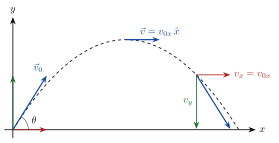
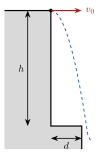

<!-- video: kommer (videoer/ingeniorfysikk/02-03-skratt-kast) -->
{fig-alt="Video kommer"}

<!-- fra notatene -->
Når noe beveger seg i et plan, for eksempel en ball som kastes, er banen krum. Da bruker vi vektorer. Trikset er å **dekomponere**: Vi deler bevegelsen i en $x$-del og en $y$-del og behandler dem hver for seg.
$$
\vec s(t) = [x(t),\ y(t)], \qquad \vec v(t) = [x'(t),\ y'(t)], \qquad \vec a(t) = [x''(t),\ y''(t)]
$$

## Konstant akselerasjon i to retninger

Er akselerasjonen konstant, gjelder bevegelseslikningene i hver retning for seg:

::: {.graa}
| $x$-retning | $y$-retning |
|---|---|
| $x = x_0 + v_{0x}\,t + \tfrac12 a_x t^2$ | $y = y_0 + v_{0y}\,t + \tfrac12 a_y t^2$ |
| $v_x = v_{0x} + a_x t$ | $v_y = v_{0y} + a_y t$ |
:::

Tiden $t$ er den samme i begge retninger. Det er den som binder de to bevegelsene sammen.

## Skrått kast

<!-- tillegg: Claude -->
Uten luftmotstand har et kastet legeme bare tyngdeakselerasjonen, og den peker rett ned. Med $x$-aksen vannrett og $y$-aksen oppover blir
$$
a_x = 0, \qquad a_y = -\mathrm{g}
$$

::: {.kort}
- **Vannrett** går legemet med *konstant fart*: $v_x = v_{0x}$ hele tiden.
- **Loddrett** er det fritt fall med startfart $v_{0y}$.
- **Uavhengige** De to bevegelsene påvirker ikke hverandre. Det kalles uavhengighetsprinsippet.
:::

{.tikz-fig style="width:520px"}

Startfarten dekomponeres som en vanlig vektor: $v_{0x} = v_0\cos\theta$ og $v_{0y} = v_0\sin\theta$. På toppen av banen er $v_y = 0$, og hastigheten er bare vannrett.

## Fire steg som alltid virker

<!-- fra notatene -->
::: {.steg}
1. **Dekomponer** bevegelseslikningene i $x$- og $y$-retning. Skriv opp hva du vet ($a_x = 0$, $a_y = -\mathrm{g}$, startfarter).
2. **Finn tiden** fra den retningen der du har nok opplysninger, som oftest $y$-retningen.
3. **Bruk tiden** i den andre retningen.
4. **Sett sammen** og løs.
:::

::: {.eksempel}
**Eksempel: Stuperen.** En stuper hopper vannrett ut fra en klippe. Et utspring med bredde $d = 1.75\ \mathrm{m}$ ligger $h = 9.00\ \mathrm{m}$ under toppen. Hvor stor vannrett fart $v_0$ må stuperen minst ha for å komme klar av utspringet?

{.tikz-fig style="width:230px"}

::: {.losning}
**1. Dekomponer.** Startfarten er vannrett, så $v_{0x} = v_0$ og $v_{0y} = 0$. Med origo på toppen:
$$
x(t) = v_0 t, \qquad y(t) = -\tfrac12 \mathrm{g} t^2
$$
To likninger og to ukjente ($v_0$ og tiden).

**2. Finn tiden fra $y$-retningen.** Stuperen er nede på utspringets høyde når $y = -h$:
$$
-h = -\tfrac12 \mathrm{g} T^2 \quad\Rightarrow\quad T = \sqrt{\frac{2h}{\mathrm{g}}}
$$

**3. Bruk tiden i $x$-retningen.** På tiden $T$ må stuperen ha kommet minst $d$ ut: $d = v_0 T$, så $v_0 = d/T$.

**4. Sett sammen:**
$$
v_0 = \frac{d}{\sqrt{2h/\mathrm{g}}} = \frac{1.75\ \mathrm{m}}{\sqrt{2\cdot9.00\ \mathrm{m}/9.81\ \mathrm{m/s^2}}} \approx \underline{\underline{1.29\ \mathrm{m/s}}}
$$
:::
:::

<!-- tillegg: Claude -->
::: {.callout-tip title="Legg merke til"}
Falltiden avhenger bare av høyden, ikke av den vannrette farten. En kule som slippes, og en kule som skytes vannrett ut fra samme høyde, treffer bakken samtidig.
:::

## Hvor langt går et kast?

<!-- fra notatene -->
Et legeme kastes med fart $v_0$ i vinkelen $\theta$ over vannrett. Hvor treffer det bakken, og hvilken vinkel gir lengst kast?

Fra $x$-retningen: $x = v_0\cos\theta\cdot t$, så $t = \dfrac{x}{v_0\cos\theta}$. Dette setter vi inn i $y$-likningen:
$$
y = v_0\sin\theta\cdot t - \tfrac12 \mathrm{g} t^2 = x\tan\theta - \frac{\mathrm{g}\,x^2}{2v_0^2\cos^2\theta}
$$
Dette er likningen for **banen**: en parabel. Lander legemet på samme høyde som det ble kastet fra ($y = 0$), får vi kastlengden
$$
x = \frac{2v_0^2}{\mathrm{g}}\sin\theta\cos\theta = \frac{v_0^2}{\mathrm{g}}\sin 2\theta
$$
Her har vi brukt $2\sin\theta\cos\theta = \sin2\theta$. Kastlengden er størst når $\sin 2\theta = 1$:

::: {.graa}
På flat mark gir $\theta = 45^\circ$ lengst kast (uten luftmotstand). To vinkler som til sammen gir $90^\circ$, for eksempel $30^\circ$ og $60^\circ$, gir like langt kast.
:::

<!-- tillegg: Claude -->
**Toppunktet.** På toppen er $v_y = v_0\sin\theta - \mathrm{g}t = 0$, så stigetiden er $t_\text{topp} = v_0\sin\theta/\mathrm{g}$, og høyden er
$$
h_\text{maks} = \frac{(v_0\sin\theta)^2}{2\mathrm{g}}
$$
Den siste finner du også fra $2a_ys = v_y^2 - v_{0y}^2$ med $v_y = 0$.

:::: {.oppgaver}

::: {.oppgave tittel="Finn startfarten"}
En ball ruller utfor en bordkant $0.80\ \mathrm{m}$ over gulvet og treffer gulvet $0.85\ \mathrm{m}$ fra bordkanten (målt vannrett). Hvor stor fart hadde ballen da den forlot bordet?

::: {.fasit}
$2.1\ \mathrm{m/s}$
:::
:::

::: {.oppgave tittel="Hvor fort treffer stuperen vannet?"}
Hvor stor er den totale farten til stuperen i eksempelet over idet hun treffer vannet ved foten av utspringet, $9.00\ \mathrm{m}$ under toppen?

::: {.fasit}
$13.4\ \mathrm{m/s}$
:::
:::

::: {.oppgave tittel="Fotballsparket"}
<!-- tillegg: Claude -->
En fotball sparkes fra bakken med $v_0 = 20\ \mathrm{m/s}$ i $35^\circ$ vinkel. Se bort fra luftmotstand.

a) Hvor høyt går ballen?

b) Hvor lang tid er den i lufta, og hvor langt går den?

::: {.fasit}
a) $6.7\ \mathrm{m}$ · b) $2.3\ \mathrm{s}$ · b) $38\ \mathrm{m}$
:::
:::

::: {.oppgave tittel="To kanoner"}
To kanoner med munning i samme punkt på bakken avfyres samtidig. De skyter kuler med **samme startfart**, men i ulik vinkel. Den grønne skyter brattere mot blink A, den blå flatere mot blink B. Blinkene står på bakkenivå. Se bort fra luftmotstand. Hvilke påstander er riktige?

- **A.** Den grønne kanonen treffer blink A først.
- **B.** Den blå kanonen treffer blink B først.
- **C.** Blinkene treffes samtidig.
- **D.** Den blå kula treffer med større fart enn den grønne.
- **E.** Kulene treffer blinkene med samme fart.

:::

::: {.oppgave tittel="Fjærkanon: finn vinkelen med Python" niva="Utfordrende"}
En fjærkanon skyter en kule med startfart $v_0 = 4.0\ \mathrm{m/s}$ mot en blink som ligger $x = 1.5\ \mathrm{m}$ unna vannrett og $0.40\ \mathrm{m}$ *under* munningen ($y = -0.40\ \mathrm{m}$, med $y$ positiv oppover).

a) Skriv kravet om at kula treffer blinken som en likning $f(\alpha) = 0$ for utskytingsvinkelen $\alpha$.

b) Finn vinkelen(e) numerisk med `fsolve`.

::: {.fasit}
$12^\circ$ · $63^\circ$
:::
:::

::::
