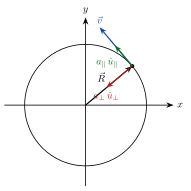
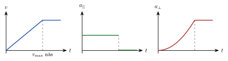



<!-- fra notatene -->
Også i en sirkelbevegelse er hastigheten den deriverte av posisjonen, og akselerasjonen den deriverte av hastigheten:
$$
\vec v(t) = \frac{\mathrm{d}\vec R}{\mathrm{d}t}, \qquad \vec a(t) = \frac{\mathrm{d}\vec v}{\mathrm{d}t} = \frac{\mathrm{d}^2\vec R}{\mathrm{d}t^2}
$$
Hastigheten peker alltid **langs tangenten** til sirkelen.

## To deler av akselerasjonen

{.tikz-fig style="width:330px"}

For sirkelbevegelse er det lurt å dele akselerasjonen i to:

::: {.graa}
$$
\vec a = \underbrace{\frac{\mathrm{d}v}{\mathrm{d}t}}_{a_\parallel}\,\hat u_\parallel + \underbrace{\frac{v^2}{R}}_{a_\perp}\,\hat u_\perp
$$
:::

- $\hat u_\parallel$ er en enhetsvektor **langs tangenten** (i fartsretningen). Delen $a_\parallel$ kalles **baneakselerasjon**: den endrer *farten*.
- $\hat u_\perp$ er en enhetsvektor som peker **inn mot sentrum**. Delen $a_\perp$ kalles **sentripetalakselerasjon**: den endrer *retningen*.

<!-- tillegg: Claude -->
Den totale akselerasjonen er lengden av summen. Siden de to delene står vinkelrett på hverandre, bruker vi Pytagoras: $a = \sqrt{a_\parallel^2 + a_\perp^2}$.

## Konstant fart

<!-- fra notatene -->
Går legemet rundt med **konstant fart**, er $a_\parallel = 0$, og bare sentripetalakselerasjonen er igjen:

::: {.graa}
$$
a = \frac{v^2}{R} \quad \text{(rettet inn mot sentrum)}
$$
:::

Farten kan også skrives med **frekvensen** $f$ (omdreininger per sekund), **perioden** $T = 1/f$ (tid for én runde) eller **vinkelfarten** $\omega = 2\pi f$. På én runde går legemet omkretsen $2\pi R$, så $v = 2\pi R/T = 2\pi R f = \omega R$. Det gir

::: {.graa}
$$
a = \frac{v^2}{R} = 4\pi^2 f^2 R = \frac{4\pi^2}{T^2} R = \omega^2 R
$$
:::

<!-- tillegg: Claude -->
::: {.callout-note title="Akselerasjon uten at farten endres?"}
Ja! Akselerasjon er endring i *hastighet*, og hastighet er en vektor. Selv om farten (lengden av vektoren) er konstant, snur retningen hele tiden. Da endres hastigheten, og det er akselerasjon. Det er sentripetalakselerasjonen du kjenner når bilen tar en skarp sving.
:::

::: {.eksempel}
<!-- fra notatene -->
**Eksempel: Vaskemaskin.** En vaskemaskin sentrifugerer med $1300$ omdreininger per minutt. Trommelen har radius $R = 0{,}25\ \mathrm{m}$. Hvor stor er akselerasjonen til klærne langs veggen?

Frekvensen i omdreininger per sekund: $f = 1300/60\ \mathrm{s^{-1}} \approx 21{,}7\ \mathrm{Hz}$. Farten er konstant, så
$$
a = 4\pi^2 f^2 R = 4\pi^2\cdot(21{,}7\ \mathrm{s^{-1}})^2\cdot0{,}25\ \mathrm{m} \approx \underline{\underline{4{,}6\cdot10^3\ \mathrm{m/s^2}}}
$$
Det er nesten **500 ganger** tyngdeakselerasjonen! Derfor blir vannet slynget ut av klærne.
:::

:::: {.oppgaver}

::: {.oppgave tittel="Akselerasjon når farten er konstant?"}
I sirkelbevegelse med konstant fart er sentripetalakselerasjonen $a = v^2/r$. Men akselerasjon handler om endring i hastighet. Burde ikke akselerasjonen være null når $v$ er konstant? Forklar.

::: {.losning}
Fart og hastighet er ikke det samme. *Fart* er hvor fort legemet går, et tall. *Hastighet* er fart med retning, en vektor, og farten er lengden av hastighetsvektoren.

I en sving er farten konstant, men retningen endres hele tiden. Da endres hastigheten, og
$$
\vec a = \frac{\Delta\vec v}{\Delta t} \neq \vec 0
$$
Ved konstant banefart peker denne akselerasjonen inn mot sentrum, og den er $a_\perp = v^2/r$.
:::
:::

::: {.oppgave tittel="Satellitt"}
En satellitt går i sirkelbane $500\ \mathrm{km}$ over jordoverflaten. Jordas radius er $6370\ \mathrm{km}$. Satellitten bruker $95$ minutter på én runde. Finn banefarten.

::: {.losning}
<!-- fra notatene -->
Radien i banen måles fra jordas sentrum: $R = 6370\ \mathrm{km} + 500\ \mathrm{km} = 6870\ \mathrm{km}$. På én periode $T$ går satellitten én omkrets:
$$
v = \frac{s}{T} = \frac{2\pi R}{T} = \frac{2\pi\cdot6{,}87\cdot10^6\ \mathrm{m}}{95\cdot60\ \mathrm{s}} \approx 7{,}6\cdot10^3\ \mathrm{m/s} = \underline{\underline{7{,}6\ \mathrm{km/s}}}
$$
:::
:::

::: {.oppgave tittel="Bil i rundkjøring" niva="Middels"}
En bil starter fra ro og kjører med jevnt økende fart rundt i en sirkelformet rundkjøring.

a) Skisser $a_\parallel(t)$ og $a_\perp(t)$. Hva skjer hvis bilen slutter å øke farten når den når $v_{\max}$?

b) Radien er $60\ \mathrm{m}$, og farten øker jevnt fra 0 til $60\ \mathrm{km/h}$ på $6{,}0\ \mathrm{s}$. Finn $a_\parallel$, $a_\perp$ og den totale akselerasjonen idet farten er $60\ \mathrm{km/h}$.

::: {.losning}
<!-- fra notatene -->
**a)** Farten øker jevnt, så $a_\parallel = \Delta v/\Delta t$ er **konstant**. Med $v = a_\parallel t$ blir
$$
a_\perp = \frac{v^2}{R} = \frac{(a_\parallel t)^2}{R} = \frac{a_\parallel^2}{R}\,t^2
$$
som vokser som en **parabel**. Når $v_{\max}$ er nådd, faller $a_\parallel$ til null, mens $a_\perp$ blir liggende konstant på $v_{\max}^2/R$:

{.tikz-fig style="width:600px"}

**b)** Baneakselerasjonen:
$$
a_\parallel = \frac{\Delta v}{\Delta t} = \frac{60/3{,}6\ \mathrm{m/s}}{6{,}0\ \mathrm{s}} \approx \underline{\underline{2{,}8\ \mathrm{m/s^2}}}
$$
Sentripetalakselerasjonen ved $60\ \mathrm{km/h}$:
$$
a_\perp = \frac{v^2}{R} = \frac{(60/3{,}6\ \mathrm{m/s})^2}{60\ \mathrm{m}} \approx \underline{\underline{4{,}6\ \mathrm{m/s^2}}}
$$
De står vinkelrett på hverandre, så
$$
a = \sqrt{a_\parallel^2 + a_\perp^2} = \sqrt{2{,}78^2 + 4{,}63^2}\ \mathrm{m/s^2} \approx \underline{\underline{5{,}4\ \mathrm{m/s^2}}}
$$
Her antar vi at bilen fortsatt akselererer akkurat idet den når $60\ \mathrm{km/h}$.
:::
:::

::::
