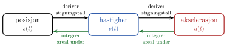

<!-- fra notatene -->
Bevegelse kan studeres på to måter:

::: {.kort}
- **Kinematikk** beskriver *hvordan* noe beveger seg: posisjon $\vec s(t)$, hastighet $\vec v(t)$ og akselerasjon $\vec a(t)$.
- **Dynamikk og statikk** forklarer *hvorfor*, ut fra kreftene $\sum\vec F$. I dynamikken er $\sum\vec F = m\vec a$, i statikken er $\sum\vec F = \vec 0$.
:::

Her holder vi oss til kinematikken. Vi starter langs en rett linje, går videre til krumlinjet bevegelse i to dimensjoner (skrått kast), og avslutter med sirkelbevegelse. Alt bygger på én kjede av derivasjon og integrasjon:

{.tikz-fig style="width:640px"}

::: {.kort}
- **[Posisjon, hastighet og akselerasjon](01-posisjon-fart-akselerasjon.qmd)** Gjennomsnitt og momentanverdier, derivasjon og grafer.
- **[Konstant akselerasjon](02-konstant-akselerasjon.qmd)** De fire bevegelseslikningene og fritt fall.
- **[Skrått kast](03-skratt-kast.qmd)** Bevegelse i to dimensjoner, kastlengde og bane.
- **[Sirkelbevegelse](04-sirkelbevegelse.qmd)** Vinkelfart, periode og sentripetalakselerasjon.
:::

Tilsvarende stoff finnes i OpenStax *University Physics*, bind 1, kapittel 3 og 4.
