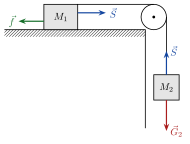

<!-- video: kommer (videoer/ingeniorfysikk/03-02-friksjon-fjaer-trinser) -->
{fig-alt="Video kommer"}

<!-- tillegg: Claude -->
Med Newtons lover på plass trenger vi gode modeller for de kreftene som dukker opp igjen og igjen: friksjon, fjærkraft og snordrag. Alle er kontaktkrefter, og alle er forenklinger av hva som skjer mellom atomene i flatene.

## Friksjon

<!-- fra notatene -->
Friksjon virker langs kontaktflaten og motvirker at flatene glir mot hverandre. Vi skiller mellom to typer:

::: {.kort}
- **Statisk friksjon (hvilefriksjon)** $f_s \le \mu_s N$. Den er akkurat så stor som trengs for å holde legemet i ro, opp til en største verdi $\mu_s N$.
- **Kinetisk friksjon (glidefriksjon)** $f_k = \mu_k N$, når flatene glir mot hverandre. Den peker mot den relative bevegelsen.
:::

Her er $N$ normalkraften, og $\mu_s$ og $\mu_k$ er friksjonstallene. De er rene tall uten enhet. Vanligvis er $\mu_k < \mu_s$: Det er tyngre å få noe *i gang* enn å holde det gående.

| Flater | $\mu_s$ | $\mu_k$ |
|---|---|---|
| gummi på tørr betong | 1.0 | 0.7 |
| gummi på våt betong | 0.5–0.7 | 0.3–0.5 |
| tre på tre | 0.5 | 0.3 |
| voksede ski på våt snø | 0.14 | 0.1 |
| stål på stål (tørt) | 0.6 | 0.3 |
| stål på stål (oljet) | 0.05 | 0.03 |
| teflon på stål | 0.04 | 0.04 |
| sko på tre | 0.9 | 0.7 |
| sko på is | 0.1 | 0.05 |
| stål på is | 0.4 | 0.02 |

::: {.eksempel}
<!-- tillegg: Claude -->
**Eksempel: Hvor hardt må du dytte?** En kasse på $40\ \mathrm{kg}$ står på et tregulv, med $\mu_s = 0.50$ og $\mu_k = 0.30$.

**a)** Hvor stor vannrett kraft må til for å få kassen i gang?\
**b)** Hvor stor kraft trengs for å holde den gående med konstant fart?\
**c)** Du dytter med $100\ \mathrm{N}$ mens kassen står i ro. Hvor stor er friksjonen?

::: {.losning}
Loddrett er det ingen akselerasjon, så $N = m\mathrm{g} = 40\cdot9.81\ \mathrm{N} = 392\ \mathrm{N}$.

**a)** Kassen begynner å gli når kraften overstiger største hvilefriksjon: $F = \mu_s N = 0.50\cdot392\ \mathrm{N} \approx \underline{\underline{0.20\ \mathrm{kN}}}$.

**b)** Konstant fart betyr $\sum F = 0$, så $F = f_k = \mu_k N = 0.30\cdot392\ \mathrm{N} \approx \underline{\underline{0.12\ \mathrm{kN}}}$.

**c)** $100\ \mathrm{N}$ er mindre enn $196\ \mathrm{N}$, så kassen står i ro. Da er $\sum F = 0$, og friksjonen er akkurat $\underline{\underline{100\ \mathrm{N}}}$, mot dyttet. Hvilefriksjonen er ikke alltid $\mu_s N$, bare *høyst* så stor.
:::
:::

<!-- tillegg: Claude -->
::: {.callout-tip title="Hvorfor ABS-bremser?"}
Et dekk som ruller uten å skli, har *statisk* friksjon mot veien. Låser hjulene seg, blir det *kinetisk* friksjon, som er mindre. ABS-bremser hindrer hjulene i å låse seg, slik at bilen bremser med den største friksjonen og samtidig kan styres.
:::

## Fjærkraft

En ideell fjær følger **Hookes lov**: Kraften er proporsjonal med hvor mye fjæra er strukket eller presset sammen fra likevekt,
$$
F_k = -kx
$$
Minustegnet betyr at kraften virker *mot* utstrekningen: Strekker du fjæra, drar den tilbake. Presser du den sammen, dytter den ut. Fjærkonstanten $k$ (enhet $\mathrm{N/m}$) sier hvor stiv fjæra er. Når vi bare trenger størrelsen, skriver vi $F_k = kx$.

::: {.eksempel}
<!-- fra notatene -->
**Eksempel: Trampoline.** En person på $70\ \mathrm{kg}$ står i ro på en trampoline som virker som en fjær med $k = 2.5\ \mathrm{kN/m}$. Hvor mye er duken presset ned?

::: {.losning}
I likevekt er $a = 0$, så $\sum F = kx - m\mathrm{g} = 0$:
$$
x = \frac{m\mathrm{g}}{k} = \frac{70\ \mathrm{kg}\cdot9.81\ \mathrm{m/s^2}}{2.5\cdot10^3\ \mathrm{N/m}} \approx \underline{\underline{27\ \mathrm{cm}}}
$$
:::
:::

## Snordrag

<!-- tillegg: Claude -->
En stram snor drar i det den er festet til, med en kraft langs snora. Den kalles **snordrag** og skrives $S$ (eller $T$). En snor kan bare *dra*, aldri dytte. I en **ideell snor** (masseløs og ustrekkelig) er snordraget like stort i hele snora, og alt som henger i den, har samme fart og akselerasjon langs snora.

## Trinser og systemer av legemer

<!-- fra notatene -->
Klosser kan kobles sammen med en snor over en friksjonsfri trinse. Tre ting er verdt å merke seg:

::: {.kort}
- **Indre krefter nuller hverandre ut** Snora drar i begge klossene med like stort snordrag $S$. For systemet som helhet er summen av de indre kreftene null.
- **Bare ytre krefter akselererer systemet** Newtons 2. lov gjelder for hele systemet, med den samlede massen.
- **Trinsa endrer bare retningen** Kraften fra en ideell trinse snur snora. Den bidrar ikke til fartsøkningen langs snora.
:::

{.tikz-fig style="width:380px"}

::: {.eksempel}
<!-- fra notatene -->
**Eksempel: Lodd på trinse.** Kloss $M_1$ ligger på et bord, kloss $M_2$ henger i snora. Finn akselerasjonen.

Gjør det først uten friksjon, og så med kinetisk friksjonstall $\mu_k$ mellom $M_1$ og bordet.

::: {.losning}
**Uten friksjon ($\mu_k = 0$):** For $M_1$ er $N_1 = G_1$ (ingen bevegelse loddrett). Langs snora er den eneste ytre kraften som driver systemet, tyngden $G_2 = M_2\mathrm{g}$. Hele systemet har massen $M_1 + M_2$:
$$
M_2\mathrm{g} = (M_1 + M_2)\,a \quad\Rightarrow\quad a = \frac{M_2}{M_1 + M_2}\,\mathrm{g}
$$

**Med friksjon ($\mu_k > 0$):** Nå bremser friksjonen $f = \mu_k N_1 = \mu_k M_1\mathrm{g}$:
$$
M_2\mathrm{g} - \mu_k M_1\mathrm{g} = (M_1 + M_2)\,a \quad\Rightarrow\quad a = \frac{M_2 - \mu_k M_1}{M_1 + M_2}\,\mathrm{g}
$$
<!-- tillegg: Claude -->
Sjekk: Med $\mu_k = 0$ får vi resultatet over igjen. Og er $\mu_k M_1 > M_2$, blir $a$ negativ. Det betyr at systemet ikke kommer i gang. Da gjelder ikke formelen lenger, og den statiske friksjonen holder klossene i ro.
:::
:::

:::: {.oppgaver}

::: {.oppgave tittel="Snordraget"}
<!-- tillegg: Claude -->
Finn snordraget $S$ i eksempelet med lodd på trinse uten friksjon.

::: {.losning}
Se på $M_1$ alene. Den eneste vannrette kraften på den er snordraget, så $S = M_1 a$:
$$
S = M_1\cdot\frac{M_2}{M_1 + M_2}\,\mathrm{g} = \frac{M_1M_2}{M_1 + M_2}\,\mathrm{g}
$$
Snordraget er mindre enn tyngden $M_2\mathrm{g}$ av det hengende loddet. Det må det være, ellers ville ikke $M_2$ akselerert nedover.
:::
:::

::: {.oppgave tittel="Atwoods maskin"}
<!-- tillegg: Claude -->
To lodd, $m_1 = 2.0\ \mathrm{kg}$ og $m_2 = 3.0\ \mathrm{kg}$, henger i hver sin ende av en snor over en friksjonsfri trinse. Finn akselerasjonen og snordraget.

::: {.losning}
Systemet beveger seg slik at $m_2$ går ned. Langs snora (positiv retning: $m_2$ ned, $m_1$ opp) er de ytre kreftene $m_2\mathrm{g}$ med og $m_1\mathrm{g}$ mot:
$$
a = \frac{m_2 - m_1}{m_1 + m_2}\,\mathrm{g} = \frac{1.0}{5.0}\cdot9.81\ \mathrm{m/s^2} \approx \underline{\underline{2.0\ \mathrm{m/s^2}}}
$$
For $m_1$ alene (positiv opp): $S - m_1\mathrm{g} = m_1a$, så
$$
S = m_1(\mathrm{g} + a) = 2.0\cdot(9.81 + 1.96)\ \mathrm{N} \approx \underline{\underline{24\ \mathrm{N}}}
$$
Snordraget ligger mellom tyngden av det lette ($19.6\ \mathrm{N}$) og det tunge loddet ($29.4\ \mathrm{N}$).
:::
:::

::: {.oppgave tittel="Glatt vei" niva="Middels"}
<!-- tillegg: Claude -->
En bil bremser med låste hjul på våt asfalt ($\mu_k = 0.40$) fra $72\ \mathrm{km/h}$.

a) Hvor stor er akselerasjonen?

b) Hvor lang er bremsestrekningen?

c) Hva blir bremsestrekningen med ABS, der hjulene ruller og $\mu_s = 0.60$ virker?

::: {.losning}
**a)** Loddrett: $N = m\mathrm{g}$. Vannrett: $-\mu_kN = ma$, så $a = -\mu_k\mathrm{g} = -0.40\cdot9.81\ \mathrm{m/s^2} \approx \underline{\underline{-3.9\ \mathrm{m/s^2}}}$. Massen forsvinner.

**b)** $v_0 = 72/3.6\ \mathrm{m/s} = 20\ \mathrm{m/s}$. Fra $2as = v^2 - v_0^2$ med $v = 0$:
$$
s = \frac{v_0^2}{2\mu_k\mathrm{g}} = \frac{(20\ \mathrm{m/s})^2}{2\cdot0.40\cdot9.81\ \mathrm{m/s^2}} \approx \underline{\underline{51\ \mathrm{m}}}
$$

**c)** Med $\mu_s = 0.60$: $s = \dfrac{400}{2\cdot0.60\cdot9.81}\ \mathrm{m} \approx \underline{\underline{34\ \mathrm{m}}}$. ABS sparer altså rundt $17\ \mathrm{m}$, og bilen kan styres underveis.
:::
:::

::: {.oppgave tittel="To fjærer" niva="Middels"}
<!-- tillegg: Claude -->
To fjærer med fjærkonstantene $k_1$ og $k_2$ kobles **etter hverandre** (i serie), og et lodd med tyngde $G$ henges i den nederste. Vis at koblingen virker som én fjær med
$$
\frac{1}{k} = \frac{1}{k_1} + \frac{1}{k_2}
$$

::: {.losning}
Begge fjærene bærer hele tyngden, så kraften i hver er $G$. Da strekkes de $x_1 = G/k_1$ og $x_2 = G/k_2$. Total strekk er
$$
x = x_1 + x_2 = G\left(\frac{1}{k_1} + \frac{1}{k_2}\right)
$$
En enkelt fjær med konstant $k$ ville strekkes $x = G/k$. Sammenligner vi, får vi $\frac1k = \frac1{k_1} + \frac1{k_2}$. Seriekoblingen er *mykere* enn hver av fjærene alene.
:::
:::

::::
