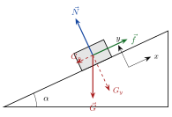



<!-- fra notatene -->
Krefter er vektorer, så de kan dekomponeres. Det gjør Newtons 2. lov til et sett av likninger, én for hver retning. Vi går gjennom metoden steg for steg med en kloss på et skråplan.

## Fem steg

**1. Newtons 2. lov på vektorform.** Før skrev vi $\sum F = ma$ med bare størrelser. Nå skriver vi
$$
\sum\vec F = m\vec a \quad\Leftrightarrow\quad \sum F_x = m a_x, \qquad \sum F_y = m a_y
$$

**2. Velg koordinatsystem – bevisst!** For et skråplan lønner det seg å legge $x$-aksen *langs* planet. Da har normalkraften og friksjonen bare én komponent hver, og bare tyngden må dekomponeres.

{.tikz-fig style="width:430px"}

$$
\vec N = [0,\ N], \qquad \vec f = [f,\ 0], \qquad \vec G = [-G_x,\ -G_y]
$$

**3. Komponenter med vinkelen.** Vinkelen mellom $\vec G$ og normalen til planet er den samme som skråplanets vinkel $\alpha$ (vinkelsummen i trekanten). Dermed
$$
G_x = G\sin\alpha, \qquad G_y = G\cos\alpha
$$

**4. Skriv ned likningssettet.** Med $G = m\mathrm{g}$ og $f = \mu N$:
$$
\begin{aligned}
\sum F_y &= N - G_y = m a_y = 0 &&\Rightarrow\quad N = m\mathrm{g}\cos\alpha \\
\sum F_x &= f - G_x = m a_x &&\Rightarrow\quad \mu N - m\mathrm{g}\sin\alpha = m a_x
\end{aligned}
$$

**5. Løs likningssettet.** Setter vi $N$ fra den første inn i den andre, forkortes massen:

::: {.graa}
$$
a_x = \mathrm{g}\left(\mu\cos\alpha - \sin\alpha\right)
$$
:::

Med $\mu = 0{,}2$ og $\alpha = 30^\circ$ blir $a_x = 9{,}81\,(0{,}2\cos30^\circ - \sin30^\circ)\ \mathrm{m/s^2} \approx -3{,}2\ \mathrm{m/s^2}$. Minus betyr at klossen akselererer *ned* planet.

::: {.eksempel}
<!-- fra notatene -->
**Eksempel: Boksesekken.** En boksesekk med $m = 30\ \mathrm{kg}$ henger i et tau. Du slår den med en vannrett kraft $F = 200\ \mathrm{N}$.

**a)** Kraftdiagram: snordraget $\vec S$ opp, tyngden $\vec G$ ned og slaget $\vec F$ vannrett.

**b)** Loddrett: $\sum F_V = S - G = 0$, så $S = m\mathrm{g}$. Vannrett (positiv retning mot deg): $\sum F_H = -F = ma$.

**c)** Akselerasjonen: $a = -\dfrac{F}{m} = -\dfrac{200\ \mathrm{N}}{30\ \mathrm{kg}} \approx -6{,}7\ \mathrm{m/s^2}$ (bort fra deg).

**d)** Motkreftene: sekken slår tilbake på hånda di med $\vec F'$, sekken drar i taket med $\vec S'$, og sekken trekker jorda med $\vec G'$.
:::

::: {.eksempel}
<!-- fra notatene -->
**Eksempel: Mesternes mester?** En deltaker ($M = 79\ \mathrm{kg}$) henger i ro i to armer. Venstre arm danner vinkelen $\alpha = 60^\circ$ med vannrett, høyre arm $\beta = 70^\circ$. Hvor store krefter $S_V$ og $S_H$ virker i armene?

Personen henger i ro, så $\sum\vec F = \vec 0$. Vi dekomponerer armkreftene: $(S_V)_x = S_V\cos\alpha$, $(S_V)_y = S_V\sin\alpha$, og tilsvarende for $S_H$ med $\beta$.

**1.** $\sum F_x = -S_V\cos\alpha + S_H\cos\beta = 0 \quad\Rightarrow\quad S_V = S_H\dfrac{\cos\beta}{\cos\alpha}$

**2.** $\sum F_y = S_V\sin\alpha + S_H\sin\beta - M\mathrm{g} = 0$

**3.** Setter 1 inn i 2 og bruker $\sin\alpha\cos\beta + \sin\beta\cos\alpha = \sin(\alpha+\beta)$:
$$
S_H = \frac{\cos\alpha}{\sin(\alpha + \beta)}M\mathrm{g}, \qquad S_V = \frac{\cos\beta}{\sin(\alpha + \beta)}M\mathrm{g}
$$

**4.** Med tall: $S_H \approx 5{,}1\cdot10^2\ \mathrm{N}$ og $S_V \approx 3{,}5\cdot10^2\ \mathrm{N}$. Den brattere armen (høyre) bærer mest.
:::

:::: {.oppgaver}

::: {.oppgave tittel="Kasse i to tau"}
En kasse med masse $m$ henger i to like tau som begge danner vinkelen $\theta$ med taket.

a) Finn snordraget $S$ i hvert tau som funksjon av $\theta$.

b) Hva skjer med snordraget når $\theta \to 0$?

c) Finn draget når $m = 50\ \mathrm{kg}$ og $\theta = 30^\circ$.

::: {.losning}
**a)** De vannrette komponentene opphever hverandre. Loddrett gir Newtons 1. lov
$$
2S\sin\theta = m\mathrm{g} \quad\Rightarrow\quad S(\theta) = \frac{m\mathrm{g}}{2\sin\theta}
$$

**b)** Når $\theta \to 0$ går $\sin\theta \to 0$ og $S \to \infty$. Et tau kan aldri strammes helt vannrett med en vekt i: det krever uendelig stort drag.

**c)** $S = \dfrac{50\cdot9{,}81}{2\cdot0{,}5}\ \mathrm{N} \approx \underline{\underline{0{,}49\ \mathrm{kN}}}$
:::
:::

::: {.oppgave tittel="Friksjonskoeffisienten i et labforsøk" niva="Middels"}
En kloss ligger i ro på et skråplan. Vinkelen $\theta$ økes forsiktig til en kritisk verdi $\theta_0$ der klossen akkurat begynner å gli.

a) Finn hvilefriksjonskoeffisienten $\mu_s$ uttrykt ved $\theta_0$.

b) Vinkelen økes til $\theta > \theta_0$. Klossen starter fra ro og glir en strekning $s$ på tiden $t$. Finn glidefriksjonskoeffisienten $\mu_k$ uttrykt ved $s$, $t$, $\mathrm{g}$ og $\theta$.

::: {.losning}
<!-- fra notatene -->
**a)** Rett før klossen sklir er $a = 0$, og friksjonen er så stor den kan bli: $f_s = \mu_s N$. Fra formelen over med $a = 0$:
$$
0 = \mathrm{g}(\mu_s\cos\theta_0 - \sin\theta_0) \quad\Rightarrow\quad \underline{\underline{\mu_s = \tan\theta_0}}
$$
(Alternativt: $\sum F_x = 0$ gir $m\mathrm{g}\sin\theta_0 = \mu_s N$ og $\sum F_y = 0$ gir $N = m\mathrm{g}\cos\theta_0$. Del den ene på den andre.)

**b)** Nedover planet er akselerasjonen konstant: $a = \mathrm{g}(\sin\theta - \mu_k\cos\theta)$. Klossen starter fra ro, så $s = \frac12 a t^2$:
$$
s = \tfrac12\mathrm{g}(\sin\theta - \mu_k\cos\theta)\,t^2 \quad\Rightarrow\quad \underline{\underline{\mu_k = \tan\theta - \frac{2s}{\mathrm{g}t^2\cos\theta}}}
$$
:::
:::

::: {.oppgave tittel="Bråbrems" niva="Middels"}
En bil med $m = 1500\ \mathrm{kg}$ kjører i $v_0 = 80\ \mathrm{km/h}$ og bråbremser. Med ABS-bremser virker maksimal hvilefriksjon hele tiden, med $\mu_s = 0{,}80$.

a) Hvor lang bremsestrekning $s$ trenger bilen på flat vei?

b) Hvor stor fart ville bilen hatt etter samme strekning hvis den startet i $90\ \mathrm{km/h}$?

c) Hvor lang bremsestrekning trenger bilen fra $80\ \mathrm{km/h}$ nedover en bakke med 15 % stigning?

::: {.losning}
<!-- fra notatene -->
**a)** Loddrett: $N = m\mathrm{g}$. Vannrett: $-f_s = ma$, så $-\mu_s m\mathrm{g} = ma$ og $a = -\mu_s\mathrm{g}$, som er konstant. Da bruker vi $2as = v^2 - v_0^2$ med $v = 0$:
$$
s = \frac{v_0^2}{2\mu_s\mathrm{g}} = \frac{(80/3{,}6\ \mathrm{m/s})^2}{2\cdot0{,}80\cdot9{,}81\ \mathrm{m/s^2}} \approx \underline{\underline{31\ \mathrm{m}}}
$$

**b)** Med $v_0 = 90/3{,}6\ \mathrm{m/s} = 25\ \mathrm{m/s}$ og samme $s$:
$$
v = \sqrt{v_0^2 - 2\mu_s\mathrm{g}s} \approx 11{,}4\ \mathrm{m/s} \approx \underline{\underline{41\ \mathrm{km/h}}}
$$
Litt høyere startfart gir altså stor fart i hindringen.

**c)** 15 % stigning betyr $0{,}15\ \mathrm{m}$ opp per meter vannrett: $\alpha = \arctan0{,}15 \approx 8{,}5^\circ$. Nedover bakken blir oppbremsingen $a = -\mathrm{g}(\mu_s\cos\alpha - \sin\alpha)$, så
$$
s = \frac{v_0^2}{2\mathrm{g}(\mu_s\cos\alpha - \sin\alpha)} = \frac{(80/3{,}6)^2}{2\cdot9{,}81\,(0{,}80\cos8{,}5^\circ - \sin8{,}5^\circ)}\ \mathrm{m} \approx \underline{\underline{39\ \mathrm{m}}}
$$
:::
:::

::::
