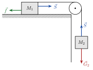

## Friksjon

<!-- fra notatene -->
Friksjon virker langs kontaktflaten og motvirker at flatene glir mot hverandre. Vi skiller mellom to typer:

::: {.graa}
- **Statisk friksjon (hvilefriksjon):** $f_s \le \mu_s N$. Den er akkurat så stor som trengs for å holde legemet i ro, opp til en maksimalverdi.
- **Kinetisk friksjon (glidefriksjon):** $f_k = \mu_k N$, når flatene glir.
:::

Her er $N$ normalkraften, og $\mu_s$ og $\mu_k$ er friksjonskoeffisientene. Vanligvis er $\mu_k < \mu_s$: det er tyngre å få noe *i gang* enn å holde det gående.

| Flater | $\mu_s$ | $\mu_k$ |
|---|---|---|
| gummi på tørr betong | 1,0 | 0,7 |
| gummi på våt betong | 0,5–0,7 | 0,3–0,5 |
| tre på tre | 0,5 | 0,3 |
| voksede ski på våt snø | 0,14 | 0,1 |
| stål på stål (tørt) | 0,6 | 0,3 |
| stål på stål (oljet) | 0,05 | 0,03 |
| teflon på stål | 0,04 | 0,04 |
| sko på tre | 0,9 | 0,7 |
| sko på is | 0,1 | 0,05 |
| stål på is | 0,4 | 0,02 |

<!-- tillegg: Claude -->
::: {.callout-tip title="Hvorfor ABS-bremser?"}
Et dekk som ruller uten å skli, har *statisk* friksjon mot veien. Låser hjulene seg, blir det *kinetisk* friksjon, som er mindre. ABS-bremser hindrer hjulene i å låse seg, slik at bilen bremser med den største friksjonen og samtidig kan styres.
:::

## Fjærkraft

Et ideelt fjær følger **Hookes lov**: kraften er proporsjonal med hvor mye fjæra er strukket eller presset sammen fra likevekt,
$$
F_k = kx
$$
og kraften virker mot utstrekningen. Fjærkonstanten $k$ (enhet $\mathrm{N/m}$) sier hvor stiv fjæra er.

::: {.eksempel}
<!-- fra notatene -->
**Eksempel: Trampoline.** En person på $70\ \mathrm{kg}$ står i ro på en trampoline som virker som en fjær med $k = 2500\ \mathrm{N/m}$. Hvor mye er duken presset ned?

::: {.losning}
I likevekt er $a = 0$, så $\sum F = F_k - G = 0$ og $kx = m\mathrm{g}$:
$$
x = \frac{m\mathrm{g}}{k} = \frac{70\ \mathrm{kg}\cdot9{,}81\ \mathrm{m/s^2}}{2{,}5\cdot10^3\ \mathrm{N/m}} \approx 27\ \mathrm{cm}
$$
:::
:::

## Trinser og systemer av legemer

<!-- fra notatene -->
Klosser kan kobles sammen med en snor over en friksjonsfri trinse. Tre ting er verdt å merke seg:

1. **Indre krefter nuller hverandre ut.** Snora drar i begge klossene med like stort snordrag $S$. For systemet som helhet er summen av de indre kreftene null.
2. **Bare ytre krefter akselererer systemet** (Newtons 2. lov for hele systemet).
3. **Kraften fra trinsa** virker normalt på snora og endrer bare *retningen*. Den bidrar ikke til fartsøkningen, så vi trenger den ikke når vi regner ut akselerasjonen.

{.tikz-fig style="width:380px"}

::: {.eksempel}
<!-- fra notatene -->
**Eksempel: Lodd på trinse.** Kloss $M_1$ ligger på et bord, kloss $M_2$ henger i snora. Finn akselerasjonen.

Gjør det først uten friksjon, og så med kinetisk friksjonstall $\mu_k$ mellom $M_1$ og bordet.

::: {.losning}
**Uten friksjon ($\mu = 0$):** For $M_1$ er $N_1 = G_1$ (ingen bevegelse loddrett). Langs snora er den eneste ytre kraften som driver systemet, tyngden $G_2 = M_2\mathrm{g}$. Hele systemet har massen $M_1 + M_2$:
$$
M_2\mathrm{g} = (M_1 + M_2)\,a \quad\Rightarrow\quad a = \frac{M_2}{M_1 + M_2}\,\mathrm{g}
$$

**Med friksjon ($\mu_k > 0$):** Nå bremser friksjonen $f = \mu_k N_1 = \mu_k M_1\mathrm{g}$:
$$
M_2\mathrm{g} - \mu_k M_1\mathrm{g} = (M_1 + M_2)\,a \quad\Rightarrow\quad a = \frac{M_2 - \mu_k M_1}{M_1 + M_2}\,\mathrm{g}
$$
<!-- tillegg: Claude -->
Sjekk: med $\mu_k = 0$ får vi resultatet over igjen. Og er $\mu_k M_1 > M_2$, blir $a$ negativ, som betyr at systemet ikke kommer i gang (da tar den statiske friksjonen over).
:::
:::

:::: {.oppgaver}

::: {.oppgave tittel="Snordraget"}
<!-- tillegg: Claude -->
Finn snordraget $S$ i eksempelet med lodd på trinse uten friksjon.

::: {.losning}
Se på $M_1$ alene. Den eneste vannrette kraften på den er snordraget, så $S = M_1 a$:
$$
S = M_1\cdot\frac{M_2}{M_1 + M_2}\,\mathrm{g} = \frac{M_1M_2}{M_1 + M_2}\,\mathrm{g}
$$
Snordraget er mindre enn tyngden $M_2\mathrm{g}$ av det hengende loddet. Det må det være, ellers ville ikke $M_2$ akselerert nedover.
:::
:::

::::
