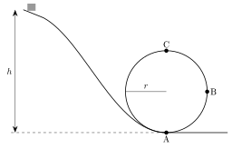

<!-- fra notatene -->
I kinematikken så vi at et legeme i sirkelbevegelse med konstant fart har akselerasjonen $a = v^2/r$, rettet inn mot sentrum. Newtons 2. lov sier da hvor stor kraftsum som trengs:

::: {.graa}
$$
\sum F_{\text{inn mot sentrum}} = m\,\frac{v^2}{r}
$$
:::

Det er ingen ny kraft. Det er *summen* av de vanlige kreftene (friksjon, normalkraft, tyngde, snordrag …) som må peke inn mot sentrum med denne størrelsen. Den «sentrifugalkraften» du føler i en karusell, er like stor og motsatt rettet, og kalles en **fiktiv kraft**: den er bare en følge av at du selv akselererer.

::: {.eksempel}
<!-- fra notatene -->
**Eksempel: Bil i sving.** En bil med masse $m = 1000\ \mathrm{kg}$ kjører i $36\ \mathrm{km/h}$ gjennom en sirkulær sving med radius $R = 20\ \mathrm{m}$.

**a)** Hvor stor er akselerasjonen?\
**b)** Hvor stor er kraftsummen på bilen, og hvilken kraft sørger for den?

::: {.losning}
**a)** Akselerasjonen: $v = 36/3{,}6\ \mathrm{m/s} = 10\ \mathrm{m/s}$, så
$$
a = \frac{v^2}{R} = \frac{(10\ \mathrm{m/s})^2}{20\ \mathrm{m}} = 5{,}0\ \mathrm{m/s^2}
$$

**b)** Kraftsummen: $\sum F = m\dfrac{v^2}{R} = 1000\ \mathrm{kg}\cdot5{,}0\ \mathrm{m/s^2} = 5{,}0\ \mathrm{kN}$. Loddrett er $N = G$. Det er **friksjonen** mellom dekk og vei som gir kraften inn mot sentrum. Er veien glatt, klarer ikke friksjonen dette, og bilen sklir rett fram.
:::
:::

::: {.eksempel}
<!-- fra notatene -->
**Eksempel: Dosering av veibanen.** Kan en bil med konstant fart kjøre gjennom en sirkulær sving *uten* friksjon?

Finn i så fall hvor mye veien må helle (doseringsvinkelen $\alpha$).

::: {.losning}
Ja, hvis veien heller innover med vinkelen $\alpha$ (dosering).

Uten friksjon er normalkraften den eneste kraften fra veien. Den står vinkelrett på veibanen, så den har en loddrett del $N_V = N\cos\alpha$ og en vannrett del $N_H = N\sin\alpha$ inn mot sentrum.

**Loddrett:** $N_V - G = 0 \;\Rightarrow\; N_V = m\mathrm{g}$

**Vannrett:** $N_H = m\dfrac{v^2}{r}$

Deler vi den ene på den andre, får vi $\tan\alpha = N_H/N_V$:

::: {.graa}
$$
\tan\alpha = \frac{v^2}{\mathrm{g}r}
$$
:::

Skal en bil kjøre med fart $v$ gjennom en sving med radius $r$ uten å trenge friksjon, bør doseringen være $\alpha = \arctan\!\big(v^2/(\mathrm{g}r)\big)$.
:::
:::

## Loop: berg-og-dalbane

{.tikz-fig style="width:440px"}

<!-- fra notatene -->
I en loop endrer kreftene seg rundt sirkelen. Vi velger positiv retning **inn mot sentrum**:

- **I bunnen (A):** normalkraften peker opp (inn), tyngden ned (ut): $N - G = m v_A^2/r$, så $N = G + mv_A^2/r$. Du kjenner deg tyngre.
- **Midtveis (B):** bare normalkraften peker inn mot sentrum: $N = mv_B^2/r$. Tyngden virker langs banen og bremser vogna med $a = \mathrm{g}$.
- **På toppen (C):** både normalkraften og tyngden peker ned (inn): $N + G = mv_C^2/r$.

Vogna mister kontakten med banen hvis $N$ blir null. Det skjer først på toppen.

:::: {.oppgaver}

::: {.oppgave tittel="Krefter i loopen" niva="Middels"}
En vogn kjører gjennom loopen over, uten friksjon og luftmotstand, og fullfører hele runden.

a) Hvilke påstander er riktige?

- **A.** I punkt A er normalkrafta lik vognas tyngde.
- **B.** I punkt A er normalkrafta større enn vognas tyngde.
- **C.** I punkt B er sentripetalakselerasjonen null.
- **D.** I punkt B er den tangentielle akselerasjonen lik $\mathrm{g}$.
- **E.** I punkt C er sentripetalakselerasjonen lik $\mathrm{g}$.

b) Et akselerometer i vogna måler $a_\perp = 3\mathrm{g}$ på toppen C. Hva er normalkraften der, uttrykt ved tyngden $G$?

::: {.losning}
<!-- fra notatene -->
**a)** I A er $N = G + mv_A^2/r > G$: **A er feil, B er riktig.**
I B er $a_\perp = N/m \neq 0$ (vogna går jo i sirkel): **C er feil.** Langs banen virker bare tyngden, så $a_\text{tang} = -\mathrm{g}$: **D er riktig.**
I C er $a_\perp = (N + G)/m$. Den er bare lik $\mathrm{g}$ hvis $N = 0$, altså helt på grensen til å miste kontakten: **E er feil** (generelt).

Riktige påstander: **B og D**.

**b)** På toppen: $N + G = m a_\perp = m\cdot3\mathrm{g} = 3G$, så $\underline{\underline{N = 2G}}$.
:::
:::

::: {.oppgave tittel="Karusell uten friksjon"}
<!-- fra notatene -->
Skriv Newtons 2. lov for en bil i bunnen (A) og på toppen (B) av en vertikal loop med radius $r$, og forklar hvorfor $N_B < N_A$ hvis farten var lik.

::: {.losning}
I bunnen: $N_A - G = m\dfrac{v_A^2}{r}$, så $N_A = m\dfrac{v_A^2}{r} + G$.

På toppen: $N_B + G = m\dfrac{v_B^2}{r}$, så $N_B = m\dfrac{v_B^2}{r} - G$.

Med samme fart er forskjellen $N_A - N_B = 2G$. I bunnen må normalkraften både bære tyngden og gi sentripetalkraften; på toppen hjelper tyngden til. (I virkeligheten er farten også lavere på toppen, så forskjellen blir enda større.)
:::
:::

::::
