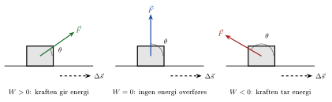



## Arbeid

<!-- fra notatene -->
**Arbeid** $W$ er hvor mye en kraft $\vec F$ virker *langs* en strekning:

::: {.graa}
$$
W = \int \vec F\cdot\mathrm{d}\vec s
$$
:::

Prikken er et **skalarprodukt**: bare den delen av kraften som peker langs bevegelsen, gjør arbeid. Er kraften konstant og vinkelen mellom kraft og forflytning $\theta$, blir
$$
W = F\,s\cos\theta
$$
Enheten er $\mathrm{N\,m} = \mathrm{J}$ (joule).

<!-- tillegg: Claude -->
Fortegnet til arbeidet forteller om kraften gir eller tar energi:

{.tikz-fig style="width:680px"}

Normalkraften på en bil på flat vei står vinkelrett på bevegelsen og gjør derfor ikke noe arbeid. Friksjon peker mot bevegelsen og gjør negativt arbeid: Den tar energi.

::: {.eksempel}
<!-- tillegg: Claude -->
**Eksempel: Kassen på skrå.** Du drar en kasse $5.0\ \mathrm{m}$ bortover gulvet med en kraft $F = 120\ \mathrm{N}$ som danner $25^\circ$ med gulvet. Friksjonen er $f = 80\ \mathrm{N}$. Hvor stort arbeid gjør hver kraft, og hva er det totale arbeidet?

::: {.losning}
$$
W_F = Fs\cos25^\circ = 120\cdot5.0\cdot0.906\ \mathrm{J} \approx 544\ \mathrm{J}, \qquad W_f = fs\cos180^\circ = -80\cdot5.0\ \mathrm{J} = -400\ \mathrm{J}
$$
Tyngden og normalkraften står vinkelrett på bevegelsen og gjør ikke arbeid. Totalt er $W = 544 - 400\ \mathrm{J} \approx \underline{\underline{0.14\ \mathrm{kJ}}}$. Med arbeid-energi-setningen nedenfor ser vi at dette blir kassens økning i kinetisk energi.
:::
:::

### Arbeid fra en fjær

Strekker du en fjær ut lengden $x$ fra likevekt, må du dra med $F = kx$, som øker underveis. Arbeidet blir arealet under $F(x)$:
$$
W = \int_0^x kx'\,\mathrm{d}x' = \tfrac12 kx^2
$$

## Kinetisk energi og arbeid-energi-setningen

**Kinetisk energi** er energien et legeme har fordi det beveger seg:

::: {.graa}
$$
E_K = \tfrac12 mv^2
$$
:::

Arbeidet fra *summen* av alle kreftene på et legeme blir til endring i kinetisk energi. Dette er **arbeid-energi-setningen**:

::: {.graa}
$$
W_{\sum F} = \Delta E_K = \tfrac12 mv^2 - \tfrac12 mv_0^2
$$
:::

<!-- tillegg: Claude -->
Den følger av Newtons 2. lov: $\int\sum F\,\mathrm{d}s = \int m\frac{\mathrm{d}v}{\mathrm{d}t}\,\mathrm{d}s = \int mv\,\mathrm{d}v = \frac12 mv^2 - \frac12 mv_0^2$.

::: {.eksempel}
<!-- fra notatene -->
**Eksempel: Friksjonsarbeid.** En bil med masse $1200\ \mathrm{kg}$ bremser med låste hjul fra $72\ \mathrm{km/h}$ til $36\ \mathrm{km/h}$ på flat vei.

**a)** Hvor stort arbeid gjør friksjonskraften?\
**b)** Med $\mu = 0.90$, hvor lang er bremsestrekningen?

::: {.losning}
**a)** Friksjonen er den eneste kraften langs bevegelsen, så
$$
W_f = \Delta E_K = \tfrac12\cdot1200\ \mathrm{kg}\left[\left(\tfrac{36}{3.6}\right)^2 - \left(\tfrac{72}{3.6}\right)^2\right]\mathrm{m^2/s^2} = -0.18\ \mathrm{MJ}
$$
Minus: friksjonen *tar* energi fra bilen (den blir til varme i dekk og vei).

**b)** Loddrett er $N = m\mathrm{g}$, så $a = -f/m = -\mu\mathrm{g}$, som er konstant:
$$
2as = v^2 - v_0^2 \quad\Rightarrow\quad s = -\frac{v^2 - v_0^2}{2\mu\mathrm{g}} = \frac{20^2 - 10^2}{2\cdot0.90\cdot9.81}\ \mathrm{m} \approx 17\ \mathrm{m}
$$
:::
:::

:::: {.oppgaver}

::: {.oppgave tittel="Kinetisk energi"}
a) En bil med masse $M = 1.5$ tonn kjører i $30\ \mathrm{km/h}$. Hva er den kinetiske energien?

b) En kule på $m = 8.0\ \mathrm{g}$ går med $v = 350\ \mathrm{m/s}$. Hva er dens kinetiske energi, og hvor fort måtte bilen kjørt for å ha like mye?

::: {.losning}
**a)** $E_K = \frac12\cdot1500\ \mathrm{kg}\cdot\left(\frac{30}{3.6}\ \mathrm{m/s}\right)^2 \approx \underline{\underline{52\ \mathrm{kJ}}}$

**b)** $E_K = \frac12\cdot0.0080\ \mathrm{kg}\cdot(350\ \mathrm{m/s})^2 = \underline{\underline{490\ \mathrm{J}}}$. Samme energi for bilen:
$$
\tfrac12 Mv_B^2 = \tfrac12 mv_K^2 \quad\Rightarrow\quad v_B = \sqrt{\frac{m}{M}}\,v_K = \sqrt{\frac{0.0080}{1500}}\cdot350\ \mathrm{m/s} \approx \underline{\underline{0.81\ \mathrm{m/s}}}
$$
Det er bare ca. $2.9\ \mathrm{km/h}$, gangfart. En liten, rask kule har lite energi sammenlignet med en tung bil.
:::
:::

::: {.oppgave tittel="Fjærkonstant fra arbeid"}
Det kreves et arbeid $W = 500\ \mathrm{J}$ for å strekke en fjær $x = 5.0\ \mathrm{cm}$. Fjæra følger Hookes lov. Finn fjærkonstanten $k$.

::: {.losning}
Arbeidet er $W = \frac12 kx^2$, så
$$
k = \frac{2W}{x^2} = \frac{2\cdot500\ \mathrm{J}}{(0.050\ \mathrm{m})^2} = \underline{\underline{0.40\ \mathrm{MN/m}}}
$$
Enheten: $\mathrm{J/m^2} = \mathrm{N\,m/m^2} = \mathrm{N/m}$. ✓
:::
:::

::: {.oppgave tittel="Løv i vind" niva="Middels"}
I tidsrommet $0 \le t \le 0.9\ \mathrm{s}$ påvirkes et løv av kraften $\vec F(t) = [0.5\ \mathrm{N/s^2}\cdot t^2,\ 3\ \mathrm{N}]$, og får hastigheten $\vec v(t) = [3\ \mathrm{m/s^3}\cdot t^2,\ \mathrm{e}^{t/(2.1\,\mathrm{s})}\ \mathrm{m/s}]$. Hvor stort arbeid gjør vinden på løvet i $x$-retning?

::: {.losning}
<!-- fra notatene -->
Vi skriver om arbeidet til et integral over tid, med $\mathrm{d}\vec s = \vec v\,\mathrm{d}t$:
$$
W = \int\vec F\cdot\mathrm{d}\vec s = \int\vec F\cdot\frac{\mathrm{d}\vec s}{\mathrm{d}t}\,\mathrm{d}t = \int\vec F\cdot\vec v\,\mathrm{d}t
$$
I $x$-retning:
$$
W_x = \int_0^{0.9} 0.5t^2\cdot3t^2\,\mathrm{d}t = 1.5\left[\frac{t^5}{5}\right]_0^{0.9} \approx 0.177\ \mathrm{J} \approx \underline{\underline{0.2\ \mathrm{J}}}
$$
:::
:::

::::
