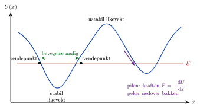



## Potensiell energi

<!-- fra notatene -->
**Potensiell energi** er et *potensial for å utføre arbeid*: energi som er lagret, og som kan bli til bevegelse.

::: {.graa}
$$
\text{tyngdefeltet: } U = m\mathrm{g}h, \qquad \text{fjær: } U = \tfrac12 kx^2
$$
:::

<!-- tillegg: Claude -->
Hvor kommer uttrykkene fra? Løfter du et legeme høyden $h$ med konstant fart, gjør du arbeidet $m\mathrm{g}h$ mot tyngden. Det arbeidet er ikke borte: Det kan hentes ut igjen som bevegelse når legemet faller. Tilsvarende gjør du arbeidet $\tfrac12kx^2$ når du strekker en fjær (se *arbeid og kinetisk energi*). Generelt er endringen i potensiell energi lik minus arbeidet kraften selv gjør: $\Delta U = -W$.

Husk at du **må velge et nullnivå** for høyden $h$. Det er bare *endringen* $\Delta U = m\mathrm{g}\Delta h$ som betyr noe fysisk, så velg det som gjør regningen enklest, ofte bakken eller det laveste punktet.

<!-- tillegg: Claude -->
Arbeidet tyngdekraften eller en fjær gjør, avhenger bare av start- og sluttpunktet, **ikke av veien** imellom. Slike krefter kalles *konservative*, og det er derfor de har en potensiell energi. Friksjon er ikke konservativ: jo lengre vei, jo mer energi tar den.

## Bevaring av mekanisk energi

Når et legeme beveger seg under påvirkning av **bare tyngdekraft og/eller fjærkraft** (i bevegelsesretningen), er den mekaniske energien bevart:

::: {.graa}
$$
E_\text{etter} = E_\text{før}, \qquad E = \tfrac12 mv^2 + m\mathrm{g}h + \tfrac12 kx^2
$$
:::

Normalkrefter som står vinkelrett på bevegelsen, gjør ikke arbeid og ødelegger ikke bevaringen.

::: {.eksempel}
<!-- fra notatene -->
**Eksempel: Ned en bakke.** En person ($M = 75\ \mathrm{kg}$) sklir fra ro ned en bakke uten friksjon. Bakken er $h = 2\ \mathrm{m}$ høy, og står på et platå $H = 4\ \mathrm{m}$ over bakkenivå.

**a)** Hva er den potensielle energien på toppen?\
**b)** Hvor stor fart har personen i bunnen av bakken?

::: {.losning}
**a)** Det kommer an på hva du velger som nullnivå! Med bunnen av bakken som nullnivå er $U = m\mathrm{g}h$; med bakkenivået under platået er $U = m\mathrm{g}(h + H)$.

**b)** $E_\text{før} = m\mathrm{g}h$ og $E_\text{etter} = \frac12 mv^2$, så
$$
v = \sqrt{2\mathrm{g}h} = \sqrt{2\cdot9.81\cdot2}\ \mathrm{m/s} \approx 6\ \mathrm{m/s}
$$
Massen forsvinner, og svaret avhenger ikke av valget av nullnivå.
:::
:::

::: {.eksempel}
<!-- fra notatene -->
**Eksempel: Fjærkanon i tyngdefeltet.** En kule ($m = 0.066\ \mathrm{kg}$) skytes rett opp av en fjærkanon. Fjæra presses sammen $x = 7.5\ \mathrm{cm}$, og kula stiger $h = 121.5\ \mathrm{cm}$ over punktet der den forlater fjæra.

**a)** Finn fjærkonstanten $k$.\
**b)** Finn utgangsfarten $v_0$ på to måter.\
**c)** Hvor langt går kula hvis den skytes med $60^\circ$ fra en kant og lander $0.27\ \mathrm{m}$ lavere?

::: {.losning}
**Fjærkonstanten:** Mellom laveste punkt (1) og toppen (3) er energien bevart, og kula ligger i ro begge steder. Fjærenergien blir til høydeenergi over høyden $h + x$:
$$
\tfrac12 kx^2 = m\mathrm{g}(h + x) \quad\Rightarrow\quad k = \frac{2m\mathrm{g}(h + x)}{x^2} = \frac{2\cdot0.066\cdot9.81\cdot1.29}{0.075^2}\ \mathrm{N/m} \approx 0.30\ \mathrm{kN/m}
$$

**Utgangsfarten, metode 1:** Fra (2) der kula forlater fjæra, til toppen (3): $\frac12 mv_0^2 = m\mathrm{g}h$, så $v_0 = \sqrt{2\mathrm{g}h} \approx 4.9\ \mathrm{m/s}$.

**Metode 2:** Fra (1) til (2): $\frac12 kx^2 = \frac12 mv_0^2 + m\mathrm{g}x$, så $v_0 = \sqrt{kx^2/m - 2\mathrm{g}x} \approx 4.9\ \mathrm{m/s}$. Samme svar. ✓

**Hvor langt går kula skutt på skrå?** Samme kanon skytes med $60^\circ$ fra en kant, og kula lander $0.27\ \mathrm{m}$ lavere. Med $v_{0y} = v_0\sin60^\circ = 4.23\ \mathrm{m/s}$ gir $\tilde y = v_{0y}t - \frac12\mathrm{g}t^2 = -0.27\ \mathrm{m}$ en andregradslikning med positiv løsning $t \approx 0.92\ \mathrm{s}$. Da blir
$$
\tilde x = v_0\cos60^\circ\cdot t \approx 2.26\ \mathrm{m}
$$
Målt i et forsøk: $2.38\ \mathrm{m}$. **Hvorfor?** <!-- tillegg: Claude --> Diskuter: er startpunktet målt riktig, er fjæra helt lik hver gang, og gir høydemålingen av $h$ (og dermed $v_0$) et for lavt tall? Små feil i $v_0$ gir store utslag, fordi kastlengden går som $v_0^2$.
:::
:::

## Når friksjon er med

<!-- tillegg: Claude -->
Gjør også andre krefter arbeid, for eksempel friksjon eller en motor, tar vi med arbeidet deres $W_\text{andre}$:

::: {.graa}
$$
E_\text{etter} = E_\text{før} + W_\text{andre}
$$
:::

Friksjon gjør negativt arbeid, $W_f = -f s$, så den mekaniske energien minker. Energien forsvinner ikke: Den blir til varme i flatene. Den *totale* energien er alltid bevart.

::: {.eksempel}
<!-- tillegg: Claude -->
**Eksempel: Akebrett med friksjon.** Et akebrett ($m = 30\ \mathrm{kg}$ med passasjer) starter fra ro og sklir $40\ \mathrm{m}$ ned en bakke med helning $20^\circ$. Friksjonstallet er $\mu_k = 0.10$. Hvor stor fart har akebrettet i bunnen?

::: {.losning}
Høydeforskjellen er $h = 40\sin20^\circ\ \mathrm{m} = 13.7\ \mathrm{m}$. Normalkraften er $N = m\mathrm{g}\cos20^\circ$, så friksjonsarbeidet er
$$
W_f = -\mu_k m\mathrm{g}\cos20^\circ\cdot s
$$
Energiregnskapet, med nullnivå i bunnen:
$$
\tfrac12mv^2 = m\mathrm{g}h - \mu_k m\mathrm{g}\cos20^\circ\cdot s \quad\Rightarrow\quad v = \sqrt{2\mathrm{g}\,s\,(\sin20^\circ - \mu_k\cos20^\circ)}
$$
$$
v = \sqrt{2\cdot9.81\cdot40\cdot(0.342 - 0.094)}\ \mathrm{m/s} \approx \underline{\underline{14\ \mathrm{m/s}}}
$$
Uten friksjon ville farten vært $\sqrt{2\mathrm{g}h} \approx 16\ \mathrm{m/s}$. Massen forsvinner også her.
:::
:::

## Kraft og energidiagram

<!-- tillegg: Claude -->
For en konservativ kraft langs $x$-aksen er $\Delta U = -F\,\Delta x$ for et lite steg. Andre veien kan vi derfor finne kraften fra den potensielle energien:

::: {.graa}
$$
F(x) = -\frac{\mathrm{d}U}{\mathrm{d}x}
$$
:::

Sjekk: For en fjær er $U = \tfrac12kx^2$, og $F = -kx$, som er Hookes lov. ✓

Et **energidiagram** viser $U(x)$ som en bakke. Den totale energien $E$ er en vannrett linje. Siden $E_K = E - U \ge 0$, kan legemet bare være der kurven ligger *under* linja:

{.tikz-fig style="width:600px"}

::: {.kort}
- **Vendepunkt** Der $U = E$, er $E_K = 0$. Legemet stopper og snur.
- **Stabil likevekt** I en dal er $F = 0$, og et lite dytt gir en kraft tilbake mot bunnen. Legemet svinger.
- **Ustabil likevekt** På en topp er også $F = 0$, men et lite dytt gir en kraft *bort* fra toppen.
:::

## En strategi som alltid virker

<!-- tillegg: Claude -->
::: {.steg}
1. **Tegn** situasjonen før og etter, og velg nullnivå for høyden.
2. **Sjekk kreftene:** Gjør bare tyngde og fjær arbeid, er den mekaniske energien bevart. Ellers tar du med arbeidet fra de andre kreftene.
3. **Sett opp** $E_\text{etter} = E_\text{før} + W_\text{andre}$ med alle energiformene.
4. **Trenger du en kraft** (for eksempel normalkraft), kombiner med Newtons 2. lov.
:::

:::: {.oppgaver}

::: {.oppgave tittel="To bøker på en hylle"}
To bøker med samme masse står på samme hylle. Bok A står over en fryser (høyde $h$ over fryseren), bok B rett over gulvet (høyde $H > h$ over gulvet). Hvilken bok har størst potensiell energi? Bok B faller ($m = 0.80\ \mathrm{kg}$). Hvor stort arbeid har tyngdekraften gjort når farten er $1.0\ \mathrm{m/s}$?

::: {.losning}
<!-- fra notatene -->
For å snakke om potensiell energi må vi velge *ett* nullnivå. Uansett hvilket vi velger, står bøkene like høyt over det, så de har **like stor** potensiell energi. At bok A bare kan falle ned til fryseren, endrer ikke det.

Arbeidet fra tyngden er lik endringen i kinetisk energi (arbeid-energi-setningen):
$$
W_G = \tfrac12 mv^2 - 0 = \tfrac12\cdot0.80\cdot1.0^2\ \mathrm{J} = \underline{\underline{0.40\ \mathrm{J}}}
$$
:::
:::

::: {.oppgave tittel="Akebakken"}
En person på $60\ \mathrm{kg}$ starter fra ro på toppen av en bakke uten friksjon, med høydeforskjell $20\ \mathrm{m}$. Hvor stor fart har personen i bunnen?

::: {.losning}
$m\mathrm{g}h = \frac12 mv^2$, så $v = \sqrt{2\mathrm{g}h} = \sqrt{2\cdot9.81\cdot20}\ \mathrm{m/s} \approx \underline{\underline{20\ \mathrm{m/s}}}$. Massen spiller ingen rolle.
:::
:::

::: {.oppgave tittel="Hoppkanten"}
En person letter fra en hoppkant med vannrett fart $22.1\ \mathrm{m/s}$ og faller $1.5\ \mathrm{m}$. Hvor stor er den totale farten i det hun treffer bakken?

::: {.losning}
<!-- fra notatene; omskrevet av Claude: bruker hele energien i stedet for å dele den i retninger -->
Bare tyngden gjør arbeid, så den mekaniske energien er bevart. Med nullnivå der hun lander:
$$
\tfrac12mv^2 = \tfrac12mv_0^2 + m\mathrm{g}h \quad\Rightarrow\quad v = \sqrt{v_0^2 + 2\mathrm{g}h} = \sqrt{22.1^2 + 2\cdot9.81\cdot1.5}\ \mathrm{m/s} \approx \underline{\underline{23\ \mathrm{m/s}}}
$$
Retningen på startfarten spiller ingen rolle for farten ved landing, bare høydeforskjellen.
:::
:::

::: {.oppgave tittel="Hvor høyt går ballen?"}
En ball kastes med $v_0 = 5.0\ \mathrm{m/s}$ i $30^\circ$ vinkel med bakken. Bruk energibevaring til å finne hvor høyt den går.

::: {.losning}
På toppen er farten bare vannrett, og den vannrette farten $v_0\cos30^\circ$ endres aldri. Energibevaring fra start til topp:
$$
\tfrac12mv_0^2 = \tfrac12m(v_0\cos30^\circ)^2 + m\mathrm{g}h \quad\Rightarrow\quad h = \frac{v_0^2(1 - \cos^2 30^\circ)}{2\mathrm{g}} = \frac{(v_0\sin30^\circ)^2}{2\mathrm{g}}
$$
$$
h = \frac{2.5^2}{2\cdot9.81}\ \mathrm{m} \approx \underline{\underline{0.32\ \mathrm{m}}}
$$
Samme svar som med bevegelseslikningene under *skrått kast*.
:::
:::

::: {.oppgave tittel="Berg-og-dalbane med loop" niva="Middels"}
En vogn starter fra ro i høyden $h$ over bunnen A av en loop med radius $r$. Ingen friksjon.

a) Fra hvilken høyde må vogna slippes for akkurat å komme rundt uten å miste kontakten?

b) Vogna slippes fra $h = 3r$. Finn normalkraften på toppen C, uttrykt ved tyngden $G$.

c) Finn normalkraften midtveis opp, i B.

::: {.losning}
<!-- fra notatene -->
**a)** På grensen er normalkraften på toppen null: $N_C + G = mv_C^2/r$ med $N_C = 0$ gir $v_C^2 = \mathrm{g}r$. Energibevaring fra start til toppen (høyde $2r$):
$$
m\mathrm{g}h = \tfrac12 mv_C^2 + m\mathrm{g}\cdot2r = \tfrac12 m\mathrm{g}r + 2m\mathrm{g}r \quad\Rightarrow\quad \underline{\underline{h = \tfrac52 r}}
$$

**b)** På toppen: $N_C = mv_C^2/r - m\mathrm{g}$, så $N_C/G = v_C^2/(\mathrm{g}r) - 1$. Energi fra $h = 3r$ ned til $2r$: $\frac12 mv_C^2 = m\mathrm{g}r$, så $v_C^2 = 2\mathrm{g}r$. Dermed $N_C/G = 2 - 1$: $\underline{\underline{N_C = G}}$.

**c)** I B peker bare normalkraften inn mot sentrum: $N_B = mv_B^2/r$. B ligger i høyden $r$, så vogna har falt $2r$: $v_B^2 = 4\mathrm{g}r$. Dermed $\underline{\underline{N_B = 4G}}$.
:::
:::

::: {.oppgave tittel="Strikkhopp" niva="Utfordrende"}
En person med masse $m$ faller fra en bro. Strikken er en ideell fjær med fjærstivhet $k$ og lengde $L$ når den ikke er strukket. Når er farten størst, og hvor stor er den?

::: {.losning}
<!-- fra notatene -->
Farten øker så lenge tyngden er større enn fjærkraften. Den er størst der kreftene balanserer: $kx = m\mathrm{g}$, altså $x = m\mathrm{g}/k$ forbi strikkens lengde.

Energibevaring fra broa til dette punktet (falt $L + x$):
$$
m\mathrm{g}(L + x) = \tfrac12 mv_\text{maks}^2 + \tfrac12 kx^2
$$
Setter inn $x = m\mathrm{g}/k$:
$$
v_\text{maks}^2 = 2\mathrm{g}L + \frac{2m\mathrm{g}^2}{k} - \frac{m\mathrm{g}^2}{k} \quad\Rightarrow\quad \underline{\underline{v_\text{maks} = \sqrt{\frac{m\mathrm{g}^2}{k} + 2\mathrm{g}L}}}
$$
:::
:::

::: {.oppgave tittel="Flipperspill" niva="Middels"}
En kule på $80\ \mathrm{g}$ skytes ut av en fjær som er presset sammen $x = 7.0\ \mathrm{cm}$. Flipperspillet heller $\theta = 15^\circ$, og kula sklir uten friksjon. Hvor stor må fjærkonstanten være for at kula akkurat skal nå toppen, $s = 78\ \mathrm{cm}$ fra der den forlater fjæra?

::: {.losning}
<!-- fra notatene -->
Kula løftes langs planet strekningen $s + x$, altså høyden $h = (s + x)\sin\theta$. Energibevaring:
$$
\tfrac12 kx^2 = m\mathrm{g}(s + x)\sin\theta \quad\Rightarrow\quad k = \frac{2m\mathrm{g}(s + x)\sin\theta}{x^2} = \frac{2\cdot0.080\cdot9.81\cdot0.85\cdot\sin15^\circ}{0.070^2}\ \mathrm{N/m} \approx \underline{\underline{70\ \mathrm{N/m}}}
$$
:::
:::

::::
