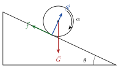

## Kraftmoment og Newtons 2. lov for rotasjon

<!-- fra notatene -->
For massesenteret gjelder fortsatt $\sum\vec F_\text{ytre} = m\vec a_\text{cm}$. Men det som får et legeme til å *rotere*, er ikke kraften alene, men **kraftmomentet**: hvor langt fra aksen kraften virker, og i hvilken retning.

::: {.graa}
$$
\vec\tau = \vec r\times\vec F, \qquad \tau = rF\sin\alpha, \qquad \sum\vec\tau_\text{ytre} = I\vec\alpha
$$
:::

Her er $\alpha$ i $rF\sin\alpha$ vinkelen mellom $\vec r$ og $\vec F$. Bare den delen av kraften som står vinkelrett på armen, gir dreiing.

<!-- tillegg: Claude -->
Derfor sitter håndtaket på en dør langt fra hengslene, og derfor er det lettere å løsne en mutter med en lang nøkkel.

::: {.eksempel}
<!-- fra notatene -->
**Eksempel: Hvordan feste staven?** En maskin gir et bestemt kraftmoment $\tau$. Vi vil gi en metallstav (lengde $L$, radius $R$) størst mulig vinkelakselerasjon. Skal maskinen feste staven ved enden (A), på midten (B) eller rotere den om sin egen lengdeakse (C)?

::: {.losning}
Fra $\alpha = \tau/I$ vil vi ha **minst mulig** $I$:
$$
I_A = \tfrac1{12}ML^2 + M\left(\tfrac L2\right)^2 = \tfrac13 ML^2, \qquad I_B = \tfrac1{12}ML^2, \qquad I_C = \tfrac12 MR^2
$$
$I_A > I_B$ alltid. $I_C < I_B$ når $\frac12 MR^2 < \frac1{12}ML^2$, altså når $L > \sqrt6\,R$. For en vanlig stav (lang og tynn) gir **C** størst vinkelakselerasjon.
:::
:::

::: {.eksempel}
<!-- fra notatene -->
**Eksempel: Stav som faller.** En stav holdes vannrett, festet i den ene enden, og slippes.

Hvor stor blir vinkelakselerasjonen, og akselerasjonen til enden av staven?

::: {.losning}
Tyngden virker i massesenteret, $L/2$ fra aksen:
$$
\tau = M\mathrm{g}\frac{L}{2} = I\alpha = \tfrac13 ML^2\,\alpha \quad\Rightarrow\quad \alpha = \frac{3\mathrm{g}}{2L}
$$
<!-- tillegg: Claude -->
Enden av staven får da akselerasjonen $a = L\alpha = \frac32\mathrm{g}$, *større* enn i fritt fall. Det er derfor et høyt tre som brekker ved roten, kan knekke på veien ned: toppen vil falle raskere enn resten av stammen klarer å følge med.
:::
:::

## Rulling ned et skråplan

{.tikz-fig style="width:420px"}

<!-- fra notatene -->
Et legeme med masse $M$, radius $R$ og treghetsmoment $I$ ruller uten å gli ned et skråplan med helning $\theta$. Vi trenger begge versjonene av Newtons 2. lov:

1. **Langs planet:** $\sum F_x = G\sin\theta - f = Ma_\text{cm}$
2. **Rotasjon om massesenteret:** bare friksjonen har arm, så $fR = I\alpha$
3. **Ren rulling:** $a_\text{cm} = R\alpha$, slik at $f = \dfrac{I}{R^2}a_\text{cm}$

Setter vi 3 inn i 1:
$$
M\mathrm{g}\sin\theta - \frac{I}{R^2}a_\text{cm} = Ma_\text{cm}
$$

::: {.graa}
$$
a_\text{cm} = \frac{\mathrm{g}\sin\theta}{1 + c}, \qquad c = \frac{I}{MR^2}
$$
:::

Jo mer av massen som sitter ytterst (større $c$), jo tregere ruller legemet:

| Legeme | $c$ | $a_\text{cm}$ |
|---|---|---|
| massiv kule | $2/5$ | $\frac57\mathrm{g}\sin\theta$ |
| massiv sylinder (disk) | $1/2$ | $\frac23\mathrm{g}\sin\theta$ |
| hul sylinder (ring) | $1$ | $\frac12\mathrm{g}\sin\theta$ |

Legg merke til at massen og radien forsvinner: alle massive sylindre ruller like fort, uansett størrelse.

::: {.eksempel}
<!-- fra notatene -->
**Eksempel: Disk mot ring.** En massiv sylinder (A) og en hul sylinder (B) med samme masse og radius ruller fra ro ned samme skråplan, høyde $h$ og lengde $s$.

**a)** Hvem kommer først?\
**b)** Hvor stor mekanisk energi har de i bunnen?\
**c)** Hvor stort arbeid gjør tyngden?\
**d)** Hvor stor er friksjonen, og hva gjør den med energien?\
**e)** Hvor stor er farten og translasjonsenergien i bunnen?\
**f)** Hvor stor er rotasjonsenergien?\
**g)** Hva blir summen?

::: {.losning}
**a)** Fra $s = \frac12 at^2$ er $t = \sqrt{2s/a}$. Disken har størst akselerasjon, så **disken kommer først**.

**b)** Mekanisk energi i bunnen: begge har $E = M\mathrm{g}h$, siden energien er bevart.

**c)** Arbeidet fra tyngden: $W = \int\vec G\cdot\mathrm{d}\vec s = M\mathrm{g}\sin\theta\cdot s = M\mathrm{g}h$ for begge.

**d)** Friksjonen er $f = \frac{I}{R^2}a_\text{cm}$: for disken $\frac13 M\mathrm{g}\sin\theta$, for ringen $\frac12 M\mathrm{g}\sin\theta$. Den flytter energi fra translasjon til rotasjon: $\frac13 M\mathrm{g}h$ for disken og $\frac12 M\mathrm{g}h$ for ringen.

**e)** Farten i bunnen fra $v^2 = 2a_\text{cm}s$: disken $v = \sqrt{\frac43\mathrm{g}h}$, ringen $v = \sqrt{\mathrm{g}h}$. Translasjonsenergien blir $\frac23 E_p$ for disken og $\frac12 E_p$ for ringen.

**f)** Rotasjonsenergien med $\omega = v/R$: $\frac13 E_p$ for disken og $\frac12 E_p$ for ringen.

**g)** Summen er $E_p$ i begge tilfeller: energien er bevart. ✓ Ren rulling gir ikke friksjonstap, fordi kontaktpunktet ikke glir.
:::
:::

## Arbeid og effekt ved rotasjon

<!-- fra notatene -->
En kraft som får noe til å rotere, virker langs en bue $\mathrm{d}s = r\,\mathrm{d}\theta$. Bare kraftdelen vinkelrett på armen gjør arbeid, og $F_\perp r = \tau$:

::: {.graa}
$$
W = \int_{\theta_1}^{\theta_2}\tau\,\mathrm{d}\theta, \qquad W = \Delta E_\text{rot} = \tfrac12 I\omega_2^2 - \tfrac12 I\omega_1^2, \qquad P = \tau\omega
$$
:::

::: {.eksempel}
<!-- fra notatene -->
**Eksempel: Treningssykkel.** Du må bruke et kraftmoment $\tau = 50\ \mathrm{N\,m}$ for å holde $30\ \mathrm{km/h}$. Hjulet har radius $35\ \mathrm{cm}$.

**a)** Hvor stor effekt yter du?\
**b)** Hvor lenge må du sykle for å lade en Tesla med $75\ \mathrm{kWh}$?\
**c)** Hvor stort arbeid gjør du per pedalomdreining?\
**d)** Pedalen er $15\ \mathrm{cm}$ fra navet. Hvor stor kraft må du tråkke med? Er det realistisk?

::: {.losning}
**a)** Effekten: $\omega = v/r = (30/3{,}6)/0{,}35\ \mathrm{rad/s} \approx 23{,}8\ \mathrm{rad/s}$, så $P = \tau\omega \approx 1{,}2\ \mathrm{kW}$.

**b)** $75\ \mathrm{kWh}/1{,}2\ \mathrm{kW} \approx 63$ timer.

**c)** Arbeidet per pedalomdreining: $W = \int_0^{2\pi}50\,\mathrm{d}\theta = 2\pi\cdot50\ \mathrm{J} \approx 0{,}31\ \mathrm{kJ}$.

**d)** $F = \tau/r = 50/0{,}15\ \mathrm{N} \approx 0{,}33\ \mathrm{kN}$, som tilsvarer tyngden av $34\ \mathrm{kg}$. Realistisk?
:::
:::

:::: {.oppgaver}

::: {.oppgave tittel="Kraftmoment"}
En kraft $F = 400\ \mathrm{N}$ virker i en arm $r = 0{,}5\ \mathrm{m}$, med vinkelen $\theta = 30^\circ$ mellom arm og kraft. Hvor stort er kraftmomentet om punktet?

::: {.losning}
$\tau = rF\sin\theta = 0{,}5\cdot400\cdot\sin30^\circ\ \mathrm{N\,m} = 100\ \mathrm{N\,m}$. Med ett signifikant siffer i armen: $\underline{\underline{0{,}1\ \mathrm{kN\,m}}}$.
:::
:::

::: {.oppgave tittel="Vinsjen"}
En vinsj med radius $R = 50\ \mathrm{cm}$ trekker en buss opp fra grøfta med konstant kraft $F = 30\ \mathrm{kN}$. Den snurrer 5 omdreininger med vinkelfart $\omega = 1{,}1\ \mathrm{s^{-1}}$.

a) Hvor stort arbeid gjør vinsjen? b) Hva er effekten?

::: {.losning}
**a)** $\tau = FR$ er konstant, og $\Delta\theta = 5\cdot2\pi = 10\pi$:
$$
W = \tau\,\Delta\theta = FR\cdot10\pi = 30\cdot10^3\cdot0{,}50\cdot10\pi\ \mathrm{J} \approx \underline{\underline{0{,}47\ \mathrm{MJ}}}
$$
Det er det samme som kraft ganger strekning, $F\cdot2\pi R\cdot5$.

**b)** $P = \tau\omega = FR\omega = 30\cdot10^3\cdot0{,}50\cdot1{,}1\ \mathrm{W} \approx \underline{\underline{16\ \mathrm{kW}}}$
:::
:::

::: {.oppgave tittel="Jo-jo" niva="Middels"}
En jo-jo er en massiv sylinder (masse $M$, radius $R$) med en tråd tvunnet rundt. Tråden holdes i ro, og sylinderen faller mens tråden ruller av uten å gli.

a) Tegn kreftene. b) Finn akselerasjonen. c) Finn snordraget.

::: {.losning}
**a)** Tyngden $\vec G$ i massesenteret, og snordraget $\vec S$ opp, i avstand $R$ fra sentrum.

**b)** Massesenteret (positiv nedover): $M\mathrm{g} - S = Ma$. Rotasjon: $SR = I\alpha = \frac12 MR^2\cdot\frac aR$, så $S = \frac12 Ma$. Innsatt:
$$
M\mathrm{g} - \tfrac12 Ma = Ma \quad\Rightarrow\quad \underline{\underline{a = \tfrac23\mathrm{g}}}
$$

**c)** $S = \frac12 Ma = \underline{\underline{\tfrac13 M\mathrm{g}}}$
:::
:::

::: {.oppgave tittel="Snøballen"}
En snøball ruller uten å gli ned en bakke med konstant helning og blir større underveis: $R = R(t)$. Snøballen er en homogen kule. Hva skjer med akselerasjonen?

A. Den avtar. B. Den øker. C. Den er konstant. D. Det avhenger av $R(t)$. E. Den øker lineært.

::: {.losning}
<!-- fra notatene -->
For en homogen kule er $c = I/(MR^2) = \frac25$ uansett størrelse, så
$$
a = \frac{\mathrm{g}\sin\theta}{1 + 2/5} = \tfrac57\mathrm{g}\sin\theta
$$
som ikke avhenger av $R$ eller $M$. Akselerasjonen er **konstant (C)**. (Vi ser bort fra at snøballen må «plukke opp» snø i ro, som i virkeligheten bremser den litt.)
:::
:::

::: {.oppgave tittel="Kule i loop" niva="Utfordrende"}
En massiv kule (masse $m$, radius $r \ll R$) ruller uten å gli inn i en loop med radius $R$. Den starter fra ro i høyden $h = 3R$ over bunnen.

a) Hva er farten i bunnen av loopen?

b) Hva er normalkraften i bunnen, uttrykt ved tyngden $G$?

c) Hva er den minste starthøyden for at kula skal komme rundt?

::: {.losning}
<!-- fra notatene -->
**a)** Energibevaring med både translasjon og rotasjon, og $v = r\omega$:
$$
m\mathrm{g}h = \tfrac12 mv^2 + \tfrac12 I\left(\frac vr\right)^2 = \tfrac12 mv^2\left(1 + \frac{I}{mr^2}\right) = \tfrac12 mv^2\cdot\tfrac75
$$
$$
v^2 = \frac{10\mathrm{g}h}{7} = \frac{30}{7}\mathrm{g}R \quad\Rightarrow\quad \underline{\underline{v = \sqrt{\tfrac{30}{7}\mathrm{g}R}}}
$$

**b)** I bunnen: $N - G = mv^2/R = \frac{30}{7}m\mathrm{g}$, så $\underline{\underline{N = \tfrac{37}{7}G}} \approx 5{,}3G$.

**c)** På toppen må $N \ge 0$. På grensen er $m\mathrm{g} = mv_3^2/R$, så $v_3^2 = \mathrm{g}R$. Energien fra start til toppen (høyden $\Delta h$ over toppen):
$$
m\mathrm{g}\Delta h = \tfrac12 mv_3^2\cdot\tfrac75 = \tfrac{7}{10}m\mathrm{g}R \quad\Rightarrow\quad \Delta h = \tfrac{7}{10}R
$$
Toppen er $2R$ over bunnen, så $\underline{\underline{h_\text{min} = 2{,}7R}}$. (For en gli-vogn uten rotasjon var svaret $2{,}5R$: rotasjonen krever litt ekstra energi.)
:::
:::

::::
