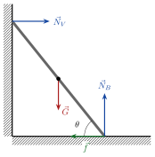

<!-- video: kommer (videoer/ingeniorfysikk/06-04-statisk-likevekt) -->
{fig-alt="Video kommer"}

<!-- tillegg: Claude -->
Broer, kraner, hyller og stillaser skal stå helt i ro. For en ingeniør er det derfor like viktig å vite når *ingenting* skjer, som å regne på bevegelse. Et legeme i ro må verken begynne å flytte seg eller å rotere.

## To betingelser

Et stivt legeme er i **statisk likevekt** når det står i ro og fortsetter å stå i ro. Da må massesenteret ikke akselerere, og legemet må ikke begynne å rotere:

::: {.graa}
$$
\sum\vec F = \vec 0 \qquad\text{og}\qquad \sum\vec\tau = \vec 0
$$
:::

Den første er Newtons 2. lov med $\vec a_\text{cm} = \vec 0$ (se *massesenter*). Den andre er Newtons 2. lov for rotasjon med $\alpha = 0$ (se *kraftmoment*). I planet gir det tre likninger: $\sum F_x = 0$, $\sum F_y = 0$ og $\sum\tau = 0$.

::: {.callout-tip title="Velg aksen selv"}
Er kraftsummen null, er kraftmomentsummen den samme om *hvilket som helst* punkt. Velg derfor aksen der den ukjente kraften du *ikke* vil finne, angriper. Den får arm null og forsvinner fra momentlikningen.
:::

Tyngden virker som om den angriper i massesenteret (tyngdepunktet). Det bruker vi i alle oppgavene under.

## Strategi

::: {.steg}
1. **Tegn kraftdiagram** for legemet, med angrepspunktet til hver kraft. Tyngden tegnes i massesenteret.
2. **Velg akse** for kraftmomentene, helst der en ukjent kraft angriper.
3. **Sett opp** $\sum F_x = 0$, $\sum F_y = 0$ og $\sum\tau = 0$ (mot klokka positivt).
4. **Løs** likningssettet, og sjekk at fortegnene gir mening.
:::

::: {.eksempel}
<!-- tillegg: Claude -->
**Eksempel: Vippa.** To barn sitter på en vippe som er $4.0\ \mathrm{m}$ lang og har oppheng på midten. Det ene barnet ($30\ \mathrm{kg}$) sitter helt ute i enden. Hvor må det andre barnet ($40\ \mathrm{kg}$) sitte for at vippa skal balansere? Hvor stor kraft virker i opphenget? Vippa veier $20\ \mathrm{kg}$.

::: {.losning}
<!-- tillegg: Claude -->
Akse i opphenget. Vippas egen tyngde angriper der og gir ikke kraftmoment, og det gjør heller ikke kraften fra opphenget. Barn 1 sitter $2.0\ \mathrm{m}$ til venstre og gir moment mot klokka, barn 2 sitter $d$ til høyre og gir moment med klokka:
$$
\sum\tau = 30\mathrm{g}\cdot2.0\ \mathrm{m} - 40\mathrm{g}\cdot d = 0 \quad\Rightarrow\quad d = \frac{30\cdot2.0}{40}\ \mathrm{m} = \underline{\underline{1.5\ \mathrm{m}}}
$$
Loddrett: Opphenget må bære alt, $F = (30 + 40 + 20)\cdot9.81\ \mathrm{N} \approx \underline{\underline{0.88\ \mathrm{kN}}}$.
:::
:::

::: {.eksempel}
<!-- tillegg: Claude -->
**Eksempel: Stigen mot veggen.** En stige med lengde $L$ og masse $m$ står mot en glatt vegg (ingen friksjon mot veggen) og danner vinkelen $\theta$ med gulvet. Hvor stort må friksjonstallet mot gulvet minst være for at stigen ikke skal skli?

{.tikz-fig style="width:330px"}

::: {.losning}
Kreftene: tyngden $G = m\mathrm{g}$ midt på stigen, normalkraften $N_V$ fra veggen (vannrett, glatt vegg), normalkraften $N_B$ fra gulvet og friksjonen $f$ langs gulvet, mot veggen.

**Krefter:** Vannrett: $f = N_V$. Loddrett: $N_B = m\mathrm{g}$.

**Kraftmoment** om foten av stigen, der både $N_B$ og $f$ angriper (de forsvinner). Tyngden har arm $\tfrac L2\cos\theta$, veggkraften har arm $L\sin\theta$:
$$
N_V\,L\sin\theta - m\mathrm{g}\,\tfrac L2\cos\theta = 0 \quad\Rightarrow\quad N_V = \frac{m\mathrm{g}}{2\tan\theta}
$$
Stigen står hvis friksjonen som trengs, ikke er større enn $\mu_s N_B$:
$$
\frac{m\mathrm{g}}{2\tan\theta} \le \mu_s m\mathrm{g} \quad\Rightarrow\quad \underline{\underline{\mu_s \ge \frac{1}{2\tan\theta}}}
$$
Med $\theta = 70^\circ$ trengs $\mu_s \ge 0.18$, men med $\theta = 45^\circ$ trengs $\mu_s \ge 0.50$. En bratt stige er tryggere, så lenge den ikke tipper bakover.
:::
:::

::: {.eksempel}
<!-- tillegg: Claude -->
**Eksempel: Skiltet på bommen.** En vannrett bom med lengde $2.0\ \mathrm{m}$ og masse $10\ \mathrm{kg}$ er festet med et hengsel i en vegg. Et skilt på $25\ \mathrm{kg}$ henger i enden. En vaier fra enden av bommen går opp til veggen og danner $30^\circ$ med bommen. Finn snordraget i vaieren og kraften fra hengselet.

::: {.losning}
Akse i hengselet, så hengselkraften forsvinner. Bommens tyngde angriper midt på ($1.0\ \mathrm{m}$), skiltet og vaieren i enden ($2.0\ \mathrm{m}$). Bare den loddrette delen av snordraget, $S\sin30^\circ$, har arm langs bommen:
$$
S\sin30^\circ\cdot2.0 - 10\mathrm{g}\cdot1.0 - 25\mathrm{g}\cdot2.0 = 0 \quad\Rightarrow\quad S = \frac{(10 + 50)\cdot9.81}{2.0\cdot0.50}\ \mathrm{N} \approx \underline{\underline{0.59\ \mathrm{kN}}}
$$
Hengselkraften $\vec H = [H_x,\ H_y]$ fra kraftsummen. Vaieren drar mot veggen (negativ $x$) og opp:
$$
H_x = S\cos30^\circ \approx 510\ \mathrm{N}, \qquad H_y = (10 + 25)\mathrm{g} - S\sin30^\circ \approx 343 - 294\ \mathrm{N} = 49\ \mathrm{N}
$$
Hengselet dytter bommen ut fra veggen med omtrent $\underline{\underline{0.51\ \mathrm{kN}}}$ og litt opp. Vaieren må tåle mye mer enn tyngden av skiltet ($245\ \mathrm{N}$), fordi den er så flat.
:::
:::

## Tipping

<!-- tillegg: Claude -->
Et legeme som står på et underlag, tipper når tyngdepunktet kommer utenfor støtteflaten. Så lenge loddlinja gjennom massesenteret treffer innenfor flaten, gir tyngden et kraftmoment som retter det opp igjen. Derfor har kraner motvekter, og derfor står en lastebil med lav last stødigere i svingene.

:::: {.oppgaver}

::: {.oppgave tittel="Bjelken på to støtter"}
<!-- tillegg: Claude -->
En bjelke på $6.0\ \mathrm{m}$ og $200\ \mathrm{kg}$ ligger på to støtter, én i hver ende. En person på $80\ \mathrm{kg}$ står $1.5\ \mathrm{m}$ fra venstre ende. Hvor stor kraft tar hver støtte?

::: {.losning}
Akse i venstre støtte. Bjelken har tyngdepunkt i $3.0\ \mathrm{m}$, personen i $1.5\ \mathrm{m}$, og høyre støtte $F_H$ i $6.0\ \mathrm{m}$:
$$
F_H\cdot6.0 - 200\mathrm{g}\cdot3.0 - 80\mathrm{g}\cdot1.5 = 0 \quad\Rightarrow\quad F_H = \frac{(600 + 120)\cdot9.81}{6.0}\ \mathrm{N} \approx \underline{\underline{1.2\ \mathrm{kN}}}
$$
Loddrett: $F_V = (200 + 80)\mathrm{g} - F_H = 2747 - 1177\ \mathrm{N} \approx \underline{\underline{1.6\ \mathrm{kN}}}$. Den nærmeste støtten tar mest, som ventet.
:::
:::

::: {.oppgave tittel="Underarmen" niva="Middels"}
<!-- tillegg: Claude -->
Du holder et lodd på $5.0\ \mathrm{kg}$ i hånda med underarmen vannrett. Albuen er aksen. Bicepsmuskelen fester seg $4.0\ \mathrm{cm}$ fra albuen og drar rett opp. Loddet er $35\ \mathrm{cm}$ fra albuen, og underarmen ($1.5\ \mathrm{kg}$) har tyngdepunkt $15\ \mathrm{cm}$ fra albuen. Hvor stor kraft må bicepsen gi?

::: {.losning}
Kraftmoment om albuen:
$$
F_B\cdot0.040 - 1.5\mathrm{g}\cdot0.15 - 5.0\mathrm{g}\cdot0.35 = 0 \quad\Rightarrow\quad F_B = \frac{(0.225 + 1.75)\cdot9.81}{0.040}\ \mathrm{N} \approx \underline{\underline{0.48\ \mathrm{kN}}}
$$
Det er nesten ti ganger tyngden av loddet. Muskelen har kort arm, så den må dra hardt, men til gjengjeld beveger hånda seg mye når muskelen trekker seg litt sammen.
:::
:::

::: {.oppgave tittel="Når tipper kassen?" niva="Middels"}
<!-- tillegg: Claude -->
En kasse med bredde $b$ og høyde $h$ står på et skråplan, og friksjonen er stor nok til at den ikke glir. Planet vippes gradvis brattere. Ved hvilken vinkel tipper kassen?

::: {.losning}
Kassen tipper når loddlinja gjennom tyngdepunktet går gjennom det nederste hjørnet. Tyngdepunktet ligger $h/2$ over bunnen og $b/2$ fra hjørnet, målt langs planet. Loddlinja treffer hjørnet når
$$
\tan\theta = \frac{b/2}{h/2} = \frac{b}{h} \quad\Rightarrow\quad \underline{\underline{\theta = \arctan\frac bh}}
$$
En høy, smal kasse ($b \ll h$) tipper ved liten vinkel.
:::
:::

::::
