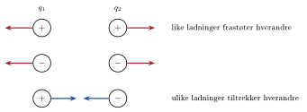

## To typer naturkrefter

<!-- fra notatene -->
**Gravitasjon** virker mellom masser. Massen er gravitasjonens «ladning», og den måles i kilogram. Kraften er alltid **tiltrekkende**:
$$
G = \gamma\frac{Mm}{r^2} \approx m\mathrm{g} \quad\text{(nær jordoverflaten)}
$$

**Elektriske krefter** virker mellom **elektriske ladninger**. Men i motsetning til masse finnes ladning med to fortegn, **positiv** og **negativ**. Derfor kan den elektriske kraften både tiltrekke og frastøte:

{.tikz-fig style="width:560px"}

::: {.callout-note title="Definisjon: Elektrisk ladning"}
<!-- fra notatene -->
Elektrisk ladning $q$ er egenskapen som gjør at et legeme påvirkes av og lager elektriske krefter. Ladning kan være **positiv eller negativ** og måles i **coulomb** ($\mathrm{C}$).
:::

<!-- tillegg: Claude -->
Like ladninger frastøter hverandre, ulike ladninger tiltrekker hverandre. Kraften virker alltid langs linja mellom ladningene, og etter Newtons 3. lov er kreftene på de to ladningene like store og motsatt rettet.

## Ladning er bevart

::: {.graa}
<!-- fra notatene -->
**Ladning er bevart i et lukket system.** Den totale ladningen kan ikke endres; ladning kan bare flyttes fra ett sted til et annet.
:::

<!-- tillegg: Claude -->
Gnir du en ballong mot håret, lages det ingen ny ladning. Elektroner flyttes fra håret til ballongen, så ballongen blir negativ og håret like mye positivt. Summen er fortsatt null.

## Elementærladningen

<!-- fra notatene -->
Det finnes en **minste ladning** i naturen, **elementærladningen**:

::: {.graa}
$$
\mathrm{e} = 1{,}60\cdot10^{-19}\ \mathrm{C}
$$
:::

Et proton har ladningen $+\mathrm{e}$, og et elektron har ladningen $-\mathrm{e}$. All ladning vi møter opptrer som et **heltallsmultiplum** av elementærladningen:
$$
q = n\cdot\mathrm{e}, \qquad n = 0, \pm1, \pm2, \dots
$$

<!-- tillegg: Claude -->
Vi sier at ladningen er **kvantisert**. Fordi $\mathrm{e}$ er så liten, merker vi det ikke i hverdagen: én coulomb tilsvarer omtrent $6{,}2\cdot10^{18}$ elementærladninger.

::: {.eksempel}
<!-- fra notatene -->
**Eksempel: Overskudd av elektroner.** En gjenstand har et overskudd på 200 millioner milliarder elektroner. Hvor stor er ladningen?

::: {.losning}
Antallet er
$$
n = 200\cdot10^{6}\cdot10^{9} = 2{,}00\cdot10^{17}
$$
Hvert elektron har ladningen $-\mathrm{e} = -1{,}60\cdot10^{-19}\ \mathrm{C}$, så
$$
Q = n\cdot(-\mathrm{e}) = 2{,}00\cdot10^{17}\cdot(-1{,}60\cdot10^{-19}\ \mathrm{C}) = \underline{\underline{-32{,}0\ \mathrm{mC}}}
$$
<!-- tillegg: Claude -->
Det høres ut som svært mange elektroner, men $32\ \mathrm{mC}$ er likevel en ganske stor ladning å samle på én gjenstand. Til sammenligning er ladningen på en gnidd ballong typisk noen få nanocoulomb.
:::
:::

:::: {.oppgaver}

::: {.oppgave tittel="Hvor mange elektroner?"}
<!-- tillegg: Claude -->
En liten metallkule har ladningen $Q = -4{,}8\ \mathrm{nC}$. Hvor mange elektroner for mye har kula?

::: {.losning}
$$
n = \frac{Q}{-\mathrm{e}} = \frac{-4{,}8\cdot10^{-9}\ \mathrm{C}}{-1{,}60\cdot10^{-19}\ \mathrm{C}} = \underline{\underline{3{,}0\cdot10^{10}}}
$$
:::
:::

::: {.oppgave tittel="Kan ladningen være slik?"}
<!-- tillegg: Claude -->
En elev påstår at en oljedråpe har ladningen $q = 2{,}4\cdot10^{-19}\ \mathrm{C}$. Hvorfor kan det ikke stemme?

::: {.losning}
All ladning er et heltallsmultiplum av $\mathrm{e}$. Men
$$
\frac{q}{\mathrm{e}} = \frac{2{,}4\cdot10^{-19}}{1{,}60\cdot10^{-19}} = 1{,}5
$$
er ikke et heltall. Ladningen må være $1{,}6\cdot10^{-19}\ \mathrm{C}$, $3{,}2\cdot10^{-19}\ \mathrm{C}$ eller et annet multiplum, så målingen eller utregningen må være feil. (Det var nettopp slike målinger på oljedråper Millikan brukte for å vise at ladning er kvantisert.)
:::
:::

::: {.oppgave tittel="Bevaring av ladning"}
<!-- tillegg: Claude -->
To like metallkuler har ladningene $q_1 = +6{,}0\ \mathrm{nC}$ og $q_2 = -2{,}0\ \mathrm{nC}$. De berører hverandre og trekkes fra hverandre igjen. Hvilken ladning har hver kule etterpå?

::: {.losning}
Total ladning er bevart: $Q = 6{,}0\ \mathrm{nC} + (-2{,}0\ \mathrm{nC}) = 4{,}0\ \mathrm{nC}$. Kulene er like, så ladningen fordeler seg likt:
$$
q_1' = q_2' = \frac{4{,}0\ \mathrm{nC}}{2} = \underline{\underline{2{,}0\ \mathrm{nC}}}
$$
:::
:::

::::
