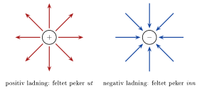
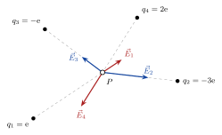

## Hva er et felt?



<!-- tillegg: Claude -->
Et **vektorfelt** gir en vektor i hvert punkt i rommet. Et værkart med vindpiler er et godt eksempel: i hvert punkt viser en pil hvilken vei og hvor kraftig det blåser. Det elektriske feltet er på samme måte en pil i hvert punkt, som forteller hvilken kraft en ladning *ville fått* om den ble plassert der.

## Elektrisk felt fra en punktladning



<!-- fra notatene -->
Coulombs lov sier hvordan to ladninger virker på hverandre. Nå deler vi opp tenkemåten i to trinn: ladningen $q$ lager et **elektrisk felt** $\vec E$ rundt seg, og en annen ladning $Q$ som befinner seg i feltet, kjenner en kraft.

::: {.callout-note title="Definisjon: Elektrisk felt fra en punktladning"}
<!-- fra notatene -->
Det elektriske feltet $\vec E$ generert av ladningen $q$ er
$$
\vec E = k\frac{q}{r^2}\,\hat r,
$$
der $\hat r$ er enhetsvektoren som peker *fra* $q$ og ut til punktet vi ser på. Enheten er $\mathrm{N/C}$.
:::

<!-- fra notatene -->
En ladning $Q$ som er i dette feltet, opplever da kraften

::: {.graa}
$$
\vec F = Q\,\vec E
$$
:::

<!-- tillegg: Claude -->
Sammenlign med tyngdekraften $\vec G = m\vec{\mathrm g}$: Tyngdeakselerasjonen $\vec{\mathrm g}$ er gravitasjonsfeltet, og massen $m$ er «ladningen» som kjenner det. På samme måte er $\vec E$ det elektriske feltet, og $Q$ er ladningen som kjenner det.

### Retningen på feltet

<!-- fra notatene -->
Feltet fra en **positiv** ladning peker rett **ut** fra ladningen. Feltet fra en **negativ** ladning peker rett **inn** mot den:

{.tikz-fig style="width:520px"}

<!-- tillegg: Claude -->
Retningen på $\vec E$ er altså retningen en *positiv* testladning ville blitt dyttet. En negativ ladning $Q$ kjenner en kraft $\vec F = Q\vec E$ som peker motsatt vei av feltet.

### Hvor sterkt er feltet?

<!-- fra notatene -->
Feltet avtar med kvadratet av avstanden: $E \propto 1/r^2$. Dobler du avstanden, blir feltet en firedel så sterkt.

## Superposisjon av felt

<!-- fra notatene -->
Dersom $\vec E_1$ er det elektriske feltet som genereres av ladning $q_1$, og $\vec E_2$ er feltet fra $q_2$ og så videre, er det totale feltet

::: {.graa}
$$
\vec E = \vec E_1 + \vec E_2 + \dots + \vec E_N = \sum_{i=1}^{N}\vec E_i
$$
:::

Dette er det totale elektriske feltet som genereres av ladningsfordelingen
$$
Q = q_1 + q_2 + \dots + q_N = \sum_{i=1}^{N} q_i
$$

<!-- tillegg: Claude -->
Merk at vi legger sammen **vektorer**, ikke tall. To felt som er like sterke, men peker motsatt vei, opphever hverandre.

::: {.eksempel}
<!-- fra notatene -->
**Eksempel: Ladninger, krefter og felt.** Fire ladninger $q_1 = \mathrm{e}$, $q_2 = -3\mathrm{e}$, $q_3 = -\mathrm{e}$ og $q_4 = 2\mathrm{e}$ ligger rundt et punkt $P$, der vi plasserer ladningen $Q = +\mathrm{e}$.

**a)** Tegn inn vektorene $\vec r_1, \vec r_2, \dots$\
**b)** Tegn inn feltene $\vec E_1, \vec E_2, \dots$ i punktet $P$.\
**c)** Tegn inn kreftene $\vec F_1, \vec F_2, \dots$ på $Q$.\
**d)** Hva ville forandret seg om $Q = -\mathrm{e}$?

::: {.losning}
**a)** Alle vektorene $\vec r_i$ tegnes *fra* ladningen $q_i$ *inn mot* punktet $P$ der vi skal finne feltet.

**b)** Fortegnet på den feltgenererende ladningen avgjør retningen, siden $\vec E_i = k\dfrac{q_i}{r_i^2}\hat r_i$:

{.tikz-fig style="width:440px"}

Feltene fra de positive ladningene ($q_1$ og $q_4$) peker bort fra dem, og feltene fra de negative ($q_2$ og $q_3$) peker mot dem. <!-- tillegg: Claude --> Lengdene er tegnet omtrentlig: $\vec E_2$ er størst fordi $q_2$ har størst ladning og ligger nærmest.

**c)** Kraften på $Q$ fra hver ladning er
$$
\vec F_i = k\frac{q_i\,Q}{r_i^2}\,\hat r_i = Q\,\vec E_i
$$
Med $Q = +\mathrm{e}$ peker hver kraft **samme vei** som det tilhørende feltet.

**d)** Svarene i **a)** og **b)** ville vært uendret: feltet avhenger bare av ladningene som lager det, ikke av ladningen vi plasserer i $P$. Men alle kreftene ville pekt **motsatt** vei.
:::
:::

::: {.eksempel}
<!-- fra notatene -->
**Eksempel: Ladninger langs en rett linje.** Ladningen $q_1 = -\mathrm{e}$ ligger i $x = -L$, og $q_2 = +\mathrm{e}$ ligger i $x = 0$. Punktet $P_1$ ligger midt mellom dem, i $x = -L/2$, og $P_2$ ligger i $x = L/2$.

{.tikz-fig style="width:520px"}

**a)** Hva er det elektriske feltet i $P_1$ og $P_2$?\
**b)** Hva er kraften på en ladning $Q = 2\mathrm{e}$ som plasseres i $P_1$? Enn om den plasseres i $P_2$?

::: {.losning}
**a)** Vi bruker $\vec E_i = k\dfrac{q_i}{r_i^2}\hat r_i$ for hver ladning og legger sammen: $\vec E = \vec E_1 + \vec E_2$.

**Punkt $P_1$:** Avstanden til begge ladningene er $L/2$. Enhetsvektoren fra $q_1$ til $P_1$ peker mot høyre, $\hat r_1 = \hat e_x$, mens enhetsvektoren fra $q_2$ til $P_1$ peker mot venstre, $\hat r_2 = -\hat e_x$. **NB!** Pass på retningen på enhetsvektorene.
$$
\vec E = k\frac{-\mathrm{e}}{(L/2)^2}\,\hat e_x + k\frac{\mathrm{e}}{(L/2)^2}\,(-\hat e_x) = \underline{\underline{-\frac{8k\mathrm{e}}{L^2}\,\hat e_x}}
$$
Begge feltene peker mot venstre: bort fra $q_2$ (positiv) og mot $q_1$ (negativ).

**Punkt $P_2$:** Nå ligger begge ladningene til venstre, så $\hat r_1 = \hat r_2 = \hat e_x$. Avstanden til $q_1$ er $3L/2$, og til $q_2$ er den $L/2$:
$$
\vec E = k\frac{-\mathrm{e}}{(3L/2)^2}\,\hat e_x + k\frac{\mathrm{e}}{(L/2)^2}\,\hat e_x = \frac{k\mathrm{e}}{L^2}\left(-\frac49 + 4\right)\hat e_x = \underline{\underline{\frac{32}{9}\,\frac{k\mathrm{e}}{L^2}\,\hat e_x}}
$$
<!-- tillegg: Claude: notatene har 2/5 her; rettet til 32/9 – må sjekkes av fagansvarlig -->
Feltet peker mot høyre: $q_2$ er nærmest og dominerer.

**b)** Kraften er $\vec F = Q\vec E = 2\mathrm{e}\,\vec E$.

- I $P_1$: $\displaystyle \vec F = \underline{\underline{-\frac{16k\mathrm{e}^2}{L^2}\,\hat e_x}}$
- I $P_2$: $\displaystyle \vec F = \underline{\underline{\frac{64}{9}\,\frac{k\mathrm{e}^2}{L^2}\,\hat e_x}}$
:::
:::

:::: {.oppgaver}

::: {.oppgave tittel="Feltet fra en punktladning"}
<!-- tillegg: Claude -->
Hvor sterkt er det elektriske feltet $0{,}50\ \mathrm{m}$ fra en punktladning på $q = +3{,}0\ \mathrm{nC}$? Hvilken kraft får et elektron som plasseres der, og hvilken vei peker den?

::: {.losning}
$$
E = k\frac{q}{r^2} = 8{,}99\cdot10^{9}\cdot\frac{3{,}0\cdot10^{-9}}{(0{,}50)^2}\ \mathrm{N/C} \approx \underline{\underline{1{,}1\cdot10^{2}\ \mathrm{N/C}}}
$$
Kraften på elektronet:
$$
F = \mathrm{e}E = 1{,}60\cdot10^{-19}\cdot108\ \mathrm{N} \approx \underline{\underline{1{,}7\cdot10^{-17}\ \mathrm{N}}}
$$
Feltet peker bort fra den positive ladningen, men elektronet er negativt, så kraften peker **mot** ladningen (tiltrekning).
:::
:::

::: {.oppgave tittel="Der feltet er null" niva="Middels"}
<!-- tillegg: Claude -->
Ladningen $q_1 = +\mathrm{e}$ ligger i $x = 0$ og $q_2 = +4\mathrm{e}$ ligger i $x = d$. Hvor på $x$-aksen er det elektriske feltet null?

::: {.losning}
Feltet kan bare bli null mellom ladningene, der feltene peker motsatt vei. Med punktet i $x$:
$$
k\frac{\mathrm{e}}{x^2} = k\frac{4\mathrm{e}}{(d - x)^2} \quad\Rightarrow\quad d - x = 2x \quad\Rightarrow\quad x = \underline{\underline{\frac d3}}
$$
Punktet ligger nærmest den minste ladningen, slik vi skulle vente.
:::
:::

::: {.oppgave tittel="Kraft eller felt?"}
<!-- tillegg: Claude -->
I et punkt $P$ er det elektriske feltet $\vec E = 2{,}0\cdot10^{4}\ \mathrm{N/C}$ rettet nedover. Hvilken kraft får **a)** et proton og **b)** et elektron i $P$? **c)** Hvilken av dem får størst akselerasjon, og hvor mye større?

::: {.losning}
**a)** $F = \mathrm{e}E = 1{,}60\cdot10^{-19}\cdot2{,}0\cdot10^{4}\ \mathrm{N} = \underline{\underline{3{,}2\cdot10^{-15}\ \mathrm{N}}}$, nedover (samme vei som feltet).

**b)** Like stor kraft, men **oppover** fordi ladningen er negativ.

**c)** $a = F/m$, og kreftene er like store. Elektronet er mye lettere:
$$
\frac{a_\mathrm{e}}{a_\mathrm{p}} = \frac{m_\mathrm{p}}{m_\mathrm{e}} = \frac{1{,}67\cdot10^{-27}}{9{,}11\cdot10^{-31}} \approx 1800
$$
Elektronet får omtrent 1800 ganger større akselerasjon.
:::
:::

::::
