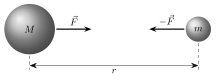
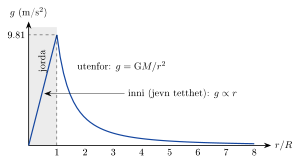
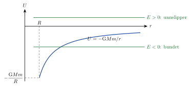

<!-- video: kommer (videoer/ingeniorfysikk/07-01-gravitasjonsloven) -->
{fig-alt="Video kommer"}

<!-- tillegg: Claude -->
Ifølge historien fikk Newton ideen da han så et eple falle. Han spurte: Hvis jorda trekker på eplet, trekker den også på månen? Svaret er ja. Den samme kraften som får ting til å falle, holder månen i bane rundt jorda og jorda i bane rundt sola. Det var første gang noen viste at de samme lovene gjelder på jorda og i verdensrommet.

## Gravitasjonsloven

{.tikz-fig style="width:420px"}

::: {.callout-important title="Newtons gravitasjonslov"}
<!-- tillegg: Claude -->
To punktmasser $M$ og $m$ i avstanden $r$ trekker på hverandre med en kraft med størrelse
$$
F = \mathrm{G}\frac{Mm}{r^2}
$$
der $\mathrm{G} = 6.674\cdot10^{-11}\ \mathrm{N\,m^2/kg^2}$ er **gravitasjonskonstanten**. Kraften virker langs linja mellom massene og er alltid tiltrekkende.
:::

<!-- tillegg: Claude -->
Tre ting å legge merke til:

::: {.kort}
- **Kraftpar.** Kraften fra $M$ på $m$ er like stor som kraften fra $m$ på $M$, med motsatt retning. Det følger Newtons tredje lov. Eplet trekker på jorda like hardt som jorda trekker på eplet, men jorda er så tung at den nesten ikke merker det.
- **Omvendt kvadrat.** Dobler du avstanden, blir kraften fire ganger mindre. Samme $1/r^2$-avhengighet har Coulombs lov for elektriske ladninger.
- **Kuler som punkter.** For en kule med symmetrisk massefordeling virker kraften utenfor som om all massen satt i sentrum. Derfor kan vi bruke loven for planeter, så lenge $r$ måles fra sentrum.
:::

<!-- tillegg: Claude -->
$\mathrm{G}$ er svært liten. Gravitasjonskraften mellom to mennesker på $75\ \mathrm{kg}$ og $60\ \mathrm{kg}$ én meter fra hverandre er bare $3\cdot10^{-7}\ \mathrm{N}$. Vi merker gravitasjon bare når minst én av massene er enorm, som en planet.

::: {.eksempel}
<!-- tillegg: Claude -->
**Eksempel: Jorda og månen.** Hvor stor er gravitasjonskraften mellom jorda ($M = 5.97\cdot10^{24}\ \mathrm{kg}$) og månen ($m = 7.35\cdot10^{22}\ \mathrm{kg}$)? Avstanden mellom sentrene er $3.84\cdot10^{8}\ \mathrm{m}$.

::: {.losning}
$$
F = \mathrm{G}\frac{Mm}{r^2} = 6.674\cdot10^{-11}\cdot\frac{5.97\cdot10^{24}\cdot7.35\cdot10^{22}}{(3.84\cdot10^{8})^2}\ \mathrm{N} = \underline{\underline{1.99\cdot10^{20}\ \mathrm{N}}}
$$
<!-- tillegg: Claude: notasjon v3, gjeldende siffer (3) -->
En enorm kraft, men den gir likevel bare månen akselerasjonen $F/m = 2.70\cdot10^{-3}\ \mathrm{m/s^2}$. Det er akkurat det som skal til for å holde månen i sin nesten sirkulære bane.
:::
:::

## Tyngdeakselerasjonen

<!-- tillegg: Claude -->
Tyngdekraften på en gjenstand ved jordoverflaten er gravitasjonskraften fra jorda. Setter vi $m\mathrm{g} = \mathrm{G}Mm/R^2$, ser vi at massen $m$ forkorter seg bort:

::: {.graa}
$$
\mathrm{g} = \frac{\mathrm{G}M}{R^2}, \qquad g(r) = \frac{\mathrm{G}M}{r^2}\quad (r \geq R)
$$
:::

<!-- tillegg: Claude -->
Det er derfor alle ting faller like fort når vi ser bort fra luftmotstand. Med $M = 5.97\cdot10^{24}\ \mathrm{kg}$ og $R = 6.37\cdot10^{6}\ \mathrm{m}$ gir formelen $\mathrm{g} = 9.82\ \mathrm{m/s^2}$. Den målte verdien er litt mindre og varierer med breddegraden, blant annet fordi jorda roterer og ikke er helt rund.

{.tikz-fig style="width:480px"}

<!-- tillegg: Claude -->
Høyt over bakken er $g$ mindre. Formelen gir oss også en måte å «veie» jorda på: Måler vi $\mathrm{g}$ og $R$, og kjenner $\mathrm{G}$, finner vi $M = \mathrm{g}R^2/\mathrm{G} = 5.96\cdot10^{24}\ \mathrm{kg}$ <!-- tillegg: Claude: notasjon v3, regnet med g = 9.81 -->. Det var Henry Cavendish som først målte $\mathrm{G}$ i laboratoriet i 1798. Derfor sier man at han «veide jorda».

::: {.eksempel}
<!-- tillegg: Claude -->
**Eksempel: Vektløs på romstasjonen?** Den internasjonale romstasjonen (ISS) går i bane $400\ \mathrm{km}$ over bakken. Hvor stor er tyngdeakselerasjonen der?

::: {.losning}
Avstanden fra jordas sentrum er $r = R + h = 6.37\cdot10^{6} + 0.40\cdot10^{6}\ \mathrm{m} = 6.77\cdot10^{6}\ \mathrm{m}$.
$$
g = \frac{\mathrm{G}M}{r^2} = \frac{6.674\cdot10^{-11}\cdot5.97\cdot10^{24}}{(6.77\cdot10^{6})^2}\ \mathrm{m/s^2} = \underline{\underline{8.69\ \mathrm{m/s^2}}}
$$
<!-- tillegg: Claude: notasjon v3, gjeldende siffer (3) -->
Det er nesten 90 % av verdien ved bakken! Astronautene er altså ikke vektløse fordi tyngdekraften er borte. De føler seg vektløse fordi både de og romstasjonen faller fritt sammen, rundt jorda. Det ser vi på under *satellitter og baner*.
:::
:::

## Gravitasjonsfeltet

<!-- tillegg: Claude -->
Vi kan tenke på massen $M$ som at den lager et **gravitasjonsfelt** rundt seg. Feltet er kraften per masse som en liten testmasse ville fått:
$$
\vec g = \frac{\vec F}{m}, \qquad g = \frac{\mathrm{G}M}{r^2}
$$
Feltet peker mot $M$. Ved jordoverflaten er feltet nettopp tyngdeakselerasjonen. Tankegangen er den samme som for det elektriske feltet, der kraft per ladning brukes i stedet for kraft per masse.

## Potensiell energi i store avstander

<!-- tillegg: Claude -->
Formelen $U = m\mathrm{g}h$ forutsetter at $g$ er konstant. Det stemmer nær bakken, men ikke når vi flytter oss tusenvis av kilometer. Da må vi regne arbeidet med den riktige kraften. Gravitasjonskraften er konservativ, og vi velger $U = 0$ uendelig langt unna. Arbeidet tyngdekraften gjør når massen kommer inn fra uendelig til $r$, gir

::: {.callout-important title="Potensiell energi i gravitasjonsfeltet"}
<!-- tillegg: Claude -->
$$
U(r) = -\frac{\mathrm{G}Mm}{r}
$$
:::

{.tikz-fig style="width:500px"}

<!-- tillegg: Claude -->
Minustegnet betyr ikke noe rart. Det er bare en følge av valget $U(\infty) = 0$. Det viktige er at $U$ **øker** når $r$ øker, akkurat som $m\mathrm{g}h$ øker med høyden. Nær bakken gir de to formlene samme endring: Med $r = R + h$ og $h \ll R$ er $\Delta U \approx \mathrm{G}Mmh/R^2 = m\mathrm{g}h$.

::: {.eksempel}
<!-- tillegg: Claude -->
**Eksempel: Løfte en satellitt.** Hvor mye øker den potensielle energien til en satellitt på $1000\ \mathrm{kg}$ når den løftes fra bakken til $400\ \mathrm{km}$ høyde? Sammenlign med $m\mathrm{g}h$.

::: {.losning}
$$
\Delta U = -\frac{\mathrm{G}Mm}{R+h} + \frac{\mathrm{G}Mm}{R} = \mathrm{G}Mm\left(\frac{1}{R} - \frac{1}{R+h}\right)
$$
$$
\Delta U = 6.674\cdot10^{-11}\cdot5.97\cdot10^{24}\cdot1000\left(\frac{1}{6.371\cdot10^{6}} - \frac{1}{6.771\cdot10^{6}}\right)\ \mathrm{J} = \underline{\underline{3.7\cdot10^{9}\ \mathrm{J}}}
$$
Med $m\mathrm{g}h$ får vi $1000\cdot9.81\cdot4.0\cdot10^{5}\ \mathrm{J} = 3.9\cdot10^{9}\ \mathrm{J}$. Det er litt for mye, fordi $g$ er mindre høyt oppe. Avviket er ca. 6 %.
:::
:::

:::: {.oppgaver}

::: {.oppgave tittel="To mennesker"}
<!-- tillegg: Claude -->
Hvor stor er gravitasjonskraften mellom to personer på $75\ \mathrm{kg}$ og $60\ \mathrm{kg}$ som står $1.0\ \mathrm{m}$ fra hverandre?

::: {.fasit}
$3.0\cdot10^{-7}\ \mathrm{N}$
:::
:::

::: {.oppgave tittel="Tyngden på Mars"}
<!-- tillegg: Claude -->
Mars har masse $6.42\cdot10^{23}\ \mathrm{kg}$ og radius $3.39\cdot10^{6}\ \mathrm{m}$. Hvor stor er tyngdeakselerasjonen ved overflaten? Hvor mye ville en person på $70\ \mathrm{kg}$ veid (tyngden i newton)?

::: {.fasit}
$3.73\ \mathrm{m/s^2}$ · $2.6\cdot10^{2}\ \mathrm{N}$
:::
:::

::: {.oppgave tittel="Halv tyngde" niva="Middels"}
<!-- tillegg: Claude -->
Hvor høyt over jordoverflaten må du for at tyngdeakselerasjonen skal være halvparten av verdien ved bakken?

::: {.fasit}
$2.64\cdot10^{6}\ \mathrm{m}$
:::
:::

::: {.oppgave tittel="Hvor er kreftene like store?" niva="Utfordrende"}
<!-- tillegg: Claude -->
En romsonde reiser rett fra jorda mot månen. I hvilken avstand fra jordas sentrum er gravitasjonskraften fra jorda og månen like store? Bruk tallene fra eksempelet over.

::: {.fasit}
$3.46\cdot10^{8}\ \mathrm{m}$
:::
:::

::::
