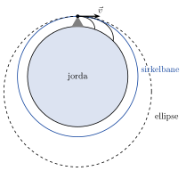
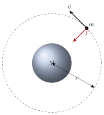

<!-- video: kommer (videoer/ingeniorfysikk/07-02-satellitter-og-baner) -->
{fig-alt="Video kommer"}

<!-- tillegg: Claude -->
Hvorfor faller ikke månen ned? Svaret er at den gjør det, hele tiden. Men den har så stor fart sidelengs at den hele tiden bommer på jorda. En satellitt i bane er i **fritt fall**. Det er derfor astronautene svever: de faller like fort som romstasjonen rundt seg.

## Newtons kanon

{.tikz-fig style="width:360px"}

<!-- tillegg: Claude -->
Newton tenkte seg en kanon på toppen av et svært høyt fjell. Jo større fart kula får, jo lenger flyr den før den lander. Fordi jorda er rund, krummer bakken seg bort under kula. Med akkurat riktig fart krummer bakken seg like fort som kula faller. Da lander kula aldri, og den går i **bane**.

## Sirkelbane

{.tikz-fig style="width:300px"}

<!-- tillegg: Claude -->
I en sirkelbane med radius $r$ er gravitasjonskraften den eneste kraften. Den virker mot sentrum og gir sentripetalakselerasjonen $a = v^2/r$ (se *sirkelbevegelse*). Newtons andre lov gir
$$
\mathrm{G}\frac{Mm}{r^2} = m\frac{v^2}{r}
$$
Massen $m$ til satellitten forkorter seg bort. Banen avhenger bare av massen $M$ til planeten og radien $r$:

::: {.callout-important title="Sirkelbane"}
<!-- tillegg: Claude -->
Banefart og omløpstid for en sirkelbane med radius $r$ rundt en masse $M$:
$$
v = \sqrt{\frac{\mathrm{G}M}{r}}, \qquad T = \frac{2\pi r}{v} = 2\pi\sqrt{\frac{r^3}{\mathrm{G}M}}
$$
:::

<!-- tillegg: Claude -->
Satellitter langt ute går altså **saktere** og bruker mye lengre tid på én runde. Husk at $r$ er avstanden fra **sentrum** av planeten: $r = R + h$, der $h$ er høyden over bakken.

::: {.eksempel}
<!-- tillegg: Claude -->
**Eksempel: Romstasjonen.** ISS går i bane $400\ \mathrm{km}$ over bakken. Hvor stor er banefarten, og hvor lang tid bruker den på én runde? ($M = 5.97\cdot10^{24}\ \mathrm{kg}$, $R = 6.37\cdot10^{6}\ \mathrm{m}$.)

::: {.losning}
$r = R + h = 6.77\cdot10^{6}\ \mathrm{m}$.
$$
v = \sqrt{\frac{\mathrm{G}M}{r}} = \sqrt{\frac{6.674\cdot10^{-11}\cdot5.97\cdot10^{24}}{6.77\cdot10^{6}}}\ \mathrm{m/s} = \underline{\underline{7.67\cdot10^{3}\ \mathrm{m/s}}}
$$
$$
T = \frac{2\pi r}{v} = \frac{2\pi\cdot6.77\cdot10^{6}}{7.67\cdot10^{3}}\ \mathrm{s} = 5.54\cdot10^{3}\ \mathrm{s} = \underline{\underline{92.4\ \mathrm{min}}}
$$
<!-- tillegg: Claude: notasjon v3, gjeldende siffer (3) -->
Romstasjonen går rundt jorda nesten 16 ganger i døgnet, med en fart på over $2.7\cdot10^{4}\ \mathrm{km/h}$. Astronautene ser altså en soloppgang omtrent hver halvannen time.
:::
:::

<!-- tillegg: Claude -->
Ofte kjenner vi omløpstiden og vil finne høyden, eller omvendt. Da er det nyttig å vite at **banefarten** også kan regnes rett fra omløpstiden: én runde er omkretsen $2\pi r$, så $v = 2\pi r/T$.

::: {.eksempel}
<!-- tillegg: Claude -->
**Eksempel: Geostasjonær satellitt.** En geostasjonær satellitt går rundt jorda på nøyaktig ett stjernedøgn, $T = 8.6164\cdot10^{4}\ \mathrm{s}$, i ekvatorplanet. Da står den stille sett fra jorda. Det brukes for TV- og værsatellitter. Hvor høyt over bakken går den, og hvor stor er farten?

::: {.losning}
Vi løser $T = 2\pi\sqrt{r^3/(\mathrm{G}M)}$ for $r$:
$$
r = \left(\frac{\mathrm{G}MT^2}{4\pi^2}\right)^{1/3} = \left(\frac{6.674\cdot10^{-11}\cdot5.97\cdot10^{24}\cdot(8.6164\cdot10^{4})^2}{4\pi^2}\right)^{1/3}\ \mathrm{m} = 4.22\cdot10^{7}\ \mathrm{m}
$$
$$
h = r - R = 4.22\cdot10^{7} - 0.64\cdot10^{7}\ \mathrm{m} = \underline{\underline{3.58\cdot10^{7}\ \mathrm{m}}}
$$
Det er nesten $3.6\cdot10^{4}\ \mathrm{km}$ over bakken. Farten er
$$
v = \frac{2\pi r}{T} = \frac{2\pi\cdot4.22\cdot10^{7}}{8.6164\cdot10^{4}}\ \mathrm{m/s} = \underline{\underline{3.07\ \mathrm{km/s}}}
$$
:::
:::

## Keplers lover

<!-- tillegg: Claude -->
Lenge før Newton fant Johannes Kepler tre lover for planetbanene, ut fra nøyaktige målinger av hvor planetene står på himmelen. Newton viste at alle tre følger av gravitasjonsloven:

::: {.kort}
- **1. Ellipsebaner.** Planetene går i ellipser med sola i det ene brennpunktet. En sirkel er et spesialtilfelle av en ellipse.
- **2. Like arealer.** Linja fra sola til planeten sveiper over like store arealer på like lang tid. Planeten går fortest når den er nærmest sola. Dette er bevaring av dreieimpuls.
- **3. Omløpstiden.** $T^2$ er proporsjonal med $a^3$, der $a$ er den store halvaksen. For sirkelbaner har vi sett det: $T^2 = \dfrac{4\pi^2}{\mathrm{G}M}r^3$.
:::

<!-- tillegg: Claude -->
Den tredje loven er et kraftig verktøy: Måler vi omløpstiden og avstanden til en måne eller planet, kan vi regne ut massen til det den går rundt. Slik har vi funnet massen til sola, til planeter med måner og til sorte hull i sentrum av galakser.

## Energi i bane og unnslippingsfart

<!-- tillegg: Claude -->
I en sirkelbane er den kinetiske energien $E_K = \tfrac12mv^2 = \tfrac12\mathrm{G}Mm/r$ og den potensielle energien $U = -\mathrm{G}Mm/r$. Den totale energien er
$$
E = E_K + U = -\frac{\mathrm{G}Mm}{2r}
$$
Energien er negativ: Satellitten er **bundet** til jorda. For å komme helt løs må den totale energien være minst null. En gjenstand som skytes ut fra overflaten, unnslipper når $\tfrac12mv^2 - \mathrm{G}Mm/R \geq 0$:

::: {.graa}
$$
v_\mathrm{unnslipp} = \sqrt{\frac{2\mathrm{G}M}{R}}
$$
:::

<!-- tillegg: Claude -->
For jorda gir det $11.2\ \mathrm{km/s}$. Unnslippingsfarten er $\sqrt2$ ganger banefarten for en sirkelbane i samme avstand. Den er uavhengig av retningen (så lenge vi ikke treffer bakken) og av massen til gjenstanden.

::: {.callout-tip title="Til ettertanke"}
<!-- tillegg: Claude -->
For å komme fra en lav bane til en høyere må en satellitt bruke rakettmotoren. Men i den høyere banen går den saktere. Hvordan kan det ha seg at den må gi gass for å få lavere fart?
:::

<!-- tillegg: Claude -->
Den totale energien $-\mathrm{G}Mm/(2r)$ **øker** når $r$ øker, selv om den kinetiske energien minker. Motoren øker den totale energien, men mesteparten går til potensiell energi. Når satellitten klatrer, bremses den av tyngdekraften.

:::: {.oppgaver}

::: {.oppgave tittel="Satellitt på 100 minutter"}
<!-- tillegg: Claude -->
En satellitt går i sirkelbane rundt jorda med omløpstid $100\ \mathrm{min}$. Hvor høyt over bakken går den, og hvor stor er banefarten?

::: {.fasit}
$7.7\cdot10^{2}\ \mathrm{km}$ · $7.5\ \mathrm{km/s}$
:::
:::

::: {.oppgave tittel="Månen"}
<!-- tillegg: Claude -->
Bruk at månen går i en tilnærmet sirkelbane med radius $3.84\cdot10^{8}\ \mathrm{m}$ til å regne ut omløpstiden til månen i døgn.

::: {.fasit}
$27.4\ \mathrm{døgn}$
:::
:::

::: {.oppgave tittel="Veie sola" niva="Middels"}
<!-- tillegg: Claude -->
Jorda går rundt sola på $365.25$ døgn i en tilnærmet sirkelbane med radius $1.496\cdot10^{11}\ \mathrm{m}$. Hva er massen til sola?

::: {.fasit}
$1.99\cdot10^{30}\ \mathrm{kg}$
:::
:::

::: {.oppgave tittel="Unnslippe fra Mars" niva="Utfordrende"}
<!-- tillegg: Claude -->
Mars har masse $6.42\cdot10^{23}\ \mathrm{kg}$ og radius $3.39\cdot10^{6}\ \mathrm{m}$. Hvor stor er unnslippingsfarten? Hvor mye mindre energi per kilogram trengs for å unnslippe Mars enn for å unnslippe jorda?

::: {.fasit}
$5.03\ \mathrm{km/s}$ · $0.202$
:::
:::

::::
