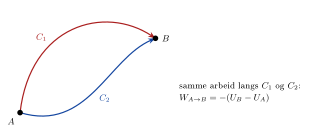

## Konservative krefter

<!-- fra notatene -->
Når ei kraft gjør arbeid, endres den kinetiske energien: $W = \Delta E_K$.

::: {.callout-note title="Definisjon: Konservativ kraft"}
<!-- fra notatene -->
En **konservativ kraft** er ei kraft som kan skrives på formen
$$
\vec F = -\vec\nabla U,
$$
der $U$ er en skalar funksjon som kalles **den potensielle energien**.
:::

<!-- tillegg: Claude -->
$\vec\nabla U$ er **gradienten** til $U$: en vektor som peker dit $U$ øker raskest. Minustegnet betyr at kraften dytter mot lavere potensiell energi, slik tyngdekraften trekker ting nedover. I én dimensjon er det bare $F = -\mathrm{d}U/\mathrm{d}x$.

<!-- fra notatene -->
Både tyngdekraft og elektrisk kraft er konservative krefter. Arbeidet en konservativ kraft gjør, er **veiuavhengig**:
$$
W = \int_A^B \vec F\cdot\mathrm{d}\vec r = -\int_A^B \vec\nabla U\cdot\mathrm{d}\vec r = -\big(U(B) - U(A)\big) = -\Delta U
$$

{.tikz-fig style="width:500px"}

For konservative krefter har vi altså

::: {.graa}
$$
W = -\Delta U
$$
:::

Da ser vi også at størrelsen $E = E_K + U$ er bevart for konservative krefter:
$$
\Delta E = \Delta U + \Delta E_K = -W + W = 0
$$

## Potensiell energi for ladninger

<!-- fra notatene -->
For elektriske krefter **definerer** vi at den potensielle energien er null uendelig langt unna: $U(r\to\infty) = 0$. Regner man ut $-\Delta U = W = \int\vec F\cdot\mathrm{d}\vec s$ med Coulombs lov, får man:

::: {.graa}
**Punktladning:** to ladninger $Q$ og $q$ i avstand $r$
$$
U(r) = k\frac{Q\,q}{r}
$$
**Samling punktladninger:** $Q$ og ladningene $q_1, \dots, q_N$ i avstandene $r_1, \dots, r_N$
$$
U = kQ\sum_{i=1}^{N}\frac{q_i}{r_i}
$$
**Homogent felt:** ladningen $Q$ i avstand $d$ «oppstrøms» i feltet $E$
$$
U = Q\,E\,d
$$
:::

<!-- tillegg: Claude -->
Legg merke til at feltet avtar som $E \propto 1/r^2$, mens den potensielle energien avtar langsommere, som $U \propto 1/r$. Det homogene feltet er den elektriske tvillingen til $U = m\mathrm{g}h$: der er $m\mathrm{g}$ byttet ut med $QE$, og $d$ måles **mot** feltretningen, slik $h$ måles mot tyngdekraften.

Fortegnet forteller om ladningene tiltrekker eller frastøter. For like ladninger er $U > 0$, og energien øker når de skyves sammen. For ulike ladninger er $U < 0$: Systemet har lavere energi når ladningene er nær hverandre.

::: {.eksempel}
<!-- fra notatene -->
**Eksempel: Kinetisk energi til en ladet partikkel.** *(Basert på eksempel 7.1 i OpenStax* University Physics*, bind 2, CC BY 4.0.)* En ladning $Q = +3{,}0\ \mathrm{nC}$ ligger i ro i avstand $r_1 = 10\ \mathrm{cm}$ fra en fast ladning $q = +5{,}0\ \mathrm{nC}$ i origo. Coulombkraften skyver $Q$ bort fra $q$, til den når $r_2 = 15\ \mathrm{cm}$.

**a)** Hvor stort arbeid gjør det elektriske feltet mellom $r_1$ og $r_2$?\
**b)** Hvor stor kinetisk energi har $Q$ i $r_2$?

::: {.losning}
**a)** Vi bruker definisjonen av arbeid:
$$
W = \int_{r_1}^{r_2}\vec F\cdot\mathrm{d}\vec r = \int_{r_1}^{r_2} k\frac{qQ}{r^2}\,\hat r\cdot\mathrm{d}\vec r
$$
Bevegelsen er rett ut fra $q$, så $\mathrm{d}\vec r = \mathrm{d}r\,\hat r$. Da er $\hat r\cdot\mathrm{d}\vec r = \hat r\cdot\hat r\,\mathrm{d}r = \mathrm{d}r$, siden $\hat r\cdot\hat r = 1$:
$$
W = \int_{r_1}^{r_2} k\frac{qQ}{r^2}\,\mathrm{d}r = \left[-k\frac{qQ}{r}\right]_{r_1}^{r_2} = kqQ\left[\frac{1}{r_1} - \frac{1}{r_2}\right]
$$
$$
W = 8{,}99\cdot10^{9}\cdot5{,}0\cdot10^{-9}\cdot3{,}0\cdot10^{-9}\left[\frac{1}{0{,}10} - \frac{1}{0{,}15}\right]\mathrm{J} = \underline{\underline{4{,}5\cdot10^{-7}\ \mathrm{J}}}
$$
<!-- tillegg: Claude -->
Vi brukte $\int x^n\,\mathrm{d}x = \frac{x^{n+1}}{n+1}$ med $n = -2$. Legg merke til at $W = U(r_1) - U(r_2) = -\Delta U$, akkurat som det skal.

**b)** Energien er bevart og $Q$ startet i ro, så
$$
W = \Delta E_K \quad\Rightarrow\quad E_K = \underline{\underline{4{,}5\cdot10^{-7}\ \mathrm{J}}}
$$
:::
:::

::: {.eksempel}
<!-- fra notatene -->
**Eksempel: Endring i potensiell energi.** *(Eksempel 7.2 i OpenStax.)* Samme situasjon som over. Hva er endringen i den potensielle energien til systemet med to ladninger fra $r_1$ til $r_2$?

::: {.losning}
Vi vet at $W = -\Delta U$, så fra eksempelet over:
$$
\Delta U = -W = \underline{\underline{-4{,}5\cdot10^{-7}\ \mathrm{J}}}
$$
Om vi ikke allerede hadde regnet ut $W$, kunne vi brukt at for en ladning i feltet fra en punktladning er $U(r) = k\dfrac{qQ}{r}$:
$$
\Delta U = U(r_2) - U(r_1) = kqQ\left[\frac{1}{r_2} - \frac{1}{r_1}\right]
$$
Det ville gitt det samme. Den potensielle energien som går tapt, blir til kinetisk energi.
:::
:::

## Arbeid for å samle ladninger

<!-- fra notatene -->
Skal vi samle flere ladninger, må noen utenfra gjøre et arbeid mot de elektriske kreftene. Arbeidet som må gjøres utenfra, er $W = -W_\mathrm{el} = -(-\Delta U) = \Delta U$. Henter vi ladningene inn én og én fra uendelig langt unna, blir det samlede arbeidet

::: {.graa}
$$
W = \sum_{i=1}^{N}\int\vec F_i\cdot\mathrm{d}\vec r = \sum_{i=1}^{N}\Delta U_i = \sum_{i=1}^{N} U(r_i)
$$
:::

der $r_i$ er avstanden mellom ladningene. **Rekkefølgen er uviktig.**

::: {.eksempel}
<!-- fra notatene -->
**Eksempel: Fire positive ladninger.** *(Basert på eksempel 7.3 i OpenStax* University Physics*, bind 2, CC BY 4.0.)* Hvor stort arbeid må gjøres utenfra for å samle fire ladninger på $+2{,}0\ \mu\mathrm{C}$, $+3{,}0\ \mu\mathrm{C}$, $+4{,}0\ \mu\mathrm{C}$ og $+5{,}0\ \mu\mathrm{C}$ i hjørnene av et kvadrat med sider $1{,}0\ \mathrm{cm}$, når hver ladning hentes fra uendelig langt unna?

{.tikz-fig style="width:300px"}

::: {.losning}
Vi bruker $U(r) = k\dfrac{Qq}{r}$ og $W = \Delta U = U_\mathrm{slutt} - U_\mathrm{start}$, der $U_\mathrm{start} = 0$ fordi ladningen kommer fra uendelig langt unna.

**Steg 1:** Den første ladningen ($2{,}0\ \mu\mathrm{C}$) har ingen andre ladninger å kjempe mot: $W_1 = 0$.

**Steg 2:** $3{,}0\ \mu\mathrm{C}$ hentes inn til $1{,}0\ \mathrm{cm}$ fra $2{,}0\ \mu\mathrm{C}$:
$$
W_2 = k\frac{2{,}0\ \mu\mathrm{C}\cdot3{,}0\ \mu\mathrm{C}}{1{,}0\ \mathrm{cm}} = 8{,}99\cdot10^{9}\cdot\frac{6{,}0\cdot10^{-12}}{0{,}010}\ \mathrm{J} \approx 5{,}4\ \mathrm{J}
$$

**Steg 3:** $4{,}0\ \mu\mathrm{C}$ hentes inn til $\sqrt2\ \mathrm{cm}$ fra $2{,}0\ \mu\mathrm{C}$ og $1{,}0\ \mathrm{cm}$ fra $3{,}0\ \mu\mathrm{C}$:
$$
W_3 = k\left[\frac{2{,}0\ \mu\mathrm{C}\cdot4{,}0\ \mu\mathrm{C}}{\sqrt2\ \mathrm{cm}} + \frac{3{,}0\ \mu\mathrm{C}\cdot4{,}0\ \mu\mathrm{C}}{1{,}0\ \mathrm{cm}}\right] \approx 15{,}9\ \mathrm{J}
$$

**Steg 4:** $5{,}0\ \mu\mathrm{C}$ hentes inn til $1{,}0\ \mathrm{cm}$ fra $2{,}0\ \mu\mathrm{C}$ og $4{,}0\ \mu\mathrm{C}$, og $\sqrt2\ \mathrm{cm}$ fra $3{,}0\ \mu\mathrm{C}$:
$$
W_4 = k\left[\frac{5{,}0\cdot2{,}0}{1{,}0\ \mathrm{cm}} + \frac{5{,}0\cdot4{,}0}{1{,}0\ \mathrm{cm}} + \frac{5{,}0\cdot3{,}0}{\sqrt2\ \mathrm{cm}}\right](\mu\mathrm{C})^2 \approx 36{,}5\ \mathrm{J}
$$

Til sammen:
$$
W = W_1 + W_2 + W_3 + W_4 = 0 + 5{,}4\ \mathrm{J} + 15{,}9\ \mathrm{J} + 36{,}5\ \mathrm{J} = \underline{\underline{57{,}8\ \mathrm{J}}}
$$
<!-- tillegg: Claude -->
Arbeidet er positivt: Alle ladningene er positive og frastøter hverandre, så vi må presse dem sammen. Prøv gjerne å hente dem inn i en annen rekkefølge. Svaret blir det samme.
:::
:::

:::: {.oppgaver}

::: {.oppgave tittel="Proton mot proton"}
<!-- tillegg: Claude -->
Hvor stor er den elektriske potensielle energien til to protoner i avstanden $r = 2{,}0\cdot10^{-15}\ \mathrm{m}$ (omtrent avstanden i en atomkjerne)? Oppgi svaret i joule og i elektronvolt ($1\ \mathrm{eV} = 1{,}60\cdot10^{-19}\ \mathrm{J}$).

::: {.losning}
$$
U = k\frac{\mathrm{e}^2}{r} = 8{,}99\cdot10^{9}\cdot\frac{(1{,}60\cdot10^{-19})^2}{2{,}0\cdot10^{-15}}\ \mathrm{J} \approx \underline{\underline{1{,}2\cdot10^{-13}\ \mathrm{J}}}
$$
$$
U = \frac{1{,}15\cdot10^{-13}}{1{,}60\cdot10^{-19}}\ \mathrm{eV} \approx \underline{\underline{0{,}72\ \mathrm{MeV}}}
$$
Så mye energi må til for å presse to protoner så nær hverandre. Den sterke kjernekraften holder dem likevel sammen i kjernen.
:::
:::

::: {.oppgave tittel="Tre ladninger i en trekant" niva="Middels"}
<!-- tillegg: Claude -->
Tre ladninger $q = +1{,}0\ \mu\mathrm{C}$ skal plasseres i hjørnene av en likesidet trekant med sider $a = 5{,}0\ \mathrm{cm}$. Hvor stort arbeid må gjøres utenfra?

::: {.losning}
Det er tre par, hvert med avstand $a$:
$$
W = 3\cdot k\frac{q^2}{a} = 3\cdot8{,}99\cdot10^{9}\cdot\frac{(1{,}0\cdot10^{-6})^2}{0{,}050}\ \mathrm{J} \approx \underline{\underline{0{,}54\ \mathrm{J}}}
$$
:::
:::

::: {.oppgave tittel="Hvor nær kommer protonet?" niva="Utfordrende"}
<!-- tillegg: Claude -->
Et proton skytes rett mot en fast gullkjerne (ladning $79\mathrm{e}$) med kinetisk energi $E_K = 5{,}0\ \mathrm{MeV}$. Hvor nær kjernen kommer protonet før det snur?

::: {.losning}
Energien er bevart. Langt unna er $U = 0$, og der protonet snur er $E_K = 0$:
$$
E_K = k\frac{79\mathrm{e}\cdot\mathrm{e}}{r_\mathrm{min}} \quad\Rightarrow\quad r_\mathrm{min} = \frac{79k\mathrm{e}^2}{E_K}
$$
Med $E_K = 5{,}0\cdot10^{6}\cdot1{,}60\cdot10^{-19}\ \mathrm{J} = 8{,}0\cdot10^{-13}\ \mathrm{J}$:
$$
r_\mathrm{min} = \frac{79\cdot8{,}99\cdot10^{9}\cdot(1{,}60\cdot10^{-19})^2}{8{,}0\cdot10^{-13}}\ \mathrm{m} \approx \underline{\underline{2{,}3\cdot10^{-14}\ \mathrm{m}}}
$$
Dette er omtrent tre ganger radien til gullkjernen. Slike spredningsforsøk (Rutherford) viste at atomet har en liten, tung kjerne.
:::
:::

::::
