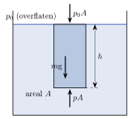
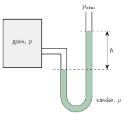
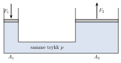

<!-- video: kommer (videoer/ingeniorfysikk/08-02-hydrostatisk-trykk) -->
{fig-alt="Video kommer"}

<!-- tillegg: Claude -->
Dykker du ned i et basseng, kjenner du trykket i ørene øke. Det kommer av vekten av vannet over deg. Her finner vi ut nøyaktig hvor fort trykket øker med dybden, og vi ser hvordan en liten kraft kan løfte en bil med en hydraulisk jekk.

## Trykket øker med dybden

<!-- tillegg: Claude -->
Tenk deg en loddrett søyle av væsken med tverrsnitt $A$ og høyde $h$, slik figuren viser. Søylen er i ro, så kreftene på den må summere seg til null. Tre krefter virker loddrett:

- trykket fra væsken over presser ned med kraften $p_0A$,
- tyngden av søylen, $m\mathrm{g} = \rho Ah\,\mathrm{g}$, trekker ned,
- trykket under presser opp med kraften $pA$.

Kreftene fra siden opphever hverandre.

{.tikz-fig style="width:330px"}

<!-- tillegg: Claude -->
Likevekt gir $pA = p_0A + \rho Ah\mathrm{g}$. Vi deler på $A$:

::: {.callout-important title="Hydrostatisk trykk"}
<!-- tillegg: Claude -->
I en væske i ro med konstant tetthet $\rho$ er trykket i dybden $h$ under et punkt med trykket $p_0$
$$
p = p_0 + \rho\mathrm{g}h
$$
Leddet $\rho\mathrm{g}h$ kalles det **hydrostatiske trykket**.
:::

<!-- tillegg: Claude -->
Tre ting er verdt å legge merke til:

::: {.kort}
- **Bare dybden teller.** Formen på beholderen spiller ingen rolle. I en smal, høy flaske og et bredt basseng er trykket det samme i samme dybde.
- **Like dyp, likt trykk.** Alle punkter i samme høyde i en sammenhengende væske i ro har samme trykk. Det er derfor vannet står like høyt i alle armene av et rør.
- **Ti meter vann er én atmosfære.** For vann er $\rho\mathrm{g} = 9.81\ \mathrm{kPa/m}$. Ti meter ned har trykket økt med omtrent $1\ \mathrm{bar}$.
:::

<!-- tillegg: Claude -->
I gasser er tettheten så liten at trykket nesten ikke endres over noen få meter. Over mange kilometer endres det likevel mye: Lufttrykket på toppen av Mount Everest er omtrent en tredjedel av trykket ved havet. Der gjelder ikke formelen over, fordi tettheten til lufta avtar med høyden.

::: {.eksempel}
<!-- tillegg: Claude -->
**Eksempel: Dykking.** Hvor stort er det absolutte trykket på $30\ \mathrm{m}$ dyp i sjøen ($\rho = 1025\ \mathrm{kg/m^3}$)? Hvor stort er overtrykket?

::: {.losning}
Overtrykket er det hydrostatiske trykket:
$$
p_\mathrm{over} = \rho\mathrm{g}h = 1025\ \mathrm{kg/m^3}\cdot9.81\ \mathrm{m/s^2}\cdot30\ \mathrm{m} = \underline{\underline{3.0\cdot10^{5}\ \mathrm{Pa}}}
$$
Det absolutte trykket får i tillegg lufttrykket på overflaten:
$$
p = p_\mathrm{atm} + \rho\mathrm{g}h = 1.013\cdot10^{5}\ \mathrm{Pa} + 3.02\cdot10^{5}\ \mathrm{Pa} = \underline{\underline{4.0\cdot10^{5}\ \mathrm{Pa}}}
$$
Trykket er fire ganger så stort som ved overflaten. Lufta en dykker puster inn, må derfor ha samme trykk, ellers klarer ikke brystkassa å utvide seg.
:::
:::

## Måle trykk: manometer og barometer

<!-- tillegg: Claude -->
Formelen $p = p_0 + \rho\mathrm{g}h$ kan brukes baklengs: Høydeforskjellen i en væskesøyle forteller hvor stort trykket er. Det er prinsippet i et **manometer**, et U-rør med væske der den ene enden er koblet til det vi vil måle, og den andre er åpen mot lufta.

{.tikz-fig style="width:330px"}

<!-- tillegg: Claude -->
Punktene på den stiplede linja nederst ligger like dypt i samme væske, så de har samme trykk. På venstre side er det trykket $p$ fra gassen. På høyre side er det lufttrykket pluss en væskesøyle med høyde $h$. Derfor er
$$
p = p_\mathrm{atm} + \rho\mathrm{g}h \qquad\Rightarrow\qquad p_\mathrm{over} = \rho\mathrm{g}h
$$

Et **barometer** måler lufttrykket. Det er et rør som er lukket i toppen, fylt med kvikksølv og snudd opp ned i en skål. Over kvikksølvet i røret er det nesten vakuum, så lufttrykket på skåla må bære hele søylen: $p_\mathrm{atm} = \rho_\mathrm{Hg}\mathrm{g}h$. Ved havoverflaten blir $h = 760\ \mathrm{mm}$. Derfor er enheten mmHg fortsatt i bruk, blant annet for blodtrykk.

::: {.callout-tip title="Til ettertanke"}
<!-- tillegg: Claude -->
Hvorfor brukes kvikksølv og ikke vann i et barometer? Regn ut hvor høy søylen ville blitt med vann.
:::

<!-- tillegg: Claude -->
Med vann blir $h = p_\mathrm{atm}/(\rho\mathrm{g}) = 1.013\cdot10^{5}/(1000\cdot9.81)\ \mathrm{m} \approx 10.3\ \mathrm{m}$. Det er også grunnen til at en vanlig sugepumpe ikke kan løfte vann mer enn ca. 10 m: Den kan bare senke trykket over vannet til null, og da er det lufttrykket som presser vannet opp.

## Pascals lov

::: {.callout-important title="Pascals lov"}
<!-- tillegg: Claude -->
En trykkendring i et lukket, inkompressibelt fluid i ro forplanter seg uforminsket til alle deler av fluidet og til veggene i beholderen.
:::

<!-- tillegg: Claude -->
Det følger direkte av $p = p_0 + \rho\mathrm{g}h$: Øker vi $p_0$ med $\Delta p$, øker trykket overalt med $\Delta p$. Dette er prinsippet bak hydrauliske systemer: bremser i bil, gravemaskiner og jekker.

{.tikz-fig style="width:480px"}

<!-- tillegg: Claude -->
Stemplene står i samme høyde, så trykket under dem er det samme:
$$
p = \frac{F_1}{A_1} = \frac{F_2}{A_2} \qquad\Rightarrow\qquad F_2 = \frac{A_2}{A_1}F_1
$$
Kraften forsterkes med forholdet mellom arealene. Men vi får ikke noe gratis: Væsken er inkompressibel, så volumet som presses ned på venstre side, er lik volumet som løftes på høyre side, $A_1 s_1 = A_2 s_2$. Det lille stempelet må derfor flyttes mye lenger. Arbeidet er det samme på begge sider: $F_1 s_1 = F_2 s_2$.

::: {.eksempel}
<!-- tillegg: Claude -->
**Eksempel: Billøft.** På et verksted løftes en bil på $1500\ \mathrm{kg}$ med et hydraulisk løft. Det store stempelet har radius $12\ \mathrm{cm}$, det lille har radius $1.0\ \mathrm{cm}$. Hvor stor kraft må virke på det lille stempelet? Hvor langt må det lille stempelet flyttes for å løfte bilen $1.0\ \mathrm{m}$?

::: {.losning}
Arealforholdet er $A_2/A_1 = (r_2/r_1)^2 = (12/1.0)^2 = 144$. Kraften som trengs:
$$
F_1 = \frac{A_1}{A_2}F_2 = \frac{m\mathrm{g}}{144} = \frac{1500\cdot9.81}{144}\ \mathrm{N} = \underline{\underline{1.0\cdot10^{2}\ \mathrm{N}}}
$$
Det tilsvarer tyngden av omtrent 10 kg. Volumet som flyttes, er det samme på begge sider:
$$
s_1 = \frac{A_2}{A_1}s_2 = 144\cdot1.0\ \mathrm{m} = \underline{\underline{1.4\cdot10^{2}\ \mathrm{m}}}
$$
I praksis pumpes det lille stempelet mange ganger, med en ventil som hindrer væsken i å renne tilbake.
:::
:::

## Kraft på en vegg

<!-- tillegg: Claude -->
På en loddrett vegg, for eksempel en demning, øker trykket lineært med dybden. Den totale kraften finner vi ved å summere trykket over hele flaten. For en vegg med bredde $b$ og vanndybde $H$ (vi ser bort fra lufttrykket, som virker på begge sider):
$$
F = \int_0^H \rho\mathrm{g}h\,b\,\mathrm{d}h = \tfrac12\rho\mathrm{g}bH^2
$$
Kraften er altså lik **middeltrykket** $\tfrac12\rho\mathrm{g}H$ ganger arealet $bH$. Fordi kraften vokser med $H^2$, må demninger være mye tykkere nederst enn øverst.

:::: {.oppgaver}

::: {.oppgave tittel="Trykk i bassenget"}
<!-- tillegg: Claude -->
Hvor stort er overtrykket på bunnen av et basseng som er $3.5\ \mathrm{m}$ dypt?

::: {.losning}
$$
p_\mathrm{over} = \rho\mathrm{g}h = 1000\cdot9.81\cdot3.5\ \mathrm{Pa} = \underline{\underline{34\ \mathrm{kPa}}}
$$
:::
:::

::: {.oppgave tittel="Manometeret"}
<!-- tillegg: Claude -->
Et kvikksølvmanometer ($\rho = 1.36\cdot10^{4}\ \mathrm{kg/m^3}$) er koblet til en gasstank. Kvikksølvet står $25\ \mathrm{cm}$ høyere i den åpne armen enn i armen mot tanken. Hva er overtrykket og det absolutte trykket i tanken?

::: {.losning}
$$
p_\mathrm{over} = \rho\mathrm{g}h = 1.36\cdot10^{4}\cdot9.81\cdot0.25\ \mathrm{Pa} = \underline{\underline{33\ \mathrm{kPa}}}
$$
$$
p = p_\mathrm{atm} + p_\mathrm{over} = 101\ \mathrm{kPa} + 33\ \mathrm{kPa} = \underline{\underline{135\ \mathrm{kPa}}}
$$
:::
:::

::: {.oppgave tittel="Demningen" niva="Middels"}
<!-- tillegg: Claude -->
En demning er $20\ \mathrm{m}$ bred, og vannet står $8.0\ \mathrm{m}$ dypt bak den. Hvor stor er den totale kraften vannet gir på demningen?

::: {.losning}
$$
F = \tfrac12\rho\mathrm{g}bH^2 = \tfrac12\cdot1000\cdot9.81\cdot20\cdot8.0^2\ \mathrm{N} = \underline{\underline{6.3\cdot10^{6}\ \mathrm{N}}}
$$
Det tilsvarer tyngden av over 600 tonn.
:::
:::

::: {.oppgave tittel="Olje og vann i U-rør" niva="Utfordrende"}
<!-- tillegg: Claude -->
Et U-rør inneholder vann. Så helles olje ($\rho_o = 850\ \mathrm{kg/m^3}$) i den ene armen, til oljesøylen er $12\ \mathrm{cm}$ høy. Oljen blander seg ikke med vannet. Hvor mye høyere står oljeoverflaten enn vannoverflaten i den andre armen?

::: {.losning}
Velg en vannrett linje gjennom skillet mellom olje og vann. Under linja er det vann på begge sider, så trykket på linja er det samme i begge armer. Begge armene er åpne mot lufta:
$$
p_\mathrm{atm} + \rho_o\mathrm{g}h_o = p_\mathrm{atm} + \rho_v\mathrm{g}h_v \quad\Rightarrow\quad h_v = \frac{\rho_o}{\rho_v}h_o = \frac{850}{1000}\cdot12\ \mathrm{cm} = 10.2\ \mathrm{cm}
$$
Vannet i den andre armen står $10.2\ \mathrm{cm}$ over skillet, oljen $12\ \mathrm{cm}$. Oljeoverflaten står altså
$$
12\ \mathrm{cm} - 10.2\ \mathrm{cm} = \underline{\underline{1.8\ \mathrm{cm}}}
$$
høyere enn vannoverflaten. Oljen er lettere, så det trengs en høyere søyle for å gi samme trykk.
:::
:::

::::
