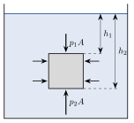
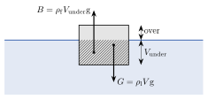

<!-- video: kommer (videoer/ingeniorfysikk/08-03-oppdrift) -->
{fig-alt="Video kommer"}

<!-- tillegg: Claude -->
Et skip av stål på flere tusen tonn flyter, mens en liten stein synker. Og en stein du løfter under vann, føles lettere enn på land. Begge deler skyldes **oppdrift**: en kraft oppover som alle fluider gir på ting som ligger i dem. Oppdriften er ikke en ny type kraft. Den kommer rett og slett av at trykket øker med dybden.

## Hvor kommer oppdriften fra?

<!-- tillegg: Claude -->
Se på en terning med sideflate $A$ og høyde $h_2 - h_1$ som ligger helt under vann. Trykket virker vinkelrett inn på alle sideflatene.

{.tikz-fig style="width:330px"}

<!-- tillegg: Claude -->
Kreftene fra sidene er like store og motsatt rettet, så de opphever hverandre. Men trykket på undersiden, $p_2 = p_0 + \rho_\mathrm{f}\mathrm{g}h_2$, er større enn trykket på oversiden, $p_1 = p_0 + \rho_\mathrm{f}\mathrm{g}h_1$. Netto kraft oppover blir
$$
B = p_2A - p_1A = \rho_\mathrm{f}\mathrm{g}(h_2 - h_1)A = \rho_\mathrm{f}V\mathrm{g}
$$
der $V = (h_2 - h_1)A$ er volumet til terningen. Men $\rho_\mathrm{f}V$ er nettopp massen av fluidet som terningen har *fortrengt*, altså skjøvet til side. Resultatet gjelder for legemer med hvilken som helst form, fordi vi kan tenke oss legemet bygd opp av mange tynne søyler.

::: {.callout-important title="Arkimedes' lov"}
<!-- tillegg: Claude -->
Et legeme som ligger helt eller delvis i et fluid, får en oppdrift som er lik tyngden av fluidet legemet fortrenger:
$$
B = \rho_\mathrm{f}V_\mathrm{f}\mathrm{g}
$$
der $\rho_\mathrm{f}$ er tettheten til **fluidet** og $V_\mathrm{f}$ er volumet av den delen av legemet som er **under** overflaten.
:::

<!-- tillegg: Claude -->
En nyttig tankemåte: Tenk deg legemet byttet ut med fluid med samme form. Det fluidet ville ligget i ro. Altså må oppdriften akkurat bære tyngden av det. Oppdriften avhenger ikke av hva legemet er laget av, bare av hvor mye plass det tar.

## Synke, sveve eller flyte

<!-- tillegg: Claude -->
Et legeme med tetthet $\rho_\mathrm{l}$ og volum $V$ som holdes helt under overflaten, får oppdriften $\rho_\mathrm{f}V\mathrm{g}$ og tyngden $\rho_\mathrm{l}V\mathrm{g}$. Det er tettheten som avgjør hva som skjer når vi slipper:

::: {.kort}
- **Synker** når $\rho_\mathrm{l} > \rho_\mathrm{f}$. Tyngden er større enn oppdriften. Eksempel: en stein i vann.
- **Svever** når $\rho_\mathrm{l} = \rho_\mathrm{f}$. Kreftene er like store. En fisk eller en ubåt justerer tettheten sin for å sveve.
- **Flyter** når $\rho_\mathrm{l} < \rho_\mathrm{f}$. Legemet stiger til en del stikker opp, og så mye er under at oppdriften akkurat bærer tyngden.
:::

<!-- tillegg: Claude -->
Et stålskip flyter fordi skroget er hult. Det er den **gjennomsnittlige** tettheten til skipet, stål pluss all lufta inni, som er mindre enn tettheten til vann.

## Hvor mye stikker under?

{.tikz-fig style="width:460px"}

<!-- tillegg: Claude -->
Et legeme som flyter i ro, har $B = G$:
$$
\rho_\mathrm{f}V_\mathrm{under}\mathrm{g} = \rho_\mathrm{l}V\mathrm{g} \qquad\Rightarrow\qquad \frac{V_\mathrm{under}}{V} = \frac{\rho_\mathrm{l}}{\rho_\mathrm{f}}
$$
Andelen som er under overflaten, er forholdet mellom tetthetene. Et legeme med halvparten av tettheten til vann ligger halvveis nede.

::: {.eksempel}
<!-- tillegg: Claude -->
**Eksempel: Toppen av isfjellet.** Hvor stor del av et isfjell ($\rho_\mathrm{is} = 917\ \mathrm{kg/m^3}$) ligger under vann i sjøen ($\rho = 1025\ \mathrm{kg/m^3}$)?

::: {.losning}
$$
\frac{V_\mathrm{under}}{V} = \frac{\rho_\mathrm{is}}{\rho_\mathrm{sjø}} = \frac{917}{1025} = \underline{\underline{0.895}}
$$
Nesten 90 % av isfjellet er under vann. Bare toppen, omtrent en tidel, stikker opp. Derfor er isfjell farlige for skip.
:::
:::

## Tilsynelatende vekt

<!-- tillegg: Claude -->
Henger du en stein i en kraftmåler og senker den ned i vann, viser kraftmåleren mindre. Kraftmåleren viser snorkraften $S$, og når steinen henger i ro, er $S + B = G$. Den **tilsynelatende vekten** er
$$
S = G - B
$$
Dette kan brukes til å finne volumet, og dermed tettheten, til ting med uregelmessig form. Ifølge historien skal Arkimedes ha brukt nettopp dette til å sjekke om kongens krone var av rent gull.

::: {.eksempel}
<!-- tillegg: Claude -->
**Eksempel: Stein i vann.** En stein på $2.5\ \mathrm{kg}$ med tetthet $2700\ \mathrm{kg/m^3}$ henger i en snor under vann. Hvor stor er snorkraften?

::: {.losning}
Volumet til steinen er
$$
V = \frac{m}{\rho} = \frac{2.5\ \mathrm{kg}}{2700\ \mathrm{kg/m^3}} = 9.26\cdot10^{-4}\ \mathrm{m^3}
$$
Oppdriften og tyngden:
$$
B = \rho_\mathrm{v}V\mathrm{g} = 1000\cdot9.26\cdot10^{-4}\cdot9.81\ \mathrm{N} = 9.08\ \mathrm{N}, \qquad G = m\mathrm{g} = 24.5\ \mathrm{N}
$$
Snorkraften er
$$
S = G - B = 24.5\ \mathrm{N} - 9.08\ \mathrm{N} = \underline{\underline{15\ \mathrm{N}}}
$$
Steinen føles omtrent en tredjedel lettere. Det passer med at tettheten til vann er omtrent en tredjedel av tettheten til steinen.
:::
:::

## Oppdrift i lufta

<!-- tillegg: Claude -->
Lufta gir også oppdrift. For de fleste ting er den liten, fordi lufta har så liten tetthet. Men en ballong fylt med helium eller varm luft har lavere gjennomsnittlig tetthet enn lufta rundt, og da stiger den.

::: {.eksempel}
<!-- tillegg: Claude -->
**Eksempel: Varmluftsballong.** En varmluftsballong har volumet $2500\ \mathrm{m^3}$. Lufta utenfor har tetthet $1.20\ \mathrm{kg/m^3}$, den varme lufta inni har $0.95\ \mathrm{kg/m^3}$. Hvor stor masse (kurv, ballongduk og passasjerer) kan ballongen løfte?

::: {.losning}
Ballongen svever når oppdriften er lik tyngden av den varme lufta pluss lasten:
$$
\rho_\mathrm{ute}V\mathrm{g} = \rho_\mathrm{inne}V\mathrm{g} + m\mathrm{g} \quad\Rightarrow\quad m = (\rho_\mathrm{ute} - \rho_\mathrm{inne})V
$$
$$
m = (1.20 - 0.95)\ \mathrm{kg/m^3}\cdot2500\ \mathrm{m^3} = \underline{\underline{6.3\cdot10^{2}\ \mathrm{kg}}}
$$
:::
:::

:::: {.oppgaver}

::: {.oppgave tittel="Tømmerstokken"}
<!-- tillegg: Claude -->
En tømmerstokk av tre med tetthet $600\ \mathrm{kg/m^3}$ flyter i vann. Hvor stor andel av volumet er over vann?

::: {.losning}
Andelen under er $\rho_\mathrm{tre}/\rho_\mathrm{v} = 600/1000 = 0.60$. Andelen over er da
$$
1 - 0.60 = \underline{\underline{0.40}}
$$
:::
:::

::: {.oppgave tittel="Lekteren"}
<!-- tillegg: Claude -->
En lekter er formet som en boks, $10\ \mathrm{m}$ lang og $4.0\ \mathrm{m}$ bred. Hvor stor last er lagt om bord når lekteren synker $15\ \mathrm{cm}$ dypere i vannet?

::: {.losning}
Ekstra oppdrift er lik tyngden av lasten. Ekstra fortrengt volum er $\Delta V = 10\cdot4.0\cdot0.15\ \mathrm{m^3} = 6.0\ \mathrm{m^3}$:
$$
m = \rho_\mathrm{v}\Delta V = 1000\ \mathrm{kg/m^3}\cdot6.0\ \mathrm{m^3} = \underline{\underline{6.0\cdot10^{3}\ \mathrm{kg}}}
$$
:::
:::

::: {.oppgave tittel="Kongens krone" niva="Middels"}
<!-- tillegg: Claude -->
En krone veier $0.85\ \mathrm{kg}$ i lufta. Hengt i en kraftmåler under vann viser den massen $0.80\ \mathrm{kg}$ (altså en kraft på $0.80\ \mathrm{kg}\cdot\mathrm{g}$). Hva er tettheten til kronen? Er den av rent gull ($1.93\cdot10^{4}\ \mathrm{kg/m^3}$)?

::: {.losning}
Oppdriften er forskjellen: $B = (0.85 - 0.80)\ \mathrm{kg}\cdot\mathrm{g} = 0.050\ \mathrm{kg}\cdot\mathrm{g}$. Det betyr at kronen fortrenger $0.050\ \mathrm{kg}$ vann, altså
$$
V = \frac{0.050\ \mathrm{kg}}{1000\ \mathrm{kg/m^3}} = 5.0\cdot10^{-5}\ \mathrm{m^3}
$$
Tettheten blir
$$
\rho = \frac{0.85\ \mathrm{kg}}{5.0\cdot10^{-5}\ \mathrm{m^3}} = \underline{\underline{1.7\cdot10^{4}\ \mathrm{kg/m^3}}}
$$
Det er mindre enn tettheten til gull. Kronen er **ikke** av rent gull, den er trolig blandet med sølv.
:::
:::

::: {.oppgave tittel="Heliumballongen" niva="Utfordrende"}
<!-- tillegg: Claude -->
En kuleformet heliumballong har radius $15\ \mathrm{cm}$. Helium har tetthet $0.18\ \mathrm{kg/m^3}$, lufta $1.20\ \mathrm{kg/m^3}$. Hvor stor masse kan ballongen maksimalt løfte (ballonggummi og snor medregnet)?

::: {.losning}
Volumet er $V = \tfrac43\pi r^3 = \tfrac43\pi(0.15\ \mathrm{m})^3 = 1.41\cdot10^{-2}\ \mathrm{m^3}$. Som for varmluftsballongen er
$$
m = (\rho_\mathrm{luft} - \rho_\mathrm{He})V = (1.20 - 0.18)\cdot1.41\cdot10^{-2}\ \mathrm{kg} = 1.4\cdot10^{-2}\ \mathrm{kg} = \underline{\underline{14\ \mathrm{g}}}
$$
Ballonggummien veier ofte noen gram, så det er ikke mye igjen til lasten.
:::
:::

::::
