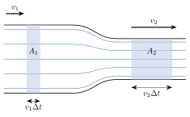





<!-- tillegg: Claude -->
Setter du tommelen over enden av en hageslange, spruter vannet mye lenger. Hvorfor? Det kommer like mye vann gjennom slangen, men det må ut gjennom et mindre hull. Da må det gå fortere. Denne enkle ideen, at det som går inn, må komme ut, kalles **kontinuitetslikningen**. Den er det første verktøyet vi trenger for fluider i bevegelse.

## Ideell strømning

<!-- tillegg: Claude -->
Ekte strømning kan være svært komplisert, med virvler og turbulens. Vi begynner med en forenklet modell, **ideell strømning**, som likevel beskriver mange situasjoner godt:

::: {.kort}
- **Inkompressibel.** Tettheten er konstant. Det stemmer godt for væsker.
- **Stasjonær.** Farten i hvert punkt endrer seg ikke med tiden. Vannet i en kran som står jevnt på, er et eksempel.
- **Uten friksjon.** Vi ser bort fra viskositet (indre friksjon). Den tar vi med senere, under *viskositet* og *tap i rør*.
- **Uten virvler.** Små biter av fluidet roterer ikke om seg selv.
:::

<!-- tillegg: Claude -->
I stasjonær strømning følger hver vanndråpe en fast bane, en **strømlinje**. Farten er alltid langs strømlinjen, så to strømlinjer kan aldri krysse hverandre. Der strømlinjene ligger tett, går strømningen fort.

## Volumstrøm

::: {.callout-note title="Definisjon: Volumstrøm"}
<!-- tillegg: Claude -->
**Volumstrømmen** $Q$ er volumet av fluid som strømmer gjennom et tverrsnitt per tid:
$$
Q = \frac{\Delta V}{\Delta t} = Av
$$
der $A$ er tverrsnittsarealet og $v$ er farten (gjennomsnittsfarten over tverrsnittet). SI-enheten er $\mathrm{m^3/s}$. Liter per sekund og liter per minutt er også vanlige.

**Massestrømmen** er $\dot m = \rho Q = \rho Av$, med enhet $\mathrm{kg/s}$.
:::

<!-- tillegg: Claude -->
Hvorfor er $Q = Av$? I løpet av tiden $\Delta t$ flytter fluidet seg avstanden $v\Delta t$. Alt fluid i en «skive» med tykkelse $v\Delta t$ har da passert tverrsnittet, og skiva har volumet $\Delta V = Av\Delta t$. Deler vi på $\Delta t$, får vi $Q = Av$.

## Kontinuitetslikningen

{.tikz-fig style="width:520px"}

<!-- tillegg: Claude -->
Fluidet kan ikke hope seg opp eller forsvinne inne i røret. Når strømningen er stasjonær, må like mye masse passere hvert tverrsnitt per tid: $\rho_1A_1v_1 = \rho_2A_2v_2$. Er fluidet inkompressibelt, er $\rho_1 = \rho_2$, og vi får

::: {.callout-important title="Kontinuitetslikningen"}
<!-- tillegg: Claude -->
For et inkompressibelt fluid i stasjonær strømning er volumstrømmen den samme gjennom alle tverrsnitt:
$$
Q = A_1v_1 = A_2v_2
$$
:::

<!-- tillegg: Claude -->
Farten er altså **omvendt proporsjonal med arealet**. Et rør med halv diameter har en fjerdedel av arealet, så farten blir fire ganger så stor. Det er dette som skjer når du holder tommelen over slangen.

Kontinuitetslikningen er en **bevaringslov**. Den sier at massen er bevart, på samme måte som bevegelsesmengde og energi er bevart i mekanikken.

::: {.eksempel}
<!-- tillegg: Claude -->
**Eksempel: Hageslangen.** En hageslange har indre diameter $2.0\ \mathrm{cm}$, og vannet strømmer med $Q = 0.30\ \mathrm{L/s}$. Slangen har en dyse med diameter $0.50\ \mathrm{cm}$.

**a)** Hvor stor er farten i slangen og i dysen?\
**b)** Hvor lang tid tar det å fylle et basseng på $50\ \mathrm{m^3}$?

::: {.losning}
**a)** Volumstrømmen i SI er $Q = 0.30\cdot10^{-3}\ \mathrm{m^3/s}$. Arealene er $A_1 = \pi(0.010\ \mathrm{m})^2 = 3.14\cdot10^{-4}\ \mathrm{m^2}$ og $A_2 = \pi(0.0025\ \mathrm{m})^2 = 1.96\cdot10^{-5}\ \mathrm{m^2}$.
$$
v_1 = \frac{Q}{A_1} = \frac{0.30\cdot10^{-3}}{3.14\cdot10^{-4}}\ \mathrm{m/s} = \underline{\underline{0.95\ \mathrm{m/s}}}, \qquad
v_2 = \frac{Q}{A_2} = \underline{\underline{15\ \mathrm{m/s}}}
$$
Legg merke til at $v_2/v_1 = (d_1/d_2)^2 = 4^2 = 16$.

**b)** Volumstrømmen er den samme hele veien:
$$
t = \frac{V}{Q} = \frac{50\ \mathrm{m^3}}{0.30\cdot10^{-3}\ \mathrm{m^3/s}} = 1.67\cdot10^{5}\ \mathrm{s} \approx \underline{\underline{46\ \mathrm{h}}}
$$
Dysen hjelper altså ikke for å fylle bassenget fortere. Den gir bare høyere fart ut.
:::
:::

::: {.eksempel}
<!-- tillegg: Claude -->
**Eksempel: Grenrør.** Et hovedrør med indre diameter $8.0\ \mathrm{cm}$ fører vann med farten $2.0\ \mathrm{m/s}$. Det deler seg i to like grenrør med diameter $5.0\ \mathrm{cm}$. Hvor stor er farten i grenrørene?

::: {.losning}
Det som strømmer inn, må fordele seg på de to grenene: $Q = 2Q_\mathrm{gren}$.
$$
A_1v_1 = 2A_2v_2 \quad\Rightarrow\quad v_2 = \frac{A_1v_1}{2A_2} = \frac{(0.040)^2\cdot2.0}{2\cdot(0.025)^2}\ \mathrm{m/s} = \underline{\underline{2.6\ \mathrm{m/s}}}
$$
Faktoren $\pi$ forkorter seg bort, fordi alle rørene er sirkulære.
:::
:::

## Vannstrålen som blir tynnere

<!-- tillegg: Claude -->
Skru på kranen litt, og se på strålen: den blir smalere jo lenger ned den kommer. Vannet akselererer i fritt fall, og når farten øker, må tverrsnittet minke for at volumstrømmen skal være den samme. Med $A = \pi d^2/4$ gir kontinuitetslikningen
$$
d = d_0\sqrt{\frac{v_0}{v}}
$$
Farten finner vi fra energibevaring: $v = \sqrt{v_0^2 + 2\mathrm{g}h}$.

```{.python .kjor}
import numpy as np
import matplotlib.pyplot as plt

g = 9.81
v0 = 0.50      # farten ut av kranen (m/s)
d0 = 1.2       # diameteren ved kranen (cm)

h = np.linspace(0, 0.20, 100)          # avstand under kranen (m)
v = np.sqrt(v0**2 + 2*g*h)
d = d0*np.sqrt(v0/v)

plt.plot(d/2, -h*100, 'b'); plt.plot(-d/2, -h*100, 'b')
plt.xlabel('radius (cm)'); plt.ylabel('høyde under kranen (cm)')
plt.axis('equal'); plt.title('Formen på vannstrålen')
plt.show()
```

<!-- tillegg: Claude -->
Endre `v0` og se hvordan formen endres. Jo saktere vannet kommer ut, jo raskere blir strålen tynn.

:::: {.oppgaver}

::: {.oppgave tittel="Vannrøret"}
<!-- tillegg: Claude -->
Et vannrør har indre diameter $10\ \mathrm{cm}$, og vannet strømmer med farten $1.5\ \mathrm{m/s}$. Hvor stor er volumstrømmen i $\mathrm{m^3/s}$ og i $\mathrm{L/min}$? Hvor stor er massestrømmen?

::: {.fasit}
$1.2\cdot10^{-2}\ \mathrm{m^3/s}$ · $7.1\cdot10^{2}\ \mathrm{L/min}$ · $12\ \mathrm{kg/s}$
:::
:::

::: {.oppgave tittel="Elva"}
<!-- tillegg: Claude -->
En elv er $20\ \mathrm{m}$ bred og i gjennomsnitt $2.0\ \mathrm{m}$ dyp, og vannet renner med $0.50\ \mathrm{m/s}$. Lenger ned går elva gjennom et trangt parti som er $8.0\ \mathrm{m}$ bredt og $1.5\ \mathrm{m}$ dypt. Hvor fort renner vannet der?

::: {.fasit}
$1.7\ \mathrm{m/s}$
:::
:::

::: {.oppgave tittel="Blodårene" niva="Middels"}
<!-- tillegg: Claude -->
Hovedpulsåren (aorta) har radius ca. $1.0\ \mathrm{cm}$, og blodet strømmer der med ca. $30\ \mathrm{cm/s}$. I de minste blodårene, kapillærene, går blodet med bare ca. $0.050\ \mathrm{cm/s}$. Hvor stort er det samlede tverrsnittet av alle kapillærene? Hvorfor er det lurt at blodet går sakte der?

::: {.fasit}
$1.9\cdot10^{3}\ \mathrm{cm^2}$
:::
:::

::: {.oppgave tittel="Vannstrålen" niva="Utfordrende"}
<!-- tillegg: Claude -->
Vann kommer ut av en kran med farten $0.50\ \mathrm{m/s}$ gjennom en åpning med diameter $1.2\ \mathrm{cm}$. Hvor tykk er strålen $10\ \mathrm{cm}$ under kranen?

::: {.fasit}
$0.70\ \mathrm{cm}$
:::
:::

::::
