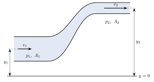
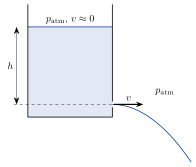
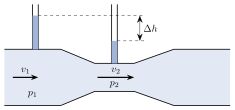



<!-- tillegg: Claude -->
Kontinuitetslikningen sier hvor fort vannet går. Men hva får det til å gå fortere i et smalt rør? Noe må dytte på det, og det er trykket. Der farten øker, må trykket falle. **Bernoullis likning** er energibevaring for et strømmende fluid, og den kobler sammen trykk, fart og høyde.

## Utledning: energibevaring for et fluid

{.tikz-fig style="width:520px"}

<!-- tillegg: Claude -->
Se på en liten porsjon fluid med volum $\Delta V$ og masse $\Delta m = \rho\Delta V$. Den flytter seg fra venstre, der trykket er $p_1$, farten $v_1$ og høyden $y_1$, til høyre, der de er $p_2$, $v_2$ og $y_2$. Vi bruker arbeid–energi-setningen: det arbeidet trykkreftene gjør, går med til å endre den mekaniske energien.

**Arbeidet fra trykket.** Fluidet bak dytter porsjonen framover med kraften $p_1A_1$ over strekningen $\Delta s_1$. Det gir arbeidet $p_1A_1\Delta s_1 = p_1\Delta V$. Foran må porsjonen dytte fluidet foran seg, og det koster $p_2\Delta V$. Netto arbeid:
$$
W = (p_1 - p_2)\Delta V
$$

**Endringen i energi.** Den kinetiske energien endres med $\tfrac12\Delta m(v_2^2 - v_1^2)$ og den potensielle med $\Delta m\,\mathrm{g}(y_2 - y_1)$.

Setter vi $W = \Delta E_K + \Delta E_P$ og deler på $\Delta V$ (husk $\Delta m/\Delta V = \rho$):
$$
p_1 - p_2 = \tfrac12\rho(v_2^2 - v_1^2) + \rho\mathrm{g}(y_2 - y_1)
$$
Vi samler leddene med samme indeks på hver side:

::: {.callout-important title="Bernoullis likning"}
<!-- tillegg: Claude -->
For ideell strømning (inkompressibel, stasjonær, uten friksjon) er
$$
p + \tfrac12\rho v^2 + \rho\mathrm{g}y = \text{konstant}
$$
langs en strømlinje. Mellom to punkter:
$$
p_1 + \tfrac12\rho v_1^2 + \rho\mathrm{g}y_1 = p_2 + \tfrac12\rho v_2^2 + \rho\mathrm{g}y_2
$$
:::

<!-- tillegg: Claude -->
Hvert ledd har enheten pascal, som er det samme som joule per kubikkmeter. Bernoullis likning er altså energi per volum: $\tfrac12\rho v^2$ er kinetisk energi per volum, $\rho\mathrm{g}y$ er potensiell energi per volum, og trykket $p$ kan tolkes som arbeidet trykket kan gjøre per volum.

::: {.kort}
- **I ro** ($v_1 = v_2 = 0$) gir likningen $p_2 = p_1 + \rho\mathrm{g}(y_1 - y_2)$. Det er det hydrostatiske trykket.
- **I samme høyde** gir den $p + \tfrac12\rho v^2 = \text{konstant}$. Der farten er stor, er trykket lavt.
- **Sammen med kontinuitetslikningen** $A_1v_1 = A_2v_2$ har vi to likninger. Det er nok til å løse de fleste oppgavene om ideell strømning.
:::

## Torricellis lov: utstrømning fra en tank

{.tikz-fig style="width:340px"}

<!-- tillegg: Claude -->
En åpen tank har et lite hull i dybden $h$ under overflaten. Vi bruker Bernoulli mellom et punkt på overflaten (1) og et punkt i strålen rett utenfor hullet (2):

- Begge steder er trykket lik lufttrykket, $p_1 = p_2 = p_\mathrm{atm}$.
- Tanken er mye bredere enn hullet, så kontinuitetslikningen gir at overflaten nesten står stille: $v_1 \approx 0$.
- Høydeforskjellen er $y_1 - y_2 = h$.

Bernoulli gir da $\rho\mathrm{g}h = \tfrac12\rho v^2$, og

::: {.graa}
$$
v = \sqrt{2\mathrm{g}h}
$$
:::

<!-- tillegg: Claude -->
Det er samme fart som en stein får ved å falle høyden $h$! Det er ikke tilfeldig: Uten friksjon blir potensiell energi til kinetisk energi på samme måte, enten det er en stein eller vann.

::: {.eksempel}
<!-- tillegg: Claude -->
**Eksempel: Tank med hull.** En vanntank står med vannflaten $2.0\ \mathrm{m}$ over et hull med diameter $1.0\ \mathrm{cm}$.

**a)** Hvor stor er farten og volumstrømmen ut av hullet?\
**b)** Tanken har et bunnareal på $1.0\ \mathrm{m^2}$. Hvor lang tid tar det å tømme den ned til hullet?

::: {.losning}
**a)** Torricellis lov:
$$
v = \sqrt{2\mathrm{g}h} = \sqrt{2\cdot9.81\cdot2.0}\ \mathrm{m/s} = \underline{\underline{6.3\ \mathrm{m/s}}}
$$
$$
Q = Av = \pi(0.0050\ \mathrm{m})^2\cdot6.26\ \mathrm{m/s} = \underline{\underline{4.9\cdot10^{-4}\ \mathrm{m^3/s}}} = 0.49\ \mathrm{L/s}
$$

**b)** Utstrømningen avtar etter hvert som $h$ minker, så vi kan ikke bare dele volumet på $Q$. Når vannflaten synker med farten $-\mathrm{d}h/\mathrm{d}t$, gir kontinuitetslikningen
$$
A_T\left(-\frac{\mathrm{d}h}{\mathrm{d}t}\right) = A\sqrt{2\mathrm{g}h}
$$
der $A_T$ er bunnarealet til tanken. Vi skiller variablene og integrerer fra $h_0$ til $0$:
$$
\int_{h_0}^{0}\frac{\mathrm{d}h}{\sqrt h} = -\frac{A}{A_T}\sqrt{2\mathrm{g}}\int_0^t\mathrm{d}t \quad\Rightarrow\quad t = \frac{A_T}{A}\sqrt{\frac{2h_0}{\mathrm{g}}}
$$
$$
t = \frac{1.0}{7.85\cdot10^{-5}}\sqrt{\frac{2\cdot2.0}{9.81}}\ \mathrm{s} = 8.1\cdot10^{3}\ \mathrm{s} \approx \underline{\underline{2.3\ \mathrm{h}}}
$$
Det tar dobbelt så lang tid som om strømmen hadde holdt seg på startverdien hele tiden.
:::
:::

## Venturirøret: måle strømning

{.tikz-fig style="width:460px"}

<!-- tillegg: Claude -->
Et rør med en innsnevring kalles et **venturirør**. I det smale partiet øker farten, og da må trykket falle. Ved å måle trykkforskjellen kan vi regne ut hvor fort fluidet strømmer. Røret ligger vannrett, så Bernoulli og kontinuitet gir
$$
p_1 - p_2 = \tfrac12\rho(v_2^2 - v_1^2), \qquad v_2 = \frac{A_1}{A_2}v_1
$$
Vi setter inn og løser for $v_1$:
$$
v_1 = \sqrt{\frac{2(p_1 - p_2)}{\rho\left[(A_1/A_2)^2 - 1\right]}}
$$

<!-- tillegg: Claude -->
Samme prinsipp, lavt trykk der farten er høy, forklarer også hvorfor en dusjforheng trekkes inn mot vannstrålen, og hvorfor en sprayflaske suger væske opp i røret.

::: {.eksempel}
<!-- tillegg: Claude -->
**Eksempel: Venturimåler.** Vann strømmer gjennom et venturirør som går fra diameter $6.0\ \mathrm{cm}$ til $3.0\ \mathrm{cm}$. Trykkforskjellen er målt til $15\ \mathrm{kPa}$. Hvor stor er volumstrømmen?

::: {.losning}
Arealforholdet er $(A_1/A_2) = (6.0/3.0)^2 = 4.0$.
$$
v_1 = \sqrt{\frac{2\cdot15\cdot10^{3}}{1000\cdot(4.0^2 - 1)}}\ \mathrm{m/s} = \sqrt{2.0}\ \mathrm{m/s} = 1.41\ \mathrm{m/s}
$$
$$
Q = A_1v_1 = \pi(0.030\ \mathrm{m})^2\cdot1.41\ \mathrm{m/s} = \underline{\underline{4.0\cdot10^{-3}\ \mathrm{m^3/s}}} = 4.0\ \mathrm{L/s}
$$
:::
:::

## Effekt: vannkraft og pumper

<!-- tillegg: Claude -->
Bernoulli-uttrykket er energi per volum. Ganger vi med volumstrømmen $Q$ (volum per tid), får vi energi per tid, altså **effekt**. Faller vann høyden $h$, frigjøres effekten $\rho\mathrm{g}hQ$. Et kraftverk med virkningsgrad $\eta$ leverer

::: {.graa}
$$
P = \eta\,\rho\mathrm{g}hQ
$$
:::

<!-- tillegg: Claude -->
Omvendt må en pumpe som løfter vann høyden $h$ og gir det farten $v$, tilføre minst effekten $P = \rho Q(\mathrm{g}h + \tfrac12 v^2)$. I praksis kommer friksjon i rørene i tillegg. Det tar vi med under *tap i rør*.

::: {.eksempel}
<!-- tillegg: Claude -->
**Eksempel: Kraftverket.** Et vannkraftverk har fallhøyde $120\ \mathrm{m}$ og slipper gjennom $50\ \mathrm{m^3/s}$. Turbinene og generatorene har samlet virkningsgrad $0.90$. Hvor stor effekt leverer kraftverket?

::: {.losning}
$$
P = \eta\rho\mathrm{g}hQ = 0.90\cdot1000\cdot9.81\cdot120\cdot50\ \mathrm{W} = 5.3\cdot10^{7}\ \mathrm{W} = \underline{\underline{53\ \mathrm{MW}}}
$$
:::
:::

:::: {.oppgaver}

::: {.oppgave tittel="Vannrøret i huset"}
<!-- tillegg: Claude -->
I kjelleren har vannrøret indre diameter $2.0\ \mathrm{cm}$, overtrykket er $3.0\ \mathrm{bar}$ og farten $1.0\ \mathrm{m/s}$. I andre etasje, $5.0\ \mathrm{m}$ høyere, har røret diameter $1.0\ \mathrm{cm}$. Hva er overtrykket der? Se bort fra friksjon.

::: {.losning}
Kontinuitet: halv diameter gir fire ganger så stor fart, $v_2 = 4.0\ \mathrm{m/s}$. Bernoulli løst for $p_2$:
$$
p_2 = p_1 + \tfrac12\rho(v_1^2 - v_2^2) - \rho\mathrm{g}(y_2 - y_1)
$$
$$
p_2 = 3.0\cdot10^{5} + \tfrac12\cdot1000\cdot(1.0^2 - 4.0^2) - 1000\cdot9.81\cdot5.0\ \mathrm{Pa} = \underline{\underline{2.4\cdot10^{5}\ \mathrm{Pa}}}
$$
Det meste av trykkfallet kommer av høyden. Farten bidrar bare med $7.5\ \mathrm{kPa}$.
:::
:::

::: {.oppgave tittel="Pitotrøret"}
<!-- tillegg: Claude -->
Et fly måler farten med et pitotrør: det måler forskjellen mellom trykket der lufta stoppes helt opp foran røret, og trykket i lufta som strømmer forbi. Forskjellen er $\tfrac12\rho v^2$. Hvor fort flyr flyet når trykkforskjellen er $600\ \mathrm{Pa}$ og lufta har tetthet $1.20\ \mathrm{kg/m^3}$?

::: {.losning}
$$
v = \sqrt{\frac{2\Delta p}{\rho}} = \sqrt{\frac{2\cdot600}{1.20}}\ \mathrm{m/s} = \underline{\underline{32\ \mathrm{m/s}}}
$$
Det er omtrent $110\ \mathrm{km/h}$, som er typisk farten et lite fly tar av med.
:::
:::

::: {.oppgave tittel="Sifongen" niva="Middels"}
<!-- tillegg: Claude -->
Med en slange kan du tømme et akvarium uten pumpe (en sifong). Slangen går over kanten, $0.30\ \mathrm{m}$ over vannflaten, og ender $0.40\ \mathrm{m}$ under vannflaten.

**a)** Hvor fort strømmer vannet ut av slangen?\
**b)** Hva er det absolutte trykket i det høyeste punktet av slangen?

::: {.losning}
**a)** Bernoulli fra vannflaten (i ro, $p_\mathrm{atm}$) til utløpet ($p_\mathrm{atm}$, $0.40\ \mathrm{m}$ lavere) gir Torricelli:
$$
v = \sqrt{2\mathrm{g}h} = \sqrt{2\cdot9.81\cdot0.40}\ \mathrm{m/s} = \underline{\underline{2.8\ \mathrm{m/s}}}
$$
**b)** Slangen har samme tverrsnitt overalt, så farten er $2.80\ \mathrm{m/s}$ også i toppen. Bernoulli fra vannflaten til toppen, $0.30\ \mathrm{m}$ høyere:
$$
p = p_\mathrm{atm} - \rho\mathrm{g}\cdot0.30 - \tfrac12\rho v^2 = 1.013\cdot10^{5} - 2943 - 3924\ \mathrm{Pa} = \underline{\underline{9.4\cdot10^{4}\ \mathrm{Pa}}}
$$
Trykket i toppen er lavere enn lufttrykket. Er toppen høyere enn ca. $10\ \mathrm{m}$, blir trykket null, og sifongen slutter å virke.
:::
:::

::: {.oppgave tittel="Pumpa" niva="Utfordrende"}
<!-- tillegg: Claude -->
En pumpe skal løfte $20\ \mathrm{L/s}$ vann $15\ \mathrm{m}$ opp fra et vann og sprute det ut med farten $3.0\ \mathrm{m/s}$. Hvor stor effekt må pumpa minst ha? Se bort fra friksjon.

::: {.losning}
Pumpa må gi vannet både potensiell og kinetisk energi. Effekten er energi per volum ganger volumstrøm:
$$
P = Q\left(\rho\mathrm{g}h + \tfrac12\rho v^2\right) = 0.020\cdot\left(1000\cdot9.81\cdot15 + \tfrac12\cdot1000\cdot3.0^2\right)\ \mathrm{W} = \underline{\underline{3.0\ \mathrm{kW}}}
$$
Med friksjon i rørene og en virkningsgrad under 1 må pumpa i praksis være kraftigere.
:::
:::

::::
