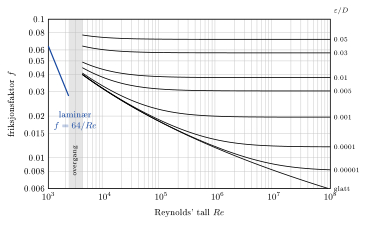



<!-- tillegg: Claude -->
Bernoullis likning gjelder uten friksjon. I et ekte rør bremser veggene og fluidet seg selv, og trykket faller jo lenger vannet går. Det er derfor vannverket trenger pumper, og derfor du får dårligere trykk i dusjen hvis noen tapper vann samtidig. Her utvider vi Bernoulli med et **tapsledd** og lærer å regne ut hvor stort det er.

## Bernoullis likning med tap

<!-- tillegg: Claude -->
Det er vanlig å dele Bernoullis likning på $\rho\mathrm{g}$. Da får alle leddene enheten meter, og de kalles **høyder**: trykkhøyde $p/(\rho\mathrm{g})$, hastighetshøyde $v^2/(2\mathrm{g})$ og stillingshøyde $z$. Med friksjon går noe av energien tapt som varme mellom punkt 1 og 2, og en pumpe kan tilføre energi. Det samlede uttrykket er

::: {.callout-important title="Utvidet Bernoulli (energilikningen)"}
<!-- tillegg: Claude -->
$$
\frac{p_1}{\rho\mathrm{g}} + \frac{v_1^2}{2\mathrm{g}} + z_1 + h_\mathrm{p} = \frac{p_2}{\rho\mathrm{g}} + \frac{v_2^2}{2\mathrm{g}} + z_2 + h_\mathrm{L}
$$
der $h_\mathrm{p}$ er **løftehøyden** til pumpa og $h_\mathrm{L}$ er **tapshøyden**: energien som går tapt per vekt av fluidet, målt i meter.
:::

<!-- tillegg: Claude -->
Tapshøyden er summen av to bidrag: **friksjonstap** langs rette rør og **engangstap** (enkelttap) i bend, ventiler, innløp og utløp.

## Friksjonstap: Darcy–Weisbach

<!-- tillegg: Claude -->
Erfaring og dimensjonsanalyse viser at friksjonstapet i et rett rør med lengde $L$ og diameter $D$ er proporsjonalt med hastighetshøyden og med $L/D$:

::: {.callout-important title="Darcy–Weisbachs likning"}
<!-- tillegg: Claude -->
$$
h_f = f\,\frac{L}{D}\,\frac{v^2}{2\mathrm{g}} \qquad\text{eller}\qquad \Delta p_f = f\,\frac{L}{D}\,\frac{\rho v^2}{2}
$$
der $f$ er den dimensjonsløse **friksjonsfaktoren** (Darcy-friksjonsfaktoren).
:::

<!-- tillegg: Claude -->
Friksjonsfaktoren avhenger av to dimensjonsløse tall: **Reynolds' tall** $Re = \rho vD/\mu$ og den **relative ruheten** $\varepsilon/D$, der $\varepsilon$ er den gjennomsnittlige høyden på ujevnhetene i rørveggen.

::: {.kort}
- **Laminær strømning** ($Re < 2300$): $f = 64/Re$. Ruheten spiller ingen rolle. Dette følger av Poiseuilles lov.
- **Turbulent strømning** ($Re > 4000$): $f$ avhenger av både $Re$ og $\varepsilon/D$. Den finnes fra Moody-diagrammet eller fra Colebrooks likning.
- **Svært stort Re**: kurvene flater ut, og $f$ avhenger bare av ruheten. Da er tapet proporsjonalt med $v^2$.
:::

<!-- tillegg: Claude -->
| Rørmateriale | $\varepsilon$ (mm) |
|---|---|
| Glass, plast | ca. $0.0015$ |
| Kobber | $0.0015$ |
| Nytt stålrør | $0.045$ |
| Galvanisert stål | $0.15$ |
| Støpejern | $0.26$ |
| Betong | $0.3$–$3$ |

## Moody-diagrammet

{.tikz-fig style="width:640px"}

<!-- tillegg: Claude -->
Slik leser du diagrammet:

::: {.steg}
1. Regn ut $Re = \rho vD/\mu$ og $\varepsilon/D$.
2. Er $Re < 2300$, bruk den rette linja $f = 64/Re$.
3. Ellers: finn kurven for din $\varepsilon/D$ (til høyre), og følg den til riktig $Re$ på den vannrette aksen.
4. Les av $f$ på den loddrette aksen. Husk at aksene er logaritmiske.
:::

<!-- tillegg: Claude -->
Kurvene i diagrammet er løsninger av **Colebrooks likning**:
$$
\frac{1}{\sqrt f} = -2.0\log_{10}\left(\frac{\varepsilon/D}{3.7} + \frac{2.51}{Re\sqrt f}\right)
$$
Den kan ikke løses direkte for $f$, men den løses lett med noen få gjentak på datamaskinen. Med kalkulator brukes ofte **Haalands formel**, som stemmer med Colebrook innenfor ca. 2 %:
$$
\frac{1}{\sqrt f} = -1.8\log_{10}\left[\left(\frac{\varepsilon/D}{3.7}\right)^{1.11} + \frac{6.9}{Re}\right]
$$

```{.python .kjor}
import numpy as np

def colebrook(Re, rel_ruhet):
    """Friksjonsfaktoren f fra Colebrooks likning (turbulent), eller 64/Re (laminær)."""
    if Re < 2300:
        return 64/Re
    f = 0.02                        # startgjetning
    for _ in range(50):             # gjentak til f ikke endres
        f = (-2.0*np.log10(rel_ruhet/3.7 + 2.51/(Re*np.sqrt(f))))**-2
    return f

# Endre tallene her:
rho, mu = 1000, 1.0e-3     # vann ved 20 °C
D, L = 0.050, 100          # diameter og lengde (m)
eps = 0.045e-3             # ruhet (m), nytt stålrør
Q = 4.0e-3                 # volumstrøm (m^3/s)

v  = Q/(np.pi*D**2/4)
Re = rho*v*D/mu
f  = colebrook(Re, eps/D)
hf = f*L/D*v**2/(2*9.81)
print(f"v = {v:.2f} m/s,  Re = {Re:.3g},  f = {f:.4f}")
print(f"friksjonstap h_f = {hf:.2f} m,  trykkfall = {rho*9.81*hf/1000:.1f} kPa")
```

## Engangstap

<!-- tillegg: Claude -->
Bend, ventiler, innsnevringer, innløp og utløp forstyrrer strømningen og gir ekstra tap. De skrives som en tapskoeffisient $K$ ganger hastighetshøyden:
$$
h_m = K\frac{v^2}{2\mathrm{g}}
$$

| Komponent | $K$ (typisk) |
|---|---|
| Skarpt innløp fra tank | 0.5 |
| Utløp i tank | 1.0 |
| 90°-bend | 0.3–0.9 |
| Åpen kuleventil | 0.05 |
| Halvåpen sluseventil | ca. 2 |

Utløpet har $K = 1$, fordi all kinetisk energi går tapt når strålen bremses opp i tanken. Har et rør mange komponenter, summeres koeffisientene: $h_m = \sum K\,v^2/(2\mathrm{g})$.

## Pumper

{.tikz-fig style="width:560px"}

<!-- tillegg: Claude -->
Mellom vannflatene i to åpne tanker er trykket lik lufttrykket og farten tilnærmet null. Utvidet Bernoulli gir da at pumpa må løfte

::: {.graa}
$$
h_\mathrm{p} = \Delta z + h_\mathrm{L}, \qquad P = \frac{\rho\mathrm{g}Qh_\mathrm{p}}{\eta}
$$
:::

<!-- tillegg: Claude -->
der $\eta$ er virkningsgraden til pumpa. Pumpa må altså både løfte vannet og betale for alt tapet underveis.

::: {.eksempel}
<!-- tillegg: Claude -->
**Eksempel: Pumpe mellom to tanker.** Vann ($\mu = 1.0\cdot10^{-3}\ \mathrm{Pa\cdot s}$) skal pumpes med $Q = 4.0\ \mathrm{L/s}$ fra en tank til en annen som står $10\ \mathrm{m}$ høyere. Røret er av nytt stål ($\varepsilon = 0.045\ \mathrm{mm}$), er $100\ \mathrm{m}$ langt og har diameter $5.0\ \mathrm{cm}$. Innløp, utløp og bend har til sammen $\sum K = 3.0$. Pumpa har virkningsgrad $0.70$. Hvor stor effekt trenger pumpa?

::: {.losning}
**Fart og Reynolds' tall:**
$$
v = \frac{Q}{\pi D^2/4} = \frac{4.0\cdot10^{-3}}{\pi\cdot0.050^2/4}\ \mathrm{m/s} = 2.04\ \mathrm{m/s}, \qquad Re = \frac{1000\cdot2.04\cdot0.050}{1.0\cdot10^{-3}} = 1.0\cdot10^{5}
$$
Strømningen er turbulent.

**Friksjonsfaktor:** $\varepsilon/D = 0.045/50 = 9.0\cdot10^{-4}$. Moody-diagrammet (eller Colebrook) gir $f \approx 0.022$.

**Tap:**
$$
h_f = f\frac{L}{D}\frac{v^2}{2\mathrm{g}} = 0.0218\cdot\frac{100}{0.050}\cdot\frac{2.04^2}{2\cdot9.81}\ \mathrm{m} = 9.2\ \mathrm{m}
$$
$$
h_m = \sum K\frac{v^2}{2\mathrm{g}} = 3.0\cdot\frac{2.04^2}{2\cdot9.81}\ \mathrm{m} = 0.63\ \mathrm{m}
$$
**Pumpe:**
$$
h_\mathrm{p} = \Delta z + h_f + h_m = 10\ \mathrm{m} + 9.2\ \mathrm{m} + 0.63\ \mathrm{m} = 19.9\ \mathrm{m}
$$
$$
P = \frac{\rho\mathrm{g}Qh_\mathrm{p}}{\eta} = \frac{1000\cdot9.81\cdot4.0\cdot10^{-3}\cdot19.9}{0.70}\ \mathrm{W} = \underline{\underline{1.1\ \mathrm{kW}}}
$$
Friksjonen i røret krever nesten like mye som selve løftet. Et rør med større diameter ville gitt mye mindre tap, fordi $v$ går ned og $h_f \propto v^2/D$.
:::
:::

::: {.callout-tip title="Til ettertanke"}
<!-- tillegg: Claude -->
Hvor mye mindre blir friksjonstapet i eksempelet hvis diameteren dobles, med samme volumstrøm? Bruk at $v \propto 1/D^2$, og anta at $f$ er omtrent den samme.
:::

<!-- tillegg: Claude -->
Med $v \propto 1/D^2$ blir $h_f \propto \dfrac{1}{D}\cdot\dfrac{1}{D^4} = \dfrac{1}{D^5}$. Dobbel diameter gir altså omtrent $2^5 = 32$ ganger mindre friksjonstap. Derfor lønner det seg ofte å bruke litt grovere rør.

:::: {.oppgaver}

::: {.oppgave tittel="Laminær olje"}
<!-- tillegg: Claude -->
Olje ($\rho = 900\ \mathrm{kg/m^3}$, $\mu = 0.10\ \mathrm{Pa\cdot s}$) strømmer med $0.50\ \mathrm{m/s}$ gjennom et rør med diameter $5.0\ \mathrm{cm}$ og lengde $20\ \mathrm{m}$. Hvor stort er trykkfallet?

::: {.losning}
$Re = 900\cdot0.50\cdot0.050/0.10 = 225$, så strømningen er laminær og $f = 64/Re = 0.284$.
$$
\Delta p_f = f\frac{L}{D}\frac{\rho v^2}{2} = 0.284\cdot\frac{20}{0.050}\cdot\frac{900\cdot0.50^2}{2}\ \mathrm{Pa} = \underline{\underline{13\ \mathrm{kPa}}}
$$
:::
:::

::: {.oppgave tittel="Kobberrøret"}
<!-- tillegg: Claude -->
Vann strømmer med $1.5\ \mathrm{m/s}$ gjennom et kobberrør med diameter $2.0\ \mathrm{cm}$ og lengde $30\ \mathrm{m}$. Bruk Moody-diagrammet eller Python-koden over til å finne friksjonstapet.

::: {.losning}
$Re = 1000\cdot1.5\cdot0.020/1.0\cdot10^{-3} = 3.0\cdot10^{4}$ og $\varepsilon/D = 0.0015/20 = 7.5\cdot10^{-5}$, nesten glatt rør. Det gir $f \approx 0.024$.
$$
h_f = 0.0237\cdot\frac{30}{0.020}\cdot\frac{1.5^2}{2\cdot9.81}\ \mathrm{m} = \underline{\underline{4.1\ \mathrm{m}}}
$$
Det tilsvarer et trykkfall på ca. $40\ \mathrm{kPa}$.
:::
:::

::: {.oppgave tittel="Hvor mye kommer ut?" niva="Middels"}
<!-- tillegg: Claude -->
En vanntank har vannflaten $8.0\ \mathrm{m}$ over utløpet av et $40\ \mathrm{m}$ langt rør med diameter $2.5\ \mathrm{cm}$. Røret slipper vannet fritt ut i lufta. Anta $f = 0.025$ og et innløpstap med $K = 0.5$. Hvor stor er utløpsfarten? Sammenlign med Torricellis lov uten tap.

::: {.losning}
Utvidet Bernoulli fra vannflaten (i ro, $p_\mathrm{atm}$) til utløpet ($p_\mathrm{atm}$, fart $v$):
$$
z_1 = \frac{v^2}{2\mathrm{g}} + \left(f\frac{L}{D} + K\right)\frac{v^2}{2\mathrm{g}} \quad\Rightarrow\quad v = \sqrt{\frac{2\mathrm{g}z_1}{1 + fL/D + K}}
$$
Med $fL/D = 0.025\cdot40/0.025 = 40$:
$$
v = \sqrt{\frac{2\cdot9.81\cdot8.0}{1 + 40 + 0.5}}\ \mathrm{m/s} = \underline{\underline{1.9\ \mathrm{m/s}}}
$$
Uten tap ville Torricelli gitt $\sqrt{2\cdot9.81\cdot8.0} = 12.5\ \mathrm{m/s}$. I et langt, tynt rør er friksjonen helt dominerende.
:::
:::

::: {.oppgave tittel="Dobbel volumstrøm" niva="Utfordrende"}
<!-- tillegg: Claude -->
I pumpeeksempelet over vil man doble volumstrømmen til $8.0\ \mathrm{L/s}$ i det samme røret. Hvor stor effekt trenger pumpa da? Bruk at $f \approx 0.021$ ved det høyere Reynolds-tallet.

::: {.losning}
Farten dobles til $v = 4.07\ \mathrm{m/s}$, så $v^2/(2\mathrm{g}) = 0.846\ \mathrm{m}$.
$$
h_f = 0.021\cdot\frac{100}{0.050}\cdot0.846\ \mathrm{m} = 35.5\ \mathrm{m}, \qquad h_m = 3.0\cdot0.846\ \mathrm{m} = 2.5\ \mathrm{m}
$$
$$
h_\mathrm{p} = 10 + 35.5 + 2.5\ \mathrm{m} = 48\ \mathrm{m}, \qquad P = \frac{1000\cdot9.81\cdot8.0\cdot10^{-3}\cdot48}{0.70}\ \mathrm{W} = \underline{\underline{5.4\ \mathrm{kW}}}
$$
Dobbel volumstrøm krever omtrent fem ganger så stor effekt, fordi tapet vokser med $v^2$ og volumstrømmen i tillegg dobles.
:::
:::

::::
