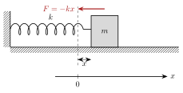
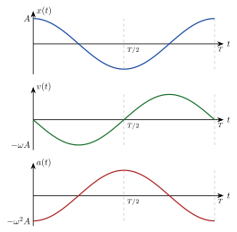
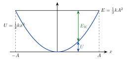

<!-- video: kommer (videoer/ingeniorfysikk/09-01-harmonisk-svingning) -->
{fig-alt="Video kommer"}

<!-- tillegg: Claude -->
En gynge, en gitarstreng, et hjerte som slår, atomer i et krystallgitter: Overalt i naturen finnes ting som beveger seg fram og tilbake. Den enkleste og viktigste av disse bevegelsene er den **harmoniske svingningen**. Den er viktig fordi nesten alle svingninger blir harmoniske når utslaget er lite, og fordi den er grunnlaget for å forstå bølger.

## Kloss på fjær

{.tikz-fig style="width:460px"}

<!-- tillegg: Claude -->
En kloss med masse $m$ ligger på et friksjonsfritt bord og er festet til en fjær med fjærstivhet $k$. I likevekt er $x = 0$. Trekker vi klossen ut og slipper, drar fjæra den tilbake med Hookes lov:
$$
F = -kx
$$
Minustegnet sier at kraften alltid peker mot likevekten. Klossen skyter forbi likevekten (den har fart der), fjæra presses sammen og skyver den tilbake, og slik fortsetter det.

Newtons andre lov, $F = ma$ med $a = \ddot x = \mathrm{d}^2x/\mathrm{d}t^2$, gir
$$
m\ddot x = -kx \qquad\Rightarrow\qquad \ddot x = -\frac{k}{m}x
$$

::: {.callout-note title="Definisjon: Enkel harmonisk svingning"}
<!-- tillegg: Claude -->
En bevegelse er en **enkel harmonisk svingning** når akselerasjonen er proporsjonal med utslaget og motsatt rettet:
$$
\ddot x = -\omega^2x
$$
Konstanten $\omega$ kalles **vinkelfrekvensen**. For klossen på fjæra er $\omega = \sqrt{k/m}$.
:::

## Løsningen

<!-- tillegg: Claude -->
Vi trenger en funksjon som blir seg selv med motsatt fortegn når den deriveres to ganger. Det gjør cosinus og sinus: $\dfrac{\mathrm{d}^2}{\mathrm{d}t^2}\cos(\omega t) = -\omega^2\cos(\omega t)$. Den generelle løsningen er

::: {.callout-important title="Harmonisk svingning"}
<!-- tillegg: Claude -->
$$
x(t) = A\cos(\omega t + \varphi)
$$
med **amplitude** $A$ (største utslag) og **fasekonstant** $\varphi$, som bestemmes av hvor klossen er og hvor fort den går ved $t = 0$. Periode og frekvens:
$$
T = \frac{2\pi}{\omega}, \qquad f = \frac1T = \frac{\omega}{2\pi}, \qquad \omega = \sqrt{\frac km}
$$
:::

<!-- tillegg: Claude -->
Legg merke til at perioden **ikke avhenger av amplituden**. En fjær svinger like fort enten den trekkes ut litt eller mye. Det er dette som gjør harmoniske svingninger så nyttige i klokker. Tung kloss gir langsom svingning, stiv fjær gir rask svingning, akkurat som vi forventer.

Ved å derivere finner vi fart og akselerasjon:
$$
v(t) = \dot x = -\omega A\sin(\omega t + \varphi), \qquad a(t) = \ddot x = -\omega^2A\cos(\omega t + \varphi)
$$

{.tikz-fig style="width:420px"}

::: {.kort}
- **Største fart:** $v_\mathrm{maks} = \omega A$, i likevektspunktet.
- **Største akselerasjon:** $a_\mathrm{maks} = \omega^2A$, i ytterpunktene.
- **Faseforskyvning:** Farten er en kvart periode foran posisjonen, akselerasjonen er en halv periode forskjøvet (motsatt fase).
:::

## Energi

<!-- tillegg: Claude -->
Fjærkraften er konservativ, med potensiell energi $U = \tfrac12kx^2$. Uten friksjon er den totale mekaniske energien bevart:
$$
E = \tfrac12mv^2 + \tfrac12kx^2 = \tfrac12kA^2
$$
I ytterpunktene står klossen stille, så all energi er potensiell. I likevekten er $x = 0$, og all energi er kinetisk. Setter vi $\tfrac12mv_\mathrm{maks}^2 = \tfrac12kA^2$, får vi igjen $v_\mathrm{maks} = \sqrt{k/m}\,A = \omega A$.

{.tikz-fig style="width:440px"}

<!-- tillegg: Claude -->
Energidiagrammet viser også hvorfor svingningen er så vanlig: Nesten enhver potensialkurve ser ut som en parabel nær bunnen. Derfor svinger nesten alt harmonisk når utslaget er lite.

::: {.eksempel}
<!-- tillegg: Claude -->
**Eksempel: Kloss på fjær.** En kloss på $0.50\ \mathrm{kg}$ er festet til en fjær med $k = 200\ \mathrm{N/m}$. Klossen trekkes $5.0\ \mathrm{cm}$ ut fra likevekt og slippes ved $t = 0$.

**a)** Finn vinkelfrekvens, periode og frekvens.\
**b)** Finn største fart og største akselerasjon.\
**c)** Hvor er klossen, og hvor fort går den, ved $t = 0.10\ \mathrm{s}$?

::: {.losning}
**a)**
$$
\omega = \sqrt{\frac km} = \sqrt{\frac{200}{0.50}}\ \mathrm{s^{-1}} = \underline{\underline{20\ \mathrm{s^{-1}}}}, \quad T = \frac{2\pi}{\omega} = \underline{\underline{0.31\ \mathrm{s}}}, \quad f = \frac1T = \underline{\underline{3.2\ \mathrm{Hz}}}
$$
**b)**
$$
v_\mathrm{maks} = \omega A = 20\cdot0.050\ \mathrm{m/s} = \underline{\underline{1.0\ \mathrm{m/s}}}, \qquad a_\mathrm{maks} = \omega^2A = 400\cdot0.050\ \mathrm{m/s^2} = \underline{\underline{20\ \mathrm{m/s^2}}}
$$
**c)** Klossen slippes fra ytterpunktet, så $x(0) = A$ og $v(0) = 0$. Det gir $\varphi = 0$ og $x = A\cos(\omega t)$. Vinkelen er $\omega t = 2.0\ \mathrm{rad}$ (husk at kalkulatoren må stå på radianer):
$$
x = 0.050\cos(2.0)\ \mathrm{m} = \underline{\underline{-2.1\ \mathrm{cm}}}, \qquad v = -0.050\cdot20\sin(2.0)\ \mathrm{m/s} = \underline{\underline{-0.91\ \mathrm{m/s}}}
$$
Klossen er på andre siden av likevekten og fortsatt på vei mot venstre.
:::
:::

## Prøv selv

```{.python .kjor}
import numpy as np
import matplotlib.pyplot as plt

m, k = 0.50, 200      # masse (kg) og fjærstivhet (N/m)
A, phi = 0.05, 0.0    # amplitude (m) og fasekonstant (rad)

w = np.sqrt(k/m)
t = np.linspace(0, 2*2*np.pi/w, 400)     # to perioder
x = A*np.cos(w*t + phi)
v = -w*A*np.sin(w*t + phi)

plt.plot(t, x*100, label='x (cm)')
plt.plot(t, v*10, label='v (dm/s)')
plt.xlabel('t (s)'); plt.legend(); plt.grid(True)
plt.title(f'T = {2*np.pi/w:.3f} s')
plt.show()
```

<!-- tillegg: Claude -->
Endre `m` og `k`, og se hvordan perioden endres. Prøv også `phi = -np.pi/2`: Da starter klossen i likevekt med fart mot høyre.

:::: {.oppgaver}

::: {.oppgave tittel="Bilen på fjærene"}
<!-- tillegg: Claude -->
En bil på $1200\ \mathrm{kg}$ synker $3.0\ \mathrm{cm}$ når fire personer med samlet masse $300\ \mathrm{kg}$ setter seg inn. Behandle bilen som én masse på én fjær. Hva er fjærstivheten, og med hvilken frekvens svinger den fullastede bilen (uten støtdempere)?

::: {.losning}
Fjæra må bære den ekstra tyngden:
$$
k = \frac{m\mathrm{g}}{\Delta x} = \frac{300\cdot9.81}{0.030}\ \mathrm{N/m} = \underline{\underline{9.8\cdot10^{4}\ \mathrm{N/m}}}
$$
Hele massen, $1500\ \mathrm{kg}$, svinger:
$$
f = \frac{1}{2\pi}\sqrt{\frac{k}{m}} = \frac{1}{2\pi}\sqrt{\frac{9.81\cdot10^{4}}{1500}}\ \mathrm{Hz} = \underline{\underline{1.3\ \mathrm{Hz}}}
$$
:::
:::

::: {.oppgave tittel="Dobbel masse"}
<!-- tillegg: Claude -->
Hva skjer med perioden hvis massen på fjæra dobles? Og hvis amplituden dobles?

::: {.losning}
$T = 2\pi\sqrt{m/k}$, så dobbel masse gir perioden $\sqrt2 \approx 1.41$ ganger lengre. Amplituden påvirker **ikke** perioden: Med dobbel amplitude går klossen dobbelt så langt, men også dobbelt så fort.
:::
:::

::: {.oppgave tittel="Fart et sted på veien" niva="Middels"}
<!-- tillegg: Claude -->
For klossen i eksempelet over ($k = 200\ \mathrm{N/m}$, $m = 0.50\ \mathrm{kg}$, $A = 5.0\ \mathrm{cm}$): Hvor stor er farten når $x = 3.0\ \mathrm{cm}$? Bruk energibevaring.

::: {.losning}
$$
\tfrac12mv^2 + \tfrac12kx^2 = \tfrac12kA^2 \quad\Rightarrow\quad v = \omega\sqrt{A^2 - x^2}
$$
$$
v = 20\cdot\sqrt{0.050^2 - 0.030^2}\ \mathrm{m/s} = 20\cdot0.040\ \mathrm{m/s} = \underline{\underline{0.80\ \mathrm{m/s}}}
$$
:::
:::

::: {.oppgave tittel="Startbetingelser" niva="Utfordrende"}
<!-- tillegg: Claude -->
Den samme klossen står i likevekt og får et dytt slik at den har farten $0.60\ \mathrm{m/s}$ mot positiv $x$-retning ved $t = 0$. Finn amplituden og fasekonstanten, og skriv opp $x(t)$.

::: {.losning}
Ved $t = 0$: $x(0) = A\cos\varphi = 0$ og $v(0) = -\omega A\sin\varphi = 0.60\ \mathrm{m/s}$.

Den første likningen gir $\varphi = \pm\pi/2$. Den andre krever $\sin\varphi < 0$, altså $\varphi = -\pi/2$. Da er $v(0) = \omega A$, og
$$
A = \frac{v(0)}{\omega} = \frac{0.60}{20}\ \mathrm{m} = \underline{\underline{3.0\ \mathrm{cm}}}
$$
$$
x(t) = 0.030\cos\left(20t - \frac{\pi}{2}\right)\ \mathrm{m} = \underline{\underline{0.030\sin(20t)\ \mathrm{m}}}
$$
:::
:::

::::
