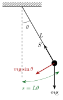
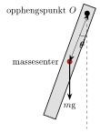

<!-- video: kommer (videoer/ingeniorfysikk/09-02-pendel) -->
{fig-alt="Video kommer"}

<!-- tillegg: Claude -->
Galileo skal ha lagt merke til at en lysekrone i katedralen i Pisa brukte like lang tid på hver sving, enten den svingte mye eller lite. Han målte tiden med sin egen puls. Den oppdagelsen ble grunnlaget for pendelurene, som var de mest nøyaktige klokkene i nesten 300 år. Her ser vi hvorfor en pendel svinger harmonisk, og hva som bestemmer perioden.

## Masse i fjær

<!-- tillegg: Claude -->
En masse som henger i en loddrett fjær, svinger med akkurat samme periode som på et vannrett bord, $T = 2\pi\sqrt{m/k}$. Tyngdekraften flytter bare likevektspunktet ned med strekningen $m\mathrm{g}/k$. Måler vi $x$ fra den nye likevekten, er bevegelseslikningen den samme som før.

## Matematisk pendel

{.tikz-fig style="width:300px"}

<!-- tillegg: Claude -->
En **matematisk pendel** er en punktmasse $m$ i ei masseløs snor med lengde $L$. Loddet beveger seg langs en sirkelbue, og vi måler posisjonen med buelengden $s = L\theta$. Snorkraften $S$ står vinkelrett på banen og gjør ikke noe arbeid. Langs banen virker bare komponenten $m\mathrm{g}\sin\theta$ av tyngden, og den peker mot bunnen. Newtons andre lov langs banen:
$$
m\ddot s = -m\mathrm{g}\sin\theta \qquad\Rightarrow\qquad L\ddot\theta = -\mathrm{g}\sin\theta
$$
Dette er ikke en harmonisk svingning, fordi høyresiden er $\sin\theta$ og ikke $\theta$. Men for små vinkler er $\sin\theta \approx \theta$ (med $\theta$ i radianer). Da får vi
$$
\ddot\theta = -\frac{\mathrm{g}}{L}\theta
$$
Det er en harmonisk svingning med $\omega^2 = \mathrm{g}/L$:

::: {.callout-important title="Matematisk pendel (små utslag)"}
<!-- tillegg: Claude -->
$$
\omega = \sqrt{\frac{\mathrm{g}}{L}}, \qquad T = 2\pi\sqrt{\frac{L}{\mathrm{g}}}
$$
:::

<!-- tillegg: Claude -->
Perioden avhenger verken av massen eller amplituden, bare av lengden og tyngdeakselerasjonen. Massen forkorter seg bort, av samme grunn som alle ting faller like fort. En pendel på $1.0\ \mathrm{m}$ har en periode på $2.0\ \mathrm{s}$, altså ett sekund per sving.

### Hvor små må utslagene være?

<!-- tillegg: Claude -->
Tilnærmingen $\sin\theta \approx \theta$ er bedre enn man skulle tro. Tabellen viser hvor mye lengre den eksakte perioden er enn $2\pi\sqrt{L/\mathrm{g}}$:

| Største utslag $\theta_0$ | 5° | 10° | 20° | 45° | 90° |
|---|---|---|---|---|---|
| $T_\mathrm{eksakt}/T$ | 1.0005 | 1.002 | 1.008 | 1.040 | 1.180 |

Opp til ca. 20° er feilen under én prosent.

```{.python .kjor}
import numpy as np
import matplotlib.pyplot as plt

g, L = 9.81, 1.0
theta0 = np.radians(60)       # startvinkel. Prøv 10, 30, 60, 120 grader!

# løser L*theta'' = -g*sin(theta) numerisk med små tidssteg
dt = 0.001
t = np.arange(0, 8, dt)
th, om = np.zeros_like(t), np.zeros_like(t)
th[0] = theta0
for i in range(len(t)-1):
    om[i+1] = om[i] - g/L*np.sin(th[i])*dt
    th[i+1] = th[i] + om[i+1]*dt

w = np.sqrt(g/L)
plt.plot(t, np.degrees(th), label='eksakt (numerisk)')
plt.plot(t, np.degrees(theta0*np.cos(w*t)), '--', label='harmonisk tilnærming')
plt.xlabel('t (s)'); plt.ylabel('vinkel (grader)'); plt.legend(); plt.grid(True)
plt.show()
```

<!-- tillegg: Claude -->
Med store utslag kommer den eksakte løsningen etter tilnærmingen, fordi tilbakeføringskraften $m\mathrm{g}\sin\theta$ er mindre enn $m\mathrm{g}\theta$.

::: {.eksempel}
<!-- tillegg: Claude -->
**Eksempel: Sekundpendelen.** Hvor lang må en pendel være for at perioden skal være nøyaktig $2.00\ \mathrm{s}$? Hva blir perioden til den samme pendelen på månen, der $g = 1.62\ \mathrm{m/s^2}$?

::: {.losning}
Vi løser $T = 2\pi\sqrt{L/\mathrm{g}}$ for $L$:
$$
L = \mathrm{g}\left(\frac{T}{2\pi}\right)^2 = 9.81\cdot\left(\frac{2.00}{2\pi}\right)^2\ \mathrm{m} = \underline{\underline{0.994\ \mathrm{m}}}
$$
På månen:
$$
T = 2\pi\sqrt{\frac{0.994}{1.62}}\ \mathrm{s} = \underline{\underline{4.92\ \mathrm{s}}}
$$
Et pendelur som tas med til månen, går altså altfor sakte.
:::
:::

## Fysisk pendel

{.tikz-fig style="width:300px"}

<!-- tillegg: Claude -->
En ekte pendel er ikke en punktmasse. Et stivt legeme som svinger om en fast akse, kalles en **fysisk pendel**. Da bruker vi Newtons andre lov for rotasjon, $\tau = I\alpha$ (se *rotasjon*). Tyngden virker i massesenteret, i avstanden $d$ fra aksen, og gir dreiemomentet $\tau = -m\mathrm{g}d\sin\theta$:
$$
I\ddot\theta = -m\mathrm{g}d\sin\theta \approx -m\mathrm{g}d\,\theta
$$
der $I$ er treghetsmomentet om opphengspunktet.

::: {.callout-important title="Fysisk pendel (små utslag)"}
<!-- tillegg: Claude -->
$$
\omega = \sqrt{\frac{m\mathrm{g}d}{I}}, \qquad T = 2\pi\sqrt{\frac{I}{m\mathrm{g}d}}
$$
:::

<!-- tillegg: Claude -->
For en punktmasse er $I = mL^2$ og $d = L$. Da får vi tilbake $T = 2\pi\sqrt{L/\mathrm{g}}$, slik det skal være.

::: {.eksempel}
<!-- tillegg: Claude -->
**Eksempel: Meterstokken.** En meterstokk ($L = 1.00\ \mathrm{m}$) henger i den ene enden og svinger med små utslag. Hva er perioden? Sammenlign med en matematisk pendel med samme lengde.

::: {.losning}
For en tynn stav om enden er $I = \tfrac13mL^2$, og massesenteret er i $d = L/2$:
$$
T = 2\pi\sqrt{\frac{\tfrac13mL^2}{m\mathrm{g}L/2}} = 2\pi\sqrt{\frac{2L}{3\mathrm{g}}} = 2\pi\sqrt{\frac{2\cdot1.00}{3\cdot9.81}}\ \mathrm{s} = \underline{\underline{1.64\ \mathrm{s}}}
$$
Den matematiske pendelen har $T = 2.01\ \mathrm{s}$. Meterstokken svinger fortere fordi mye av massen er nær opphengspunktet. Den oppfører seg som en matematisk pendel med lengden $\tfrac23L$.
:::
:::

:::: {.oppgaver}

::: {.oppgave tittel="Gyngen"}
<!-- tillegg: Claude -->
En gynge har tau som er $2.5\ \mathrm{m}$ lange. Hva er perioden når barnet sitter stille og gynger med små utslag?

::: {.losning}
$$
T = 2\pi\sqrt{\frac{L}{\mathrm{g}}} = 2\pi\sqrt{\frac{2.5}{9.81}}\ \mathrm{s} = \underline{\underline{3.2\ \mathrm{s}}}
$$
:::
:::

::: {.oppgave tittel="Største fart"}
<!-- tillegg: Claude -->
En pendel med lengde $1.0\ \mathrm{m}$ slippes fra ro med utslaget $10^\circ$. Hvor stor er farten i bunnen? Bruk energibevaring.

::: {.losning}
Loddet faller høyden $h = L(1 - \cos\theta_0)$:
$$
v = \sqrt{2\mathrm{g}L(1 - \cos\theta_0)} = \sqrt{2\cdot9.81\cdot1.0\cdot(1 - \cos10^\circ)}\ \mathrm{m/s} = \underline{\underline{0.55\ \mathrm{m/s}}}
$$
:::
:::

::: {.oppgave tittel="Måle g" niva="Middels"}
<!-- tillegg: Claude -->
I en laboratorieøvelse måler en student tiden for 20 svingninger med en pendel på $0.800\ \mathrm{m}$ til $35.9\ \mathrm{s}$. Hvilken verdi for $g$ gir det? Hvorfor er det lurt å måle mange svingninger i stedet for én?

::: {.losning}
$T = 35.9/20\ \mathrm{s} = 1.795\ \mathrm{s}$. Fra $T = 2\pi\sqrt{L/g}$:
$$
g = \frac{4\pi^2L}{T^2} = \frac{4\pi^2\cdot0.800}{1.795^2}\ \mathrm{m/s^2} = \underline{\underline{9.80\ \mathrm{m/s^2}}}
$$
Reaksjonstiden ved start og stopp gir den samme feilen enten man måler én eller 20 svingninger. Med 20 svingninger fordeles feilen på 20 perioder, så usikkerheten i $T$ blir 20 ganger mindre.
:::
:::

::: {.oppgave tittel="Ring på en spiker" niva="Utfordrende"}
<!-- tillegg: Claude -->
En tynn ring med radius $R = 10\ \mathrm{cm}$ henger på en spiker og svinger med små utslag i ringens plan. Treghetsmomentet om sentrum er $mR^2$. Finn perioden. (Bruk parallellakseteoremet: $I = I_\mathrm{cm} + md^2$.)

::: {.losning}
Massesenteret er i sentrum av ringen, så $d = R$. Om spikeren:
$$
I = mR^2 + mR^2 = 2mR^2
$$
$$
T = 2\pi\sqrt{\frac{2mR^2}{m\mathrm{g}R}} = 2\pi\sqrt{\frac{2R}{\mathrm{g}}} = 2\pi\sqrt{\frac{2\cdot0.10}{9.81}}\ \mathrm{s} = \underline{\underline{0.90\ \mathrm{s}}}
$$
Ringen svinger som en matematisk pendel med lengden $2R$, altså hele diameteren.
:::
:::

::::
