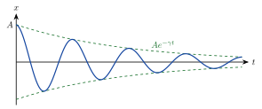
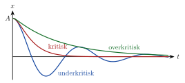

<!-- video: kommer (videoer/ingeniorfysikk/09-03-dempede-svingninger) -->
{fig-alt="Video kommer"}

<!-- tillegg: Claude -->
En gynge stopper til slutt hvis ingen dytter. Lufta og friksjonen i opphenget tar litt energi for hver sving, og utslaget blir mindre og mindre. Slike svingninger kalles **dempede**. Noen ganger vil vi ha så lite demping som mulig, for eksempel i en klokke. Andre ganger vil vi ha mye, for eksempel i støtdemperne på en bil, som skal hindre at bilen gynger etter hver humpe.

## Bevegelseslikningen

<!-- tillegg: Claude -->
En vanlig modell er at dempingskraften er proporsjonal med farten og motsatt rettet: $F_d = -b\dot x$, der $b$ er **dempingskonstanten** (enhet $\mathrm{kg/s}$). Det stemmer godt for en kloss i olje eller en støtdemper, og for lav fart i lufta. Sammen med fjærkraften gir Newtons andre lov
$$
m\ddot x = -kx - b\dot x \qquad\Rightarrow\qquad \ddot x + 2\gamma\dot x + \omega_0^2x = 0
$$
der vi har innført

::: {.graa}
$$
\omega_0 = \sqrt{\frac km} \quad\text{(egenfrekvensen uten demping)}, \qquad \gamma = \frac{b}{2m} \quad\text{(dempingsraten)}
$$
:::

<!-- tillegg: Claude -->
Hvordan systemet oppfører seg, avhenger av om dempingen $\gamma$ er mindre eller større enn $\omega_0$.

## Underkritisk demping ($\gamma < \omega_0$)

<!-- tillegg: Claude -->
Med svak demping svinger systemet fortsatt, men amplituden avtar eksponentielt. Løsningen er

::: {.callout-important title="Underkritisk dempet svingning"}
<!-- tillegg: Claude -->
$$
x(t) = A\mathrm{e}^{-\gamma t}\cos(\omega_dt + \varphi), \qquad \omega_d = \sqrt{\omega_0^2 - \gamma^2}
$$
:::

{.tikz-fig style="width:500px"}

<!-- tillegg: Claude -->
Du kan sjekke løsningen ved å sette den inn i likningen. To ting å merke seg:

::: {.kort}
- **Amplituden avtar eksponentielt.** For hver tid $1/\gamma$ blir amplituden en faktor $\mathrm{e} \approx 2.7$ mindre. Halveringstiden er $t_{1/2} = \ln2/\gamma$.
- **Litt langsommere svingning.** Vinkelfrekvensen $\omega_d$ er litt mindre enn $\omega_0$. Med svak demping er forskjellen så liten at den nesten ikke merkes.
:::

<!-- tillegg: Claude -->
Energien er proporsjonal med kvadratet av amplituden, $E \propto A^2\mathrm{e}^{-2\gamma t}$, så den avtar dobbelt så fort som amplituden.

::: {.eksempel}
<!-- tillegg: Claude -->
**Eksempel: Kloss i olje.** Klossen på $0.50\ \mathrm{kg}$ med fjær $k = 200\ \mathrm{N/m}$ svinger nå i olje, med dempingskonstant $b = 0.80\ \mathrm{kg/s}$. Hvor lang tid tar det før amplituden er halvert, og hvor mange svingninger rekker klossen på den tiden?

::: {.losning}
$$
\gamma = \frac{b}{2m} = \frac{0.80}{2\cdot0.50}\ \mathrm{s^{-1}} = 0.80\ \mathrm{s^{-1}}, \qquad \omega_0 = \sqrt{\frac{200}{0.50}}\ \mathrm{s^{-1}} = 20\ \mathrm{s^{-1}}
$$
Siden $\gamma \ll \omega_0$, er dempingen underkritisk og $\omega_d \approx 20\ \mathrm{s^{-1}}$. Halveringstiden:
$$
t_{1/2} = \frac{\ln2}{\gamma} = \frac{0.693}{0.80}\ \mathrm{s} = \underline{\underline{0.87\ \mathrm{s}}}
$$
Perioden er $T = 2\pi/\omega_d = 0.314\ \mathrm{s}$, så klossen rekker
$$
\frac{0.866}{0.314} \approx \underline{\underline{2.8\ \text{svingninger}}}
$$
:::
:::

## Kritisk og overkritisk demping

{.tikz-fig style="width:500px"}

<!-- tillegg: Claude -->
Øker vi dempingen, blir $\omega_d$ mindre, og ved $\gamma = \omega_0$ forsvinner svingningen helt:

::: {.kort}
- **Kritisk demping** ($\gamma = \omega_0$): Systemet går tilbake til likevekt så fort som mulig uten å svinge forbi. Løsningen er $x = (C_1 + C_2t)\mathrm{e}^{-\omega_0t}$. Støtdempere på biler og dørpumper er laget for å være nær kritisk dempet.
- **Overkritisk demping** ($\gamma > \omega_0$): Dempingen er så sterk at systemet kryper sakte tilbake til likevekt. Tenk på en fjær i sirup.
:::

<!-- tillegg: Claude -->
Den kritiske dempingskonstanten finner vi fra $\gamma = \omega_0$, altså $b/(2m) = \sqrt{k/m}$:
$$
b_\mathrm{kritisk} = 2\sqrt{km}
$$

::: {.eksempel}
<!-- tillegg: Claude -->
**Eksempel: Støtdemperen.** Bilen på $1500\ \mathrm{kg}$ med fjærstivhet $k = 9.8\cdot10^{4}\ \mathrm{N/m}$ skal være kritisk dempet. Hvor stor dempingskonstant må støtdemperne ha til sammen?

::: {.losning}
$$
b = 2\sqrt{km} = 2\sqrt{9.8\cdot10^{4}\cdot1500}\ \mathrm{kg/s} = \underline{\underline{2.4\cdot10^{4}\ \mathrm{kg/s}}}
$$
Med slitte støtdempere blir $b$ mindre. Da blir dempingen underkritisk, og bilen fortsetter å gynge etter en humpe.
:::
:::

## Prøv selv

```{.python .kjor}
import numpy as np
import matplotlib.pyplot as plt

m, k = 0.50, 200          # masse og fjærstivhet
b = 0.80                  # dempingskonstant. Prøv 0.8, 5, 20 (kritisk) og 50!

dt = 1e-4
t = np.arange(0, 3, dt)
x, v = np.zeros_like(t), np.zeros_like(t)
x[0] = 0.05               # slippes fra 5 cm
for i in range(len(t)-1):
    a = (-k*x[i] - b*v[i])/m
    v[i+1] = v[i] + a*dt
    x[i+1] = x[i] + v[i+1]*dt

plt.plot(t, x*100)
plt.xlabel('t (s)'); plt.ylabel('x (cm)'); plt.grid(True)
plt.title(f'b = {b} kg/s,  kritisk b = {2*np.sqrt(k*m):.1f} kg/s')
plt.show()
```

:::: {.oppgaver}

::: {.oppgave tittel="Kritisk demping"}
<!-- tillegg: Claude -->
En masse på $2.0\ \mathrm{kg}$ henger i en fjær med $k = 50\ \mathrm{N/m}$. Hvor stor dempingskonstant gir kritisk demping?

::: {.fasit}
$20\ \mathrm{kg/s}$
:::
:::

::: {.oppgave tittel="Energitap"}
<!-- tillegg: Claude -->
Amplituden til en dempet svingning er halvert etter $10$ svingninger. Hvor stor andel av den opprinnelige energien er igjen?

::: {.fasit}
$0.25$
:::
:::

::: {.oppgave tittel="Pendel i lufta" niva="Middels"}
<!-- tillegg: Claude -->
En pendel med lengde $1.00\ \mathrm{m}$ og masse $0.20\ \mathrm{kg}$ svinger slik at amplituden halveres i løpet av 10 svingninger. Finn $\gamma$ og dempingskonstanten $b$. Er det rimelig å bruke den udempede perioden?

::: {.fasit}
$0.0346\ \mathrm{s^{-1}}$ · $0.014\ \mathrm{kg/s}$
:::
:::

::: {.oppgave tittel="Sjekk løsningen" niva="Utfordrende"}
<!-- tillegg: Claude -->
Vis at $x(t) = A\mathrm{e}^{-\gamma t}\cos(\omega_dt)$ er en løsning av $\ddot x + 2\gamma\dot x + \omega_0^2x = 0$ når $\omega_d^2 = \omega_0^2 - \gamma^2$.

:::

::::
