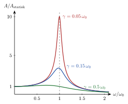

<!-- video: kommer (videoer/ingeniorfysikk/09-04-tvungne-svingninger) -->
{fig-alt="Video kommer"}

<!-- tillegg: Claude -->
Når du dytter et barn på en gynge, må du dytte i riktig takt. Dytter du akkurat når gyngen er på vei bort fra deg, blir utslaget større og større, selv om hvert dytt er lite. Dytter du i feil takt, skjer det nesten ingenting. Dette er **resonans**: Et system som drives med sin egen frekvens, kan få svært store utslag. Resonans er nyttig i musikkinstrumenter, radioer og MR-maskiner, og farlig for broer, bygninger og maskiner.

## Drevet svingning

<!-- tillegg: Claude -->
Vi tar en dempet fjær–masse-svingning og legger til en ytre kraft som varierer harmonisk med vinkelfrekvensen $\omega$:
$$
m\ddot x = -kx - b\dot x + F_0\cos(\omega t)
$$
Vi deler på $m$ og bruker $\omega_0 = \sqrt{k/m}$ og $\gamma = b/(2m)$:
$$
\ddot x + 2\gamma\dot x + \omega_0^2x = \frac{F_0}{m}\cos(\omega t)
$$

<!-- tillegg: Claude -->
Like etter at kraften slås på, er bevegelsen en blanding av egen svingning og påtvunget svingning. Men den egne svingningen dempes ut. Etter en stund svinger systemet bare i **takt med kraften**, med vinkelfrekvensen $\omega$, ikke $\omega_0$. Dette kalles den **stasjonære** løsningen:

::: {.callout-important title="Stasjonær tvungen svingning"}
<!-- tillegg: Claude -->
$$
x(t) = A\cos(\omega t - \delta), \qquad A = \frac{F_0/m}{\sqrt{(\omega_0^2 - \omega^2)^2 + (2\gamma\omega)^2}}
$$
der $\delta$ er en faseforskyvning mellom kraften og utslaget.
:::

<!-- tillegg: Claude -->
Du kan finne amplituden ved å sette $x = A\cos(\omega t - \delta)$ inn i likningen og samle leddene med $\cos(\omega t)$ og $\sin(\omega t)$ hver for seg. Det er en god øvelse i trigonometri.

## Resonans

{.tikz-fig style="width:500px"}

<!-- tillegg: Claude -->
Kurvene viser tre områder:

::: {.kort}
- **Langsom driving** ($\omega \ll \omega_0$): Massen følger kraften i takt, og utslaget er omtrent $F_0/k$, som om kraften var konstant.
- **Resonans** ($\omega \approx \omega_0$): Nevneren blir liten, og amplituden blir stor. Med svak demping er toppen omtrent $A_\mathrm{maks} \approx \dfrac{F_0}{2m\gamma\omega_0}$. Uten demping ville den blitt uendelig stor.
- **Rask driving** ($\omega \gg \omega_0$): Massen rekker ikke å følge med. Utslaget blir lite og er i motfase med kraften.
:::

<!-- tillegg: Claude -->
Ved resonans skyver kraften alltid i samme retning som farten. Da tilfører den energi hele tiden, akkurat som når du dytter gyngen i riktig takt. Amplituden vokser til dempingen tar like mye energi per periode som kraften tilfører.

::: {.eksempel}
<!-- tillegg: Claude -->
**Eksempel: Kloss drevet ved resonans.** Klossen på $0.50\ \mathrm{kg}$ med $k = 200\ \mathrm{N/m}$ og $b = 0.80\ \mathrm{kg/s}$ ($\gamma = 0.80\ \mathrm{s^{-1}}$, $\omega_0 = 20\ \mathrm{s^{-1}}$) drives av en kraft med amplitude $F_0 = 1.0\ \mathrm{N}$. Finn amplituden når

**a)** kraften er konstant ($\omega = 0$),\
**b)** $\omega = \omega_0 = 20\ \mathrm{s^{-1}}$,\
**c)** $\omega = 10\ \mathrm{s^{-1}}$.

::: {.losning}
**a)** Fjæra strekkes til kraftlikevekt: $A = F_0/k = 1.0/200\ \mathrm{m} = \underline{\underline{5.0\ \mathrm{mm}}}$.

**b)** Ved resonans er $\omega_0^2 - \omega^2 = 0$:
$$
A = \frac{F_0/m}{2\gamma\omega_0} = \frac{1.0/0.50}{2\cdot0.80\cdot20}\ \mathrm{m} = \underline{\underline{6.3\ \mathrm{cm}}}
$$
Det er 12.5 ganger så mye som med konstant kraft.

**c)**
$$
A = \frac{2.0}{\sqrt{(400 - 100)^2 + (2\cdot0.80\cdot10)^2}}\ \mathrm{m} = \frac{2.0}{300.4}\ \mathrm{m} = \underline{\underline{6.7\ \mathrm{mm}}}
$$
Bare halvveis til resonansfrekvensen er utslaget nesten som med konstant kraft. Resonansen er skarp.
:::
:::

## Resonans i praksis

<!-- tillegg: Claude -->
Alle konstruksjoner har egenfrekvenser. Ingeniører må passe på at de ikke drives nær dem:

::: {.kort}
- **Broer.** Soldater bryter takten når de går over broer, så de ikke driver brua med egenfrekvensen. Millennium Bridge i London begynte å svaie da den åpnet i 2000, fordi folk ubevisst gikk i takt med svaiingen. Den måtte få ekstra dempere.
- **Maskiner.** En vaskemaskin rister kraftig ved en bestemt turtall under sentrifugering, når turtallet passerer egenfrekvensen. Maskinen er laget for å passere raskt gjennom den.
- **Musikk.** Strenger og luftsøyler i instrumenter har egenfrekvenser som gir tonene. Kroppen til en gitar resonerer og forsterker lyden.
- **Glass.** En sanger kan i prinsippet knuse et vinglass ved å synge akkurat egenfrekvensen sterkt nok.
:::

## Prøv selv

```{.python .kjor}
import numpy as np
import matplotlib.pyplot as plt

m, k, b, F0 = 0.50, 200, 0.80, 1.0
w = 20.0          # drivfrekvens. Prøv 10, 18, 20, 22 og 40!

w0, g = np.sqrt(k/m), b/(2*m)
dt = 1e-4
t = np.arange(0, 10, dt)
x, v = np.zeros_like(t), np.zeros_like(t)
for i in range(len(t)-1):
    a = (-k*x[i] - b*v[i] + F0*np.cos(w*t[i]))/m
    v[i+1] = v[i] + a*dt
    x[i+1] = x[i] + v[i+1]*dt

A = (F0/m)/np.sqrt((w0**2 - w**2)**2 + (2*g*w)**2)
plt.plot(t, x*100); plt.axhline(A*100, ls='--'); plt.axhline(-A*100, ls='--')
plt.xlabel('t (s)'); plt.ylabel('x (cm)'); plt.grid(True)
plt.title(f'omega = {w} 1/s, stasjonær amplitude = {A*100:.2f} cm')
plt.show()
```

<!-- tillegg: Claude -->
Legg merke til at det tar litt tid før svingningen når den stasjonære amplituden (de stiplede linjene). Ved resonans tar det lengst tid.

:::: {.oppgaver}

::: {.oppgave tittel="Vaskemaskinen"}
<!-- tillegg: Claude -->
En vaskemaskin står på gummiføtter og har egenfrekvensen $8.0\ \mathrm{Hz}$. Ved hvilket turtall (omdreininger per minutt) rister den mest?

::: {.fasit}
$480\ \text{omdreininger per minutt}$
:::
:::

::: {.oppgave tittel="Over resonans"}
<!-- tillegg: Claude -->
Bruk klossen fra eksempelet. Hvor stor er amplituden når den drives med $\omega = 40\ \mathrm{s^{-1}}$, dobbelt så fort som egenfrekvensen?

::: {.fasit}
$1.7\ \mathrm{mm}$
:::
:::

::: {.oppgave tittel="Mindre demping" niva="Middels"}
<!-- tillegg: Claude -->
Hva skjer med amplituden ved resonans hvis dempingskonstanten halveres? Hva skjer med amplituden langt fra resonans?

:::

::: {.oppgave tittel="Energien ved resonans" niva="Utfordrende"}
<!-- tillegg: Claude -->
Ved resonans er farten i fase med kraften. Vis at den gjennomsnittlige effekten kraften tilfører, er lik den gjennomsnittlige effekten dempingen tar, når $A = F_0/(b\omega_0)$. Bruk at gjennomsnittet av $\sin^2$ over en periode er $\tfrac12$.

:::

::::
