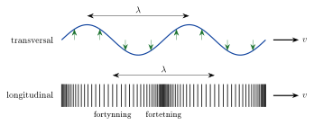

<!-- video: kommer (videoer/ingeniorfysikk/10-01-bolgebeskrivelse) -->
{fig-alt="Video kommer"}

<!-- tillegg: Claude -->
Kast en stein i et vann, og ringene sprer seg utover. Men vannet selv flytter seg ikke bortover: En and som ligger på vannet, vipper bare opp og ned når ringene passerer. En **bølge** er en forstyrrelse som brer seg, og den frakter **energi uten å frakte stoff**. Lyd, lys, jordskjelv og signaler i en fiberkabel er alle bølger.

## Mekaniske bølger

<!-- tillegg: Claude -->
En **mekanisk bølge** trenger et stoff (et **medium**) å bre seg i, for eksempel en streng, vann eller luft. Hver del av mediet svinger om sin likevektsstilling og dytter på naboen. Slik vandrer forstyrrelsen videre. Lys og andre elektromagnetiske bølger er annerledes: De trenger ikke noe medium og kan gå gjennom vakuum.

{.tikz-fig style="width:520px"}

::: {.kort}
- **Transversale bølger.** Mediet svinger vinkelrett på bølgeretningen. Eksempler: bølger på en streng eller et tau, og (i overført betydning) lys.
- **Longitudinale bølger.** Mediet svinger langs bølgeretningen. Eksempler: lyd i luft og trykkbølger i en fjær.
- **Begge deler.** Vannbølger er en blanding: Vannpartiklene går i små sirkler. Jordskjelv sender ut både longitudinale (P-bølger) og transversale (S-bølger) bølger.
:::

## Størrelser som beskriver en bølge

<!-- tillegg: Claude -->
En **harmonisk bølge** har form som en sinuskurve. Den beskrives med disse størrelsene:

::: {.callout-note title="Definisjon: Størrelser for en harmonisk bølge"}
<!-- tillegg: Claude -->
- **Amplituden** $A$: største utslag fra likevekt.
- **Bølgelengden** $\lambda$: avstanden mellom to bølgetopper (eller to punkter som er i samme fase).
- **Perioden** $T$: tiden det tar for ett punkt i mediet å gjøre én hel svingning.
- **Frekvensen** $f = 1/T$: antall svingninger per sekund, målt i hertz (Hz).
- **Bølgefarten** $v$: farten bølgeformen beveger seg med.
:::

<!-- tillegg: Claude -->
På én periode har bølgen flyttet seg nøyaktig én bølgelengde, fordi neste topp da har kommet fram dit den forrige var. Derfor er

::: {.callout-important title="Bølgelikningen for farten"}
<!-- tillegg: Claude -->
$$
v = \frac{\lambda}{T} = f\lambda
$$
:::

<!-- tillegg: Claude -->
Bølgefarten bestemmes av **mediet**, ikke av kilden. Lyd går med omtrent $343\ \mathrm{m/s}$ i luft ved $20\ \mathrm{^\circ C}$, uansett tonehøyde. Øker du frekvensen, blir bølgelengden kortere, slik at $f\lambda$ blir den samme. Når en bølge går fra ett medium til et annet, endres farten og bølgelengden, men frekvensen er den samme.

### Bølgetall og vinkelfrekvens

<!-- tillegg: Claude -->
I formlene er det ofte enklere å bruke

::: {.graa}
$$
k = \frac{2\pi}{\lambda} \quad\text{(bølgetallet)}, \qquad \omega = \frac{2\pi}{T} = 2\pi f \quad\text{(vinkelfrekvensen)}
$$
:::

<!-- tillegg: Claude -->
Da blir bølgefarten $v = \omega/k$. Vi bruker $k$ og $\omega$ når vi skriver opp bølgefunksjonen (se *bølgefunksjonen og bølgefart*).

::: {.eksempel}
<!-- tillegg: Claude -->
**Eksempel: Tone og radio.** Finn bølgelengden til

**a)** tonen A ($440\ \mathrm{Hz}$) i luft, der lydfarten er $343\ \mathrm{m/s}$,\
**b)** en FM-radiostasjon på $100\ \mathrm{MHz}$. Radiobølger går med lysfarten $\mathrm{c} = 3.00\cdot10^{8}\ \mathrm{m/s}$.

::: {.losning}
**a)**
$$
\lambda = \frac{v}{f} = \frac{343\ \mathrm{m/s}}{440\ \mathrm{Hz}} = \underline{\underline{0.780\ \mathrm{m}}}
$$
**b)**
$$
\lambda = \frac{\mathrm{c}}{f} = \frac{3.00\cdot10^{8}\ \mathrm{m/s}}{1.00\cdot10^{8}\ \mathrm{Hz}} = \underline{\underline{3.00\ \mathrm{m}}}
$$
Derfor er FM-antenner omtrent en meter lange: De fungerer best når lengden er en brøkdel av bølgelengden.
:::
:::

:::: {.oppgaver}

::: {.oppgave tittel="Havbølger"}
<!-- tillegg: Claude -->
En båt ligger for anker. Bølgetoppene er $12\ \mathrm{m}$ fra hverandre, og båten vipper opp og ned én gang hvert fjerde sekund. Hvor fort går bølgene?

::: {.fasit}
$3.0\ \mathrm{m/s}$
:::
:::

::: {.oppgave tittel="Transversal eller longitudinal?"}
<!-- tillegg: Claude -->
Avgjør om bølgen er transversal eller longitudinal: **a)** en «bølge» på fotballstadion, **b)** et dytt i enden av en lang slinky-fjær langs fjæra, **c)** lyd i vann.

:::

::: {.oppgave tittel="Fra luft til vann" niva="Middels"}
<!-- tillegg: Claude -->
En lydbølge med frekvens $1.0\ \mathrm{kHz}$ går fra luft ($343\ \mathrm{m/s}$) ned i vann ($1480\ \mathrm{m/s}$). Hva er bølgelengden i lufta og i vannet?

::: {.fasit}
$0.34\ \mathrm{m}$ · $1.5\ \mathrm{m}$
:::
:::

::: {.oppgave tittel="Jordskjelv" niva="Utfordrende"}
<!-- tillegg: Claude -->
Et jordskjelv sender ut P-bølger med farten $8.0\ \mathrm{km/s}$ og S-bølger med $4.5\ \mathrm{km/s}$. En målestasjon registrerer S-bølgen $60\ \mathrm{s}$ etter P-bølgen. Hvor langt unna var jordskjelvet?

::: {.fasit}
$6.2\cdot10^{2}\ \mathrm{km}$
:::
:::

::::
