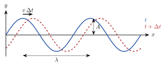

<!-- video: kommer (videoer/ingeniorfysikk/10-02-bolgefunksjonen) -->
{fig-alt="Video kommer"}

<!-- tillegg: Claude -->
En bølge endrer seg både i rommet og i tiden. Et bilde av en streng viser bølgeformen ved ett tidspunkt. En film av ett punkt på strengen viser at punktet svinger opp og ned. **Bølgefunksjonen** $y(x,t)$ beskriver begge deler på en gang: Den sier hvor stort utslaget er i punktet $x$ ved tiden $t$.

## En bølge som flytter seg

<!-- tillegg: Claude -->
Tenk deg en bølgeform $y = f(x)$ ved $t = 0$. Den flytter seg mot høyre med farten $v$ uten å endre form. Ved tiden $t$ har den flyttet seg strekningen $vt$, så toppen som var i $x$, er nå i $x + vt$. Bølgeformen ved tiden $t$ er derfor $y = f(x - vt)$.

{.tikz-fig style="width:500px"}

::: {.callout-important title="Harmonisk bølge"}
<!-- tillegg: Claude -->
En harmonisk bølge som går i positiv $x$-retning:
$$
y(x,t) = A\sin(kx - \omega t + \varphi)
$$
med $k = 2\pi/\lambda$ og $\omega = 2\pi f$. Bølgefarten er $v = \omega/k = f\lambda$.

En bølge i **negativ** $x$-retning har $+\omega t$: $y = A\sin(kx + \omega t + \varphi)$.
:::

<!-- tillegg: Claude -->
**Hvilken vei går bølgen?** Se på fortegnene foran $kx$ og $\omega t$. Er de **ulike**, går bølgen i positiv retning. Er de **like**, går den i negativ retning. Grunnen er at fasen $kx - \omega t$ er konstant (en bestemt topp) når $x = \text{konstant} + (\omega/k)t$, altså når $x$ øker med tiden.

::: {.eksempel}
<!-- tillegg: Claude -->
**Eksempel: Les av bølgeuttrykket.** En bølge på en streng er gitt ved
$$
y(x,t) = 0.020\ \mathrm{m}\cdot\sin\left(15\ \mathrm{m^{-1}}\,x - 60\ \mathrm{s^{-1}}\,t\right)
$$
Finn amplituden, bølgelengden, frekvensen, bølgefarten og retningen, og den største farten et punkt på strengen får.

::: {.losning}
Vi sammenligner med $y = A\sin(kx - \omega t)$: $A = 0.020\ \mathrm{m}$, $k = 15\ \mathrm{m^{-1}}$ og $\omega = 60\ \mathrm{s^{-1}}$.
$$
\lambda = \frac{2\pi}{k} = \frac{2\pi}{15}\ \mathrm{m} = \underline{\underline{0.42\ \mathrm{m}}}, \qquad f = \frac{\omega}{2\pi} = \frac{60}{2\pi}\ \mathrm{Hz} = \underline{\underline{9.5\ \mathrm{Hz}}}
$$
$$
v = \frac{\omega}{k} = \frac{60}{15}\ \mathrm{m/s} = \underline{\underline{4.0\ \mathrm{m/s}}}
$$
Fortegnene er ulike, så bølgen går i **positiv $x$-retning**.

Et punkt på strengen har $\partial y/\partial t = -A\omega\cos(kx - \omega t)$, så største fart er
$$
v_{y,\mathrm{maks}} = A\omega = 0.020\cdot60\ \mathrm{m/s} = \underline{\underline{1.2\ \mathrm{m/s}}}
$$
Legg merke til at dette **ikke** er bølgefarten. Bølgefarten sier hvor fort formen flytter seg bortover. $v_y$ sier hvor fort strengen beveger seg opp og ned.
:::
:::

## Bølgefart på en streng

<!-- tillegg: Claude -->
Hva bestemmer hvor fort en bølge går på en streng? To egenskaper ved strengen:

::: {.kort}
- **Snorkraften** $S$. En stram streng drar hardere tilbake når den bøyes, så forstyrrelsen sendes raskere videre.
- **Massen per lengde** $\mu = m/L$ (lineær massetetthet). En tung streng er treg og reagerer saktere.
:::

::: {.callout-important title="Bølgefart på en streng"}
<!-- tillegg: Claude -->
$$
v = \sqrt{\frac{S}{\mu}}
$$
:::

<!-- tillegg: Claude -->
Enheten stemmer: $\sqrt{\mathrm{N}/(\mathrm{kg/m})} = \sqrt{\mathrm{kg\,m/s^2\cdot m/kg}} = \mathrm{m/s}$. Formelen kan utledes ved å se på kreftene på en liten bit av strengen. Det gjør vi under bølgelikningen.

Dette er grunnen til at en gitarist strammer strengen for å få høyere tone, og at basstrengene er tykke: Høyere fart gir høyere frekvens med samme lengde, tyngre streng gir lavere.

### Bølgelikningen

<!-- tillegg: Claude -->
Se på en liten bit av strengen med lengde $\Delta x$ og masse $\mu\Delta x$. Snorkraften $S$ drar i begge ender langs strengen. Hvis strengen krummer, peker de to kreftene litt forskjellig vei, og summen av de loddrette komponentene er omtrent $S\,\Delta x\,\partial^2y/\partial x^2$. Newtons andre lov gir
$$
\mu\Delta x\frac{\partial^2y}{\partial t^2} = S\Delta x\frac{\partial^2y}{\partial x^2} \qquad\Rightarrow\qquad \frac{\partial^2y}{\partial t^2} = v^2\frac{\partial^2y}{\partial x^2}, \quad v = \sqrt{\frac S\mu}
$$
Dette er **bølgelikningen**. Enhver funksjon $f(x - vt)$ eller $f(x + vt)$ er en løsning. Den samme likningen beskriver lyd, lys og mange andre bølger, bare med en annen $v$.

::: {.eksempel}
<!-- tillegg: Claude -->
**Eksempel: Gitarstrengen.** En gitarstreng har massen $5.0\ \mathrm{g}$ per meter og er strammet med $80\ \mathrm{N}$. Hvor fort går bølger på strengen?

::: {.losning}
$$
v = \sqrt{\frac{S}{\mu}} = \sqrt{\frac{80\ \mathrm{N}}{5.0\cdot10^{-3}\ \mathrm{kg/m}}} = \underline{\underline{1.3\cdot10^{2}\ \mathrm{m/s}}}
$$
:::
:::

:::: {.oppgaver}

::: {.oppgave tittel="Skriv bølgefunksjonen"}
<!-- tillegg: Claude -->
En bølge med amplitude $3.0\ \mathrm{cm}$, bølgelengde $0.50\ \mathrm{m}$ og frekvens $8.0\ \mathrm{Hz}$ går i negativ $x$-retning. Skriv opp bølgefunksjonen (med $\varphi = 0$) og finn bølgefarten.

::: {.fasit}
$4.0\ \mathrm{m/s}$
:::
:::

::: {.oppgave tittel="Strammere streng"}
<!-- tillegg: Claude -->
Hvor mye må snorkraften økes for at bølgefarten på en streng skal dobles?

:::

::: {.oppgave tittel="Snorkraften i gitarstrengen" niva="Middels"}
<!-- tillegg: Claude -->
En gitarstreng er $65\ \mathrm{cm}$ lang mellom festepunktene og har $\mu = 7.0\ \mathrm{g/m}$. Den grunnleggende bølgelengden er to ganger strenglengden (se *stående bølger*). Hvor stor snorkraft trengs for at frekvensen skal bli $110\ \mathrm{Hz}$ (tonen A)?

::: {.fasit}
$1.4\cdot10^{2}\ \mathrm{N}$
:::
:::

::: {.oppgave tittel="Fart i et punkt" niva="Utfordrende"}
<!-- tillegg: Claude -->
For bølgen i eksempelet, $y = 0.020\sin(15x - 60t)$ (SI-enheter): Hvor stort er utslaget og farten til punktet $x = 0.10\ \mathrm{m}$ ved $t = 0.050\ \mathrm{s}$?

::: {.fasit}
$-2.0\ \mathrm{cm}$ · $-0.085\ \mathrm{m/s}$
:::
:::

::::
