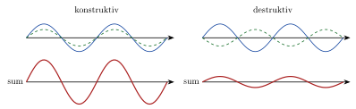
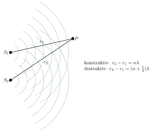

<!-- video: kommer (videoer/ingeniorfysikk/10-04-interferens) -->
{fig-alt="Video kommer"}

<!-- tillegg: Claude -->
To ballonger som kolliderer, spretter fra hverandre. To bølger som møtes, går rett gjennom hverandre og fortsetter som om ingenting hadde skjedd. Men akkurat der de overlapper, legges utslagene sammen. Det kan gi både forsterkning og utslukking. Det er derfor støydempende hodetelefoner virker, og derfor lyden kan bli svak på enkelte plasser i et rom med to høyttalere.

## Superposisjonsprinsippet

::: {.callout-important title="Superposisjonsprinsippet"}
<!-- tillegg: Claude -->
Når to eller flere bølger overlapper, er det samlede utslaget summen av utslagene fra hver bølge:
$$
y(x,t) = y_1(x,t) + y_2(x,t)
$$
:::

<!-- tillegg: Claude -->
Prinsippet gjelder så lenge utslagene ikke er for store. Det følger av at bølgelikningen er **lineær**: Er $y_1$ og $y_2$ løsninger, er også summen en løsning.

## Konstruktiv og destruktiv interferens

{.tikz-fig style="width:560px"}

<!-- tillegg: Claude -->
To bølger med samme frekvens som møtes, gir **interferens**. Resultatet avhenger av **faseforskjellen** $\Delta\varphi$:

::: {.kort}
- **Konstruktiv interferens.** Bølgene er i fase ($\Delta\varphi = 0, 2\pi, 4\pi, \dots$). Toppene treffer topper, og amplitudene legges sammen: $A = A_1 + A_2$.
- **Destruktiv interferens.** Bølgene er i motfase ($\Delta\varphi = \pi, 3\pi, \dots$). Toppene treffer bunner, og amplitudene trekkes fra hverandre: $A = |A_1 - A_2|$. Er amplitudene like, slukker bølgene hverandre helt.
:::

<!-- tillegg: Claude -->
For to bølger med lik amplitude $A$ og faseforskjell $\Delta\varphi$ gir en trigonometrisk identitet
$$
A\sin(\theta) + A\sin(\theta + \Delta\varphi) = 2A\cos\left(\frac{\Delta\varphi}{2}\right)\sin\left(\theta + \frac{\Delta\varphi}{2}\right)
$$
Den samlede amplituden er $2A\cos(\Delta\varphi/2)$: $2A$ når $\Delta\varphi = 0$ og null når $\Delta\varphi = \pi$.

Energien forsvinner ikke ved destruktiv interferens. Den flyttes til steder med konstruktiv interferens.

## To kilder: veiforskjell

{.tikz-fig style="width:540px"}

<!-- tillegg: Claude -->
To kilder $S_1$ og $S_2$ som svinger i fase, sender ut bølger med samme bølgelengde. I et punkt $P$ har bølgen fra $S_2$ gått strekningen $r_2$, og bølgen fra $S_1$ strekningen $r_1$. En veiforskjell på én bølgelengde gir faseforskjellen $2\pi$. Altså:

::: {.callout-important title="Interferens fra to kilder i fase"}
<!-- tillegg: Claude -->
$$
\text{Konstruktiv: } r_2 - r_1 = n\lambda, \qquad \text{Destruktiv: } r_2 - r_1 = \left(n + \tfrac12\right)\lambda
$$
med $n = 0, \pm1, \pm2, \dots$
:::

<!-- tillegg: Claude -->
Det samme prinsippet ligger bak Youngs dobbeltspalteforsøk med lys, som viste at lys er en bølge.

::: {.eksempel}
<!-- tillegg: Claude -->
**Eksempel: To høyttalere.** To høyttalere spiller samme tone, $343\ \mathrm{Hz}$, i fase. Lydfarten er $343\ \mathrm{m/s}$. Du står $4.0\ \mathrm{m}$ fra den ene og $5.5\ \mathrm{m}$ fra den andre. Hører du sterk eller svak lyd?

::: {.losning}
Bølgelengden er $\lambda = v/f = 343/343\ \mathrm{m} = 1.0\ \mathrm{m}$. Veiforskjellen er
$$
r_2 - r_1 = 5.5\ \mathrm{m} - 4.0\ \mathrm{m} = 1.5\ \mathrm{m} = 1.5\lambda
$$
Det er et halvtallig antall bølgelengder, så interferensen er **destruktiv**. Lyden er svak. I praksis forsvinner den ikke helt, fordi lyden også reflekteres fra veggene, og fordi amplitudene ikke er helt like.
:::
:::

## Refleksjon

<!-- tillegg: Claude -->
Når en bølge kommer til enden av en streng, reflekteres den. Hvordan den reflekteres, avhenger av hvordan enden er festet:

::: {.kort}
- **Fast ende.** Strengen er festet til en vegg. Den reflekterte pulsen blir **snudd opp ned** (faseskift på $\pi$). Strengen drar i veggen, og veggen drar like hardt tilbake.
- **Fri ende.** Enden kan gli fritt opp og ned, for eksempel en ring på en stang. Den reflekterte pulsen er **ikke** snudd.
:::

<!-- tillegg: Claude -->
Den innkommende og den reflekterte bølgen overlapper. Med riktig frekvens gir det **stående bølger**, som er temaet på neste side i dette temaet.

:::: {.oppgaver}

::: {.oppgave tittel="Samlet amplitude"}
<!-- tillegg: Claude -->
To bølger med amplitudene $3.0\ \mathrm{mm}$ og $5.0\ \mathrm{mm}$ og samme frekvens overlapper. Hva er den største og den minste mulige samlede amplituden?

::: {.losning}
Størst ved konstruktiv interferens: $3.0 + 5.0 = \underline{\underline{8.0\ \mathrm{mm}}}$. Minst ved destruktiv: $5.0 - 3.0 = \underline{\underline{2.0\ \mathrm{mm}}}$.
:::
:::

::: {.oppgave tittel="Støydempende hodetelefoner"}
<!-- tillegg: Claude -->
Støydempende hodetelefoner måler støyen utenfra og spiller en lyd som skal slukke den. Hvilken faseforskjell skal motlyden ha? Hvorfor fungerer det best for jevn, lavfrekvent støy som motordur?

::: {.losning}
Motlyden må ha lik amplitude og faseforskjell $\pi$ (motfase). For lavfrekvent lyd er bølgelengden lang, så en liten feil i tid eller avstand gir en liten feil i fase. Jevn støy er lett å forutsi. For høye frekvenser blir bølgelengden så kort at små avvik ødelegger utslukkingen.
:::
:::

::: {.oppgave tittel="Faseforskjell" niva="Middels"}
<!-- tillegg: Claude -->
To bølger med lik amplitude $A$ har faseforskjellen $\Delta\varphi = \pi/3$. Hva er den samlede amplituden?

::: {.losning}
$$
A_\mathrm{sum} = 2A\cos\left(\frac{\pi}{6}\right) = 2A\cdot\frac{\sqrt3}{2} = \underline{\underline{\sqrt3\,A \approx 1.73A}}
$$
:::
:::

::: {.oppgave tittel="Hvor er lyden svak?" niva="Utfordrende"}
<!-- tillegg: Claude -->
To høyttalere står $3.0\ \mathrm{m}$ fra hverandre og spiller samme tone i fase. Midt mellom dem er lyden sterk. Du går langs linja mot den ene høyttaleren, og lyden er svakest første gang når du har gått $25\ \mathrm{cm}$ fra midten. Hvorfor er lyden alltid sterk på midten? Hvilken frekvens spiller høyttalerne? Lydfarten er $343\ \mathrm{m/s}$.

::: {.losning}
På midten er avstanden til begge høyttalerne den samme. Veiforskjellen er null, så interferensen er konstruktiv uansett frekvens.

Flytter du deg $d = 0.25\ \mathrm{m}$ mot den ene, kommer du $d$ nærmere den ene og $d$ lenger fra den andre. Veiforskjellen blir $2d = 0.50\ \mathrm{m}$. Første utslukking er ved veiforskjellen $\lambda/2$:
$$
\frac{\lambda}{2} = 0.50\ \mathrm{m} \quad\Rightarrow\quad \lambda = 1.0\ \mathrm{m}, \qquad f = \frac{v}{\lambda} = \frac{343}{1.0}\ \mathrm{Hz} = \underline{\underline{3.4\cdot10^{2}\ \mathrm{Hz}}}
$$
<!-- tillegg: Claude: notasjon v3, gjeldende siffer (2, fra 25 cm) -->
:::
:::

::::
