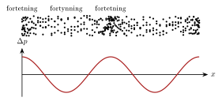

<!-- video: kommer (videoer/ingeniorfysikk/10-06-lyd) -->
{fig-alt="Video kommer"}

<!-- tillegg: Claude -->
Lyd er små, raske trykkendringer i lufta. Øret vårt er et utrolig følsomt trykkmåler: Det kan høre trykkendringer på noen få titusendeler av en pascal, og tåle trykkendringer som er en million ganger større. Derfor måler vi lydstyrke med en logaritmisk skala, **desibel**.

## Lyd er en trykkbølge

{.tikz-fig style="width:480px"}

<!-- tillegg: Claude -->
En høyttalermembran som svinger fram og tilbake, dytter på lufta foran seg. Når membranen går ut, presses lufta sammen til en **fortetning** med litt høyere trykk. Når den går inn, blir det en **fortynning** med litt lavere trykk. Disse trykkendringene brer seg utover som en longitudinal bølge. Hver luftbit svinger bare litt fram og tilbake, mens trykkbølgen går videre med lydfarten.

Mennesker hører lyd med frekvenser fra ca. $20\ \mathrm{Hz}$ til $20\ \mathrm{kHz}$. Lavere frekvenser kalles **infralyd**, høyere kalles **ultralyd**. Flaggermus og delfiner bruker ultralyd til å orientere seg, og leger bruker den til å ta bilder inne i kroppen.

## Lydfarten

<!-- tillegg: Claude -->
Lydfarten avhenger av hvor stivt mediet er (hvor vanskelig det er å presse sammen) og hvor tungt det er. Det er det samme mønsteret som for en streng, $v = \sqrt{S/\mu}$:

::: {.graa}
$$
v = \sqrt{\frac{B}{\rho}}
$$
der $B$ er **kompresjonsmodulen** (hvor mye trykk som trengs for en relativ volumendring) og $\rho$ er tettheten.
:::

<!-- tillegg: Claude -->
| Medium | Lydfart ($\mathrm{m/s}$) |
|---|---|
| Luft, $0\ \mathrm{^\circ C}$ | 331 |
| Luft, $20\ \mathrm{^\circ C}$ | 343 |
| Vann | ca. 1480 |
| Stål | ca. 5000–6000 |

I luft øker lydfarten med temperaturen, omtrent $v \approx (331 + 0.6\,T_C)\ \mathrm{m/s}$, der $T_C$ er temperaturen i celsius. Væsker og faste stoffer er mye stivere enn luft, så der går lyden mye fortere.

::: {.eksempel}
<!-- tillegg: Claude -->
**Eksempel: Hvor langt unna slo lynet ned?** Du ser et lyn og hører tordenen $4.5\ \mathrm{s}$ senere. Hvor langt unna slo lynet ned?

::: {.losning}
Lyset kommer fram nesten med en gang, så tiden er tiden lyden bruker:
$$
d = vt = 343\ \mathrm{m/s}\cdot4.5\ \mathrm{s} = \underline{\underline{1.5\ \mathrm{km}}}
$$
Tommelfingerregel: Tell sekundene og del på tre, så får du avstanden i kilometer.
:::
:::

## Lydnivå i desibel

<!-- tillegg: Claude -->
Den svakeste lyden et normalt øre kan høre ved $1\ \mathrm{kHz}$, har intensiteten $I_0 = 1.0\cdot10^{-12}\ \mathrm{W/m^2}$. En lyd som gjør vondt, har ca. $1\ \mathrm{W/m^2}$. Det er tolv tierpotenser imellom. Øret oppfatter ikke intensiteten lineært: En lyd med ti ganger så stor intensitet høres bare omtrent dobbelt så sterk ut. Derfor bruker vi en logaritmisk skala:

::: {.callout-note title="Definisjon: Lydnivå"}
<!-- tillegg: Claude -->
**Lydnivået** $\beta$ til en lyd med intensitet $I$ er
$$
\beta = 10\ \mathrm{dB}\cdot\log_{10}\left(\frac{I}{I_0}\right), \qquad I_0 = 1.0\cdot10^{-12}\ \mathrm{W/m^2}
$$
Enheten er desibel (dB).
:::

<!-- tillegg: Claude -->
| Lyd | Lydnivå (dB) |
|---|---|
| Høregrensen | 0 |
| Hvisking | 20–30 |
| Vanlig samtale | 60 |
| Tung trafikk | 85 |
| Rockekonsert | 110 |
| Smertegrensen | ca. 120 |

::: {.kort}
- **Ti ganger** så stor intensitet gir **10 dB mer**.
- **Dobbel** intensitet gir $10\log_{10}2 \approx$ **3 dB mer**. To like høyttalere er altså bare 3 dB sterkere enn én.
- **Dobbel avstand** fra en punktkilde gir en fjerdedel av intensiteten, altså **6 dB mindre**.
:::

<!-- tillegg: Claude -->
Langvarig støy over ca. 85 dB kan skade hørselen. Skadene kommer gradvis og er varige.

::: {.eksempel}
<!-- tillegg: Claude -->
**Eksempel: Konsert.** På en konsert er intensiteten $0.10\ \mathrm{W/m^2}$. Hva er lydnivået? Hvor stor intensitet svarer til grensen på $85\ \mathrm{dB}$?

::: {.losning}
$$
\beta = 10\log_{10}\left(\frac{0.10}{1.0\cdot10^{-12}}\right)\ \mathrm{dB} = 10\log_{10}(10^{11})\ \mathrm{dB} = \underline{\underline{110\ \mathrm{dB}}}
$$
For $85\ \mathrm{dB}$ løser vi definisjonen for $I$:
$$
I = I_0\cdot10^{\beta/10} = 1.0\cdot10^{-12}\cdot10^{8.5}\ \mathrm{W/m^2} = \underline{\underline{3.2\cdot10^{-4}\ \mathrm{W/m^2}}}
$$
Konserten har over 300 ganger høyere intensitet enn grensen.
:::
:::

:::: {.oppgaver}

::: {.oppgave tittel="Samtale"}
<!-- tillegg: Claude -->
Hva er lydnivået til en samtale med intensitet $1.0\cdot10^{-6}\ \mathrm{W/m^2}$?

::: {.fasit}
$60\ \mathrm{dB}$
:::
:::

::: {.oppgave tittel="Ti høyttalere"}
<!-- tillegg: Claude -->
Én høyttaler gir $70\ \mathrm{dB}$ der du står. Hva blir lydnivået med ti like høyttalere som spiller samtidig (uten interferens)?

::: {.fasit}
$80\ \mathrm{dB}$
:::
:::

::: {.oppgave tittel="Lenger unna" niva="Middels"}
<!-- tillegg: Claude -->
Lydnivået er $80\ \mathrm{dB}$ i avstanden $2.0\ \mathrm{m}$ fra en punktkilde. Hva er lydnivået $20\ \mathrm{m}$ unna?

::: {.fasit}
$60\ \mathrm{dB}$
:::
:::

::: {.oppgave tittel="Lyd i vann og stål" niva="Utfordrende"}
<!-- tillegg: Claude -->
Vann har kompresjonsmodul $2.2\cdot10^{9}\ \mathrm{Pa}$. Stål har $2.0\cdot10^{11}\ \mathrm{Pa}$ og tetthet $7800\ \mathrm{kg/m^3}$. Regn ut lydfarten i begge. Du legger øret mot en lang jernbaneskinne. Noen slår på skinna $1.0\ \mathrm{km}$ unna. Hvor lang tid går det mellom lyden gjennom skinna og lyden gjennom lufta?

::: {.fasit}
$1.5\cdot10^{3}\ \mathrm{m/s}$ · $5.1\cdot10^{3}\ \mathrm{m/s}$ · $2.7\ \mathrm{s}$
:::
:::

::::
