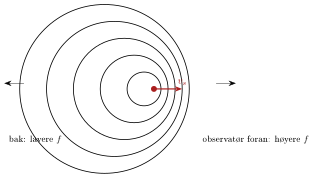

<!-- video: kommer (videoer/ingeniorfysikk/10-07-dopplereffekten) -->
{fig-alt="Video kommer"}

<!-- tillegg: Claude -->
Når en ambulanse kjører forbi med sirenen på, hører du at tonen plutselig går ned i det øyeblikket den passerer. Sirenen sender ut samme tone hele tiden. Det er bevegelsen som endrer frekvensen du hører. Dette kalles **dopplereffekten**, og den brukes i alt fra fartskontroller og værradar til å måle hvor fort galakser beveger seg bort fra oss.

## Kilde i bevegelse

{.tikz-fig style="width:480px"}

<!-- tillegg: Claude -->
En kilde sender ut lyd med frekvens $f$ og beveger seg med farten $v_s$ mot en observatør. Lyden går med farten $v$ i lufta. I løpet av én periode $T = 1/f$ går en bølgetopp strekningen $vT$, men kilden har samtidig flyttet seg $v_sT$ etter. Neste bølgetopp sendes ut fra et punkt som er nærmere. Avstanden mellom toppene foran kilden blir
$$
\lambda' = vT - v_sT = \frac{v - v_s}{f}
$$
Observatøren står i ro, så toppene kommer forbi med lydfarten $v$. Frekvensen hun hører, er
$$
f' = \frac{v}{\lambda'} = f\,\frac{v}{v - v_s}
$$
Bak kilden ligger toppene glissent, og der er $f' = f\,v/(v + v_s)$.

## Observatør i bevegelse

<!-- tillegg: Claude -->
Står kilden i ro og observatøren beveger seg mot den med farten $v_o$, er bølgelengden uendret. Men observatøren møter bølgetoppene raskere, med den relative farten $v + v_o$. Da blir $f' = f\,(v + v_o)/v$.

## Den generelle formelen

::: {.callout-important title="Dopplereffekten for lyd"}
<!-- tillegg: Claude -->
$$
f' = f\,\frac{v \pm v_o}{v \mp v_s}
$$
Bruk de **øverste** fortegnene når observatør eller kilde beveger seg **mot** den andre, og de **nederste** når de beveger seg **fra** hverandre. Farten $v$ er lydfarten i lufta, og alle farter måles i forhold til lufta.
:::

<!-- tillegg: Claude -->
En god sjekk: Bevegelse mot hverandre skal alltid gi **høyere** frekvens, bevegelse fra hverandre **lavere**. Velg fortegnene slik at det stemmer.

::: {.eksempel}
<!-- tillegg: Claude -->
**Eksempel: Ambulansen.** En ambulansesirene har frekvensen $700\ \mathrm{Hz}$. Ambulansen kjører med $25\ \mathrm{m/s}$ ($90\ \mathrm{km/h}$). Hvilken frekvens hører du når den kommer mot deg, og når den har passert? Lydfarten er $343\ \mathrm{m/s}$.

::: {.losning}
Mot deg (kilden nærmer seg, $v_o = 0$):
$$
f' = 700\ \mathrm{Hz}\cdot\frac{343}{343 - 25} = \underline{\underline{7.6\cdot10^{2}\ \mathrm{Hz}}}
$$
Etter passering (kilden fjerner seg):
$$
f' = 700\ \mathrm{Hz}\cdot\frac{343}{343 + 25} = \underline{\underline{6.5\cdot10^{2}\ \mathrm{Hz}}}
$$
<!-- tillegg: Claude: notasjon v3, gjeldende siffer (2) -->
Tonen faller med ca. $100\ \mathrm{Hz}$ når ambulansen passerer. Det tilsvarer omtrent to halvtoner.
:::
:::

## Lydmuren

<!-- tillegg: Claude -->
Hva skjer når kilden går like fort som lyden, $v_s = v$? Da blir nevneren null. Alle bølgetoppene hoper seg opp rett foran kilden, og det dannes en kraftig trykkbølge. Går kilden enda fortere, ligger bølgetoppene på en kjegle bak kilden. Det er dette som gir smellet fra et overlydsfly eller en pisk som smeller. Forholdet $v_s/v$ kalles **Mach-tallet**.

## Dopplereffekt for lys

<!-- tillegg: Claude -->
Lys viser også dopplereffekt, men formelen er litt annerledes, fordi lys ikke trenger et medium og lysfarten er den samme for alle observatører. For farter mye mindre enn lysfarten er den relative endringen $\Delta f/f \approx v/\mathrm{c}$. Lys fra galakser som fjerner seg, får lavere frekvens (**rødforskyvning**). Det var slik Edwin Hubble oppdaget at universet utvider seg.

:::: {.oppgaver}

::: {.oppgave tittel="Syklisten"}
<!-- tillegg: Claude -->
Du sykler med $8.0\ \mathrm{m/s}$ mot en høyttaler som står i ro og spiller $500\ \mathrm{Hz}$. Hvilken frekvens hører du?

::: {.losning}
Observatøren beveger seg mot kilden:
$$
f' = 500\ \mathrm{Hz}\cdot\frac{343 + 8.0}{343} = \underline{\underline{5.1\cdot10^{2}\ \mathrm{Hz}}}
$$
<!-- tillegg: Claude: notasjon v3, gjeldende siffer (2) -->
:::
:::

::: {.oppgave tittel="Toget"}
<!-- tillegg: Claude -->
Et tog tuter med $400\ \mathrm{Hz}$. Du står ved sporet og hører $430\ \mathrm{Hz}$ mens toget nærmer seg. Hvor fort kjører toget?

::: {.losning}
$$
f' = f\frac{v}{v - v_s} \quad\Rightarrow\quad v_s = v\left(1 - \frac{f}{f'}\right) = 343\cdot\left(1 - \frac{400}{430}\right)\ \mathrm{m/s} = \underline{\underline{24\ \mathrm{m/s}}}
$$
Det er ca. $86\ \mathrm{km/h}$.
:::
:::

::: {.oppgave tittel="Begge beveger seg" niva="Middels"}
<!-- tillegg: Claude -->
To biler kjører mot hverandre, begge med $20\ \mathrm{m/s}$. Den ene tuter med $500\ \mathrm{Hz}$. Hvilken frekvens hører sjåføren i den andre bilen?

::: {.losning}
Begge beveger seg mot hverandre, så vi bruker de øverste fortegnene:
$$
f' = 500\ \mathrm{Hz}\cdot\frac{343 + 20}{343 - 20} = \underline{\underline{5.6\cdot10^{2}\ \mathrm{Hz}}}
$$
<!-- tillegg: Claude: notasjon v3, gjeldende siffer (2) -->
:::
:::

::: {.oppgave tittel="Flaggermusen" niva="Utfordrende"}
<!-- tillegg: Claude -->
En flaggermus flyr med $5.0\ \mathrm{m/s}$ mot en vegg og sender ut ultralyd med frekvensen $40.0\ \mathrm{kHz}$. Hvilken frekvens har ekkoet som flaggermusen hører?

::: {.losning}
Dette skjer i to trinn. **1.** Veggen står i ro og mottar lyd fra en kilde som nærmer seg:
$$
f_\mathrm{vegg} = f\,\frac{v}{v - v_s}
$$
**2.** Veggen sender lyden tilbake med denne frekvensen, og flaggermusen er en observatør som beveger seg mot veggen:
$$
f' = f_\mathrm{vegg}\,\frac{v + v_o}{v} = f\,\frac{v + u}{v - u}
$$
med $u = 5.0\ \mathrm{m/s}$:
$$
f' = 40.0\ \mathrm{kHz}\cdot\frac{343 + 5.0}{343 - 5.0} = \underline{\underline{41\ \mathrm{kHz}}}
$$
<!-- tillegg: Claude: notasjon v3, gjeldende siffer (2) -->
Flaggermusen kan bruke frekvensforskjellen til å vite hvor fort den nærmer seg veggen.
:::
:::

::::
