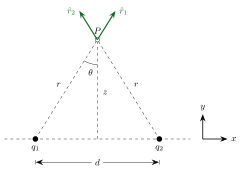

<!-- tillegg: Claude: notasjon v2 (desimalpunktum; konstantene k_e, G, m_e, m_p og µ i rett skrift) -->

## Vektorkomponenter og enhetsvektorer

<!-- fra notatene -->
Når ladningene ikke ligger på én linje, må vi dekomponere feltene. Se på to ladninger $q_1$ og $q_2$ med avstand $d$ mellom seg, og et punkt $P$ i høyden $z$ rett over midtpunktet:

{.tikz-fig style="width:460px"}

Begge ladningene ligger i avstanden $r$ fra $P$, og linjene fra ladningene til $P$ danner vinkelen $\theta$ med den loddrette aksen. Enhetsvektorene som peker fra ladningene mot $P$, er

::: {.graa}
$$
\hat r_1 = [\sin\theta,\ \cos\theta], \qquad \hat r_2 = [-\sin\theta,\ \cos\theta]
$$
:::

<!-- fra notatene -->
De har lengde 1, fordi $\sin^2\theta + \cos^2\theta = 1$. Feltene fra hver ladning blir da
$$
\vec E_1 = \mathrm{k_e}\frac{q_1}{r^2}\,\hat r_1 = \mathrm{k_e}\frac{q_1}{r^2}\,[\sin\theta,\ \cos\theta], \qquad
\vec E_2 = \mathrm{k_e}\frac{q_2}{r^2}\,\hat r_2 = \mathrm{k_e}\frac{q_2}{r^2}\,[-\sin\theta,\ \cos\theta]
$$
og det totale feltet i $P$ er

::: {.graa}
$$
\vec E_\mathrm{tot} = \vec E_1 + \vec E_2 = \frac{\mathrm{k_e}}{r^2}\Big[(q_1 - q_2)\sin\theta,\ (q_1 + q_2)\cos\theta\Big]
$$
:::

<!-- tillegg: Claude -->
Denne ene formelen dekker alle kombinasjoner av $q_1$ og $q_2$. Det er fordelen med å gjøre jobben med enhetsvektorer én gang, generelt.

::: {.callout-tip title="Enhetsvektorer i et ortogonalt koordinatsystem"}
<!-- fra notatene -->
For aksene gjelder $\hat e_x\cdot\hat e_x = \hat e_z\cdot\hat e_z = 1$ og $\hat e_x\cdot\hat e_z = 0$. Vi kan også lage koordinatløse enhetsvektorer; da er skalarproduktet $\hat r_i\cdot\hat r_j = 1$ når $i = j$ og $\cos\theta_{ij}$ ellers, der $\theta_{ij}$ er vinkelen mellom dem. Enhetsvektorer har alltid lengde 1 og kan bygges slik: $\hat e_x = \vec x/|\vec x|$.
:::

## Eksempel: Felt over to ladninger

::: {.eksempel}
<!-- fra notatene -->
**Eksempel: Feltet over to ladninger.** *(Basert på eksempel 5.4 i OpenStax* University Physics*, bind 2, CC BY 4.0.)*

**a)** Finn det elektriske feltet i avstanden $z$ over midtpunktet mellom to like ladninger $+q$ med avstand $d$ mellom seg. Sjekk at svaret gir mening når $z \gg d$.\
**b)** Som **a)**, men nå er den høyre ladningen $-q$.

::: {.losning}
Vi bruker det generelle uttrykket over, med
$$
r = \sqrt{\left(\tfrac d2\right)^2 + z^2}, \qquad \sin\theta = \frac{d/2}{r}, \qquad \cos\theta = \frac{z}{r}
$$

<!-- tillegg: Claude -->
**a)** $q_1 = q_2 = q$. Da blir $x$-komponenten null, og
$$
\vec E_\mathrm{tot} = \frac{\mathrm{k_e}}{r^2}\,[0,\ 2q\cos\theta] = \underline{\underline{\frac{2\mathrm{k_e}q\,z}{\left(z^2 + (d/2)^2\right)^{3/2}}\,[0,\ 1]}}
$$
Feltet peker rett opp. Når $z \gg d$, kan vi se bort fra $d/2$ i nevneren: $E \approx 2\mathrm{k_e}q/z^2$. Langt unna ser de to ladningene ut som én ladning $2q$. ✓

<!-- fra notatene -->
**b)** $q_1 = q$ og $q_2 = -q$. Nå er det $y$-komponenten som blir null:
$$
\vec E_\mathrm{tot}(r, \theta) = \frac{\mathrm{k_e}q}{r^2}\,[2\sin\theta,\ 0]
$$
Vi kan skrive om til $z$ og $d$ som variabler ved å sette inn $r$ og $\sin\theta$:
$$
\vec E_\mathrm{tot}(d, z) = \underline{\underline{\frac{d\,\mathrm{k_e}\,q}{\left(z^2 + (d/2)^2\right)^{3/2}}\,[1,\ 0]}}
$$
<!-- tillegg: Claude -->
Feltet peker vannrett, fra den positive mot den negative ladningen. Et slikt par kalles en **elektrisk dipol**. Når $z \gg d$, blir $E \approx \mathrm{k_e}qd/z^3$: feltet avtar raskere enn fra én ladning, fordi bidragene fra $+q$ og $-q$ nesten opphever hverandre langt unna.
:::
:::

:::: {.oppgaver}

::: {.oppgave tittel="Feltet i et hjørne" niva="Middels"}
<!-- tillegg: Claude -->
To ladninger $q = +2.0\ \mathrm{nC}$ ligger i to hjørner av et kvadrat med sider $a = 0.10\ \mathrm{m}$: én i $(0,\ 0)$ og én i $(a,\ a)$. Finn det elektriske feltet (størrelse og retning) i hjørnet $(a,\ 0)$.

::: {.losning}
Ladningen i $(0,\ 0)$ ligger rett til venstre for punktet, i avstand $a$. Feltet peker bort fra den, altså i $+x$-retning:
$$
\vec E_1 = \mathrm{k_e}\frac{q}{a^2}\,[1,\ 0]
$$
Ladningen i $(a,\ a)$ ligger rett over punktet, i avstand $a$. Feltet peker nedover:
$$
\vec E_2 = \mathrm{k_e}\frac{q}{a^2}\,[0,\ -1]
$$
Med $\mathrm{k_e}q/a^2 = 8.99\cdot10^{9}\cdot2.0\cdot10^{-9}/0.010\ \mathrm{N/C} = 1.8\cdot10^{3}\ \mathrm{N/C}$ blir
$$
\vec E = 1.8\cdot10^{3}\,[1,\ -1]\ \mathrm{N/C}, \qquad E = \sqrt2\cdot1.8\cdot10^{3}\ \mathrm{N/C} \approx \underline{\underline{2.5\cdot10^{3}\ \mathrm{N/C}}}
$$
rettet $45^\circ$ under $+x$-aksen.
:::
:::

::: {.oppgave tittel="Dipol langt unna" niva="Middels"}
<!-- tillegg: Claude -->
Bruk svaret fra eksempelet over. En dipol har $q = 1.0\ \mathrm{nC}$ og $d = 2.0\ \mathrm{mm}$. Finn feltet i $z = 0.10\ \mathrm{m}$, både med det eksakte uttrykket og med tilnærmingen $E \approx \mathrm{k_e}qd/z^3$. Hvor stor er feilen?

::: {.losning}
Eksakt:
$$
E = \frac{\mathrm{k_e}qd}{\left(z^2 + (d/2)^2\right)^{3/2}} = \frac{8.99\cdot10^{9}\cdot1.0\cdot10^{-9}\cdot2.0\cdot10^{-3}}{\left(0.010 + 1.0\cdot10^{-6}\right)^{3/2}}\ \mathrm{N/C} \approx 17.98\ \mathrm{N/C}
$$
Tilnærmet:
$$
E \approx \frac{\mathrm{k_e}qd}{z^3} = \frac{1.798\cdot10^{-2}}{1.0\cdot10^{-3}}\ \mathrm{N/C} \approx 17.98\ \mathrm{N/C}
$$
Forskjellen er bare ca. $0.015\ \%$, så tilnærmingen er svært god når $z \gg d$. Svar: $\underline{\underline{E \approx 18\ \mathrm{N/C}}}$.
:::
:::

::::
