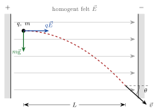

<!-- tillegg: Claude: notasjon v2 (desimalpunktum; konstantene k_e, G, m_e, m_p og µ i rett skrift) -->

## Homogent felt

<!-- tillegg: Claude -->
Mellom to store, parallelle plater med motsatt ladning er det elektriske feltet tilnærmet **homogent**: like sterkt og like rettet overalt mellom platene. Da er kraften $\vec F = q\vec E$ på en ladning konstant, og akselerasjonen
$$
\vec a = \frac{q\vec E}{m}
$$
er også konstant. Det betyr at vi kan bruke bevegelseslikningene for konstant akselerasjon fra [kinematikken](/tema/mekanikk/kinematikk/konstant-akselerasjon.html), akkurat som for skrått kast.

## Bevegelse i kryssede felt

<!-- fra notatene -->
Se på en partikkel som starter i ro, $\vec v_0 = \vec 0$, i et homogent elektrisk felt som peker vannrett. Samtidig virker tyngdekraften loddrett. Partikkelen akselereres altså av feltet i $x$-retning og faller i $y$-retning. Si at vi ønsker å finne farten $\vec v$ når den har tilbakelagt lengden $L$ vannrett.

{.tikz-fig style="width:440px"}

::: {.callout-tip title="Strategi"}
<!-- fra notatene -->
1. Del bevegelsen i to retninger, $x$ og $y$.
2. Finn tida $t$ partikkelen bruker på lengden $L$.
3. Hvor stor fartsøkning får den i $x$-retning på den tida?
4. Hvor stor fartsøkning får den i $y$-retning på den tida?
5. Finn vinkelen $\theta$ fra fartskomponentene.
:::

::: {.eksempel}
<!-- tillegg: Claude -->
**Eksempel: Støvkorn mellom to plater.** Et ladet støvkorn med masse $m = 1.0\cdot10^{-12}\ \mathrm{kg}$ og ladning $q = +2.0\cdot10^{-15}\ \mathrm{C}$ slippes fra ro mellom to loddrette plater. Feltet er $E = 5.0\cdot10^{3}\ \mathrm{N/C}$ og peker vannrett. Finn farten (størrelse og retning) når kornet har beveget seg $L = 0.20\ \mathrm{m}$ vannrett.

::: {.losning}
**1. Del opp.** I $x$-retning virker bare den elektriske kraften, og i $y$-retning bare tyngdekraften:
$$
a_x = \frac{qE}{m} = \frac{2.0\cdot10^{-15}\cdot5.0\cdot10^{3}}{1.0\cdot10^{-12}}\ \mathrm{m/s^2} = 10\ \mathrm{m/s^2}, \qquad a_y = -\mathrm{g} = -9.81\ \mathrm{m/s^2}
$$

**2. Tida.** Kornet starter i ro, så $L = \tfrac12 a_x t^2$:
$$
t = \sqrt{\frac{2L}{a_x}} = \sqrt{\frac{2\cdot0.20}{10}}\ \mathrm{s} = 0.20\ \mathrm{s}
$$

**3. Fart i $x$-retning:** $v_x = a_x t = 10\cdot0.20\ \mathrm{m/s} = 2.0\ \mathrm{m/s}$

**4. Fart i $y$-retning:** $v_y = a_y t = -9.81\cdot0.20\ \mathrm{m/s} \approx -1.96\ \mathrm{m/s}$

**5. Fart og vinkel:**
$$
v = \sqrt{v_x^2 + v_y^2} \approx \underline{\underline{2.8\ \mathrm{m/s}}}, \qquad \tan\theta = \frac{|v_y|}{v_x} = \frac{1.96}{2.0} \quad\Rightarrow\quad \theta \approx \underline{\underline{44^\circ}}\ \text{under vannrett}
$$
:::
:::

::: {.callout-warning title="Når kan vi se bort fra tyngdekraften?"}
<!-- tillegg: Claude -->
Sammenlign $qE/m$ med $\mathrm{g}$. For støvkornet over er de like store, så begge må tas med. For et elektron i det samme feltet er $\mathrm{e}E/\mathrm{m_e} \approx 9\cdot10^{14}\ \mathrm{m/s^2}$, omtrent $10^{14}$ ganger større enn $\mathrm{g}$. For elektroner, protoner og ioner kan vi nesten alltid se bort fra tyngdekraften.
:::

:::: {.oppgaver}

::: {.oppgave tittel="Elektronstråle mellom plater" niva="Middels"}
<!-- tillegg: Claude -->
Et elektron kommer vannrett inn mellom to vannrette plater med farten $v_0 = 2.0\cdot10^{7}\ \mathrm{m/s}$. Feltet mellom platene er $E = 1.0\cdot10^{4}\ \mathrm{N/C}$ og peker loddrett nedover. Platene er $L = 5.0\ \mathrm{cm}$ lange.

**a)** Hvor langt er elektronet avbøyd loddrett når det forlater platene?\
**b)** Med hvilken vinkel kommer det ut?

::: {.losning}
Elektronet er negativt, så kraften peker **oppover**, mot feltet. Tyngdekraften kan vi se bort fra.
$$
a_y = \frac{\mathrm{e}E}{\mathrm{m_e}} = \frac{1.60\cdot10^{-19}\cdot1.0\cdot10^{4}}{9.11\cdot10^{-31}}\ \mathrm{m/s^2} \approx 1.76\cdot10^{15}\ \mathrm{m/s^2}
$$
I $x$-retning er farten konstant, så tida mellom platene er
$$
t = \frac{L}{v_0} = \frac{0.050}{2.0\cdot10^{7}}\ \mathrm{s} = 2.5\cdot10^{-9}\ \mathrm{s}
$$
**a)** $y = \tfrac12 a_y t^2 = \tfrac12\cdot1.76\cdot10^{15}\cdot(2.5\cdot10^{-9})^2\ \mathrm{m} \approx \underline{\underline{5.5\ \mathrm{mm}}}$ oppover.

**b)** $v_y = a_y t \approx 4.4\cdot10^{6}\ \mathrm{m/s}$, så
$$
\tan\theta = \frac{v_y}{v_0} = \frac{4.4\cdot10^{6}}{2.0\cdot10^{7}} \quad\Rightarrow\quad \theta \approx \underline{\underline{12^\circ}}
$$
over vannrett. Slik ble elektronstrålen styrt i gamle TV-skjermer og oscilloskop.
:::
:::

::: {.oppgave tittel="Svevende dråpe"}
<!-- tillegg: Claude -->
En oljedråpe med masse $m = 3.3\cdot10^{-15}\ \mathrm{kg}$ svever i ro mellom to vannrette plater der feltet er $E = 1.0\cdot10^{5}\ \mathrm{N/C}$ og peker nedover. Hvor stor er ladningen på dråpen, og hvor mange elementærladninger tilsvarer det?

::: {.losning}
Dråpen svever, så den elektriske kraften balanserer tyngden: $|q|E = m\mathrm{g}$.
$$
|q| = \frac{m\mathrm{g}}{E} = \frac{3.3\cdot10^{-15}\cdot9.81}{1.0\cdot10^{5}}\ \mathrm{C} \approx 3.2\cdot10^{-19}\ \mathrm{C}
$$
Kraften må peke oppover mens feltet peker nedover, så ladningen er **negativ**: $q \approx \underline{\underline{-3.2\cdot10^{-19}\ \mathrm{C}}}$. Det er $n = 3.2/1.6 = \underline{\underline{2}}$ elementærladninger, altså to ekstra elektroner.
:::
:::

::::
