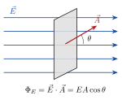

<!-- video: kommer (videoer/ingeniorfysikk/11-06-gauss-lov) -->
{fig-alt="Video kommer"}

<!-- tillegg: Claude -->
Coulombs lov gir feltet fra én punktladning. Skal vi finne feltet fra en ladet kule, en lang ledning eller en stor plate, må vi i prinsippet summere bidrag fra uendelig mange små ladninger. Det kan være mye arbeid. **Gauss' lov** gir en snarvei: Når ladningen er fordelt symmetrisk, kan vi finne feltet nesten uten regning. Ideen er å telle hvor mange feltlinjer som går ut gjennom en lukket flate.

## Elektrisk fluks

<!-- tillegg: Claude -->
Tenk deg at feltlinjene er som vann som strømmer. Hvor mye som går gjennom en flate, avhenger av hvor sterkt feltet er, hvor stor flaten er, og hvordan den står. Det måler vi med **fluks**.

{.tikz-fig style="width:380px"}

::: {.callout-note title="Definisjon: Elektrisk fluks"}
<!-- tillegg: Claude -->
For et homogent felt $\vec E$ gjennom en plan flate med **arealvektor** $\vec A$ (lengde lik arealet, retning vinkelrett på flaten) er den elektriske fluksen
$$
\Phi_E = \vec E\cdot\vec A = EA\cos\theta
$$
For en krum flate eller et felt som varierer, deler vi flaten i små biter $\mathrm{d}\vec A$ og summerer: $\Phi_E = \int\vec E\cdot\mathrm{d}\vec A$. Enheten er $\mathrm{N\,m^2/C}$.
:::

<!-- tillegg: Claude -->
For en **lukket** flate, som et kuleskall eller en boks, lar vi $\mathrm{d}\vec A$ peke **utover**. Da er fluksen positiv der feltlinjene går ut, og negativ der de går inn. Den samlede fluksen skrives med en ring på integraltegnet: $\oint\vec E\cdot\mathrm{d}\vec A$.

## Gauss' lov

<!-- tillegg: Claude -->
Se på en punktladning $Q$ i sentrum av et kuleskall med radius $r$. Feltet står vinkelrett på skallet overalt og har størrelsen $E = Q/(4\pi\varepsilon_0r^2)$. Fluksen ut blir
$$
\oint\vec E\cdot\mathrm{d}\vec A = E\cdot4\pi r^2 = \frac{Q}{4\pi\varepsilon_0r^2}\cdot4\pi r^2 = \frac{Q}{\varepsilon_0}
$$
Radien forsvant! Det er fordi feltet avtar som $1/r^2$ mens arealet vokser som $r^2$. Antall feltlinjer som går ut, er det samme uansett størrelse på kula. Faktisk gjelder det for **alle** lukkede flater, uansett form:

::: {.callout-important title="Gauss' lov"}
<!-- tillegg: Claude -->
Den elektriske fluksen ut av en lukket flate er lik ladningen inni flaten delt på $\varepsilon_0$:
$$
\oint\vec E\cdot\mathrm{d}\vec A = \frac{Q_\mathrm{inni}}{\varepsilon_0}
$$
:::

<!-- tillegg: Claude -->
Ladninger **utenfor** flaten bidrar ikke til den samlede fluksen: Feltlinjene deres går inn på den ene siden og ut på den andre. Gauss' lov er like generell som Coulombs lov, men den er mest nyttig når symmetrien lar oss si at $E$ er konstant over flaten.

## Slik bruker du Gauss' lov

::: {.steg}
1. Finn symmetrien: kule, sylinder (lang linje) eller plan.
2. Velg en tenkt lukket flate, en **gaussflate**, med samme symmetri gjennom punktet der du vil finne feltet.
3. Bruk symmetrien: Feltet har samme størrelse overalt der det står vinkelrett på flaten, og gir ingen fluks der det går langs flaten.
4. Regn ut fluksen ($E$ ganger arealet der feltet går ut), sett lik $Q_\mathrm{inni}/\varepsilon_0$ og løs for $E$.
:::

{.tikz-fig style="width:580px"}

### Ladet kule

<!-- tillegg: Claude -->
Utenfor en kule med ladningen $Q$ velger vi et kuleskall med radius $r$. Da er $E\cdot4\pi r^2 = Q/\varepsilon_0$, så

$$
E = \frac{Q}{4\pi\varepsilon_0r^2} \quad (r \geq R)
$$

Feltet utenfor er akkurat som om all ladningen satt i sentrum. Inni en **ledende** kule er feltet null: All ladningen ligger på overflaten, og en gaussflate inni har $Q_\mathrm{inni} = 0$. Inni en **isolerende** kule med jevnt fordelt ladning er $Q_\mathrm{inni} = Q\,r^3/R^3$, og feltet vokser lineært: $E = Qr/(4\pi\varepsilon_0R^3)$.

### Lang ladet linje

<!-- tillegg: Claude -->
En lang, rett linje har ladningen $\lambda$ per lengde. Feltet peker rett ut fra linja. Vi velger en sylinder med radius $r$ og lengde $L$. Gjennom endeflatene går ingen fluks, fordi feltet går langs dem. Gjennom sideflaten med areal $2\pi rL$:
$$
E\cdot2\pi rL = \frac{\lambda L}{\varepsilon_0} \qquad\Rightarrow\qquad E = \frac{\lambda}{2\pi\varepsilon_0r}
$$
Feltet avtar som $1/r$, langsommere enn fra en punktladning.

### Stort ladet plan

<!-- tillegg: Claude -->
Et stort, plant ark har ladningen $\sigma$ per areal. Feltet står vinkelrett på arket, på begge sider. Vi velger en liten boks med endeflater $A$ på hver side. Fluks går bare ut gjennom de to endeflatene:
$$
2EA = \frac{\sigma A}{\varepsilon_0} \qquad\Rightarrow\qquad E = \frac{\sigma}{2\varepsilon_0}
$$
Feltet er **uavhengig av avstanden**! Det er homogent på hver side. To parallelle plater med motsatt ladning $\pm\sigma$ gir feltet $E = \sigma/\varepsilon_0$ mellom seg og null utenfor. Det er feltet i en platekondensator (se *kapasitans*).

::: {.graa}
| Ladningsfordeling | Felt |
|---|---|
| Punktladning eller kule (utenfor) | $E = \dfrac{Q}{4\pi\varepsilon_0r^2}$ |
| Lang linje | $E = \dfrac{\lambda}{2\pi\varepsilon_0r}$ |
| Stort plan | $E = \dfrac{\sigma}{2\varepsilon_0}$ |
| To motsatt ladde plan (mellom) | $E = \dfrac{\sigma}{\varepsilon_0}$ |
:::

::: {.eksempel}
<!-- tillegg: Claude -->
**Eksempel: Isolerende kule.** En isolerende kule med radius $R = 10\ \mathrm{cm}$ har ladningen $Q = 5.0\ \mathrm{nC}$ jevnt fordelt i hele volumet. Finn feltet i avstanden $5.0\ \mathrm{cm}$ og $20\ \mathrm{cm}$ fra sentrum.

::: {.losning}
Utenfor ($r = 0.20\ \mathrm{m}$):
$$
E = \mathrm{k_e}\frac{Q}{r^2} = 8.99\cdot10^{9}\cdot\frac{5.0\cdot10^{-9}}{0.20^2}\ \mathrm{N/C} = \underline{\underline{1.1\cdot10^{3}\ \mathrm{N/C}}}
$$
Inni ($r = 0.050\ \mathrm{m}$): Bare ladningen innenfor gaussflaten teller, $Q_\mathrm{inni} = Q(r/R)^3 = Q/8$.
$$
E = \mathrm{k_e}\frac{Qr}{R^3} = 8.99\cdot10^{9}\cdot\frac{5.0\cdot10^{-9}\cdot0.050}{0.10^3}\ \mathrm{N/C} = \underline{\underline{2.2\cdot10^{3}\ \mathrm{N/C}}}
$$
Feltet er størst på overflaten og avtar både innover og utover.
:::
:::

:::: {.oppgaver}

::: {.oppgave tittel="Fluks fra en ladning"}
<!-- tillegg: Claude -->
En ladning på $1.0\ \mathrm{\mu C}$ ligger inni en lukket boks. Hva er den samlede elektriske fluksen ut av boksen? Endres svaret hvis ladningen flyttes til et hjørne inni boksen?

::: {.losning}
$$
\Phi_E = \frac{Q}{\varepsilon_0} = \frac{1.0\cdot10^{-6}}{8.85\cdot10^{-12}}\ \mathrm{N\,m^2/C} = \underline{\underline{1.1\cdot10^{5}\ \mathrm{N\,m^2/C}}}
$$
Svaret er det samme så lenge ladningen er inni boksen. Fluksen fordeler seg bare annerledes på sideflatene.
:::
:::

::: {.oppgave tittel="Ladet plan"}
<!-- tillegg: Claude -->
Et stort plant ark har ladningen $2.0\ \mathrm{\mu C/m^2}$. Hvor sterkt er feltet $1.0\ \mathrm{cm}$ og $10\ \mathrm{cm}$ fra arket?

::: {.losning}
Feltet er uavhengig av avstanden (så lenge arket er stort i forhold til avstanden):
$$
E = \frac{\sigma}{2\varepsilon_0} = \frac{2.0\cdot10^{-6}}{2\cdot8.85\cdot10^{-12}}\ \mathrm{N/C} = \underline{\underline{1.1\cdot10^{5}\ \mathrm{N/C}}}
$$
i begge avstandene.
:::
:::

::: {.oppgave tittel="Ladet ledning" niva="Middels"}
<!-- tillegg: Claude -->
En lang, rett ledning har ladningen $3.0\ \mathrm{nC/m}$. Hvor sterkt er feltet $5.0\ \mathrm{cm}$ fra ledningen? Hvor mye svakere er det i dobbel avstand?

::: {.losning}
$$
E = \frac{\lambda}{2\pi\varepsilon_0r} = \frac{3.0\cdot10^{-9}}{2\pi\cdot8.85\cdot10^{-12}\cdot0.050}\ \mathrm{N/C} = \underline{\underline{1.1\cdot10^{3}\ \mathrm{N/C}}}
$$
Feltet avtar som $1/r$, så i dobbel avstand er det **halvparten** så sterkt.
:::
:::

::: {.oppgave tittel="Hult kuleskall" niva="Utfordrende"}
<!-- tillegg: Claude -->
Et tynt, ledende kuleskall med radius $R$ har ladningen $Q$. En punktladning $q$ sitter i sentrum. Finn feltet inni skallet og utenfor skallet.

::: {.losning}
Inni ($r < R$): Gaussflaten omslutter bare $q$:
$$
E = \frac{q}{4\pi\varepsilon_0r^2}
$$
Utenfor ($r > R$): Gaussflaten omslutter både $q$ og $Q$:
$$
E = \frac{q + Q}{4\pi\varepsilon_0r^2}
$$
Skallet påvirker ikke feltet inni. (Ladningen på skallet fordeler seg slik at $-q$ sitter på innsiden og $Q + q$ på utsiden, men det endrer ikke svaret.)
:::
:::

::::
