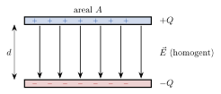

<!-- video: kommer (videoer/ingeniorfysikk/13-01-kapasitans) -->
{fig-alt="Video kommer"}

<!-- tillegg: Claude -->
Blitsen i et kamera trenger en kraftig strømstøt på et tusendels sekund. Et batteri klarer ikke å levere så mye så fort. Løsningen er en **kondensator**: en komponent som lagrer ladning og energi, og som kan tømmes nesten momentant. Kondensatorer finnes i nesten all elektronikk, fra mobiltelefoner til hjertestartere.

## Hva er en kondensator?

<!-- tillegg: Claude -->
En kondensator er to ledere som er isolert fra hverandre. Kobler vi den til et batteri, flytter batteriet elektroner fra den ene lederen til den andre. Da får den ene ladningen $+Q$ og den andre $-Q$, og det blir en spenning $V$ mellom dem. Jo mer ladning vi flytter, jo større blir spenningen. Forholdet mellom dem er en egenskap ved kondensatoren:

::: {.callout-note title="Definisjon: Kapasitans"}
<!-- tillegg: Claude -->
**Kapasitansen** $C$ til en kondensator er ladningen per spenning:
$$
C = \frac{Q}{V}
$$
SI-enheten er **farad**: $1\ \mathrm{F} = 1\ \mathrm{C/V}$. Vanlige kondensatorer har kapasitans fra pikofarad ($\mathrm{pF}$) til millifarad ($\mathrm{mF}$).
:::

<!-- tillegg: Claude -->
Kapasitansen sier hvor mye ladning kondensatoren kan ta per volt. Den avhenger bare av **geometrien** (størrelse, form, avstand) og av **stoffet** mellom lederne, ikke av ladningen eller spenningen.

## Platekondensatoren

{.tikz-fig style="width:420px"}

<!-- tillegg: Claude -->
Den enkleste kondensatoren er to parallelle metallplater med areal $A$ og avstand $d$. Ladningen fordeler seg jevnt med flatetettheten $\sigma = Q/A$. Fra Gauss' lov vet vi at feltet mellom to motsatt ladde plater er homogent:
$$
E = \frac{\sigma}{\varepsilon_0} = \frac{Q}{\varepsilon_0A}
$$
I et homogent felt er spenningen $V = Ed$ (se *elektrisk potensial og spenning*):
$$
V = Ed = \frac{Qd}{\varepsilon_0A}
$$
Da blir kapasitansen

::: {.callout-important title="Kapasitansen til en platekondensator"}
<!-- tillegg: Claude -->
$$
C = \frac QV = \varepsilon_0\frac{A}{d}
$$
med vakuum (eller luft) mellom platene.
:::

<!-- tillegg: Claude -->
Formelen er lett å forstå: Store plater gir plass til mye ladning, og liten avstand gir lav spenning for en gitt ladning. Begge deler gir stor kapasitans.

::: {.eksempel}
<!-- tillegg: Claude -->
**Eksempel: Platekondensator.** To plater med areal $100\ \mathrm{cm^2}$ står $1.0\ \mathrm{mm}$ fra hverandre. Finn kapasitansen, ladningen og feltet mellom platene når kondensatoren er koblet til $12\ \mathrm{V}$.

::: {.losning}
Med $A = 1.0\cdot10^{-2}\ \mathrm{m^2}$ og $d = 1.0\cdot10^{-3}\ \mathrm{m}$:
$$
C = \varepsilon_0\frac Ad = 8.85\cdot10^{-12}\cdot\frac{1.0\cdot10^{-2}}{1.0\cdot10^{-3}}\ \mathrm{F} = \underline{\underline{89\ \mathrm{pF}}}
$$
$$
Q = CV = 8.85\cdot10^{-11}\cdot12\ \mathrm{C} = \underline{\underline{1.1\ \mathrm{nC}}}, \qquad E = \frac Vd = \frac{12}{1.0\cdot10^{-3}}\ \mathrm{V/m} = \underline{\underline{1.2\cdot10^{4}\ \mathrm{V/m}}}
$$
:::
:::

::: {.callout-tip title="Til ettertanke"}
<!-- tillegg: Claude -->
Hvor store plater trengs for en kapasitans på $1\ \mathrm{F}$ med $1\ \mathrm{mm}$ avstand?
:::

<!-- tillegg: Claude -->
$A = Cd/\varepsilon_0 = 1\cdot10^{-3}/8.85\cdot10^{-12}\ \mathrm{m^2} \approx 1.1\cdot10^{8}\ \mathrm{m^2}$. Det er et kvadrat på over 10 km på hver side! Én farad er altså enormt. Moderne superkondensatorer klarer likevel flere farad i en liten boks, ved å bruke porøse materialer med svært stor overflate og en avstand mellom ladningene på bare noen få atomer.

## Kondensatoren i en krets

<!-- tillegg: Claude -->
I kretsskjemaer tegnes en kondensator som to korte, parallelle streker. Når den kobles til en spenningskilde, går det en kort strøm mens den lades opp. Når spenningen over kondensatoren er lik spenningen fra kilden, stopper strømmen. En oppladet kondensator **slipper ikke gjennom likestrøm**. Hvordan opp- og utladingen skjer i tid, ser vi på under *RC-kretser*.

:::: {.oppgaver}

::: {.oppgave tittel="Ladning på kondensatoren"}
<!-- tillegg: Claude -->
En kondensator på $470\ \mathrm{\mu F}$ lades opp til $9.0\ \mathrm{V}$. Hvor stor ladning har den?

::: {.losning}
$$
Q = CV = 470\cdot10^{-6}\cdot9.0\ \mathrm{C} = \underline{\underline{4.2\ \mathrm{mC}}}
$$
:::
:::

::: {.oppgave tittel="Endre avstanden"}
<!-- tillegg: Claude -->
Avstanden mellom platene i en platekondensator halveres, mens den er koblet til et batteri. Hva skjer med kapasitansen, spenningen og ladningen?

::: {.losning}
$C = \varepsilon_0A/d$, så kapasitansen **dobles**. Batteriet holder spenningen fast, så $V$ er **uendret**. Ladningen $Q = CV$ blir **dobbelt så stor**: Batteriet fyller på med mer ladning.
:::
:::

::: {.oppgave tittel="Gjennomslag" niva="Middels"}
<!-- tillegg: Claude -->
Luft leder strøm (det blir gnister) når feltet er over ca. $3.0\cdot10^{6}\ \mathrm{V/m}$. Hvor stor spenning tåler platekondensatoren i eksempelet ($d = 1.0\ \mathrm{mm}$)? Hvor stor ladning har den da?

::: {.losning}
$$
V_\mathrm{maks} = E_\mathrm{maks}d = 3.0\cdot10^{6}\cdot1.0\cdot10^{-3}\ \mathrm{V} = \underline{\underline{3.0\ \mathrm{kV}}}
$$
$$
Q = CV = 8.85\cdot10^{-11}\cdot3.0\cdot10^{3}\ \mathrm{C} = \underline{\underline{0.27\ \mathrm{\mu C}}}
$$
:::
:::

::: {.oppgave tittel="Kulekondensator" niva="Utfordrende"}
<!-- tillegg: Claude -->
En kulekondensator består av en ledende kule med radius $a$ inni et ledende kuleskall med radius $b$. Vis at kapasitansen er
$$
C = 4\pi\varepsilon_0\frac{ab}{b - a}
$$
Hint: Feltet mellom kulene er som fra en punktladning $Q$ i sentrum.

::: {.losning}
Mellom kulene er $E = Q/(4\pi\varepsilon_0r^2)$. Spenningen er integralet av feltet fra $a$ til $b$:
$$
V = \int_a^b\frac{Q}{4\pi\varepsilon_0r^2}\,\mathrm{d}r = \frac{Q}{4\pi\varepsilon_0}\left[\frac1a - \frac1b\right] = \frac{Q}{4\pi\varepsilon_0}\cdot\frac{b - a}{ab}
$$
$$
C = \frac QV = 4\pi\varepsilon_0\frac{ab}{b - a} \qquad\blacksquare
$$
Når avstanden $d = b - a$ er liten i forhold til radien, er $ab \approx a^2$ og $C \approx \varepsilon_0\cdot4\pi a^2/d = \varepsilon_0A/d$, som for en platekondensator.
:::
:::

::::
