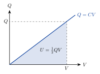

<!-- video: kommer (videoer/ingeniorfysikk/13-03-energi-i-kondensator) -->
{fig-alt="Video kommer"}

<!-- tillegg: Claude -->
En hjertestarter gir et kraftig elektrisk støt gjennom brystet for å få hjertet i takt igjen. Energien kommer fra en kondensator som er ladet opp i forkant. Hvor mye energi kan en kondensator lagre, og hvor sitter energien egentlig?

## Arbeidet med å lade opp

<!-- tillegg: Claude -->
Å lade opp en kondensator betyr å flytte ladning fra den ene platen til den andre. Den første ladningen er lett å flytte, fordi det ikke er noen spenning ennå. Men jo mer ladning som er flyttet, jo høyere blir spenningen, og jo mer arbeid koster det å flytte neste bit.

Når ladningen er $q$, er spenningen $v = q/C$. Å flytte en liten ladning $\mathrm{d}q$ koster arbeidet $v\,\mathrm{d}q$. Det samlede arbeidet for å lade opp til $Q$ er
$$
W = \int_0^Q\frac qC\,\mathrm{d}q = \frac{Q^2}{2C}
$$

{.tikz-fig style="width:360px"}

<!-- tillegg: Claude -->
Arbeidet lagres som potensiell energi i kondensatoren. Med $Q = CV$ kan energien skrives på tre måter:

::: {.callout-important title="Energi lagret i en kondensator"}
<!-- tillegg: Claude -->
$$
U = \frac{Q^2}{2C} = \tfrac12QV = \tfrac12CV^2
$$
:::

<!-- tillegg: Claude -->
Faktoren $\tfrac12$ kommer av at spenningen vokser jevnt fra $0$ til $V$ under oppladingen. Gjennomsnittsspenningen er $V/2$, så energien blir $Q\cdot V/2$. Det er arealet av trekanten i grafen.

::: {.eksempel}
<!-- tillegg: Claude -->
**Eksempel: Kamerablitsen.** En blitskondensator på $100\ \mathrm{\mu F}$ lades til $300\ \mathrm{V}$ og tømmes på $1.0\ \mathrm{ms}$. Hvor mye energi lagres, og hvor stor er den gjennomsnittlige effekten under blitsen?

::: {.losning}
$$
U = \tfrac12CV^2 = \tfrac12\cdot100\cdot10^{-6}\cdot300^2\ \mathrm{J} = \underline{\underline{4.5\ \mathrm{J}}}
$$
$$
P = \frac{U}{t} = \frac{4.5\ \mathrm{J}}{1.0\cdot10^{-3}\ \mathrm{s}} = \underline{\underline{4.5\ \mathrm{kW}}}
$$
Energien er liten, men den leveres svært raskt. Batteriet bruker noen sekunder på å lade opp kondensatoren, med mye lavere effekt.
:::
:::

## Energien sitter i feltet

<!-- tillegg: Claude -->
Hvor er energien? Vi kan si at den sitter i **det elektriske feltet** mellom platene. For en platekondensator er $C = \varepsilon_0A/d$ og $V = Ed$:
$$
U = \tfrac12CV^2 = \tfrac12\cdot\frac{\varepsilon_0A}{d}\cdot E^2d^2 = \tfrac12\varepsilon_0E^2\cdot(Ad)
$$
$Ad$ er volumet mellom platene. Energien per volum er altså

::: {.callout-important title="Energitetthet i et elektrisk felt"}
<!-- tillegg: Claude -->
$$
u_E = \tfrac12\varepsilon_0E^2
$$
:::

<!-- tillegg: Claude -->
Selv om vi utledet den for en platekondensator, gjelder formelen for alle elektriske felt, også i tomt rom. Elektromagnetiske bølger, som lys, frakter energi nettopp fordi de har elektriske (og magnetiske) felt.

::: {.eksempel}
<!-- tillegg: Claude -->
**Eksempel: Felt rett før gnisten.** Luft tåler et felt på ca. $3.0\cdot10^{6}\ \mathrm{V/m}$ før det går en gnist. Hvor stor er energitettheten da?

::: {.losning}
$$
u_E = \tfrac12\varepsilon_0E^2 = \tfrac12\cdot8.85\cdot10^{-12}\cdot(3.0\cdot10^{6})^2\ \mathrm{J/m^3} = \underline{\underline{40\ \mathrm{J/m^3}}}
$$
Til sammenligning har bensin ca. $3\cdot10^{10}\ \mathrm{J/m^3}$. Derfor kan ikke kondensatorer erstatte batterier eller drivstoff som energilager. De er gode til å levere energi raskt, ikke til å lagre mye.
:::
:::

:::: {.oppgaver}

::: {.oppgave tittel="Hjertestarteren"}
<!-- tillegg: Claude -->
En hjertestarter har en kondensator på $32\ \mathrm{\mu F}$ som lades til $5.0\ \mathrm{kV}$. Hvor mye energi lagres?

::: {.fasit}
$4.0\cdot10^{2}\ \mathrm{J}$
:::
:::

::: {.oppgave tittel="Dobbel spenning"}
<!-- tillegg: Claude -->
Hva skjer med energien i en kondensator når spenningen dobles?

:::

::: {.oppgave tittel="Trekke platene fra hverandre" niva="Middels"}
<!-- tillegg: Claude -->
En platekondensator er ladet og koblet fra batteriet. Så trekkes platene fra hverandre til dobbel avstand. Hva skjer med ladningen, spenningen og energien? Hvor kommer energien fra?

:::

::: {.oppgave tittel="Kraften mellom platene" niva="Utfordrende"}
<!-- tillegg: Claude -->
Bruk resultatet i forrige oppgave til å finne kraften mellom platene i en isolert platekondensator. Hint: Arbeidet med å øke avstanden med $\mathrm{d}x$ er $F\,\mathrm{d}x = \mathrm{d}U$.

:::

::::
