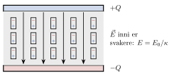

<!-- video: kommer (videoer/ingeniorfysikk/13-04-dielektrikum) -->
{fig-alt="Video kommer"}

<!-- tillegg: Claude -->
Nesten ingen kondensatorer har luft mellom platene. I stedet fylles rommet med et isolerende stoff: plast, keramikk, glass eller papir. Et slikt stoff kalles et **dielektrikum**, og det gjør tre ting på en gang: Det øker kapasitansen, det tåler høyere spenning enn luft, og det holder platene fra hverandre.

## Dielektrisitetstallet

<!-- tillegg: Claude -->
Fyller vi rommet mellom platene helt med et dielektrikum, øker kapasitansen med en faktor $\kappa$ (kappa):

::: {.callout-note title="Definisjon: Dielektrisitetstall"}
<!-- tillegg: Claude -->
**Dielektrisitetstallet** $\kappa$ (også kalt relativ permittivitet $\varepsilon_r$) er forholdet mellom kapasitansen med og uten dielektrikum:
$$
\kappa = \frac{C}{C_0}, \qquad C = \kappa\varepsilon_0\frac Ad
$$
:::

<!-- tillegg: Claude -->
| Stoff | $\kappa$ | Tåler felt (MV/m) |
|---|---|---|
| Vakuum | 1 (eksakt) | – |
| Luft | 1.0006 | 3 |
| Papir | 3.7 | 16 |
| Glass | ca. 5–10 | ca. 10 |
| Vann (rent) | 80 | – |
| Bariumtitanat (keramikk) | ca. $10^{3}$–$10^{4}$ | ca. 10 |

## Hvorfor øker kapasitansen?

{.tikz-fig style="width:420px"}

<!-- tillegg: Claude -->
Molekylene i et dielektrikum leder ikke strøm, men ladningene i dem kan forskyve seg litt. Feltet fra platene drar elektronskyen litt mot den positive platen og atomkjernene litt mot den negative. Hvert molekyl blir en liten **dipol**. Noen stoffer, som vann, har dipoler fra før, og de snur seg etter feltet.

Inni stoffet opphever dipolene hverandre. Men på overflaten mot den positive platen blir det et tynt lag med negativ ladning, og mot den negative platen et lag med positiv ladning. Disse **induserte ladningene** lager et felt som peker motsatt av feltet fra platene. Det samlede feltet blir svakere:
$$
E = \frac{E_0}{\kappa}
$$
Med svakere felt blir spenningen $V = Ed$ lavere for samme ladning. Da er $C = Q/V$ større.

::: {.eksempel}
<!-- tillegg: Claude -->
**Eksempel: Papir mellom platene.** Platekondensatoren med $A = 100\ \mathrm{cm^2}$ og $d = 1.0\ \mathrm{mm}$ fylles med papir ($\kappa = 3.7$). Hva blir kapasitansen? Hvor stor spenning tåler den nå, sammenlignet med luft?

::: {.losning}
$$
C = \kappa C_0 = 3.7\cdot8.85\cdot10^{-11}\ \mathrm{F} = \underline{\underline{3.3\cdot10^{-10}\ \mathrm{F}}} = 0.33\ \mathrm{nF}
$$
Med luft tåler den $3\ \mathrm{MV/m}\cdot1.0\ \mathrm{mm} = 3\ \mathrm{kV}$. Med papir tåler den
$$
V_\mathrm{maks} = 16\cdot10^{6}\ \mathrm{V/m}\cdot1.0\cdot10^{-3}\ \mathrm{m} = \underline{\underline{16\ \mathrm{kV}}}
$$
Både kapasitansen og spenningen den tåler, øker. Derfor kan den lagre mye mer energi.
:::
:::

## Batteri koblet til eller ikke?

<!-- tillegg: Claude -->
Hva som skjer når dielektrikumet skyves inn, avhenger av om kondensatoren er koblet til et batteri:

::: {.kort}
- **Koblet til batteri (konstant $V$).** Kapasitansen øker, så batteriet fyller på mer ladning: $Q = \kappa Q_0$. Energien $\tfrac12CV^2$ øker med faktoren $\kappa$.
- **Isolert (konstant $Q$).** Spenningen faller: $V = V_0/\kappa$. Energien $Q^2/(2C)$ **minker** med faktoren $\kappa$. Kondensatoren trekker dielektrikumet inn og gjør arbeid på det.
:::

<!-- tillegg: Claude -->
Alle formlene for platekondensatoren gjelder fortsatt med et dielektrikum, hvis vi bytter ut $\varepsilon_0$ med $\kappa\varepsilon_0$. For eksempel blir energitettheten $u = \tfrac12\kappa\varepsilon_0E^2$.

:::: {.oppgaver}

::: {.oppgave tittel="Glass"}
<!-- tillegg: Claude -->
En kondensator har $C_0 = 50\ \mathrm{pF}$ med luft. Hva blir kapasitansen når rommet fylles med glass med $\kappa = 6.0$?

::: {.losning}
$$
C = \kappa C_0 = 6.0\cdot50\ \mathrm{pF} = \underline{\underline{3.0\cdot10^{2}\ \mathrm{pF}}}
$$
:::
:::

::: {.oppgave tittel="Isolert kondensator"}
<!-- tillegg: Claude -->
En isolert kondensator er ladet til $100\ \mathrm{V}$. Et dielektrikum med $\kappa = 4.0$ skyves inn. Hva blir spenningen?

::: {.losning}
Ladningen er konstant, så $V = V_0/\kappa = 100/4.0\ \mathrm{V} = \underline{\underline{25\ \mathrm{V}}}$.
:::
:::

::: {.oppgave tittel="Med batteri" niva="Middels"}
<!-- tillegg: Claude -->
En kondensator på $20\ \mathrm{nF}$ er koblet til $50\ \mathrm{V}$. Et dielektrikum med $\kappa = 3.0$ skyves inn mens batteriet er tilkoblet. Hvor mye ladning leverer batteriet, og hvor mye øker energien i kondensatoren?

::: {.losning}
Ladningen går fra $Q_0 = 20\ \mathrm{nF}\cdot50\ \mathrm{V} = 1.0\ \mathrm{\mu C}$ til $Q = 3.0\ \mathrm{\mu C}$. Batteriet leverer
$$
\Delta Q = \underline{\underline{2.0\ \mathrm{\mu C}}}
$$
Energien går fra $\tfrac12\cdot20\cdot10^{-9}\cdot50^2\ \mathrm{J} = 25\ \mathrm{\mu J}$ til $75\ \mathrm{\mu J}$, en økning på $\underline{\underline{50\ \mathrm{\mu J}}}$.

(Batteriet gjør arbeidet $\Delta Q\cdot V = 100\ \mathrm{\mu J}$. Halvparten går til kondensatoren, resten til å dra dielektrikumet inn.)
:::
:::

::: {.oppgave tittel="Halvfylt kondensator" niva="Utfordrende"}
<!-- tillegg: Claude -->
Venstre halvdel av en platekondensator (halve arealet) fylles med et dielektrikum med $\kappa$, høyre halvdel har luft. Vis at kapasitansen blir $C = \tfrac12(1 + \kappa)C_0$.

::: {.losning}
De to halvdelene har samme spenning, fordi platene er de samme ledere. De står altså i **parallell**:
$$
C = \kappa\varepsilon_0\frac{A/2}{d} + \varepsilon_0\frac{A/2}{d} = \tfrac12(\kappa + 1)\varepsilon_0\frac Ad = \tfrac12(1 + \kappa)C_0 \qquad\blacksquare
$$
:::
:::

::::
