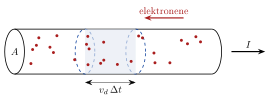

<!-- video: kommer (videoer/ingeniorfysikk/14-01-elektrisk-strom) -->
{fig-alt="Video kommer"}

<!-- tillegg: Claude -->
Når du slår på lyset, tennes lampa med en gang. Men elektronene i ledningen kryper av sted med en fart på under en millimeter i sekundet! Hvordan henger det sammen? Svaret er at ledningen allerede er full av elektroner. Når spenningen slås på, begynner alle å bevege seg nesten samtidig, slik vannet i en full hageslange kommer ut i enden med en gang du åpner kranen.

## Strøm

::: {.callout-note title="Definisjon: Elektrisk strøm"}
<!-- tillegg: Claude -->
**Strømmen** $I$ er ladningen som passerer et tverrsnitt per tid:
$$
I = \frac{\mathrm{d}Q}{\mathrm{d}t}
$$
SI-enheten er **ampere**: $1\ \mathrm{A} = 1\ \mathrm{C/s}$.
:::

<!-- tillegg: Claude -->
Retningen til strømmen er per definisjon den veien **positiv** ladning ville gått, fra pluss til minus utenfor batteriet. I metaller er det elektronene som beveger seg, og de går motsatt vei. Det spiller ingen rolle for regningen: Negativ ladning mot venstre gir samme strøm som positiv ladning mot høyre.

En strøm på $1\ \mathrm{A}$ betyr at $1/(1.602\cdot10^{-19}) = 6.24\cdot10^{18}$ elektroner passerer hvert sekund.

## Driftsfart

{.tikz-fig style="width:520px"}

<!-- tillegg: Claude -->
Elektronene i et metall farer rundt i tilfeldige retninger med stor fart, ca. $10^{6}\ \mathrm{m/s}$. Uten spenning går de like mye alle veier, og det går ingen strøm. Et elektrisk felt gir dem en liten, felles fart i én retning, **driftsfarten** $v_d$.

Hvor stor blir strømmen? Leder med tverrsnitt $A$ har $n$ frie elektroner per volum, hver med ladning $\mathrm{e}$. I løpet av $\Delta t$ passerer alle elektronene i en sylinder med lengde $v_d\Delta t$, altså $nAv_d\Delta t$ elektroner. Det gir

::: {.callout-important title="Strøm og driftsfart"}
<!-- tillegg: Claude -->
$$
I = nqv_dA, \qquad J = \frac IA = nqv_d
$$
der $J$ er **strømtettheten** (strøm per areal, enhet $\mathrm{A/m^2}$).
:::

::: {.eksempel}
<!-- tillegg: Claude -->
**Eksempel: Hvor fort går elektronene?** En kobberledning med diameter $2.0\ \mathrm{mm}$ fører strømmen $10\ \mathrm{A}$. Kobber har ca. $8.5\cdot10^{28}$ frie elektroner per kubikkmeter. Hvor stor er driftsfarten?

::: {.losning}
Arealet er $A = \pi(1.0\cdot10^{-3}\ \mathrm{m})^2 = 3.14\cdot10^{-6}\ \mathrm{m^2}$.
$$
v_d = \frac{I}{n\mathrm{e}A} = \frac{10}{8.5\cdot10^{28}\cdot1.602\cdot10^{-19}\cdot3.14\cdot10^{-6}}\ \mathrm{m/s} = \underline{\underline{2.3\cdot10^{-4}\ \mathrm{m/s}}}
$$
Det er under en kvart millimeter i sekundet. Et elektron bruker over en time på å flytte seg én meter! Signalet går likevel nesten med lysfarten, fordi det er feltet, ikke elektronene, som brer seg langs ledningen.
:::
:::

## Hva driver strømmen?

<!-- tillegg: Claude -->
Det trengs et elektrisk felt i lederen for å holde strømmen i gang. Feltet kommer av en **spenning** (potensialforskjell) mellom endene, for eksempel fra et batteri. I en leder med strøm er altså feltet ikke null, i motsetning til i en leder i likevekt (se *Gauss' lov*). Sammenhengen mellom spenning og strøm er temaet for *resistans og resistivitet*.

:::: {.oppgaver}

::: {.oppgave tittel="Ladning gjennom lampa"}
<!-- tillegg: Claude -->
En lampe har strømmen $0.50\ \mathrm{A}$ i $2.0$ timer. Hvor mye ladning har gått gjennom den? Hvor mange elektroner er det?

::: {.losning}
$$
Q = It = 0.50\cdot2.0\cdot3600\ \mathrm{C} = \underline{\underline{3.6\cdot10^{3}\ \mathrm{C}}}, \qquad N = \frac{Q}{\mathrm{e}} = \frac{3600}{1.602\cdot10^{-19}} = \underline{\underline{2.2\cdot10^{22}}}
$$
:::
:::

::: {.oppgave tittel="Batterikapasitet"}
<!-- tillegg: Claude -->
Et mobilbatteri har kapasiteten $2000\ \mathrm{mAh}$. Hvor mye ladning er det i coulomb? Hvor lenge varer det med strømmen $250\ \mathrm{mA}$?

::: {.losning}
$$
Q = 2.0\ \mathrm{A}\cdot3600\ \mathrm{s} = \underline{\underline{7.2\cdot10^{3}\ \mathrm{C}}}, \qquad t = \frac{2000\ \mathrm{mAh}}{250\ \mathrm{mA}} = \underline{\underline{8.0\ \mathrm{h}}}
$$
:::
:::

::: {.oppgave tittel="Tynnere ledning" niva="Middels"}
<!-- tillegg: Claude -->
Den samme strømmen går gjennom en kobberledning som er halvparten så tykk (halv diameter). Hva skjer med driftsfarten?

::: {.losning}
$v_d = I/(n\mathrm{e}A)$ og $A \propto d^2$. Halv diameter gir en fjerdedel av arealet, så driftsfarten blir **fire ganger** så stor.
:::
:::

::: {.oppgave tittel="Strøm som varierer" niva="Utfordrende"}
<!-- tillegg: Claude -->
Ladningen som har passert et punkt, er gitt ved $Q(t) = (4.0\ \mathrm{C/s})\,t - (0.50\ \mathrm{C/s^2})\,t^2$. Finn strømmen ved $t = 2.0\ \mathrm{s}$. Når er strømmen null?

::: {.losning}
$$
I = \frac{\mathrm{d}Q}{\mathrm{d}t} = 4.0 - 1.0\,t \ \mathrm{A}, \qquad I(2.0\ \mathrm{s}) = \underline{\underline{2.0\ \mathrm{A}}}
$$
Strømmen er null når $4.0 - 1.0\,t = 0$, altså ved $t = \underline{\underline{4.0\ \mathrm{s}}}$. Etterpå er den negativ: Ladningen går motsatt vei.
:::
:::

::::
