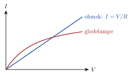

<!-- video: kommer (videoer/ingeniorfysikk/14-02-resistans-og-resistivitet) -->
{fig-alt="Video kommer"}

<!-- tillegg: Claude -->
Hvorfor blir en ledning varm når det går strøm gjennom den, og hvorfor bruker vi kobber i ledninger og wolfram i glødelamper? Elektronene som driver gjennom metallet, kolliderer hele tiden med atomene og mister energi. Det gir **resistans**: lederen gjør motstand mot strømmen. Hvor stor motstanden er, avhenger både av stoffet og av formen på lederen.

## Resistans og Ohms lov

::: {.callout-note title="Definisjon: Resistans"}
<!-- tillegg: Claude -->
**Resistansen** $R$ til en komponent er spenningen over den delt på strømmen gjennom den:
$$
R = \frac VI
$$
SI-enheten er **ohm**: $1\ \Omega = 1\ \mathrm{V/A}$.
:::

<!-- tillegg: Claude -->
For mange ledere, spesielt metaller ved konstant temperatur, er $R$ den samme uansett spenning. Da er strømmen proporsjonal med spenningen:

::: {.callout-important title="Ohms lov"}
<!-- tillegg: Claude -->
$$
V = RI \qquad (R\ \text{konstant})
$$
:::

{.tikz-fig style="width:420px"}

<!-- tillegg: Claude -->
Ohms lov er ikke en naturlov som alltid gjelder, men en egenskap noen materialer har. Dioder, glødelamper og halvledere er **ikke-ohmske**: Grafen av $I$ mot $V$ er ikke en rett linje.

## Resistivitet

<!-- tillegg: Claude -->
En lang ledning har større resistans enn en kort, fordi elektronene må gjennom flere kollisjoner. En tykk ledning har mindre resistans enn en tynn, fordi det er flere veier for elektronene. Det fører til

::: {.callout-important title="Resistansen til en leder"}
<!-- tillegg: Claude -->
$$
R = \rho\frac LA
$$
der $L$ er lengden, $A$ tverrsnittsarealet og $\rho$ **resistiviteten** til stoffet (enhet $\Omega\,\mathrm{m}$).
:::

<!-- tillegg: Claude -->
| Stoff (20 °C) | $\rho$ ($\Omega\,\mathrm{m}$) | $\alpha$ ($\mathrm{K^{-1}}$) |
|---|---|---|
| Sølv | $1.59\cdot10^{-8}$ | $3.8\cdot10^{-3}$ |
| Kobber | $1.68\cdot10^{-8}$ | $3.9\cdot10^{-3}$ |
| Aluminium | $2.65\cdot10^{-8}$ | $3.9\cdot10^{-3}$ |
| Wolfram | $5.6\cdot10^{-8}$ | $4.5\cdot10^{-3}$ |
| Konstantan (legering) | $4.9\cdot10^{-7}$ | ca. $10^{-5}$ |
| Silisium (rent) | ca. $10^{3}$ | negativ |
| Glass | $10^{10}$–$10^{14}$ | – |

Resistiviteten varierer over mer enn 20 tierpotenser fra de beste lederne til de beste isolatorene. Den omvendte størrelsen, $\sigma = 1/\rho$, kalles **konduktiviteten**.

::: {.eksempel}
<!-- tillegg: Claude -->
**Eksempel: Skjøteledningen.** En skjøteledning er $10\ \mathrm{m}$ lang, og hver av de to lederne er av kobber med diameter $1.5\ \mathrm{mm}$. Hva er resistansen fram og tilbake?

::: {.losning}
Strømmen går gjennom $L = 20\ \mathrm{m}$ kobber. Arealet er $A = \pi(0.75\cdot10^{-3})^2\ \mathrm{m^2} = 1.77\cdot10^{-6}\ \mathrm{m^2}$.
$$
R = \rho\frac LA = 1.68\cdot10^{-8}\cdot\frac{20}{1.77\cdot10^{-6}}\ \Omega = \underline{\underline{0.19\ \Omega}}
$$
Med $10\ \mathrm{A}$ blir spenningsfallet $1.9\ \mathrm{V}$, og ledningen avgir ca. $19\ \mathrm{W}$ som varme (se *elektrisk effekt*).
:::
:::

## Temperaturavhengighet

<!-- tillegg: Claude -->
I metaller vibrerer atomene mer når temperaturen stiger, og elektronene kolliderer oftere. Resistiviteten øker omtrent lineært:
$$
\rho(T) = \rho_0\left[1 + \alpha(T - T_0)\right], \qquad R(T) = R_0\left[1 + \alpha(T - T_0)\right]
$$
der $\alpha$ er **temperaturkoeffisienten**. I halvledere er det motsatt: Varme frigjør flere ladningsbærere, og resistansen synker. Dette brukes i temperaturfølere (termistorer).

::: {.eksempel}
<!-- tillegg: Claude -->
**Eksempel: Glødelampe.** En glødetråd av wolfram har resistansen $30\ \Omega$ ved $20\ \mathrm{^\circ C}$. Hva er resistansen når tråden lyser med $2500\ \mathrm{^\circ C}$? (Den lineære modellen er grov ved så stor temperaturforskjell, men gir en god pekepinn.)

::: {.losning}
$$
R = R_0[1 + \alpha\Delta T] = 30\cdot[1 + 4.5\cdot10^{-3}\cdot2480]\ \Omega = \underline{\underline{3.6\cdot10^{2}\ \Omega}}
$$
Resistansen er over ti ganger så stor når lampa lyser. Derfor går det en stor strømstøt i det øyeblikket du slår på en kald glødelampe, og det er da de oftest går.
:::
:::

:::: {.oppgaver}

::: {.oppgave tittel="Ohms lov"}
<!-- tillegg: Claude -->
Det går $0.25\ \mathrm{A}$ gjennom en motstand når spenningen over den er $12\ \mathrm{V}$. Hva er resistansen?

::: {.fasit}
$48\ \Omega$
:::
:::

::: {.oppgave tittel="Lengre og tynnere"}
<!-- tillegg: Claude -->
En ledning strekkes slik at den blir dobbelt så lang og halvparten så tykk (halv diameter). Hva skjer med resistansen?

::: {.fasit}
$8$
:::
:::

::: {.oppgave tittel="Finn resistiviteten" niva="Middels"}
<!-- tillegg: Claude -->
En tråd er $2.0\ \mathrm{m}$ lang og har diameter $0.40\ \mathrm{mm}$. Med $6.0\ \mathrm{V}$ over tråden går det $0.76\ \mathrm{A}$. Hva er resistiviteten? Hvilket stoff kan det være?

::: {.fasit}
$5.0\cdot10^{-7}\ \Omega\,\mathrm{m}$
:::
:::

::: {.oppgave tittel="Termometer" niva="Utfordrende"}
<!-- tillegg: Claude -->
En kobbertråd har resistansen $12.0\ \Omega$ ved $20\ \mathrm{^\circ C}$. Når den legges i en ovn, måles resistansen til $15.6\ \Omega$. Hva er temperaturen i ovnen?

::: {.fasit}
$97\ \mathrm{^\circ C}$
:::
:::

::::
