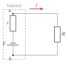

<!-- video: kommer (videoer/ingeniorfysikk/14-03-emf-og-indre-resistans) -->
{fig-alt="Video kommer"}

<!-- tillegg: Claude -->
Står det $12\ \mathrm{V}$ på et bilbatteri, er spenningen mellom polene alltid $12\ \mathrm{V}$? Nei. Starter du bilen, faller spenningen merkbart, og lysene blir svakere. Det er fordi batteriet selv har en liten resistans inni. Her ser vi hva et batteri egentlig gjør, og hvordan vi beskriver det.

## Elektromotorisk spenning

<!-- tillegg: Claude -->
I en ledning går strømmen fra høyt til lavt potensial, «nedover». Inni batteriet må ladningen løftes «oppover» igjen, fra lavt til høyt potensial. Det krever energi, og den kommer fra kjemiske reaksjoner i batteriet (eller fra bevegelse i en generator, eller lys i en solcelle).

::: {.callout-note title="Definisjon: Elektromotorisk spenning (emf)"}
<!-- tillegg: Claude -->
Den **elektromotoriske spenningen** $\mathcal{E}$ til en spenningskilde er arbeidet kilden gjør per ladning den flytter fra minuspolen til plusspolen:
$$
\mathcal{E} = \frac{W}{q}
$$
Enheten er volt. Selv om navnet sier «kraft» (engelsk *electromotive force*), er emf ikke en kraft, men en spenning.
:::

## Indre resistans og polspenning

{.tikz-fig style="width:360px"}

<!-- tillegg: Claude -->
Et ekte batteri har en **indre resistans** $r$: Ladningene møter litt motstand inni også. Vi tenker oss batteriet som en ideell kilde $\mathcal{E}$ i serie med $r$. Når det går strømmen $I$, mister ladningen spenningen $Ir$ inni batteriet. Spenningen mellom polene, **polspenningen**, blir derfor

::: {.callout-important title="Polspenning"}
<!-- tillegg: Claude -->
$$
V_\mathrm{pol} = \mathcal{E} - Ir
$$
:::

<!-- tillegg: Claude -->
Er batteriet koblet til en ytre resistans $R$, er $V_\mathrm{pol} = IR$. Da får vi

::: {.graa}
$$
\mathcal{E} = IR + Ir \qquad\Rightarrow\qquad I = \frac{\mathcal{E}}{R + r}
$$
:::

{.tikz-fig style="width:340px"}

::: {.kort}
- **Ingen strøm** (åpen krets): $V_\mathrm{pol} = \mathcal{E}$. Derfor måler et voltmeter (som trekker nesten ingen strøm) emf-en direkte.
- **Stor strøm**: Polspenningen faller. Det er dette som skjer når bilen startes.
- **Kortslutning** ($R = 0$): Strømmen blir $\mathcal{E}/r$, som kan være svært stor. Batteriet blir varmt og kan bli ødelagt.
:::

::: {.eksempel}
<!-- tillegg: Claude -->
**Eksempel: Batteri med last.** Et batteri med $\mathcal{E} = 12.0\ \mathrm{V}$ og $r = 0.50\ \Omega$ kobles til en motstand $R = 5.5\ \Omega$. Finn strømmen og polspenningen.

::: {.losning}
$$
I = \frac{\mathcal{E}}{R + r} = \frac{12.0}{5.5 + 0.50}\ \mathrm{A} = \underline{\underline{2.0\ \mathrm{A}}}
$$
$$
V_\mathrm{pol} = \mathcal{E} - Ir = 12.0 - 2.0\cdot0.50\ \mathrm{V} = \underline{\underline{11.0\ \mathrm{V}}}
$$
Sjekk: $V_\mathrm{pol} = IR = 2.0\cdot5.5\ \mathrm{V} = 11.0\ \mathrm{V}$. ✓
:::
:::

::: {.eksempel}
<!-- tillegg: Claude -->
**Eksempel: Måle indre resistans.** Et voltmeter viser $1.50\ \mathrm{V}$ over et AA-batteri uten last. Med en motstand på $4.5\ \Omega$ koblet til viser det $1.35\ \mathrm{V}$. Hva er den indre resistansen?

::: {.losning}
Uten last måles emf-en: $\mathcal{E} = 1.50\ \mathrm{V}$. Med last er strømmen $I = V_\mathrm{pol}/R = 1.35/4.5\ \mathrm{A} = 0.30\ \mathrm{A}$.
$$
r = \frac{\mathcal{E} - V_\mathrm{pol}}{I} = \frac{1.50 - 1.35}{0.30}\ \Omega = \underline{\underline{0.50\ \Omega}}
$$
:::
:::

:::: {.oppgaver}

::: {.oppgave tittel="Starte bilen"}
<!-- tillegg: Claude -->
Et bilbatteri har $\mathcal{E} = 12.6\ \mathrm{V}$ og $r = 0.020\ \Omega$. Startmotoren trekker $100\ \mathrm{A}$. Hva er polspenningen mens bilen startes?

::: {.fasit}
$10.6\ \mathrm{V}$
:::
:::

::: {.oppgave tittel="Kortslutning"}
<!-- tillegg: Claude -->
Hvor stor blir strømmen hvis AA-batteriet i eksempelet ($\mathcal{E} = 1.50\ \mathrm{V}$, $r = 0.50\ \Omega$) kortsluttes?

::: {.fasit}
$3.0\ \mathrm{A}$
:::
:::

::: {.oppgave tittel="To målinger" niva="Middels"}
<!-- tillegg: Claude -->
Med en motstand på $2.0\ \Omega$ går det $1.5\ \mathrm{A}$ fra et batteri. Med $5.0\ \Omega$ går det $0.70\ \mathrm{A}$. Finn $\mathcal{E}$ og $r$.

::: {.fasit}
$0.63\ \Omega$ · $3.9\ \mathrm{V}$
:::
:::

::: {.oppgave tittel="Batterier i serie" niva="Utfordrende"}
<!-- tillegg: Claude -->
Fire AA-batterier ($\mathcal{E} = 1.50\ \mathrm{V}$, $r = 0.50\ \Omega$ hver) kobles i serie til en lampe med $R = 10\ \Omega$. Hva blir strømmen? Hva ville den blitt med ideelle batterier?

::: {.fasit}
$0.50\ \mathrm{A}$
:::
:::

::::
