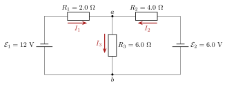

<!-- video: kommer (videoer/ingeniorfysikk/14-04-kirchhoffs-lover) -->
{fig-alt="Video kommer"}

<!-- tillegg: Claude -->
Lysene i et hus er koblet i parallell: Slår du av ett, lyser de andre fortsatt. Gammeldagse julelys var koblet i serie: Gikk én pære, ble alle mørke. Her lærer vi å regne på slike kretser, og vi ser på to enkle lover som løser selv kompliserte kretser: **Kirchhoffs lover**.

## Serie og parallell

{.tikz-fig style="width:540px"}

<!-- tillegg: Claude -->
**I serie** går den samme strømmen gjennom alle motstandene, og spenningene legges sammen: $V = IR_1 + IR_2 + \dots$

**I parallell** har alle motstandene den samme spenningen, og strømmene legges sammen: $I = V/R_1 + V/R_2 + \dots$

::: {.callout-important title="Motstander i serie og parallell"}
<!-- tillegg: Claude -->
$$
\text{Serie: } R = R_1 + R_2 + R_3 + \dots \qquad\qquad \text{Parallell: } \frac1R = \frac{1}{R_1} + \frac{1}{R_2} + \frac{1}{R_3} + \dots
$$
:::

<!-- tillegg: Claude -->
I serie blir den samlede resistansen **større** enn hver av dem, i parallell **mindre** enn den minste. Kobler du flere apparater i parallell til samme kontakt, går den samlede resistansen ned og strømmen opp. Derfor går sikringen hvis du kobler for mye til én kurs.

::: {.eksempel}
<!-- tillegg: Claude -->
**Eksempel: Tre i parallell.** Motstander på $4.0\ \Omega$, $6.0\ \Omega$ og $12\ \Omega$ kobles i parallell til $12\ \mathrm{V}$. Finn den samlede resistansen og strømmen fra kilden.

::: {.losning}
$$
\frac1R = \frac{1}{4.0} + \frac{1}{6.0} + \frac{1}{12}\ \Omega^{-1} = \frac{3 + 2 + 1}{12}\ \Omega^{-1} = \frac12\ \Omega^{-1} \quad\Rightarrow\quad R = \underline{\underline{2.0\ \Omega}}
$$
$$
I = \frac VR = \frac{12}{2.0}\ \mathrm{A} = \underline{\underline{6.0\ \mathrm{A}}}
$$
Sjekk: $3.0 + 2.0 + 1.0\ \mathrm{A} = 6.0\ \mathrm{A}$. ✓
:::
:::

## Kirchhoffs lover

<!-- tillegg: Claude -->
Ikke alle kretser kan deles opp i serie- og parallellkoblinger. Har kretsen flere batterier på ulike steder, trenger vi et mer generelt verktøy. Kirchhoffs lover er to bevaringslover:

::: {.callout-important title="Kirchhoffs lover"}
<!-- tillegg: Claude -->
**Strømloven (knutepunktsregelen):** I et knutepunkt er summen av strømmene inn lik summen av strømmene ut:
$$
\sum I_\mathrm{inn} = \sum I_\mathrm{ut}
$$
**Spenningsloven (sløyferegelen):** Rundt en lukket sløyfe er summen av alle spenningsendringer null:
$$
\sum\Delta V = 0
$$
:::

::: {.kort}
- **Strømloven** er bevaring av ladning: Ladning kan ikke hope seg opp i et knutepunkt.
- **Spenningsloven** er bevaring av energi: Går du en runde og kommer tilbake der du startet, er du på samme potensial.
:::

### Fortegnsregler

<!-- tillegg: Claude -->
Gå rundt sløyfa i en valgt retning og legg sammen:

::: {.kort}
- **Motstand** i samme retning som strømmen: $-IR$ (potensialet faller). Mot strømmen: $+IR$.
- **Batteri** fra minus- til plusspol: $+\mathcal{E}$. Fra pluss til minus: $-\mathcal{E}$.
:::

<!-- tillegg: Claude -->
Du velger retningen på strømmene selv. Blir svaret negativt, går strømmen motsatt vei. Det er helt greit.

::: {.steg}
1. Tegn kretsen og gi hver gren en strøm med en valgt retning.
2. Bruk strømloven i knutepunktene (én likning færre enn antall knutepunkter).
3. Bruk spenningsloven i nok sløyfer til at du har like mange likninger som ukjente.
4. Løs likningssettet. Sjekk svaret i en sløyfe du ikke brukte.
:::

{.tikz-fig style="width:520px"}

::: {.eksempel}
<!-- tillegg: Claude -->
**Eksempel: To batterier.** Finn strømmene $I_1$, $I_2$ og $I_3$ i kretsen over.

::: {.losning}
**Strømloven** i knutepunktet $a$: $I_1 + I_2 = I_3$.

**Venstre sløyfe**, med klokka fra nedre venstre hjørne: opp gjennom batteri 1 ($+12$), gjennom $R_1$ med strømmen ($-2.0I_1$), ned gjennom $R_3$ med strømmen ($-6.0I_3$):
$$
12 - 2.0I_1 - 6.0I_3 = 0
$$
**Høyre sløyfe**, mot klokka fra nedre høyre hjørne: opp gjennom batteri 2 ($+6.0$), gjennom $R_2$ med strømmen ($-4.0I_2$), ned gjennom $R_3$ ($-6.0I_3$):
$$
6.0 - 4.0I_2 - 6.0I_3 = 0
$$
Vi setter $I_3 = I_1 + I_2$ inn i de to sløyfelikningene:
$$
12 = 8.0I_1 + 6.0I_2, \qquad 6.0 = 6.0I_1 + 10I_2
$$
Den første gir $I_1 = 1.5 - 0.75I_2$. Innsatt i den andre: $6.0 = 9.0 - 4.5I_2 + 10I_2$, så $I_2 = -0.545\ \mathrm{A}$.
$$
I_1 = \underline{\underline{1.9\ \mathrm{A}}}, \qquad I_2 = \underline{\underline{-0.55\ \mathrm{A}}}, \qquad I_3 = I_1 + I_2 = \underline{\underline{1.4\ \mathrm{A}}}
$$
$I_2$ er negativ: Strømmen gjennom $R_2$ går mot høyre, og batteri 2 blir **ladet opp** av batteri 1.

Sjekk i den ytre sløyfa: $12 - 2.0\cdot1.909 + 4.0\cdot(-0.545) - 6.0 = 12 - 3.82 - 2.18 - 6.0 = 0$. ✓
:::
:::

```{.python .kjor}
import numpy as np
# Kirchhoff for kretsen over som et likningssett A*I = b
#        I1   I2   I3
A = np.array([[1,   1,  -1],    # strømloven:  I1 + I2 - I3 = 0
              [2.0, 0,  6.0],   # venstre sløyfe: 2 I1 + 6 I3 = 12
              [0,  4.0, 6.0]])  # høyre sløyfe:   4 I2 + 6 I3 = 6
b = np.array([0, 12, 6.0])
I = np.linalg.solve(A, b)
print("I1, I2, I3 =", np.round(I, 3), "A")
```

:::: {.oppgaver}

::: {.oppgave tittel="Julelys"}
<!-- tillegg: Claude -->
En lysslynge har 20 like pærer i serie og kobles til $230\ \mathrm{V}$. Hver pære har resistansen $46\ \Omega$ når den lyser. Hva er strømmen og spenningen over hver pære?

::: {.fasit}
$0.25\ \mathrm{A}$ · $11.5\ \mathrm{V}$
:::
:::

::: {.oppgave tittel="Serie og parallell"}
<!-- tillegg: Claude -->
En motstand på $4.0\ \Omega$ står i serie med en parallellkobling av $6.0\ \Omega$ og $3.0\ \Omega$. Hele kretsen er koblet til $12\ \mathrm{V}$. Finn strømmen gjennom hver motstand.

::: {.fasit}
$2.0\ \mathrm{A}$ · $0.67\ \mathrm{A}$ · $1.3\ \mathrm{A}$
:::
:::

::: {.oppgave tittel="Spenningsdeler" niva="Middels"}
<!-- tillegg: Claude -->
To motstander $R_1$ og $R_2$ i serie er koblet til spenningen $V$. Vis at spenningen over $R_2$ er $V_2 = V\dfrac{R_2}{R_1 + R_2}$. Hvilke motstander trengs for å få $3.0\ \mathrm{V}$ ut av $12\ \mathrm{V}$?

:::

::: {.oppgave tittel="Endre batteriet" niva="Utfordrende"}
<!-- tillegg: Claude -->
I kretsen med to batterier: Hvor stor må $\mathcal{E}_2$ være for at det ikke skal gå strøm gjennom $R_2$?

::: {.fasit}
$9.0\ \mathrm{V}$
:::
:::

::::
