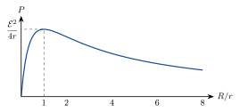

<!-- video: kommer (videoer/ingeniorfysikk/14-05-elektrisk-effekt) -->
{fig-alt="Video kommer"}

<!-- tillegg: Claude -->
På strømregningen betaler du for kilowattimer, og på vannkokeren står det $2000\ \mathrm{W}$. Hva betyr tallene, og hvordan henger de sammen med strøm og spenning? Her ser vi hvor fort elektrisk energi omdannes til varme, lys og bevegelse.

## Effekt i en krets

<!-- tillegg: Claude -->
Når ladningen $\Delta q$ går gjennom en komponent med spenningen $V$ over seg, mister den den potensielle energien $\Delta U = \Delta q\,V$. Energien går over til noe annet, for eksempel varme i en motstand eller bevegelse i en motor. Per tid blir det

::: {.callout-important title="Elektrisk effekt"}
<!-- tillegg: Claude -->
$$
P = \frac{\Delta U}{\Delta t} = IV
$$
For en motstand der $V = IR$:
$$
P = I^2R = \frac{V^2}{R}
$$
:::

<!-- tillegg: Claude -->
De tre formene er like riktige for en motstand. Velg den som passer med det du vet. $I^2R$ er nyttig når strømmen er kjent, for eksempel i en ledning. $V^2/R$ er nyttig når spenningen er kjent, for eksempel for apparater i stikkontakten.

Den varmen som utvikles i en motstand, kalles **joulevarme** eller resistiv oppvarming. Den er nyttig i vannkokere, ovner og varmekabler, men et tap i ledninger og elektronikk.

::: {.eksempel}
<!-- tillegg: Claude -->
**Eksempel: Vannkokeren.** En vannkoker på $2.0\ \mathrm{kW}$ er koblet til $230\ \mathrm{V}$.

**a)** Hvor stor er strømmen og resistansen?\
**b)** Hvor lang tid tar det å varme $1.0\ \mathrm{L}$ vann fra $20\ \mathrm{^\circ C}$ til $100\ \mathrm{^\circ C}$? Vann har spesifikk varmekapasitet $4.19\ \mathrm{kJ/(kg\,K)}$. Se bort fra varmetap.

::: {.losning}
**a)**
$$
I = \frac PV = \frac{2000}{230}\ \mathrm{A} = \underline{\underline{8.7\ \mathrm{A}}}, \qquad R = \frac{V^2}{P} = \frac{230^2}{2000}\ \Omega = \underline{\underline{26\ \Omega}}
$$
**b)** Energien som trengs: $Q = mc\Delta T = 1.0\cdot4190\cdot80\ \mathrm{J} = 3.35\cdot10^{5}\ \mathrm{J}$.
$$
t = \frac QP = \frac{3.35\cdot10^{5}}{2000}\ \mathrm{s} = \underline{\underline{1.7\cdot10^{2}\ \mathrm{s}}}
$$
Under tre minutter.
:::
:::

## Kilowattimer

<!-- tillegg: Claude -->
Energi er effekt ganger tid, $E = Pt$. Strømselskapene måler energi i **kilowattimer**: den energien et apparat på $1\ \mathrm{kW}$ bruker på én time.
$$
1\ \mathrm{kWh} = 1000\ \mathrm{W}\cdot3600\ \mathrm{s} = 3.6\cdot10^{6}\ \mathrm{J} = 3.6\ \mathrm{MJ}
$$

## Største effekt fra et batteri

{.tikz-fig style="width:440px"}

<!-- tillegg: Claude -->
Et batteri med emf $\mathcal{E}$ og indre resistans $r$ leverer effekten
$$
P = I^2R = \frac{\mathcal{E}^2R}{(R + r)^2}
$$
til en ytre motstand $R$. Er $R$ svært liten, er strømmen stor, men spenningen over $R$ liten. Er $R$ svært stor, er strømmen liten. Effekten er størst imellom. Deriverer vi og setter lik null, finner vi at maksimum er ved $R = r$, med $P_\mathrm{maks} = \mathcal{E}^2/(4r)$. Dette kalles **effekttilpasning** og er viktig for høyttalere og antenner. Men da går halvparten av effekten tapt i batteriet, så for strømforsyning vil vi heller ha $R \gg r$.

## Hvorfor høy spenning i kraftlinjene?

<!-- tillegg: Claude -->
Et kraftverk skal sende effekten $P$ gjennom ledninger med resistansen $R_\mathrm{l}$. Strømmen er $I = P/V$, og tapet i ledningene er
$$
P_\mathrm{tap} = I^2R_\mathrm{l} = \frac{P^2R_\mathrm{l}}{V^2}
$$
Ti ganger høyere spenning gir hundre ganger mindre tap. Derfor transformeres spenningen opp til flere hundre kilovolt i kraftlinjene, og ned igjen før den kommer inn i husene.

:::: {.oppgaver}

::: {.oppgave tittel="Strømregningen"}
<!-- tillegg: Claude -->
Vannkokeren på $2.0\ \mathrm{kW}$ står på i $3.0$ minutter. Hvor mange kilowattimer bruker den, og hva koster det med en strømpris på $1.50\ \mathrm{kr/kWh}$?

::: {.losning}
$$
E = 2.0\ \mathrm{kW}\cdot\frac{3.0}{60}\ \mathrm{h} = \underline{\underline{0.10\ \mathrm{kWh}}}, \qquad \text{pris} = 0.10\cdot1.50\ \mathrm{kr} = \underline{\underline{0.15\ \mathrm{kr}}}
$$
:::
:::

::: {.oppgave tittel="Tap i skjøteledningen"}
<!-- tillegg: Claude -->
En skjøteledning har resistansen $0.20\ \Omega$ og fører $10\ \mathrm{A}$. Hvor stor effekt går tapt som varme i ledningen?

::: {.losning}
$$
P = I^2R = 10^2\cdot0.20\ \mathrm{W} = \underline{\underline{20\ \mathrm{W}}}
$$
Det er derfor man ikke skal bruke skjøteledninger som er kveilet sammen med store strømmer: Varmen slipper ikke ut.
:::
:::

::: {.oppgave tittel="To lamper" niva="Middels"}
<!-- tillegg: Claude -->
En lampe på $60\ \mathrm{W}$ og en på $100\ \mathrm{W}$ (begge beregnet for $230\ \mathrm{V}$) kobles i **serie** til $230\ \mathrm{V}$. Hvilken lyser sterkest? Anta at resistansene er konstante.

::: {.losning}
$R = V^2/P$ gir $R_{60} = 230^2/60\ \Omega = 882\ \Omega$ og $R_{100} = 529\ \Omega$. I serie er strømmen den samme, så $P = I^2R$ er størst for den største resistansen. **Lampa på 60 W lyser sterkest!** Strømmen er $230/1411\ \mathrm{A} = 0.163\ \mathrm{A}$, som gir $P_{60} = 23\ \mathrm{W}$ og $P_{100} = 14\ \mathrm{W}$.
:::
:::

::: {.oppgave tittel="Effekttilpasning" niva="Utfordrende"}
<!-- tillegg: Claude -->
Vis at $P = \mathcal{E}^2R/(R + r)^2$ har maksimum ved $R = r$.

::: {.losning}
Med kvotientregelen:
$$
\frac{\mathrm{d}P}{\mathrm{d}R} = \mathcal{E}^2\frac{(R + r)^2 - R\cdot2(R + r)}{(R + r)^4} = \mathcal{E}^2\frac{r - R}{(R + r)^3}
$$
Den er null for $R = r$, positiv for $R < r$ og negativ for $R > r$. Altså maksimum ved $R = r$, med
$$
P_\mathrm{maks} = \frac{\mathcal{E}^2r}{(2r)^2} = \frac{\mathcal{E}^2}{4r} \qquad\blacksquare
$$
:::
:::

::::
