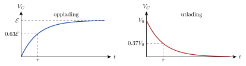

<!-- video: kommer (videoer/ingeniorfysikk/14-06-rc-kretser) -->
{fig-alt="Video kommer"}

<!-- tillegg: Claude -->
Lyset i bilen slukker ikke med en gang du lukker døra. Det dempes sakte i noen sekunder. En blinkende sykkellykt blinker i fast takt. Begge deler styres av en kondensator som lades eller lades ut gjennom en motstand. En slik **RC-krets** gir en tidsforsinkelse, og den er en av de vanligste byggesteinene i elektronikk.

{.tikz-fig style="width:380px"}

## Utlading

<!-- tillegg: Claude -->
En kondensator med kapasitans $C$ er ladet til spenningen $V_0$ (ladningen $Q_0 = CV_0$). Ved $t = 0$ kobles den til en motstand $R$. Ladningen strømmer fra den ene platen gjennom motstanden til den andre. Spenningen over kondensatoren er $q/C$, og den driver strømmen gjennom motstanden: $q/C = IR$. Strømmen tapper kondensatoren, så $I = -\mathrm{d}q/\mathrm{d}t$:
$$
\frac{\mathrm{d}q}{\mathrm{d}t} = -\frac{q}{RC}
$$
Endringen er proporsjonal med det som er igjen. Det gir eksponentiell nedgang, akkurat som radioaktivt henfall:

::: {.callout-important title="Utlading av en kondensator"}
<!-- tillegg: Claude -->
$$
q(t) = Q_0e^{-t/\tau}, \qquad V_C(t) = V_0e^{-t/\tau}, \qquad I(t) = \frac{V_0}{R}e^{-t/\tau}
$$
der $\tau = RC$ er **tidskonstanten**.
:::

## Opplading

<!-- tillegg: Claude -->
En uladet kondensator kobles til en spenningskilde $\mathcal{E}$ gjennom en motstand $R$. Spenningsloven rundt kretsen gir $\mathcal{E} - IR - q/C = 0$. I starten er kondensatoren tom, så hele spenningen ligger over motstanden, og strømmen er $\mathcal{E}/R$. Etter hvert øker spenningen over kondensatoren, og strømmen avtar. Løsningen er

::: {.callout-important title="Opplading av en kondensator"}
<!-- tillegg: Claude -->
$$
V_C(t) = \mathcal{E}\left(1 - e^{-t/\tau}\right), \qquad I(t) = \frac{\mathcal{E}}{R}e^{-t/\tau}, \qquad \tau = RC
$$
:::

{.tikz-fig style="width:600px"}

## Tidskonstanten

<!-- tillegg: Claude -->
Tidskonstanten $\tau = RC$ har enheten $\Omega\cdot\mathrm{F} = (\mathrm{V/A})\cdot(\mathrm{C/V}) = \mathrm{C/A} = \mathrm{s}$. Den sier hvor fort kretsen reagerer:

::: {.kort}
- **Etter $\tau$** er utladingen kommet ned til $e^{-1} \approx 37\ \%$.
- **Halveringstiden** er $t_{1/2} = \tau\ln2 \approx 0.69\,\tau$.
- **Etter ca. $5\tau$** er kondensatoren i praksis helt utladet (eller ladet), under 1 % igjen.
- **Stor $R$ eller stor $C$** gir langsom opplading og utlading.
:::

::: {.eksempel}
<!-- tillegg: Claude -->
**Eksempel: Utlading.** En kondensator på $100\ \mathrm{\mu F}$ er ladet til $12\ \mathrm{V}$ og lades ut gjennom en motstand på $10\ \mathrm{k\Omega}$.

**a)** Hva er tidskonstanten og startstrømmen?\
**b)** Hva er spenningen etter $2.0\ \mathrm{s}$?\
**c)** Når er spenningen halvert?

::: {.losning}
**a)**
$$
\tau = RC = 1.0\cdot10^{4}\cdot100\cdot10^{-6}\ \mathrm{s} = \underline{\underline{1.0\ \mathrm{s}}}, \qquad I_0 = \frac{V_0}{R} = \frac{12}{1.0\cdot10^{4}}\ \mathrm{A} = \underline{\underline{1.2\ \mathrm{mA}}}
$$
**b)**
$$
V_C = 12\,e^{-2.0/1.0}\ \mathrm{V} = \underline{\underline{1.6\ \mathrm{V}}}
$$
**c)**
$$
t_{1/2} = \tau\ln2 = \underline{\underline{0.69\ \mathrm{s}}}
$$
:::
:::

## Prøv selv

```{.python .kjor}
import numpy as np
import matplotlib.pyplot as plt

R = 10e3        # motstand (ohm)
C = 100e-6      # kapasitans (F)
E = 12          # spenningskilde (V)

tau = R*C
t = np.linspace(0, 5*tau, 300)
plt.plot(t, E*(1 - np.exp(-t/tau)), label='opplading')
plt.plot(t, E*np.exp(-t/tau), label='utlading')
plt.axvline(tau, ls='--', color='gray')
plt.xlabel('t (s)'); plt.ylabel('V_C (V)'); plt.legend(); plt.grid(True)
plt.title(f'tau = RC = {tau:.2f} s')
plt.show()
```

:::: {.oppgaver}

::: {.oppgave tittel="Tidskonstant"}
<!-- tillegg: Claude -->
Hva er tidskonstanten til en krets med $R = 2.2\ \mathrm{k\Omega}$ og $C = 470\ \mathrm{\mu F}$?

::: {.losning}
$$
\tau = RC = 2.2\cdot10^{3}\cdot470\cdot10^{-6}\ \mathrm{s} = \underline{\underline{1.0\ \mathrm{s}}}
$$
:::
:::

::: {.oppgave tittel="Ned til 1 volt"}
<!-- tillegg: Claude -->
En kondensator på $50\ \mathrm{\mu F}$ er ladet til $9.0\ \mathrm{V}$ og lades ut gjennom $2.0\ \mathrm{k\Omega}$. Hvor lang tid tar det før spenningen er $1.0\ \mathrm{V}$?

::: {.losning}
$\tau = 2.0\cdot10^{3}\cdot50\cdot10^{-6}\ \mathrm{s} = 0.10\ \mathrm{s}$. Fra $V = V_0e^{-t/\tau}$:
$$
t = \tau\ln\frac{V_0}{V} = 0.10\ \mathrm{s}\cdot\ln\frac{9.0}{1.0} = \underline{\underline{0.22\ \mathrm{s}}}
$$
:::
:::

::: {.oppgave tittel="Finn kapasitansen" niva="Middels"}
<!-- tillegg: Claude -->
En kondensator lades ut gjennom en motstand på $47\ \mathrm{k\Omega}$. Spenningen faller fra $10\ \mathrm{V}$ til $4.0\ \mathrm{V}$ på $3.0\ \mathrm{s}$. Hva er kapasitansen?

::: {.losning}
$$
\tau = \frac{t}{\ln(V_0/V)} = \frac{3.0}{\ln(10/4.0)}\ \mathrm{s} = 3.27\ \mathrm{s}, \qquad C = \frac{\tau}{R} = \frac{3.27}{47\cdot10^{3}}\ \mathrm{F} = \underline{\underline{70\ \mathrm{\mu F}}}
$$
:::
:::

::: {.oppgave tittel="Energien under opplading" niva="Utfordrende"}
<!-- tillegg: Claude -->
Vis at under en fullstendig opplading gjennom en motstand går like mye energi tapt som varme i motstanden som det lagres i kondensatoren.

::: {.losning}
Varmen i motstanden er
$$
W_R = \int_0^\infty I^2R\,\mathrm{d}t = \int_0^\infty\frac{\mathcal{E}^2}{R}e^{-2t/\tau}\,\mathrm{d}t = \frac{\mathcal{E}^2}{R}\cdot\frac{\tau}{2} = \frac{\mathcal{E}^2}{R}\cdot\frac{RC}{2} = \tfrac12C\mathcal{E}^2
$$
Kondensatoren ender med $U = \tfrac12C\mathcal{E}^2$. Kilden har levert $Q\mathcal{E} = C\mathcal{E}^2$, og halvparten går til hver. Overraskende nok er det uavhengig av $R$. $\blacksquare$
:::
:::

::::
