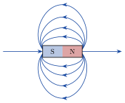

<!-- video: kommer (videoer/ingeniorfysikk/15-01-magnetfelt) -->
{fig-alt="Video kommer"}

<!-- tillegg: Claude -->
Et kompass peker mot nord, en kjøleskapsmagnet holder lappen på plass, og en elektromotor snurrer. Alt dette skyldes **magnetiske krefter**. Lenge trodde man at magnetisme og elektrisitet var to helt ulike ting. I 1820 oppdaget Hans Christian Ørsted at en kompassnål beveget seg når det gikk strøm i en ledning i nærheten. Det var starten på **elektromagnetismen**: Magnetfelt lages av ladninger i bevegelse, og de virker på ladninger i bevegelse.

## Magneter og poler

<!-- tillegg: Claude -->
En magnet har to **poler**, nord (N) og sør (S). Like poler frastøter hverandre, ulike tiltrekker hverandre. Men i motsetning til elektriske ladninger kommer polene **alltid i par**. Deler du en stavmagnet i to, får du to nye magneter, hver med sin nord- og sørpol. Ingen har noen gang funnet en enkelt magnetisk pol (en *monopol*).

## Magnetfeltet

<!-- tillegg: Claude -->
Rundt en magnet er det et **magnetfelt** $\vec B$. Vi tegner det med feltlinjer, slik vi gjorde for det elektriske feltet:

{.tikz-fig style="width:340px"}

::: {.kort}
- **Retning.** Feltet i et punkt peker dit nordpolen på en kompassnål peker.
- **Styrke.** Der feltlinjene ligger tett, er feltet sterkt.
- **Lukkede linjer.** Magnetiske feltlinjer har ingen start eller slutt. De går ut fra nordpolen, rundt til sørpolen og videre gjennom magneten. Det er et uttrykk for at det ikke finnes magnetiske monopoler.
:::

<!-- tillegg: Claude -->
SI-enheten for magnetfeltet er **tesla** (T). Hva en tesla er, definerer vi ut fra kraften feltet gir på en ladning (se *kraft på ladning i bevegelse*): $1\ \mathrm{T} = 1\ \mathrm{N/(A\,m)}$.

| Magnetfelt | Størrelse |
|---|---|
| Jordas magnetfelt ved overflaten | ca. $5\cdot10^{-5}\ \mathrm{T}$ |
| Kjøleskapsmagnet | ca. $5\cdot10^{-3}\ \mathrm{T}$ |
| Sterk neodymmagnet | ca. $1\ \mathrm{T}$ |
| MR-maskin | $1.5$–$3\ \mathrm{T}$ |
| Sterkeste magneter i laboratorier | ca. $45\ \mathrm{T}$ |
| Nøytronstjerner | opptil $10^{11}\ \mathrm{T}$ |

## Felt inn og ut av arket

<!-- tillegg: Claude -->
Magnetfelt og krefter står ofte vinkelrett på hverandre, så vi trenger tre dimensjoner. På en flat tegning viser vi et felt som peker **ut av arket** med ⊙ (spissen av en pil som kommer mot deg), og et felt **inn i arket** med ⊗ (fjærene på en pil som går bort fra deg).

{.tikz-fig style="width:400px"}

## Jorda som magnet

<!-- tillegg: Claude -->
Jorda oppfører seg som en stor stavmagnet. Magnetfeltet kommer fra strømmer i den flytende jernkjernen. Nordpolen på en kompassnål peker mot nord. Siden ulike poler tiltrekker hverandre, betyr det at det er en **magnetisk sørpol** nær den geografiske nordpolen! Den magnetiske polen ligger heller ikke helt ved den geografiske, og den flytter seg litt fra år til år.

Jordas magnetfelt beskytter oss mot ladde partikler fra sola. Partiklene ledes langs feltlinjene mot polområdene, der de kolliderer med lufta og gir **nordlys**.

:::: {.oppgaver}

::: {.oppgave tittel="Dele en magnet"}
<!-- tillegg: Claude -->
Du deler en stavmagnet på midten. Hva får du? Hva skjer hvis du holder de to bitene inntil hverandre slik de satt?

:::

::: {.oppgave tittel="Hvor sterkt?"}
<!-- tillegg: Claude -->
Hvor mange ganger sterkere er feltet i en MR-maskin på $3.0\ \mathrm{T}$ enn jordas magnetfelt?

::: {.fasit}
$6\cdot10^{4}$
:::
:::

::: {.oppgave tittel="Feltlinjer som krysser?" niva="Middels"}
<!-- tillegg: Claude -->
Forklar hvorfor to magnetiske feltlinjer aldri kan krysse hverandre.

:::

::::
