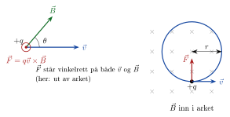
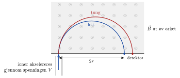

<!-- video: kommer (videoer/ingeniorfysikk/15-02-kraft-pa-ladning) -->
{fig-alt="Video kommer"}

<!-- tillegg: Claude -->
Et magnetfelt virker ikke på en ladning som ligger stille. Men så snart ladningen beveger seg, kjenner den en kraft. Og kraften er merkelig: Den virker **verken langs farten eller langs feltet**, men vinkelrett på begge. Det får ladde partikler til å gå i sirkler, og det brukes i alt fra gamle TV-rør til partikkelakseleratorer og massespektrometre.

## Lorentzkraften

::: {.callout-important title="Magnetisk kraft på en ladning"}
<!-- tillegg: Claude -->
En ladning $q$ med farten $\vec v$ i et magnetfelt $\vec B$ får kraften
$$
\vec F = q\,\vec v\times\vec B, \qquad F = |q|vB\sin\theta
$$
der $\theta$ er vinkelen mellom $\vec v$ og $\vec B$.
:::

{.tikz-fig style="width:560px"}

<!-- tillegg: Claude -->
Kryssproduktet bestemmer retningen (se *vektorer*). Med **høyrehåndsregelen**: Pek fingrene langs $\vec v$, bøy dem mot $\vec B$. Tommelen peker da langs $\vec F$ for en **positiv** ladning. For en negativ ladning, som et elektron, er kraften motsatt vei.

::: {.kort}
- **Ingen kraft** når ladningen står stille ($v = 0$) eller beveger seg langs feltet ($\theta = 0$).
- **Størst kraft**, $|q|vB$, når farten står vinkelrett på feltet.
- **Gjør ikke arbeid.** Kraften står alltid vinkelrett på farten. Den endrer retningen, men ikke farten. Den kinetiske energien er konstant.
:::

<!-- tillegg: Claude -->
Formelen definerer også enheten tesla: Et felt på $1\ \mathrm{T}$ gir kraften $1\ \mathrm{N}$ på en ladning på $1\ \mathrm{C}$ som går med $1\ \mathrm{m/s}$ vinkelrett på feltet. Altså $1\ \mathrm{T} = 1\ \mathrm{N\,s/(C\,m)} = 1\ \mathrm{N/(A\,m)}$.

Er det også et elektrisk felt, er den samlede kraften $\vec F = q(\vec E + \vec v\times\vec B)$. Den kalles **Lorentzkraften**.

## Sirkelbevegelse

<!-- tillegg: Claude -->
En ladning som går vinkelrett på et homogent magnetfelt, får en kraft med konstant størrelse som alltid peker vinkelrett på farten. Det er akkurat det som gir sirkelbevegelse. Kraften er sentripetalkraften:
$$
|q|vB = \frac{mv^2}{r}
$$

::: {.callout-important title="Ladning i homogent magnetfelt"}
<!-- tillegg: Claude -->
$$
r = \frac{mv}{|q|B}, \qquad T = \frac{2\pi m}{|q|B}, \qquad f = \frac{|q|B}{2\pi m}
$$
:::

<!-- tillegg: Claude -->
Merk at **omløpstiden ikke avhenger av farten**. Raske partikler går i større sirkler, men bruker like lang tid på én runde. Det er prinsippet bak **syklotronen**, en av de første partikkelakseleratorene. Frekvensen $f$ kalles **syklotronfrekvensen**.

Har partikkelen også en fartskomponent langs feltet, går den i en **skrue** rundt feltlinjene. Det er slik ladde partikler fra sola følger jordas feltlinjer mot polene.

::: {.eksempel}
<!-- tillegg: Claude -->
**Eksempel: Proton i magnetfelt.** Et proton går med farten $2.0\cdot10^{6}\ \mathrm{m/s}$ vinkelrett på et magnetfelt på $0.50\ \mathrm{T}$. Finn kraften, radien og omløpstiden.

::: {.losning}
$$
F = \mathrm{e}vB = 1.602\cdot10^{-19}\cdot2.0\cdot10^{6}\cdot0.50\ \mathrm{N} = \underline{\underline{1.6\cdot10^{-13}\ \mathrm{N}}}
$$
$$
r = \frac{\mathrm{m_p}v}{\mathrm{e}B} = \frac{1.673\cdot10^{-27}\cdot2.0\cdot10^{6}}{1.602\cdot10^{-19}\cdot0.50}\ \mathrm{m} = \underline{\underline{4.2\ \mathrm{cm}}}
$$
$$
T = \frac{2\pi\mathrm{m_p}}{\mathrm{e}B} = \frac{2\pi\cdot1.673\cdot10^{-27}}{1.602\cdot10^{-19}\cdot0.50}\ \mathrm{s} = \underline{\underline{1.3\cdot10^{-7}\ \mathrm{s}}}
$$
:::
:::

## Massespektrometeret

{.tikz-fig style="width:540px"}

<!-- tillegg: Claude -->
Et **massespektrometer** skiller atomer og molekyler etter masse. Ionene med ladning $q$ akselereres først gjennom en spenning $V$, slik at $qV = \tfrac12mv^2$. Så kommer de inn i et magnetfelt og går en halvsirkel med radius $r = mv/(qB)$ før de treffer en detektor. Setter vi inn $v = \sqrt{2qV/m}$:
$$
r = \frac1B\sqrt{\frac{2mV}{q}}
$$
Radien øker med $\sqrt m$. Ioner med ulik masse lander på ulike steder. Massespektrometre brukes til å finne isotoper, til datering med karbon-14, til dopingtester og til å finne ut hva ukjente stoffer er laget av.

::: {.eksempel}
<!-- tillegg: Claude -->
**Eksempel: Karbonisotoper.** Ioner av karbon-12 og karbon-14 med ladning $+\mathrm{e}$ akselereres gjennom $1.0\ \mathrm{kV}$ og går inn i et felt på $0.20\ \mathrm{T}$. Hvor langt fra hverandre treffer de detektoren? ($1\ \mathrm{u} = 1.661\cdot10^{-27}\ \mathrm{kg}$.)

::: {.losning}
For karbon-12, $m = 12\ \mathrm{u} = 1.99\cdot10^{-26}\ \mathrm{kg}$:
$$
r_{12} = \frac{1}{0.20}\sqrt{\frac{2\cdot1.99\cdot10^{-26}\cdot1.0\cdot10^{3}}{1.602\cdot10^{-19}}}\ \mathrm{m} = 7.89\ \mathrm{cm}
$$
For karbon-14: $r_{14} = r_{12}\sqrt{14/12} = 8.52\ \mathrm{cm}$. Ionene går en halvsirkel, så de treffer i avstanden $2r$. Avstanden mellom treffpunktene er
$$
2(r_{14} - r_{12}) = 2\cdot(8.52 - 7.89)\ \mathrm{cm} = \underline{\underline{1.3\ \mathrm{cm}}}
$$
:::
:::

## Hastighetsvelger

<!-- tillegg: Claude -->
Et elektrisk felt $E$ og et magnetfelt $B$ som står vinkelrett på hverandre og på farten, gir krefter i motsatt retning. De opphever hverandre når $qE = qvB$, altså for akkurat én fart:
$$
v = \frac EB
$$
Bare partikler med denne farten går rett gjennom. De andre bøyes av. Dette kalles en **hastighetsvelger** (Wienfilter), og den brukes ofte foran et massespektrometer.

:::: {.oppgaver}

::: {.oppgave tittel="Retningen på kraften"}
<!-- tillegg: Claude -->
Et elektron går mot høyre i et magnetfelt som peker inn i arket. Hvilken vei virker kraften?

::: {.losning}
For en positiv ladning gir $\vec v\times\vec B$ med $\vec v$ mot høyre og $\vec B$ inn i arket en kraft **oppover**. Elektronet er negativt, så kraften virker **nedover**.
:::
:::

::: {.oppgave tittel="Hastighetsvelger"}
<!-- tillegg: Claude -->
En hastighetsvelger har $E = 2.0\cdot10^{4}\ \mathrm{V/m}$ og $B = 0.10\ \mathrm{T}$. Hvilken fart slipper gjennom?

::: {.losning}
$$
v = \frac EB = \frac{2.0\cdot10^{4}}{0.10}\ \mathrm{m/s} = \underline{\underline{2.0\cdot10^{5}\ \mathrm{m/s}}}
$$
:::
:::

::: {.oppgave tittel="Elektron i jordfeltet" niva="Middels"}
<!-- tillegg: Claude -->
Et elektron med farten $1.0\cdot10^{6}\ \mathrm{m/s}$ går vinkelrett på jordas magnetfelt ($5.0\cdot10^{-5}\ \mathrm{T}$). Hva er radien i banen?

::: {.losning}
$$
r = \frac{\mathrm{m_e}v}{\mathrm{e}B} = \frac{9.11\cdot10^{-31}\cdot1.0\cdot10^{6}}{1.602\cdot10^{-19}\cdot5.0\cdot10^{-5}}\ \mathrm{m} = \underline{\underline{0.11\ \mathrm{m}}}
$$
Selv det svake jordfeltet bøyer elektronbaner merkbart. Gamle TV-skjermer måtte derfor justeres etter hvordan de sto.
:::
:::

::: {.oppgave tittel="Dobbel energi" niva="Utfordrende"}
<!-- tillegg: Claude -->
I et massespektrometer dobles akselerasjonsspenningen. Hva skjer med radien? Og hvis i stedet magnetfeltet dobles?

::: {.losning}
$r = \dfrac1B\sqrt{2mV/q}$. Dobbel spenning gir $\sqrt2 \approx 1.41$ ganger så stor radius. Dobbelt magnetfelt gir **halv** radius.
:::
:::

::::
